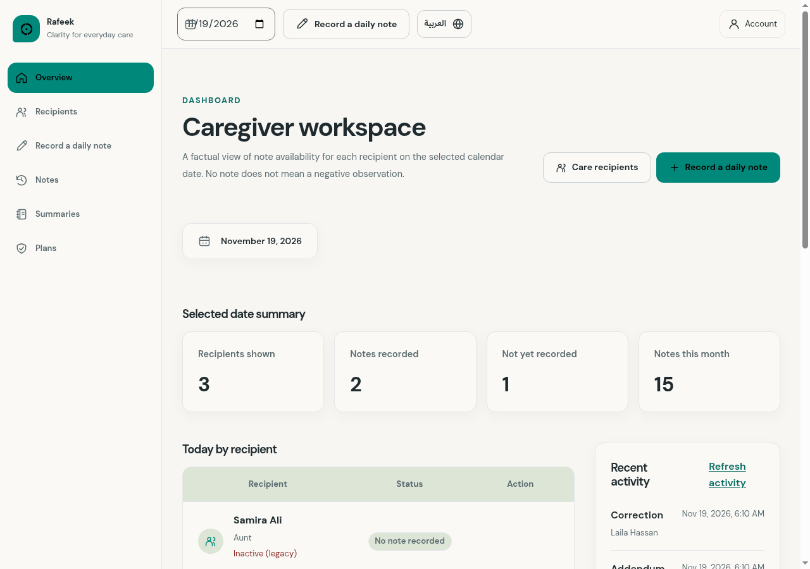
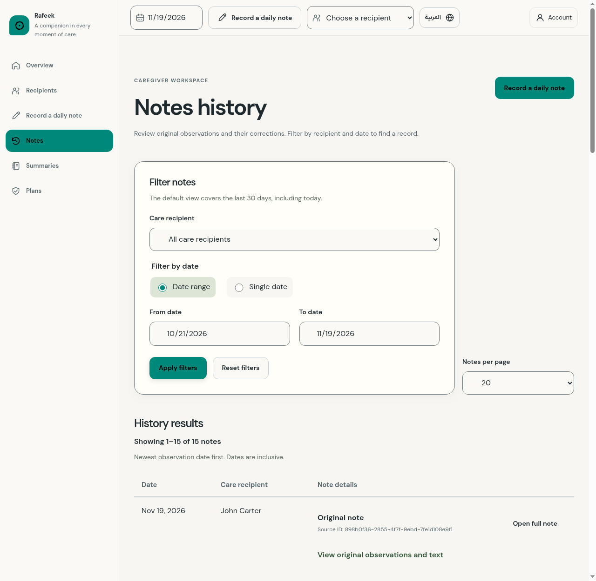
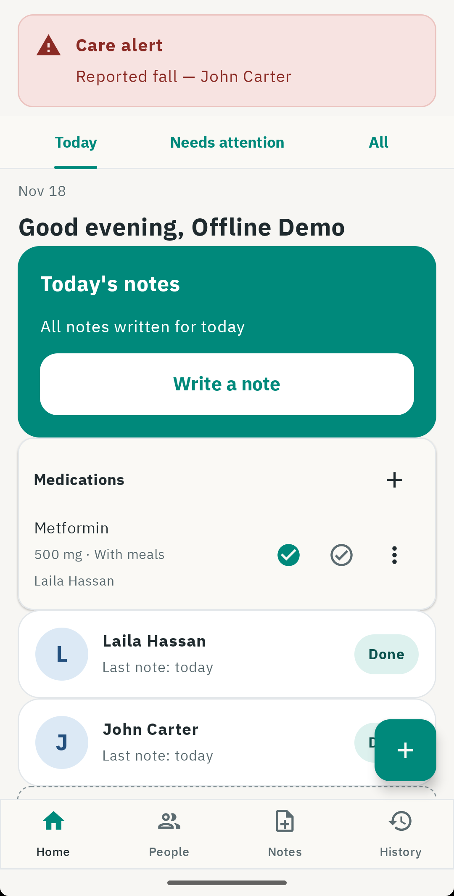
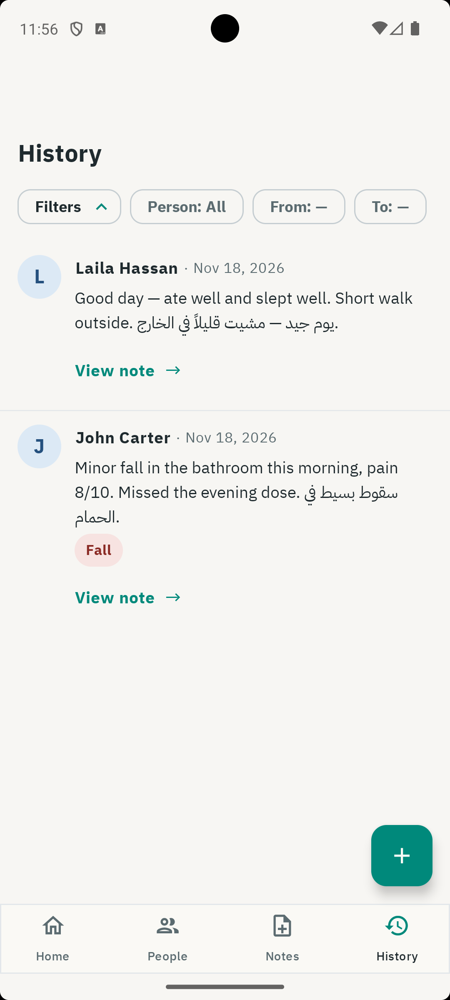
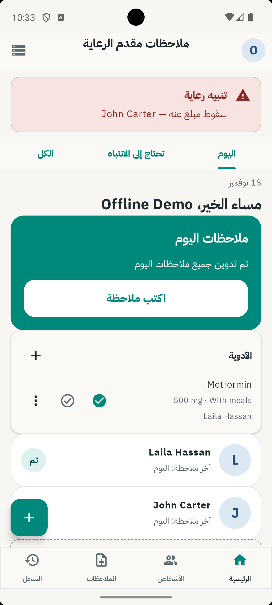
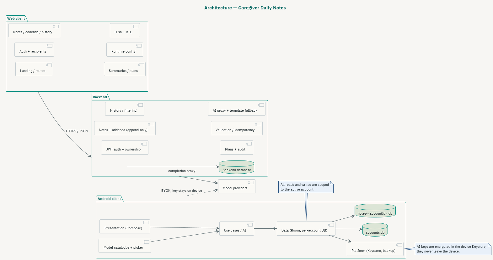

# Rafeek — رفيق

[](https://openjdk.org/)
[](https://kotlinlang.org/)
[](https://spring.io/projects/spring-boot)
[](https://react.dev/)
[](https://www.typescriptlang.org/)
[](https://developer.android.com/compose)
[](https://www.postgresql.org/)
[](https://playwright.dev/)
[](LICENSE)
[](https://depi.gov.eg/)

**Project lead & maintainer: [Alaa Shehata](https://github.com/alaa157)**


A care-support system for recording structured daily observations about the people you care for, reviewing their history, and generating AI-assisted summaries and care plans from those notes.

Two clients, one domain model: a **React web application** and a **native Kotlin/Compose Android app**. Both are built around the same append-only note record and the same safety rules.

> **Project notice.** Rafeek is the capstone project of the [Digital Egypt Pioneers Initiative (DEPI)](https://depi.gov.eg/), Software Testing track, built with synthetic data only. It is not a diagnostic or medical-monitoring system, is not medical advice, and must not be used with real patient or care-recipient data.

---

## Contents

- [What it does](#what-it-does)
- [Screenshots](#screenshots)
- [Design principles](#design-principles)
- [Architecture](#architecture)
- [Technology stack](#technology-stack)
- [Getting started](#getting-started)
- [Running the applications](#running-the-applications)
- [Testing](#testing)
- [API overview](#api-overview)
- [AI features and safety rules](#ai-features-and-safety-rules)
- [Data handling and privacy](#data-handling-and-privacy)
- [Repository layout](#repository-layout)
- [References & artifacts](#references--artifacts)
- [Team & acknowledgments](#team--acknowledgments)
- [License](#license)
- [Contributing](#contributing)

---

## What it does

A caregiver signs in and manages their own care recipients. For each recipient they record a daily note: mood, appetite, sleep, mobility, medication status, pain score, falls, and free text in Arabic, English, or a mix of both.

Notes are never edited in place. Corrections are appended as **addenda** or as typed, immutable **correction events**, so the original record and its full history always survive. From that history the caregiver can:

- Browse and filter notes by date and recipient.
- Request an AI summary over the last 7, 14, or 30 days.
- Review an AI-suggested care plan, then accept, edit, or dismiss it.
- Track medications and per-dose intake events.
- See deterministic safety signals raised by the backend, independent of any model.

## Screenshots

### Web app

<p align="center">
  
</p>
<p align="center">
  
</p>

### Mobile app (Android)

<p align="center">
  
  
  
</p>

Captured from the running apps with synthetic data: the web client against a local Spring Boot + PostgreSQL backend, and the Android offline demo on a cloud device. The full set — every screen in English and Arabic, desktop and mobile — is in [`docs/screenshots/`](docs/screenshots/).

## Design principles

**The backend is the authority.** Business rules, ownership checks, deterministic safety flags, trend calculation, plan versioning, and audit logging all live server-side. Clients render; they do not decide.

**History is append-only.** A note's original content is immutable. Corrections are new records with their own sequence numbers, and the effective state is replayed from them. Nothing is silently overwritten.

**The model never holds the pen on safety.** Red flags are computed by ordinary backend code. An LLM may raise urgency but can never lower or remove a deterministic flag, and it cannot add, remove, or alter medications.

**Uncertainty is a first-class state.** Observations distinguish `RECORDED`, `UNKNOWN`, `NOT_RECORDED`, and `NOT_APPLICABLE`. A contradictory medication report collapses to "unverified" rather than being presented as a fact in either direction.

**Bilingual by construction.** Arabic and English ship together, with RTL layout and bidi isolation for mixed-direction text. Arabic string parity is enforced by test, not by convention.

## Architecture

<p align="center">
  
</p>

The web client talks to the backend for everything. The Android release build is **local-first and standalone**: accounts, notes, and plans live in on-device Room databases, and no backend is required. Its AI features call the caregiver's chosen provider directly with a key held in the Android Keystore.

The full UML set — [system context](docs/diagrams/context/01-context.svg), [sequence](docs/diagrams/sequence/03-sequence.svg), [activity](docs/diagrams/activity/04-activity.svg), and [entity–relationship](docs/diagrams/erd/05-erd.svg) diagrams — is in [`docs/diagrams/`](docs/diagrams/), each as SVG, PNG, PDF, and PlantUML source.

## Technology stack

| Layer | Stack |
|---|---|
| **Backend** | Java 21, Spring Boot 3.3.4, Spring Security, JWT (jjwt), Spring Data JPA, Flyway, PostgreSQL, Maven, JUnit 5, JaCoCo |
| **Web** | React 18.3, TypeScript 5.6, Vite 5.4, React Router 6.30, Vitest 2.1, Testing Library, Playwright 1.64, axe-core |
| **Android** | Kotlin 2.0.21, Jetpack Compose (BOM 2024.10), Room, DataStore, Retrofit, kotlinx.serialization, Gradle (AGP 8.7.3), minSdk 23 / target 35 |
| **Infrastructure** | Supabase PostgreSQL, Docker (Render runtime), GitHub Actions, GitHub Releases for APKs |

## Getting started

### Prerequisites

- **Java 21+** and **Maven** (backend)
- **Node.js 18+** and **npm** (web)
- **JDK 17**, Android SDK `platforms;android-35` and `build-tools;35.0.0` (Android only — AGP 8.7 does not accept newer JDKs)
- A PostgreSQL database (Supabase free tier is sufficient)

### One-command setup

```bash
./setup.sh            # checks prerequisites, builds backend, installs web deps
./setup.sh --test     # also runs backend and web unit tests
./setup.sh --e2e      # also installs Playwright Chromium
./setup.sh --run      # builds, then starts backend + web dev server
./setup.sh --tunnel   # also exposes the backend via a Cloudflare quick tunnel
```

The script creates `.env` from `.env.example`, generates a random `JWT_SECRET`, and warns you while database values are still placeholders.

### Manual setup

```bash
cp .env.example .env       # then fill in DATABASE_URL, DATABASE_USERNAME, DATABASE_PASSWORD
mvn -f backend/pom.xml -DskipTests package
cd web && npm ci
```

### Environment variables

| Variable | Purpose |
|---|---|
| `DATABASE_URL` | Full `jdbc:postgresql://…` URL (pooler recommended on Supabase free tier) |
| `DATABASE_USERNAME` | Database user |
| `DATABASE_PASSWORD` | Database password |
| `JWT_SECRET` | JWT signing secret. Generate with `openssl rand -base64 32`; never reuse across environments |

The backend holds **no** AI provider keys. AI credentials are supplied per request by the caregiver (see [AI features](#ai-features-and-safety-rules)).

## Running the applications

**Backend** — listens on `8080` (or `PORT`), applies Flyway migrations on startup, and validates the schema with `ddl-auto: validate`:

```bash
set -a; source .env; set +a
mvn -f backend/pom.xml spring-boot:run
```

API docs are disabled in the base configuration and enabled only under the `dev` profile, so `/v3/api-docs` and Swagger UI do not exist in production.

**Web** — Vite dev server, proxying to the backend:

```bash
cd web && npm run dev
```

The built web app reads its API origin from `public/config.json` at runtime, so a deployment can be repointed without a rebuild:

```bash
cd web && npm run build
API_BASE_URL=https://your-backend.example npm run config:runtime
```

`API_BASE_URL` must be HTTPS (HTTP is permitted only for loopback) and must not contain credentials, a query, or a fragment.

**Android** — from `android/`:

```bash
./gradlew :app:assembleDebug      # offline demo APK, unminified
./gradlew :app:assembleMinified   # offline demo APK, R8-shrunk
./gradlew :app:assembleRelease    # standalone release build
```

`debug` and `minified` serve canned in-memory data with no network and no login: long-press the logo on the login screen to enter the offline demo. `release` is the standalone local-first build with local accounts and no backend dependency. See [`android/README.md`](android/README.md) for the full build, variant, and data-layout reference.

## Testing

| Suite | Command |
|---|---|
| Backend unit and integration | `mvn -f backend/pom.xml test` |
| Web unit | `cd web && npm test` |
| Web type check | `cd web && npm run typecheck` |
| Web browser (Playwright) | `cd web && npx playwright test` |
| Android JVM unit | `cd android && ./gradlew :app:testDebugUnitTest` |
| Android instrumentation | `cd android && ./gradlew :app:connectedDebugAndroidTest` |

The test estate spans backend unit and integration suites (JUnit 5, Spring Boot Test, JaCoCo), web unit tests (Vitest + Testing Library), Playwright browser tests across desktop, tablet, mobile, and compact viewports with axe-core accessibility checks and English/Arabic workflow coverage, Android JVM and Compose UI instrumentation suites, and a deterministic AI evaluation harness whose safety metrics are enforced at `1.0`.

The measured inventory — test totals, JaCoCo coverage, executed-versus-specified status, and the defect register with evidence, fixes, and verification — is maintained in [`docs/testing/README.md`](docs/testing/README.md) and [`docs/testing/defects/`](docs/testing/defects/), so this README does not duplicate figures that change as the estate grows. Defects are tracked one per GitHub issue.

**Formal deliverable:** the [Test Case Specification & Execution Report](docs/testing/rafeek-test-cases.pdf) (PDF) — IEEE 829-style key cases plus the executed registers and the specified E2E/Android inventories, prepared for DEPI review.

GitHub Actions workflows in [`.github/workflows/`](.github/workflows/) cover the frontend suite (unit, typecheck, build, Playwright), the backend suite with JaCoCo coverage, a Docker image build, Android JVM + emulator instrumentation tests (`android-tests.yml`), and Android APK releases. `ci.yml` and `android-tests.yml` are enabled and run on every pull request to main and on demand; live run status is in the repository's Actions tab.

## API overview

All endpoints require a caregiver bearer token except registration and login. The caregiver identity is derived from the verified JWT; clients never submit an owner ID. Another caregiver's resources return `404`, never `403`.

| Area | Endpoints |
|---|---|
| Auth | `POST /api/auth/register`, `POST /api/auth/login` |
| Recipients | `GET/POST /api/recipients`, `GET/PUT /api/recipients/{id}`, `PATCH …/care-details`, `…/archive`, `…/restore` |
| Notes | `POST /api/notes`, `GET /api/notes/{id}`, `GET /api/notes/by-recipient/{id}?date=`, `GET /api/notes?from=&to=` |
| Addenda | `POST/GET /api/notes/{id}/addenda` |
| Corrections | `POST/GET /api/notes/{id}/corrections` |
| Signals | `GET /api/notes/signals?recipientId=&from=&to=` |
| Activity | `GET /api/activity?limit=` |
| Medications | `GET/POST /api/recipients/{recipientId}/medications`, `…/{medicationId}/intake-events` |
| Summaries | `POST /api/summaries`, `POST /api/summaries/byok` |
| Plans | `POST /api/recipients/{recipientId}/plans/suggestions`, `GET …/active`, `GET …/history`, `POST …/{planId}/accept`, `…/edit-and-accept`, `…/dismiss` |
| Safety | `GET /api/recipients/{recipientId}/safety-signals`, `GET/POST …/safety-acknowledgements` |
| AI connection | `POST /api/ai/byok/connection-test` |

Writes accept an optional `Idempotency-Key` header: the same key with an identical payload replays the original record, while the same key with a different payload returns `409 IDEMPOTENCY_CONFLICT`. Detailed contracts for the notes and recipients domains — including error codes and idempotency semantics — are in [`docs/api/`](docs/api/).

## AI features and safety rules

AI is **bring-your-own-key**. The backend stores no provider credentials and has no default model. Each summary or plan request carries the caregiver's provider, model, and key; the key is used for that call only, never persisted server-side, and never logged. Supported providers are OpenAI, Gemini, xAI, and OpenRouter (all via OpenAI-compatible endpoints); the Android app additionally supports Anthropic.

These rules constrain what the model is allowed to do:

- **Deterministic red flags.** Falls, high pain, repeated missed medication, and sustained poor appetite are computed in backend code. The model may escalate urgency but never suppress a flag.
- **Backend-computed trends.** Period-over-period changes are calculated server-side, not inferred by the model.
- **Fixed action catalog.** Plan items are selected and parameterized from a predefined catalog, with evidence cited. The model does not invent free-form medical advice.
- **Medication hard lock.** A plan's medication list is copied from the server-owned baseline, never from model output.

AI output is measured by a deterministic evaluation harness over a synthetic golden dataset spanning English, Modern Standard Arabic, Egyptian dialect, mixed-language, short, long, messy, contradictory, irrelevant, and prompt-injection inputs. The metrics — red-flag recall, schema validity, groundedness, and medication safety — must all equal `1.0`; the harness fails on any regression. See [`docs/ai/eval-harness.md`](docs/ai/eval-harness.md).

## Data handling and privacy

The repository currently has **no approved privacy policy and no terms document**. [`docs/privacy/README.md`](docs/privacy/README.md) records that gap and inventories, from source, what the software actually stores and who can see it. It is a factual audit, not a policy, and it is the correct starting point for anyone writing one.

Two things worth knowing before you run this:

- The backend persists health-adjacent data about identifiable people: recipient names, dates of birth, allergies, conditions, emergency contacts, and note contents including free text.
- BYOK summaries send per-note transcripts — note ID, date, and all observation values including free text verbatim — to whichever provider the caregiver selects. Recipient name and date of birth are excluded. The UI discloses this before AI is enabled.

There is no retention schedule, purge job, or data-export feature in the codebase. Archiving a recipient is reversible and non-destructive.

## Repository layout

```
backend/          Spring Boot API — auth, notes, recipients, plans, medications, safety, AI
  src/main/resources/db/migration/   Flyway migrations
  src/main/resources/prompts/        Model prompt templates
web/              React + TypeScript client
  src/features/   auth, notes, recipients, history, summary, plans, medications, safety, ai, settings
  src/i18n/       English and Arabic translations, RTL and bidi support
  src/tests/      Unit, integration, and live-workflow suites
android/          Native Kotlin/Compose app
  app/src/main/java/com/caregiver/mobile/   core, data, presentation, ai
docs/             API contracts, AI evaluation, UML diagrams, design system, privacy audit, screenshots
.github/          CI and Android release workflows
setup.sh          One-command local setup
```

## References & artifacts

### Testing & quality

| Artifact | Contents |
|---|---|
| [**Formal Test Case Specification & Execution Report (PDF)**](docs/testing/rafeek-test-cases.pdf) | DEPI deliverable — formal key cases, executed registers, defect summary, sign-off |
| [`docs/testing/`](docs/testing/) | Test strategy, inventory, measured coverage, execution status |
| [`docs/testing/defects/`](docs/testing/defects/) | Defect register — evidence, repro, fixes, verification; each defect links to its GitHub issue |
| [`docs/ai/eval-harness.md`](docs/ai/eval-harness.md) · [`docs/ai/golden/`](docs/ai/golden/) | AI evaluation metrics and the synthetic golden dataset |

### Diagrams (UML set)

| Diagram | View | Formats |
|---|---|---|
| System context | [`docs/diagrams/context/`](docs/diagrams/context/) | [PNG](docs/diagrams/context/01-context.png) · [SVG](docs/diagrams/context/01-context.svg) · [PDF](docs/diagrams/context/01-context.pdf) · [source](docs/diagrams/context/01-context.puml) |
| Architecture | [`docs/diagrams/architecture/`](docs/diagrams/architecture/) | [PNG](docs/diagrams/architecture/02-architecture.png) · [SVG](docs/diagrams/architecture/02-architecture.svg) · [PDF](docs/diagrams/architecture/02-architecture.pdf) · [source](docs/diagrams/architecture/02-architecture.puml) |
| Sequence (AI summary flow) | [`docs/diagrams/sequence/`](docs/diagrams/sequence/) | [PNG](docs/diagrams/sequence/03-sequence.png) · [SVG](docs/diagrams/sequence/03-sequence.svg) · [PDF](docs/diagrams/sequence/03-sequence.pdf) · [source](docs/diagrams/sequence/03-sequence.puml) |
| Activity (daily note flow) | [`docs/diagrams/activity/`](docs/diagrams/activity/) | [PNG](docs/diagrams/activity/04-activity.png) · [SVG](docs/diagrams/activity/04-activity.svg) · [PDF](docs/diagrams/activity/04-activity.pdf) · [source](docs/diagrams/activity/04-activity.puml) |
| Entity relationships | [`docs/diagrams/erd/`](docs/diagrams/erd/) | [PNG](docs/diagrams/erd/05-erd.png) · [SVG](docs/diagrams/erd/05-erd.svg) · [PDF](docs/diagrams/erd/05-erd.pdf) · [source](docs/diagrams/erd/05-erd.puml) |

### Screenshots

| Gallery | Contents |
|---|---|
| [`docs/screenshots/web/`](docs/screenshots/web/) | EN desktop, AR RTL, mobile; real seeded flows |
| [`docs/screenshots/android/`](docs/screenshots/android/) | Onboarding, home, note editor, medications, history, settings, full AR pass |

### API, design & project docs

| Document | Contents |
|---|---|
| [`docs/api/daily-notes.md`](docs/api/daily-notes.md) | Notes, addenda, corrections, signals, idempotency, error codes |
| [`docs/api/recipients.md`](docs/api/recipients.md) | Recipient lifecycle, care details, archive and restore |
| [`docs/design-system/DESIGN-STYLE.md`](docs/design-system/DESIGN-STYLE.md) | Android visual design guide |
| [`docs/design-system/DECISIONS.md`](docs/design-system/DECISIONS.md) | Design system parity decisions |
| [`docs/privacy/README.md`](docs/privacy/README.md) | Verified data-handling inventory and policy gap |
| [`docs/brand/the-gather/`](docs/brand/the-gather/) | Selected brand concept — Rafeek "The Gather" mark and logo files |
| [`docs/guide/`](docs/guide/) | Caregiver user guide — English and Arabic walkthroughs |
| [`android/README.md`](android/README.md) | Android build variants, local accounts, data layout |
| [`CHANGELOG.md`](CHANGELOG.md) | Milestones and release history |

## Team & acknowledgments

Rafeek was built as the capstone project of the **Software Testing track** of the [Digital Egypt Pioneers Initiative (DEPI)](https://depi.gov.eg/) — a national digital-skills program by Egypt's Ministry of Communications and Information Technology.

### Contributions

| Member | GitHub | Contributions |
|---|---|---|
| **Alaa Shehata** — Project lead & maintainer | [`alaa157`](https://github.com/alaa157) | Project architecture and full-stack ownership: the native Android app, backend services, AI integration and the safety evaluation harness, Rafeek branding, CI and release engineering, testing strategy, and documentation. |
| Ebrahim Ahmed | [`ebrahimahmedss47-commits`](https://github.com/ebrahimahmedss47-commits) | Backend — the daily notes API, with its validation, history, and structured-signal contracts. |
| Mahmoud Hewidy | [`hewidyy`](https://github.com/hewidyy) | Web frontend — the React/TypeScript client, core caregiver workflows, accessibility and RTL. |
| Mohamed Hemdan | [`mohamed-hemdan1`](https://github.com/mohamed-hemdan1) | Backend — authentication and JWT security, care plans, and append-only audit logging. |

**Supervisor:** Mina Yonan  ·  **Training partner:** [GlobalKnowledge](https://www.globalknowledge.com/en-eg)

Contribution activity is public in the repository's [contributors graph](https://github.com/alaa157/caregiver-daily-notes/graphs/contributors).

## License

Released under the [MIT License](LICENSE).

## Contributing

Work is tracked as GitHub issues, one defect or feature per issue, each independently actionable and self-contained. Pull requests target `main`; run the relevant suites locally (see [Testing](#testing)) before opening a PR. Branch convention for fixes is `fix/<area>-<issue-number>-<slug>`.

If you find a separate problem while working, file a separate issue rather than widening the current change.
