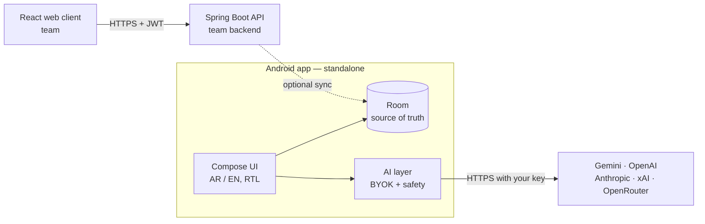

# Caregiver Daily Notes

A care-support app for family caregivers: structured daily notes, medication tracking, and
grounded AI summaries — in Arabic and English, offline-first on the phone, with **your own** AI key.

> **Not a medical device.** The suggestions this app produces come from the notes you write, not
> from clinical judgement. Synthetic data only — do not use with real patient data.

---

## What this branch delivers

`feat/standalone-byok-ai` is the **standalone (BYOK — bring your own key) release line**. The
Android app is the product: it installs from an APK, works with no account and no server, and
talks to whichever AI provider you already pay for.

| | |
|---|---|
| **Local-first** | Room is the source of truth. No login, no backend, no network needed to record a note. |
| **Your key, your provider** | OpenAI, Anthropic, Gemini, xAI, OpenRouter. The key is encrypted in the Android Keystore, stored in a separate slot per provider, and never leaves the device. |
| **Consent before the first send** | A dialog states exactly what leaves the phone and to whom. Nothing is sent until you accept. |
| **Grounded, not generated** | Every AI claim must cite a note and quote it verbatim. Unclear or conflicting observations stay unclear. |
| **Deterministic safety** | Falls, high pain, missed medication and poor-appetite streaks are computed on-device. The model can raise urgency; it can never lower it. |
| **The medication hard lock** | The AI can propose a plan item. It can never add, remove or change a dose. |
| **Never loses a note** | Saving a note never depends on AI. On failure you get a template summary, then “AI unavailable”. |
| **Bilingual, RTL-first** | Arabic and English, same workflows, with proper bidi isolation and a right-to-left layout that is not a mirror of the English one. |
| **Your data stays yours** | JSON backup/restore, CSV import/export, and a PDF summary export. |

### The AI layer

The app ships its own small AI layer rather than depending on a server:

- **One provider boundary** — `LlmClient` + `LlmClientFactory`; native JSON modes where the
  provider has them (Gemini `responseMimeType`, OpenAI `response_format`).
- **One shared reader** — `ModelOutputSanitizer` unwraps code fences, preambles and `<think>`
  blocks; `LlmJson.decode` allows a single repair retry before giving up.
- **Grounding** — `ClaimGrounding` matches each claim back to a note by stem, checks negation in
  both directions, and requires a quote with real substance.
- **A closed plan state machine** — `PlanStateMachine` (5 statuses, one transition table) instead
  of ad-hoc status writes; accepting a new plan archives the previous version.
- **Predictable failures** — per-call timeout, one cancellation handler, `blocked_safety` reported
  without a pointless retry.
- **A model catalogue** — a free model is offered first wherever a provider has one; the model
  field stays free text so a provider can serve anything else.

### The safety layer

Deterministic signals are computed from the structured observations, not from the model:
falls, pain above threshold, missed medication, and poor-appetite streaks. Trends are computed
over the same data. The model may only *add* urgency to those signals, never remove it, and the
action catalogue is fixed — the model selects and parameterises allowed items, it does not invent
new ones. Notes are delimited and treated as data, so text inside a note can never become an
instruction.

---

## Architecture



- The app is **usable on its own**. The backend is optional: it is there for shared data between
  caregivers and for the web client, and the app can sync to it through an outbox.
- The backend keeps its own AI path (`backend/…/ai/`) for the web client — Gemini primary,
  OpenRouter backup, template fallback.
- Neither client shares frontend source with the other.

See [ARCHITECTURE.md](./ARCHITECTURE.md) for boundaries, ownership and dependency rules, and
[android/README.md](./android/README.md) for the app-level build, runtime modes and device
walkthrough.

---

## Tech stack

| Layer | Stack |
|---|---|
| Mobile | Kotlin, Jetpack Compose, Material3, Navigation Compose, Coroutines + Flow, Room, DataStore, WorkManager, Retrofit/OkHttp, kotlinx.serialization, JUnit + Compose UI + Robolectric |
| Backend | Java 21, Spring Boot 3.3, Maven, Spring Security + JWT, JPA / Flyway, springdoc OpenAPI |
| Database | PostgreSQL via Supabase (persistent source of truth, versioned migrations) |
| Web | React + TypeScript, i18n AR/EN, RTL, Playwright + axe |
| AI (app) | Provider-agnostic `LlmClient`; Gemini, OpenAI, Anthropic, xAI, OpenRouter |
| AI (backend) | OpenAI-compatible `ChatCompletionsLlmClient` with `FailoverLlmClient`, `FakeLlmClient` in tests |
| Infra | GitHub Actions, GitHub Releases (APK), Cloudflare Tunnel for demo sharing |

---

## Repository layout

```text
.
├── android/        # Native Kotlin/Compose app — the standalone release
├── backend/        # Spring Boot API — auth, recipients, notes, plans, ai, audit
│   ├── src/main/java/com/caregiver/
│   └── src/main/resources/db/migration/   # Flyway migrations
├── web/            # React + TypeScript web client
├── docs/           # api, ai, android, demo, design-reference, presentations, releases
├── .github/        # CI workflows + APK verification script
├── ARCHITECTURE.md
├── CONTRIBUTING.md
└── LICENSE
```

> **Branch note.** This branch was cut before the web client and the `notes/`, `recipient/` and
> `audit/` backend modules landed on `main`. `main` has since been merged in, so the whole
> system is in one tree: the standalone Android app, the backend behind it, and the web client.
> The Android app still runs with no backend at all — the merge did not change that.

---

## Quickstart

### 1. Install the app (no backend needed)

1. Download the latest APK from [GitHub Releases](https://github.com/alaa157/caregiver-daily-notes/releases).
2. Install it (allow installing from unknown sources).
3. Open **Settings → AI**, choose a provider, paste your key and the model id, then tap
   **Test connection**.

Getting a key: [OpenAI](https://platform.openai.com/api-keys) ·
[Anthropic](https://console.anthropic.com/settings/keys) ·
[Gemini](https://aistudio.google.com/app/apikey) ·
[xAI](https://console.x.ai) ·
[OpenRouter](https://openrouter.ai/keys)

### 2. Build from source

```bash
cd android
./gradlew :app:assembleDebug      # → app/build/outputs/apk/debug/app-debug.apk
./gradlew :app:testDebugUnitTest  # JVM unit tests, no device needed
```

Requirements: **JDK 17** (newer JDKs fail the AGP build), Android SDK platform 35, build-tools
35.0.0. `minSdk 23`, `target/compile 35`.

Runtime modes: `debug` builds carry `DEMO_BACKEND=true` (illustrative data, no network) and
`LOCAL_MODE=true`. `release` builds are `DEMO_BACKEND=false` — the demo banner is driven by
`DEMO_BACKEND`, not by `LOCAL_MODE`, so production content is never mislabelled as demo data.

### 3. Run the backend (optional)

```bash
cp .env.example .env     # fill in real values — never commit .env
mvn -f backend/pom.xml spring-boot:run
# API: http://localhost:8080   OpenAPI: http://localhost:8080/swagger-ui.html
```

| Variable | Purpose |
|---|---|
| `DATABASE_URL`, `DATABASE_USERNAME`, `DATABASE_PASSWORD` | PostgreSQL (Supabase pooler URL preferred) |
| `JWT_SECRET` | JWT signing secret (`openssl rand -base64 32`) |
| `GEMINI_API_KEY` | Backend primary LLM key (optional — falls back to “AI unavailable”) |
| `OPENROUTER_API_KEY` | Backend backup LLM key (optional) |

Names match the GitHub Actions Secrets exactly. The clients read the backend base URL from a
single runtime setting, so a fresh tunnel URL never needs a rebuild.

---

## Testing

```bash
mvn -f backend/pom.xml test          # backend unit + integration
cd android && ./gradlew :app:testDebugUnitTest       # JVM unit tests, no device
cd android && ./gradlew :app:connectedDebugAndroidTest   # Compose UI tests, needs a device
```

- **Decision-table tests** for red-flag combinations and boundaries
- **State-transition tests** for every legal and illegal plan transition
- **Golden dataset** (~22 notes: MSA / Egyptian / mixed / messy / contradictory / injection) —
  red-flag recall, schema-valid rate, groundedness
- **Metamorphic tests** — irrelevant sentence, paraphrase, negation flips
- **Security** — cross-caregiver access must fail

### CI

| Workflow | Trigger | What it does |
|---|---|---|
| `android.yml` | push/PR touching `android/**`, manual dispatch | One Gradle invocation: debug APK, unit tests, lint, instrumentation APK |
| `ci.yml` | push/PR on `main` | Backend tests with JaCoCo coverage + container build |
| `android-release.yml` | tags `v*` | Signed release APK, published to GitHub Releases (fails if the tag does not match `versionName`) |

---

## Documentation

- [ARCHITECTURE.md](./ARCHITECTURE.md) — layout, domains, ownership, dependency rules
- [android/README.md](./android/README.md) — build, runtime modes, device walkthrough
- [docs/api/android-gaps.md](./docs/api/android-gaps.md) — known API gaps clients must not work around
- [docs/ai/eval-harness.md](./docs/ai/eval-harness.md) + [docs/ai/golden/](./docs/ai/golden/) — evaluation methodology
- [docs/android/](./docs/android/) — backup/restore, CSV transfer, language notes
- [docs/demo/seed-demo.sh](./docs/demo/seed-demo.sh) — demo seeding
- [docs/releases/](./docs/releases/) — release process
- [docs/presentations/](./docs/presentations/) — product decks (English and Arabic)
- [docs/design-reference/](./docs/design-reference/) — brand and design references
- [docs/superpowers/plans/](./docs/superpowers/plans/) — the implementation plans this branch was built from

---

## Team & ownership

Four people build this. Each area below is owned by one person and tracked by their own issues —
follow the link to see the work, the discussion and the Definition of Done.

| Person | Part | Issues |
|---|---|---|
| **Alaa** ([`alaa157`](https://github.com/alaa157)) | AI foundation and evaluation harness (backend `ai/`), the native Android app (`android/`), cross-module integration and release readiness | [#22](https://github.com/alaa157/caregiver-daily-notes/issues/22) – [#29](https://github.com/alaa157/caregiver-daily-notes/issues/29) |
| **Ebrahim Ahmed** ([`ebrahimahmedss47-commits`](https://github.com/ebrahimahmedss47-commits)) | Daily-notes API — note model and creation, append-only addendums, history and filtering, validation and idempotency, structured observation signals (backend `notes/`) | [#30](https://github.com/alaa157/caregiver-daily-notes/issues/30) – [#34](https://github.com/alaa157/caregiver-daily-notes/issues/34) |
| **Mohamed Hemdan** ([`mohamed-hemdan1`](https://github.com/mohamed-hemdan1)) | Caregiver authentication and JWT, care-recipient management, plan persistence and versioning, append-only audit log, backend hardening (backend `auth/`, `recipient/`, `plans/`, `audit/`) | [#8](https://github.com/alaa157/caregiver-daily-notes/issues/8) – [#12](https://github.com/alaa157/caregiver-daily-notes/issues/12) |
| **Mahmoud Hewidy** ([`hewidyy`](https://github.com/hewidyy)) | React + TypeScript web client — foundation, auth, recipients, notes and addendums, history, AI summary and plan screens, RTL and accessibility, Playwright E2E (`web/`) | [#13](https://github.com/alaa157/caregiver-daily-notes/issues/13) – [#21](https://github.com/alaa157/caregiver-daily-notes/issues/21) |

Ownership is primary responsibility, not permission to skip review. Cross-area changes are
coordinated through an issue and a PR, and nobody merges their own PR.

---

## License

[MIT](./LICENSE) © 2026 the Caregiver Daily Notes contributors.
