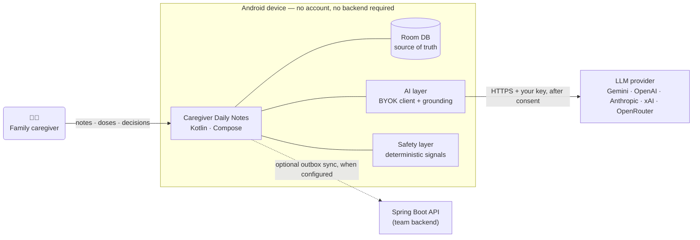
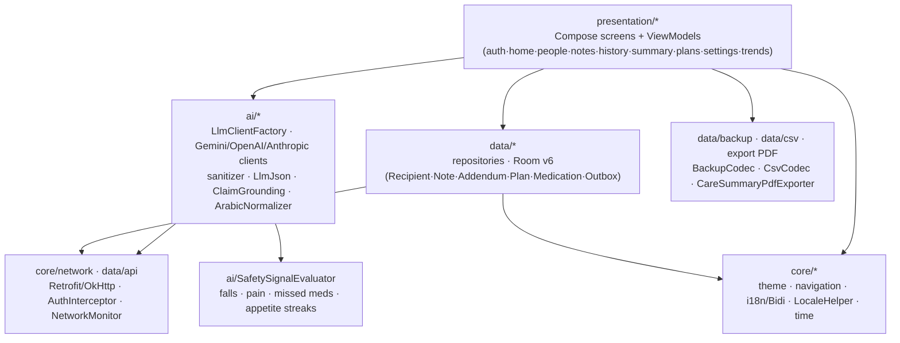
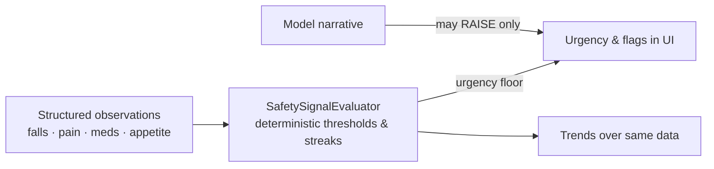

# Software Requirements Specification — Caregiver Daily Notes

| | |
|---|---|
| **Document** | SRS-CaregiverDailyNotes v1.0 |
| **Product** | Caregiver Daily Notes — Android (standalone BYOK release line) |
| **Source of truth** | `feat/standalone-byok-ai` @ `09d9df3`, shipped as **v0.3.5 (demo)**, versionCode 5 |
| **Status** | In force — describes the shipped build |
| **Structure** | Aligned (adapted) with ISO/IEC/IEEE 29148 §8.2 feature-normative layout |
| **Related** | [README.md](../README.md) · [ARCHITECTURE.md](../ARCHITECTURE.md) · [docs/releases/](../docs/releases/android-0.3.5-standalone.md) · [docs/ai/eval-harness.md](../docs/ai/eval-harness.md) |
| **Date** | 2026-10-21 |

> **Not a medical device.** The app is a documentation and summarisation aid. Suggestions are
> derived from caregiver notes, never from clinical judgement. Synthetic data only — do not use
> with real patient data. The product is not HIPAA-compliant.

---

## Contents

1. [Introduction](#1-introduction)
2. [Overall Description](#2-overall-description)
3. [Functional Requirements](#3-functional-requirements)
4. [Safety Concept](#4-safety-concept)
5. [Design Language](#5-design-language)
6. [Non-Functional Requirements](#6-non-functional-requirements)
7. [Verification and Traceability](#7-verification-and-traceability)
8. [Out of Scope](#8-out-of-scope)
9. [Appendix A — Glossary](#appendix-a--glossary)

---

## 1. Introduction

### 1.1 Purpose
This document specifies the functional, safety and non-functional requirements of
**Caregiver Daily Notes** for the *standalone Android release line*. It is written for the
project team (requirements review, test planning, release gating) and for future contributors.

### 1.2 Scope
The specification covers the **native Android application** (`android/`) as an installable,
self-contained APK:

- care-recipient profiles, structured daily notes and append-only history;
- per-recipient medication schedules and daily dose tracking;
- on-device deterministic safety signals over structured observations;
- bring-your-own-key (BYOK) AI summaries and AI-suggested care plans, grounded in the notes;
- data portability (JSON backup/restore, CSV import/export, PDF summary export);
- bilingual operation (Arabic / English) with right-to-first-class RTL layout.

The optional Spring Boot backend and React web client are **external, out of scope** (§8);
they appear here only as context entities.

### 1.3 Product view

### 1.4 User classes

| Class | Role | Abilities |
|---|---|---|
| Family caregiver | Primary user | Everything: notes, medication, summaries, plans, settings, data transfer |
| Care recipient | Data subject | Passive; data lives on the caregiver's device |
| AI provider operator | External | Processes consented payloads via API; holds no app data |
| Team backend (optional) | External | Receives outbox-synced copies when the caregiver configures it |

### 1.5 Requirements conventions
- **SHALL** denotes a binding requirement; **SHOULD** a strong preference; **MAY** an option.
- Functional requirements carry stable IDs `FR-XX-n`; safety invariants `SI-n`; non-functional
  requirements `NFR-C-n` (C = category). IDs are **not** renumbered when text is revised.
- Priority uses **MoSCoW** (Must / Should / Could / Won't — this release).
- Each requirement names its **verification** (§7); a requirement with no verification is
  not in force.

### 1.6 References
| Ref | Document |
|---|---|
| R1 | README.md — product overview, quickstart, CI matrix |
| R2 | ARCHITECTURE.md — module boundaries and dependency rules |
| R3 | docs/releases/android-0.3.5-standalone.md — build content and device walkthrough |
| R4 | docs/ai/eval-harness.md — AI evaluation methodology and golden dataset |
| R5 | docs/design-reference/material-theme-tokens.md — the "Calm Clinical Warmth" palette |
| R6 | docs/android/backup-restore.md, csv-transfer.md, language.md |

---

## 2. Overall Description

### 2.1 Module architecture

Two data paths coexist behind one API boundary: **Room-backed (local, default — no account
needed)** and **Retrofit-backed (teams/demo on a configured server)**. The standalone release
line treats Room as the source of truth; the network path is progressive enhancement.

### 2.2 Operating environment

| Aspect | Requirement |
|---|---|
| Platform | Android 6.0 **minSdk 23** → target/compile **SDK 35** |
| Build | JDK 17 (Temurin), Gradle 8.9, Kotlin/Compose BOM, AGP |
| Runtime | Fully usable **offline**; network used only for AI calls and (optional) backend sync |
| Distribution | GitHub Releases APK (arm64-v8a, armeabi-v7a, x86_64); no Play Store |
| Modes | `debug` = demo/local flags on; `release` = production content; minification on |

### 2.3 Constraints

| ID | Constraint |
|---|---|
| C-1 | **No account requirement.** The app SHALL be fully functional with no registration, no login and no configured server. |
| C-2 | **BYOK only.** AI access requires the user's own provider API key; the product ships no keys and offers no proxy. |
| C-3 | **Local-first.** Room is the source of truth; nothing in the recording path may block or fail on network or AI. |
| C-4 | **Bilingual parity.** Every user-visible string exists in Arabic and English; the Arabic layout is first-class RTL, not a mirrored afterthought. |
| C-5 | **Not a medical device.** No requirement may oblige the app to provide clinical judgement, diagnosis or medication authority (see §4). |

### 2.4 Assumptions
A1 — The caregiver owns/controls the device and the notes recorded. A2 — The selected AI
provider is reachable and its native JSON mode (where used) follows the documented contract
(R2). A3 — Users read the consent dialog before first send.

---

## 3. Functional Requirements

Priority: **M**ust for v0.3.5 unless marked (S)hould / (C)ould.

### 3.1 Care recipients — `FR-RC`

| ID | Requirement | Pri | Verification |
|---|---|---|---|
| FR-RC-1 | The user **shall** create, view and edit care recipients with independent Arabic and English names, and a relationship field. | M | Unit tests (recipient CRUD); device walkthrough R3 §3 |
| FR-RC-2 | The recipient **shall** be the selection context for all downstream features (notes, history, summary, plans). | M | Unit tests; UI tests |
| FR-RC-3 | Names **shall** render in the correct script order under both LTR and RTL layout. | M | Compose UI tests; language walkthrough R6 |

### 3.2 Daily notes — `FR-NT`

| ID | Requirement | Pri | Verification |
|---|---|---|---|
| FR-NT-1 | A note **shall** combine structured observations — mood, appetite, sleep, mobility, medication intake, pain (0–10), falls — with free text in Arabic, English or mixed script. | M | Unit tests on note model; golden dataset R4 |
| FR-NT-2 | Saving a note **shall** succeed with the device in airplane mode and with **no AI key configured**. | M | Unit tests (offline save); walkthrough R3 §4 |
| FR-NT-3 | Notes are **append-only**: a correction is written as a linked **addendum**; the original **shall never** be edited or deleted in place. | M | Unit tests (addendum immutability); walkthrough R3 §5 |
| FR-NT-4 | The note editor **shall** offer unsaved-change protection when leaving with pending edits. | M | Compose UI tests (unsaved-changes dialogs) |
| FR-NT-5 | Note text **shall** be treated strictly as data in every AI prompt: delimited, never executable as instruction (prompt-injection defence). | M | Golden-dataset injection cases R4 |

### 3.3 Medication tracking — `FR-MD`

| ID | Requirement | Pri | Verification |
|---|---|---|---|
| FR-MD-1 | Each recipient **shall** own a medication list with a configurable `dosesPerDay`. | M | Unit tests (medication CRUD) |
| FR-MD-2 | The home screen **shall** render one toggle per dose per day for *today*, persisted locally. | M | `MedicationViewModelTest` (state pump) |
| FR-MD-3 | Dose-taking state **shall** feed the deterministic safety signal *missed medication* (§4). | M | Decision-table tests (R4 methodology) |
| FR-MD-4 | The AI **shall never** add, remove, reschedule or mark medication (hard lock). | M | Unit tests on plan suggestion boundaries; SI-5 |

### 3.4 History — `FR-HI`

| ID | Requirement | Pri | Verification |
|---|---|---|---|
| FR-HI-1 | The user **shall** browse history filtered by person and by date. | M | Unit tests; walkthrough |
| FR-HI-2 | A note's history entry **shall** link the original and all addenda, preserving provenance order. | M | Unit tests (addendum ordering) |

### 3.5 AI summary — `FR-SU`

| ID | Requirement | Pri | Verification |
|---|---|---|---|
| FR-SU-1 | The user **shall** generate a grounded summary for the last **7, 14 or 30 days** for a selected recipient. | M | Unit tests (`SummaryWindow`); Compose UI tests |
| FR-SU-2 | Without a configured key or on AI failure, the app **shall** still produce the deterministic result (signals + trends) and a template narrative marked **"AI unavailable"**; note saving is never gated on AI. | M | Unit tests (fallback path) |
| FR-SU-3 | Every AI narrative claim **shall** cite a note id and quote it **verbatim** (ClaimGrounding: stem matching, two-direction negation checks, substance-filtered quotes). Unsupported claims are dropped as *unclear*, not guessed. | M | Metamorphic tests; golden dataset (groundedness score) R4 |
| FR-SU-4 | The summary **shall** show an explicit *uncertainty* section for unclear/contradictory observations. | M | Golden dataset (contradiction cases) R4 |
| FR-SU-5 | Deterministic signals and trends **shall** be rendered before/without the model's narrative. | M | Decomposed view tests |

### 3.6 Care plans — `FR-PL`

| ID | Requirement | Pri | Verification |
|---|---|---|---|
| FR-PL-1 | The AI **shall** propose plan items only from a fixed action catalogue; the model selects/parameterises, never invents actions. | M | Unit tests (catalogue validation) |
| FR-PL-2 | The user **shall** accept, edit-and-accept, or dismiss a proposal. | M | State-transition tests (all legal transitions) |
| FR-PL-3 | Plan versions **shall** follow a closed 5-status state machine (`Proposal → Accepted / Edited-and-Accepted / Dismissed → Archived`); a newly accepted version **shall** archive all prior versions — never two live versions. | M | State-transition tests incl. every illegal transition |
| FR-PL-4 | The AI **shall** be able to **raise** urgency of plan items but **never lower** deterministic urgency. | M | Decision-table tests; SI-4 |
| FR-PL-5 | Earlier versions **shall** remain inspectable (version history screen). | M | Unit tests; UI test |

### 3.7 AI provider management (BYOK) — `FR-AI`

| ID | Requirement | Pri | Verification |
|---|---|---|---|
| FR-AI-1 | The user **shall** choose a provider (Gemini, OpenAI, Anthropic, xAI, OpenRouter), paste a key and a model id; providers without a curated list accept free-text model ids. | M | `SettingsScreenTest`; model catalogue tests |
| FR-AI-2 | Keys **shall** be stored encrypted via the **Android Keystore** with a separate slot per provider, and **shall never** be transmitted to any party other than the chosen provider. | M | Unit tests (`AiKeyStore`, cipher round-trip) |
| FR-AI-3 | Before the **first** AI send, a consent dialog **shall** state exactly what leaves the device and to whom; no request **shall** be sent until the user consents. Consent is revocable in settings. | M | Compose UI tests (`AiConsentDialog` flows, revoke + confirmation) |
| FR-AI-4 | A **Test connection** action **shall** validate the provider/key/model without consuming the consent gate for later narrative sends. | M | UI test; manual walkthrough R3 §2 |
| FR-AI-5 | Where a provider offers a free tier model, the catalogue **shall** offer it first. | S | `AiModelCatalog` tests (`AiFreeTier`) |
| FR-AI-6 | Malformed model output **shall** be sanitised (code fences/preamble unwrapping) with a single JSON-repair retry; irrecoverable output fails predictably with no unbounded retry. | M | Sanitizer + `LlmJson` unit tests (`LlmStatus { OK, REPAIRED, FALLBACK }`) |
| FR-AI-7 | Every AI call **shall** be cancellable, time-boxed (per-call timeout), and provider `blocked_safety` responses shall surface as a reported state without automatic re-send. | M | `CallCancellation` tests |
| FR-AI-8 | Arabic notes **shall** be normalised (unification of letter variants) before matching/grounding work. | M | `ArabicNormalizer` unit tests |
| FR-AI-9 | The app **shall** support a custom provider base URL field for OpenAI-compatible endpoints behind the user's proxy. | S | `SettingsScreenTest` (base-url dialog; row scroll-into-view included) |

### 3.8 Data portability — `FR-DP`

| ID | Requirement | Pri | Verification |
|---|---|---|---|
| FR-DP-1 | The user **shall** export and re-import a full JSON backup (all entities), validated on restore. | M | Backup codec/validator tests; walkthrough R6 |
| FR-DP-2 | The user **shall** export notes to CSV and import notes from CSV with a pre-transfer plan (merge strategy preview). | M | `CsvCodec`/`CsvImportPlanner` tests |
| FR-DP-3 | The user **shall** export a PDF care summary for sharing with a clinician visit — generated and stored locally. | S | Export unit tests |
| FR-DP-4 | With a server configured, an **outbox** worker **shall** upload local records opportunistically (WorkManager); no sync failure may affect local editing. | S | `OutboxSyncWorker` tests |

### 3.9 Language & appearance — `FR-LN`

| ID | Requirement | Pri | Verification |
|---|---|---|---|
| FR-LN-1 | The app **shall** run fully in Arabic or English with in-app language switching (no restart). | M | `LocaleHelper` tests; walkthrough R3 §8 |
| FR-LN-2 | RTL: layout shall mirror natively (`supportsRtl`), with correct bidi isolation — quoted fragments and mixed-script names never reverse. | M | `Bidi` unit tests; walkthrough R3 §8 |
| FR-LN-3 | Arabic typefaces **shall** use IBM Plex Sans Arabic; Latin type Inter. | M | Theme snapshot tests |
| FR-LN-4 | The user **shall** choose light/dark appearance theme. | S | Settings UI tests |

---

## 4. Safety Concept

Safety in this product is **deterministic-first**: signal computation from structured data, with
the model as an add-on that cannot subtract. These invariants are the document of record for
that contract.

| ID | Invariant | Pri | Verification |
|---|---|---|---|
| SI-1 | Red-flag signals (fall, high pain, missed medication, poor-appetite streak) **shall** be computed **on-device** from structured observations, deterministically. | M | Decision-table tests over red-flag combinations and boundaries |
| SI-2 | AI output **shall** increase perceived urgency at most; hardware/deterministic urgency floors are never lowered by model text. | M | Decision-table tests; metamorphic negation cases |
| SI-3 | Every AI claim **shall** ground to a cited note with a verbatim quote; ungrounded text becomes explicit *uncertainty*, never a fact. | M | Golden dataset groundedness rate; metamorphic tests |
| SI-4 | Note text **shall** be inert data inside prompts — injection attempts in golden cases produce no behavioural change. | M | Golden injection cases |
| SI-5 | The medication graph is **write-protected**: the model can propose plan items only, never medication mutations. | M | FR-MD-4 tests |

**Failure philosophy:** predictable failure states over silent degradation — per-call timeout,
one cancellation handler, explicit "AI unavailable" template fallback, and `blocked_safety`
reported directly (FR-AI-7).

---

## 5. Design Language

### 5.1 Theme tokens — "Calm Clinical Warmth"

The product ships a Material 3 dynamic scheme recorded in R5; the SRS pins the reference identity:

| Token group | Value | Usage |
|---|---|---|
| Primary | `#00514d` on `#f2fbff` surfaces | App surfaces, containers `#0e6b66` / `#9ae9e2` |
| Secondary | `#2c6863` · container `#afebe5` | Supportive accents |
| Tertiary | `#1c4a78` · container `#386291` / `#c5ddff` | Informational accents |
| Error | `#ba1a1a` · container `#ffdad6` | Validation + red-flag rendering |
| Base | background `#f2fbff`, on-background `#121d21`, outline `#6f7978` | Chrome, text, borders |

### 5.2 Typography

| Role | Font | Size / line | Weight | Tracking |
|---|---|---|---|---|
| Display | Inter | 28 / 36 | 700 | −0.02em |
| Title | Inter | 22 / 28 | 700 | −0.01em |
| Section | Inter | 17 / 24 | 600 | — |
| Body | Inter | 15 / 22 | 400 | — |
| Arabic | IBM Plex Sans Arabic | per Material roles | — | bidi-isolated |

Design rules carried by this spec: dark theme derived from the same tokens; red-flag colouring
only via `error` ramps (no arbitrary reds); notes/record affordances always reachable within the
primary scaffold; interactive list rows keep a clickable container plus a stable **test tag**
derived from the row title, enabling reliable semantics tests even in the 320×470 CI test window.

---

## 6. Non-Functional Requirements

Status column: ✅ evidenced · 🎯 target (stated engineering goal — measured post-ship).

| ID | Category | Requirement | Pri | Status / Method |
|---|---|---|---|---|
| NFR-PE-1 | Performance | Notes/meds interactions render with no perceived jank on a mid-tier arm64 device; summaries stream without blocking input. | M | 🎯 Macrobenchmark + manual pass |
| NFR-PE-2 | Performance | Cold start to first frame < 2 s on reference device. | M | 🎯 Macrobenchmark |
| NFR-RE-1 | Reliability | Local recording path independent of network/AI (C-3). A killed AI call never corrupts or blocks writes. | M | ✅ Unit + cancellation tests |
| NFR-RE-2 | Reliability | Room schema migrations are versioned and additive; current schema v6 migrates cleanly from v5. | M | ✅ Migration test |
| NFR-SE-1 | Security | API keys encrypted at rest (Keystore), per-provider slotting, never displayed in full. | M | ✅ `AiKeyStore` tests; walkthrough R3 §2 |
| NFR-SE-2 | Security | Consent precedes the first send for each provider; revocation takes effect on the next send. | M | ✅ Consent flow UI tests |
| NFR-PR-1 | Privacy | Data leaves the device **only** to: consented AI provider, and—when explicitly configured—the team backend. No third-party analytics from the app binary. | M | ✅ Code review; release diff inspection |
| NFR-US-1 | Usability | All primary flows ≤ 3 taps from Home: add note, toggle dose, view summary, view plan. | M | 🎯 Walkthrough audit per release |
| NFR-A11-1 | Accessibility | All controls expose accessible semantics (content descriptions, merged row semantics); RTL-first. | M | ✅ Compose semantics tests; 🎯 axe-style audit |
| NFR-I18N-1 | Internationalisation | 100% string parity EN/AR; no hard-coded UI literals. | M | ✅ Parity test suite (`StringsParityTest`) |
| NFR-MA-1 | Maintainability | AI layer isolated behind `LlmClient`; provider additions require no UI changes. | M | ✅ Boundary review (R2) |
| NFR-TE-1 | Testability | Full unit-suite runs without a device; one Gradle invocation produces APK + tests + lint + instrumentation APK. | M | ✅ `android.yml` CI |
| NFR-DE-1 | Delivery | Release artifacts reproducible from tags; signed release FAILS when tag ≠ `versionName`. | M | ✅ `android-release.yml` gate |

### 6.1 Verification environment note
CI executes the JVM (unit + Compose/Robolectric) suite in an emulated **320 × 470 px** window;
content taller than the viewport (e.g. settings rows) **must** be scroll-into-view before
interaction. Tests encode this explicitly (row/tag semantics + `performScrollTo`), which is a
normative test-authoring rule for UI tests added to this suite.

---

## 7. Verification and Traceability

### 7.1 Verification methods
| Method | Instrument | Gates |
|---|---|---|
| Unit / JVM (Robolectric, Compose semantics) | `:app:testDebugUnitTest` — ~670 tests | CI `android.yml` on every push |
| Instrumentation | `:app:connectedDebugAndroidTest` | CI build of Android-test APK; device runs pre-tag |
| AI quality | eval-harness: decision tables, state transitions, golden 22-note dataset (MSA/Egyptian/mixed/messy/contradictory/injection), metamorphic identity | R4 scoring (red-flag recall, schema-valid rate, groundedness) — release-blocking for AI changes |
| Cross-checks | `android-release.yml`: tag = versionName; APK sha256 recorded in release notes | release gate |
| Manual | Device walkthrough ar+en (R3 §3–8) | per release |

### 7.2 Traceability matrix (summary)

| Feature area | Requirements | Automated evidence (selection) |
|---|---|---|
| Notes, addenda | FR-NT-1…5 | note CRUD tests, addendum immutability, unsaved-changes dialogs, injection golden cases |
| Medication | FR-MD-1…4 | `MedicationViewModelTest`, dose-today panel tests, plan hard-lock tests |
| Summary | FR-SU-1…5 | `SummaryWindow`/sanitizer/`LlmJson` tests, grounding metamorphs, fallback template test |
| Plans | FR-PL-1…5 | full transition-table suite (legal + illegal) |
| BYOK AI | FR-AI-1…9 | `AiKeyStore`, consent dialog suites, `SettingsScreenTest` (tag/assert + scroll), catalogue tests |
| Portability | FR-DP-1…4 | backup codec/validator, CSV planner, PDF exporter, outbox worker |
| Language | FR-LN-1…4 | `Bidi`, `LocaleHelper`, `StringsParityTest`, RTL walkthrough |
| Safety | SI-1…5 | decision tables, red-flag boundaries, urgency monotonicity |
| Delivery | NFR-TE-1, NFR-DE-1 | `android.yml`, `android-release.yml` |

### 7.3 Release definition of done (demo line)

1. CI **green** at the release sha (run head verified by sha — artifacts taken only from the run
   whose `headSha` matches).
2. APK downloaded from that run, renamed
   `caregiver-daily-notes-<version>-demo-<sha>.apk`, binary-verified for `versionName` and the
   marker strings (`MODEL_URGENT`, `home_medications_*`, `dosesPerDay`).
3. GitHub Release (prerelease) created with asset `app-minified.apk`, `--target` = built commit,
   sha256 in notes.
4. Checklist of §4 invariants reviewed after any AI/safety change.

---

## 8. Out of Scope

Explicitly **not** governed by this SRS (further releases may revise):

- React web client and backend `notes/`, `recipient/`, `audit/` modules (live on `main`).
- Server-side AI path (Gemini primary / OpenRouter failover / template fallback) and JWT auth.
- Play Store distribution and signed-production user base.
- Multi-caregiver data sharing (backend-mediated) beyond optional outbox sync.
- Clinical decision support of any kind, reminders-as-authority, dosage computation.

---

## Appendix A — Glossary

| Term | Definition |
|---|---|
| **Addendum** | A later, linked correction attached to a note; never replaces or rewrites the original. |
| **BYOK** | *Bring your own key.* The user's own AI provider credential, entered and stored locally. |
| **Care recipient** | The person being cared for; owns profiles, medications, notes, plans. |
| **Care plan** | A versioned set of suggested care actions, proposed by AI from a fixed catalogue and governed by one state machine. |
| **Claim grounding** | The requirement that every AI statement points to a source note and quotes it verbatim; without a grounding, a statement is uncertainty, not fact. |
| **Consent gate** | The explicit first-use consent stating what is sent, to whom, before any AI request. |
| **Dose toggle** | One control for one dose of one medication of one day. |
| **Deterministic signal** | A red-flag or trend value computed on-device from structured observations, independent of any model. |
| **Hard lock (medication)** | The invariant that AI can never create, delete, or mutate a medication or dose. |
| **Model id** | Free-text identifier of the model at the chosen provider (catalogue-suggested when listed). |
| **Outbox** | Local staging of records a worker uploads to an optional backend when configured. |
| **Structured observation** | A note field with a controlled value set (e.g. pain 0–10, falls count), feeding deterministic signals. |
| **Summary window** | The 7/14/30-day period a summary covers. |
| **Urgency floor** | The minimum urgency implied by deterministic signals; AI may raise it, never lower it. |

## Appendix B — Change history

| Version | Date | Author | Change |
|---|---|---|---|
| 1.0 | 2026-10-21 | Alaa (with project team) | Initial SRS, capturing the v0.3.5 (demo) build in force. |

---

*End of document. When requirements change, update the relevant FR/SI/NFR in place — never
renumber IDs — and note the change in Appendix B.*
