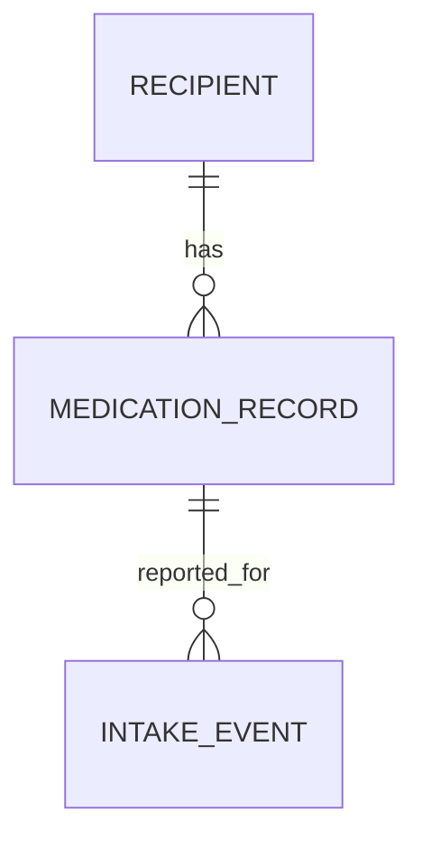

# Web Medication Domain Contract

This document defines the minimum vocabulary for caregiver-reported medication
tracking in the Web application. Implementations of issues #112–#115 must
preserve these meanings. This is a domain contract, not a database schema or
migration specification.

## A. Scope and safety boundaries

This is a caregiver-reported medication tracking feature for an educational
capstone application, not a clinical system. The application does not prescribe
medication, provide treatment instructions, or establish whether a medication
or dose is clinically appropriate. Stored medication data must not be presented
or interpreted as proof of clinical adherence.

A scheduled medication does not prove that a dose was taken. An absent intake
event does not prove that a dose was missed. Only an explicit caregiver report
creates an intake event.

This contract excludes:

- Dose calculation or dose recommendations.
- Drug interaction checking.
- Treatment advice.
- Automatic medication reminders.
- Clinical alerts.
- Automatic inference of missed doses.

Do not add clinical meaning or behavior beyond the caregiver-entered text and
explicit reports defined here.

## B. MedicationRecord

A `MedicationRecord` is the caregiver-maintained medication identity record for
one recipient. Its vocabulary consists of exactly these fields:

| Field | Meaning |
|---|---|
| `id` | Stable medication record identifier |
| `recipientId` | Recipient to whom the record belongs |
| `displayName` | Caregiver-entered medication name |
| `doseText` | Caregiver-entered dose description |
| `scheduleText` | Caregiver-entered schedule description |
| `active` | Whether the medication record is currently active |
| `createdAt` | Record creation timestamp |
| `updatedAt` | Last update timestamp |

This eight-field list defines the `MedicationRecord` domain/API vocabulary; it
does not remove backend ownership requirements or prescribe database columns.
Backend persistence must maintain both caregiver and recipient relationships.
Repository queries must always enforce both caregiver and recipient scope, and
the caregiver identity must come from authenticated backend context, never
browser-supplied ownership fields. Ownership relationships required for secure
persistence are not additional `MedicationRecord` vocabulary fields.

Rules:

1. A medication record belongs to exactly one recipient.
2. Backend services must enforce caregiver ownership for every operation on a
   recipient's medication records.
3. `displayName`, `doseText`, and `scheduleText` are caregiver-entered text.
   Preserve what was entered; do not calculate, normalize, reinterpret, or
   recommend a dose.
4. Do not infer a schedule from previous intake events.
5. Changing a medication record must not silently modify its historical intake
   events.
6. `active` is a record-management flag indicating whether the record is
   currently active in the caregiver-maintained tracker. It is not a statement
   that the medication is clinically appropriate, prescribed, or being taken.
   Inactive records remain historical records; deactivation is not deletion.

## C. Schedule

`scheduleText` is a caregiver-entered description of intended medication
timing. It represents only what the caregiver entered.

A schedule is not an intake event and does not prove that a dose was taken. Do
not use schedule text or the passage of a scheduled time to generate an
inferred `MISSED` event. This contract includes no reminder or alert behavior.

## D. IntakeEvent

An `IntakeEvent` is a separate, timestamped caregiver report linked to the
specific medication record it concerns:

`IntakeEvent → MedicationRecord → Recipient`

The recorded intake values are exactly:

- `TAKEN` — a caregiver explicitly reported that the dose was taken.
- `MISSED` — a caregiver explicitly reported that the dose was missed.
- `UNSURE` — a caregiver explicitly reported being unsure whether the dose was
  taken.

These are reports, not clinical conclusions. An intake event is a separate
record from a medication schedule and represents an explicit report, not an
automatically calculated result.

Rules:

1. Every intake event refers to the medication record it concerns.
2. Create an event only for an explicit caregiver report; do not create one
   merely because a scheduled time passed.
3. An empty intake history remains empty.
4. Do not add event values beyond `TAKEN`, `MISSED`, and `UNSURE`.

## E. NOT_RECORDED

`NOT_RECORDED` is a display state representing the absence of an intake event.
It is **not** a persisted intake event value.

- `UNSURE` is an explicit caregiver report of uncertainty about whether a dose
  was taken.
- `NOT_RECORDED` means that no intake event exists; it is not a report of
  uncertainty.
- Unknown medication information is information the caregiver cannot
  establish.
- Missing information is information that was not supplied or captured.
- Unknown and missing information are not additional persisted intake event
  values. Do not treat either as a negative observation or as a missed dose.
- Missing or unknown medication information must never be presented as a
  green, normal, healthy, safe, or confirmed status. Absence of information
  must not be interpreted as a positive observation.
- If no intake event exists, the application may display `NOT_RECORDED`.
- Do not create a fake event row for `NOT_RECORDED`.
- Do not convert `NOT_RECORDED` into `MISSED`.
- Do not assume an event exists merely because a schedule exists.
- Do not replace missing information with `false`, `0`, or an empty string.

| State | Meaning | Persisted intake event? |
|---|---|---|
| `TAKEN` | An explicit report that the dose was taken | Yes |
| `MISSED` | An explicit report that the dose was missed | Yes |
| `UNSURE` | An explicit report of uncertainty about whether the dose was taken | Yes |
| `NOT_RECORDED` | No intake event is present; display state only | No |

`NOT_RECORDED` must not be treated as another event state or as evidence that
the dose was missed. Preserve the distinctions among unknown information,
missing information, an explicit `UNSURE` report, and `NOT_RECORDED`; do not
add persisted intake-event values or domain enums for them.

## F. VerificationState

Verification is an independent dimension describing the verification status
of a caregiver-reported event. Its allowed values are exactly:

- `VERIFIED` — a verification assertion was made for the reported event.
- `UNVERIFIED` — the reported event is explicitly designated unverified.
- `NOT_ASSERTED` — no verification assertion was made.

Verification does not change the intake state and must never be inferred from
the event value. `VERIFIED` is a status assertion, not a clinical guarantee;
this vocabulary does not define a verification method or evidence standard.
A `TAKEN` event may have `UNVERIFIED` verification.

| Intake state | Verification state | Example meaning |
|---|---|---|
| `TAKEN` | `UNVERIFIED` | A caregiver reported the dose taken; the report is designated unverified. |
| `MISSED` | `VERIFIED` | A caregiver reported the dose missed; a verification assertion is recorded separately. |
| `UNSURE` | `NOT_ASSERTED` | A caregiver reported uncertainty; no verification assertion was made. |

These dimensions remain separate in storage, APIs, and presentation. A
verification state is meaningful only for an existing reported event;
`NOT_RECORDED` has no event whose verification could be asserted.

## G. Relationships and data integrity

One recipient may have multiple medication records. One medication record may
have multiple intake events, and each event refers to one specific medication
record. A schedule is text on the medication record; it is not an intake
event.

The diagram expresses relationships and distinct concepts only; it does not
specify a database schema. In particular:

- Changing `scheduleText` must not rewrite historical intake events.
- Editing medication text must not silently change an event's reported state,
  timestamp, or verification state.
- Do not construct intake history from schedule text or from the absence of
  events.
- This issue defines no database schema or migration.

## H. Existing PlanDocument MedicationEntry

The existing
[`MedicationEntry.java`](../../backend/src/main/java/com/caregiver/plans/MedicationEntry.java)
is a Java record with `name`, `dose`, and `schedule` strings. It is a plan-content
value object: its values are required non-blank text and are included in the
immutable medication list of
[`PlanDocument.java`](../../backend/src/main/java/com/caregiver/plans/PlanDocument.java).

That `MedicationEntry` is **not**:

- A standalone medication database entity.
- A medication intake event.
- A medication repository.
- A replacement for the `MedicationRecord` concept defined here.

Keep plan-content medication entries distinct from recipient medication
records and reported intake history. Do not modify either existing Java file
for this documentation issue.

## I. Guidance for issues #112–#115

The linked issue bodies are the implementation source of truth for their
assigned files, operations, and tests. Apply this contract without extending
their scope:

- [#112 — Medication record persistence](https://github.com/alaa157/caregiver-daily-notes/issues/112):
  persist standalone recipient medication records with caregiver ownership
  enforced in scoped backend queries. Preserve caregiver-entered medication
  text and the active/inactive record distinction. Do not put intake state or
  intake timestamps on the schedule record; preserve the existing plan
  medication content.
- [#113 — Medication record API](https://github.com/alaa157/caregiver-daily-notes/issues/113):
  implement the authenticated, caregiver- and recipient-scoped operations and
  request/response fields specified by that issue. Medication create, read,
  update, and archive operations manage `MedicationRecord`; they do not record
  an intake event.
- [#114 — Web medication list and editor](https://github.com/alaa157/caregiver-daily-notes/issues/114):
  provide the recipient-detail management UI using the API in #113. Preserve
  entered text, show active and archived records as specified, and keep loading,
  empty, and error states distinct. A schedule must not create an intake event,
  reminder, or alert.
- [#115 — Intake event persistence](https://github.com/alaa157/caregiver-daily-notes/issues/115):
  persist explicit intake reports separately from medication records and
  schedules. Use only `TAKEN`, `MISSED`, and `UNSURE` as persisted intake
  values, keep verification separate using only `VERIFIED`, `UNVERIFIED`, and
  `NOT_ASSERTED`, and represent no event as absence of a row / display-only
  `NOT_RECORDED`. Do not infer missed events; preserve event history as
  specified by that issue.

Do not use these issues as authority to introduce dose calculations,
recommendations, interaction checking, treatment advice, automatic reminders,
clinical alerts, or inferred adherence.

## J. Links and traceability

- [Architecture code map](code-map.md) — repository map for current backend,
  web, and documentation boundaries.
- [Project architecture](../../ARCHITECTURE.md) — feature ownership and
  repository architecture.
- [Web parity roadmap](../product-alignment/web-parity-roadmap/README.md) —
  product direction and explicit medication-safety boundaries.
- [Web parity domain decisions (WP-01)](../product-alignment/web-parity-roadmap/wp-01/README.md) —
  caregiver tracker scope and open schedule/intake details.
- Existing plan-content references:
  [`MedicationEntry.java`](../../backend/src/main/java/com/caregiver/plans/MedicationEntry.java)
  and
  [`PlanDocument.java`](../../backend/src/main/java/com/caregiver/plans/PlanDocument.java).
- Planned implementation issues: [#112](https://github.com/alaa157/caregiver-daily-notes/issues/112),
  [#113](https://github.com/alaa157/caregiver-daily-notes/issues/113),
  [#114](https://github.com/alaa157/caregiver-daily-notes/issues/114), and
  [#115](https://github.com/alaa157/caregiver-daily-notes/issues/115). These
  links refer to planned issues, not to implementations already present in the
  repository.
