

# رفيق — دليل مقدّم الرعاية (العربية)

**Rafeek — Caregiver User Guide** · [English version](caregiver-guide.en.md) · [فهرس الدليل](README.md)

رفيق يجمع ملاحظات الرعاية اليومية في مكان واحد: تسجّل ما تلاحظه، وتعود إليه
لاحقًا، ثم تطلب — عندما تختار ذلك — ملخصًا بالذكاء الاصطناعي وخطة رعاية مقترحة.
يستعرض هذا الدليل كل إجراءات التطبيق على **الويب** و**أندرويد**، بلقطات شاشة
مأخوذة من التطبيق أثناء التشغيل ببيانات تجريبية اصطناعية (الأشخاص الظاهرون، مثل
Laila Hassan وJohn Carter، ليسوا حقيقيين).

> **معلومات لدعم الرعاية فقط، وليست نصيحة طبية.** رفيق مشروع تعليمي ضمن مبادرة
> رواد مصر الرقمية (DEPI 2026، مسار اختبار البرمجيات)، وليس نظامًا للتشخيص أو
> المراقبة الطبية. إذا كنت تشك في وجود حالة طوارئ طبية، فاتصل بخدمات الطوارئ
> المحلية على الفور.

---

## المحتويات

1. ماذا يقدم رفيق
2. التطبيقان في لمحة
3. البدء
4. الرئيسية والتنقل
5. المستفيدون من الرعاية
6. الأدوية
7. تسجيل ملاحظة يومية
8. قراءة ملاحظة محفوظة
9. تصحيح ملاحظة
10. سجل الملاحظات
11. ملخصات الذكاء الاصطناعي
12. خطط الرعاية
13. إعداد الذكاء الاصطناعي (مفتاحك الخاص)
14. أساسيات السلامة والخصوصية
15. حل المشكلات
16. مسرد المصطلحات (عربي ↔ إنجليزي)
17. وثائق ذات صلة

---

## 1. ماذا يقدم رفيق

الدورة الأساسية أربع خطوات:

1. **إضافة المستفيدين من الرعاية** — الأشخاص الذين ترعاهم.
2. **تسجيل الملاحظات اليومية** — مشاهدات منظّمة مع نص حر، بالعربية أو
   الإنجليزية أو بمزيج منهما.
3. **طلب ملخص بالذكاء الاصطناعي** — نظرة عامة مدعومة بالأدلة لآخر 7 أو 14 أو
   30 يومًا، مع معلومات سلامة تُقيَّم بشكل مستقل.
4. **مراجعة خطة رعاية مقترحة** — تقبلها أو تعدّلها أو تستبعدها. لا يُطبَّق شيء
   دون قرارك الصريح.

فكرتان تشكّلان كل شيء في التطبيق:

- **السجل جدير بالثقة.** الملاحظات الأصلية لا تُعدَّل ولا تُمحى أبدًا. تُضاف
  التصحيحات كسجلات مستقلة مؤرخة، ويستطيع التطبيق دائمًا أن يعرض لك ما كُتب في
  الأصل وما تغيّر بعده.
- **النموذج لا يمسك القلم في أمور السلامة.** إشارات السلامة تُحسب بقواعد
  ثابتة في الخادم، مستقلة عن أي نموذج ذكاء اصطناعي. يستطيع النموذج رفع درجة
  الاستعجال، لكنه لا يستطيع أبدًا خفض إشارة سلامة أو إزالتها، ولا يستطيع إضافة
  دواء أو حذفه أو تغييره.

## 2. التطبيقان في لمحة

| | تطبيق الويب | تطبيق أندرويد |
|---|---|---|
| الطبيعة | مساحة عمل متصلة بالخادم | تطبيق مستقل يعمل محليًا أولًا |
| الحساب | حساب مقدّم رعاية على الخادم؛ تسجيل الدخول يقتصر على علامة التبويب | حسابات محلية على الجهاز؛ لا يحتاج خادمًا |
| البيانات | قاعدة بيانات الخادم (PostgreSQL) | قاعدة بيانات لكل حساب على الجهاز |
| مزودو الذكاء الاصطناعي | OpenAI وGemini وxAI وOpenRouter | OpenAI وAnthropic وGemini وxAI وOpenRouter |
| حفظ المفتاح | في ذاكرة علامة التبويب فقط؛ يُعاد إدخاله بعد إعادة التحميل | مشفّر في Android Keystore، لكل حساب ومزود على حدة |
| التصحيحات | إضافات لاحقة نصية **و** أحداث تصحيح منظّمة لكل حقل | إضافات لاحقة نصية («الملاحظة الأصلية لا تُعدَّل») |
| تتبع الأدوية | سجلات أدوية + أحداث تناول مسجّلة في صفحة المستفيد | قائمة أدوية + تسجيل جرعات سريع من الرئيسية |
| اللغة | عربية / إنجليزية، بدعم كامل للاتجاهين | عربية / إنجليزية، بدعم كامل للاتجاهين |

يشترك التطبيقين في قواعد المجال نفسها: ملاحظة أصلية واحدة لكل مستفيد وتاريخ،
تصحيحات تُضاف ولا تستبدل، حالات عدم يقين متمايزة، وبيانات أدوية للقراءة فقط
داخل الخطط.

## 3. البدء

### تطبيق الويب

1. افتح التطبيق واختر **إنشاء حساب** (أو **تسجيل الدخول** إن كان لديك حساب).
2. أنشئ الحساب بـ**البريد الإلكتروني** و**كلمة مرور** من 8 أحرف على الأقل (بحد
   أقصى 72 بايت بترميز UTF-8)، ثم أكّد كلمة المرور.
3. بعد الدخول تصل إلى **نظرة عامة**.لحماية خصوصيتك يقتصر تسجيل الدخول على
   علامة التبويب الحالية — فتح علامة تبويب جديدة يعني تسجيل الدخول مجددًا.

  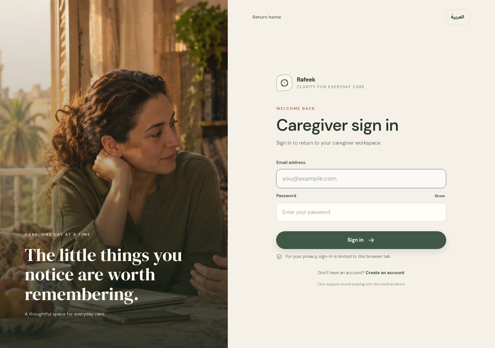

  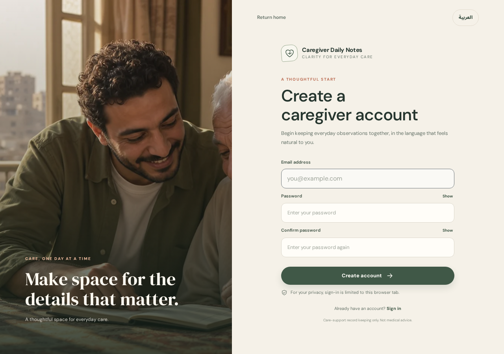

### تطبيق أندرويد

1. ثبّت أحدث ملف `app-release.apk` من صفحة الإصدارات (Releases) في مستودع
   المشروع على GitHub (اسمح بالتثبيت من مصادر غير معروفة عند الطلب).
2. عند أول تشغيل أنشئ **حسابًا محليًا** على الجهاز. يعمل التطبيق الرسمي كاملًا
   دون اتصال — لا خادم في الصورة. لكل حساب قاعدة بيانات خاصة؛ لا يمكن إزالة
   الحساب النشط، وإزالة حساب آخر تحذف بياناته بعد التأكيد.
3. ميزات الذكاء الاصطناعي (الملخصات واقتراحات الخطط) تحتاج مفتاح API خاصًا بك —
   انظر القسم 13.

**العرض التجريبي دون اتصال:** في شاشة تسجيل الدخول، اضغط مطولًا على الشعار
لتظهر عبارة **«استكشاف العرض التجريبي (دون اتصال)»**. يستخدم العرض بيانات
اصطناعية توضيحية ولا يحتاج شبكة. لقطات أندرويد في هذا الدليل مأخوذة من هذا
العرض.

## 4. الرئيسية والتنقل

### مساحة عمل الويب

القائمة الجانبية تضم: **نظرة عامة**، **المستفيدون**، **تسجيل ملاحظة يومية**،
**الملاحظات** (السجل)، **الملخصات**، **الخطط**. في الشريط العلوي: التاريخ
المحدد، واختيار المستفيد، وزر اللغة (**العربية** / **English**)، وقائمة
**الحساب** (تسجيل الخروج).

**نظرة عامة** عرض واقعي لتوفر الملاحظات في التاريخ المحدد:

- **ملخص التاريخ المحدد** — عدد المستفيدين المعروضين، والملاحظات المسجلة، وما
  لم يُسجل بعد، وملاحظات هذا الشهر.
- **اليوم حسب المستفيد** — حالة كل شخص (*تم تسجيل ملاحظة* / *لم تُسجل ملاحظة*)
  مع إجراء مباشر لفتح الملاحظة أو تسجيلها.
- **النشاط الأخير** — أحدث الملاحظات والتصحيحات والإضافات اللاحقة.

> عدم وجود ملاحظة يعني أنه لم يُعثر على ملاحظة لهذا التاريخ، **ولا يعني تسجيل
> مشاهدة سلبية**. لا تستنتج نظرة عامة حال شخص من الصمت.

  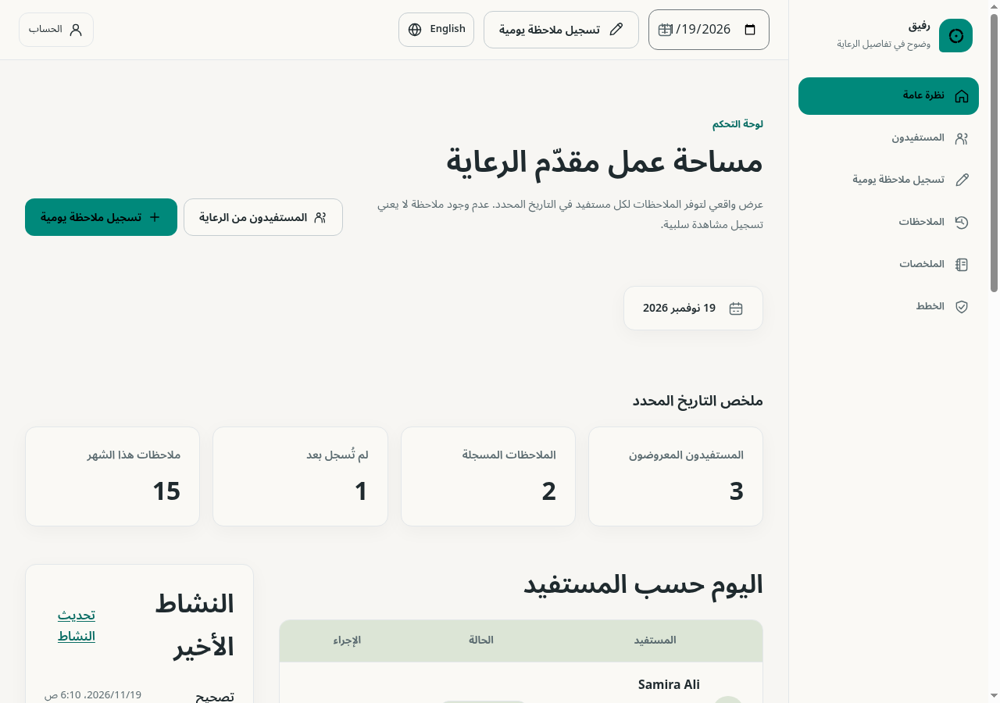

**المظهر:** الإعدادات ← الواجهة ← **المظهر والألوان** تتيح اختيار مظهر النظام
أو الفاتح أو الداكن، مع معاينة حية.

  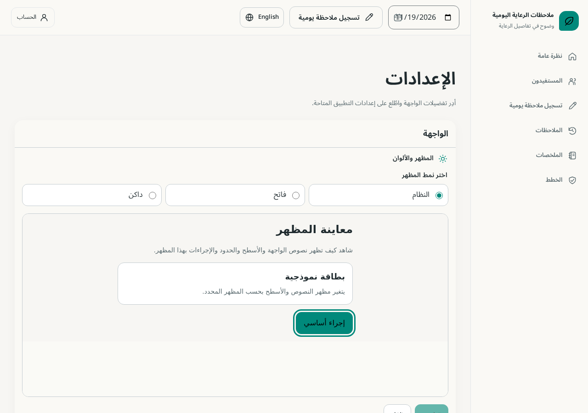

### تطبيق أندرويد

التنقل السفلي: **الرئيسية**، **المستفيدون**، **الملاحظات**، **السجل**. في
الرئيسية ثلاثة تبويبات — **اليوم**، **ما يحتاج انتباهًا**، **الكل** — إضافة إلى:

- شريط **تنبيه رعاية** عند وجود حدث يستدعي الانتباه (مثل سقوط مُبلَّغ عنه)،
- بطاقة **ملاحظات اليوم** مع اختصار **كتابة ملاحظة**،
- بطاقة **الأدوية** مع تسجيل الجرعات السريع (القسم 6)،
- قائمة المستفيدين مع حالة آخر ملاحظة لكل شخص.

  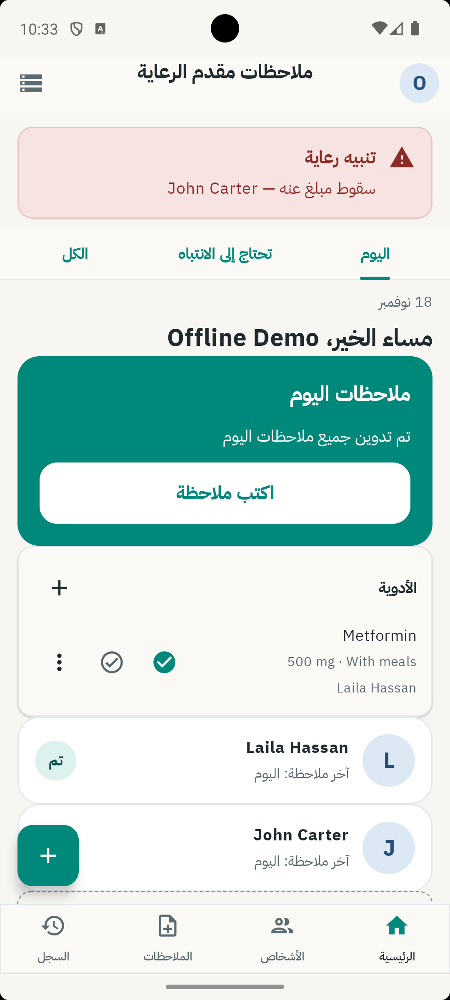
  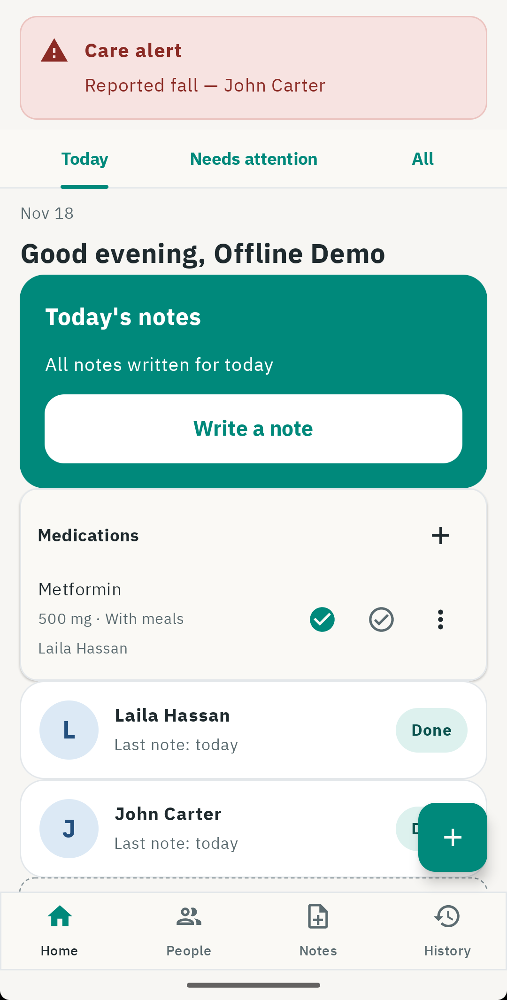

### تبديل اللغة

التطبيقان عربيان أولًا مع دعم كامل للإنجليزية. استخدم زر اللغة في الشريط
العلوي (الويب) أو الإعدادات (أندرويد). تنقلب التخطيطات بالكامل بين اليمين
لليسار واليسار لليمين، ويحافظ النص المختلط عربي/إنجليزي على اتجاهه الطبيعي في
كل مكان.

## 5. المستفيدون من الرعاية

### إضافة مستفيد (الويب)

**المستفيدون ← إضافة مستفيد من الرعاية.** ابدأ بـ**الاسم** (مطلوب، بحد أقصى
120 حرفًا). ويمكنك اختياريًا إضافة **صلة القرابة أو العلاقة**: الأم، الأب،
الزوج/الزوجة، الجدة، الجد، الابن/البنت، الأخ/الأخت، قريب، صديق، عميل، أو أخرى
مع وصف قصير (بحد أقصى 80 حرفًا).

إذا كان لديك مستفيد بالاسم نفسه بالفعل، ينبّهك رفيق ويتيح **فتح المستفيد
الحالي** أو **إنشاء رغم ذلك** — التكرار مسموح لكنه غير مستحسن لأنه يصعّب
التمييز بين السجلات.

  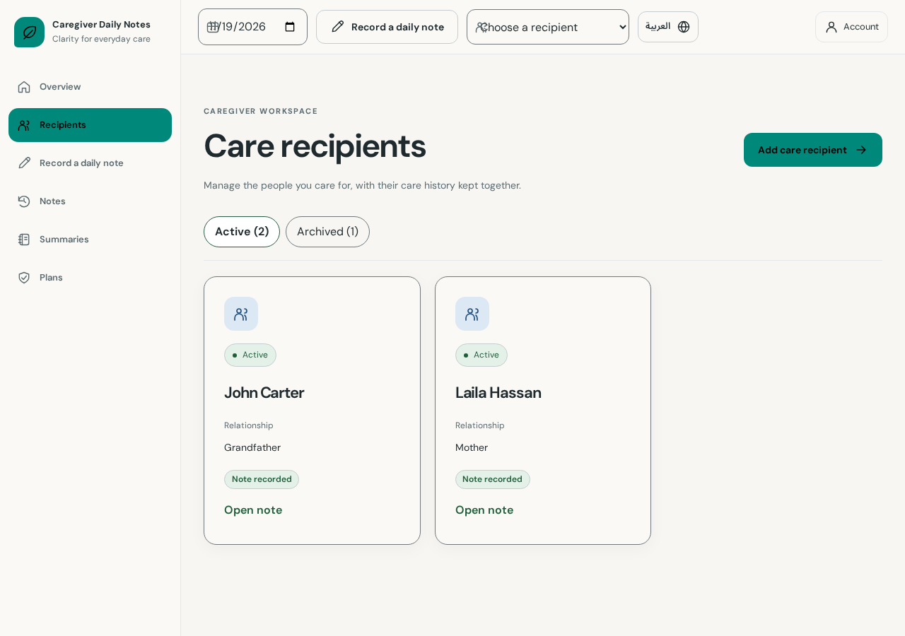

  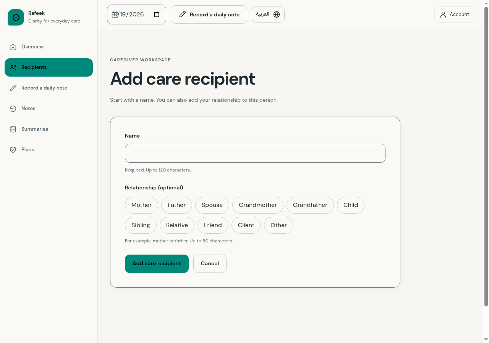

### صفحة المستفيد

لكل مستفيد أربعة تبويبات: **نظرة عامة**، **الملاحظات**، **الملخصات**،
**الخطة**. تعرض نظرة عامة حالته، وحالة ملاحظة اليوم (*فتح ملاحظة اليوم* /
*تسجيل ملاحظة اليوم*)، وصلة القرابة، وتاريخي الإضافة والتحديث، و**تفاصيل
الرعاية**.

  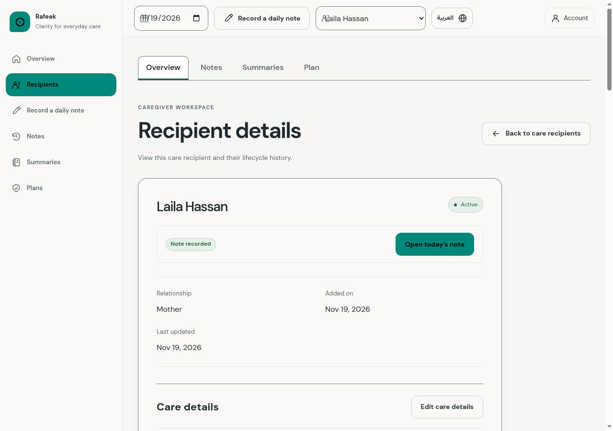

**تفاصيل الرعاية** (اختيارية، ولا يطلع عليها أحد غيرك): تاريخ الميلاد،
الحساسية، الحالات الصحية، اسم جهة اتصال الطوارئ ورقم هاتفها. في أندرويد توجد
الحقول نفسها في نموذج تفاصيل الرعاية بصفحة الشخص.

  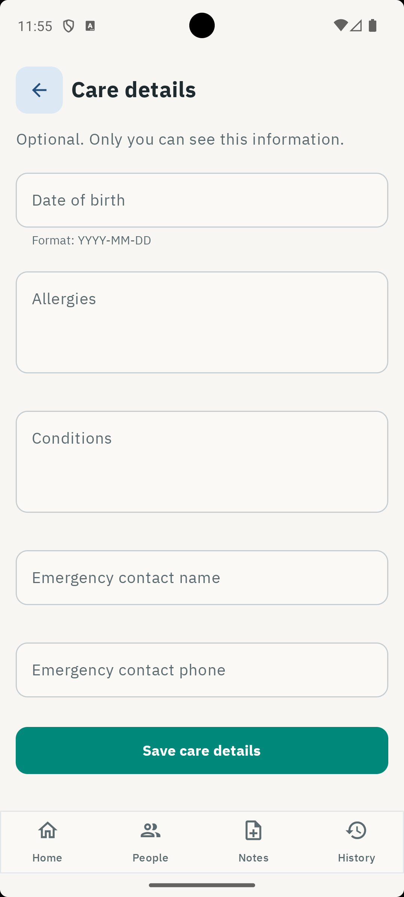
  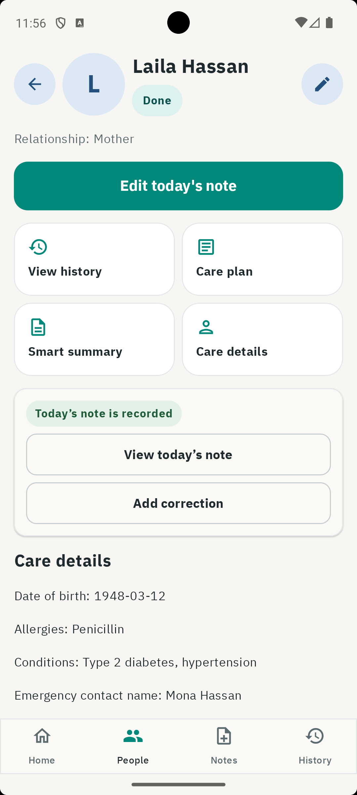

### الأرشفة والاستعادة

- **أرشفة المستفيد** تُخرجه من سير عمل الرعاية النشط. تبقى ملاحظاته وتصحيحاته
  وخططه وسجلاته **محفوظة**، ويصبح للقراءة فقط. الأرشفة قابلة للعكس — ليست
  حذفًا.
- **استعادة المستفيد** تعيده إلى الرعاية النشطة؛ تبقى سجلاته السابقة كما هي.
- **يتطلب المراجعة** حالة للسجلات القديمة غير النشطة التي لم يُحسم معناها
  التاريخي. تبقى للقراءة فقط حتى تحسمها باعتبارها مؤرشفة أو نشطة.

يمكن مراجعة المستفيدين المؤرشفين في كل مكان (السجل، الملخصات، الخطط)، لكن لا
تُسجَّل لهم ملاحظات أو قرارات جديدة حتى تتم الاستعادة.

## 6. الأدوية

سجلات الأدوية أوصاف تحتفظ بها للرجوع إليها — **رفيق لا يصف دواءً ولا يغيّره
ولا يتحقق منه بنفسه أبدًا**، وبيانات الأدوية للقراءة فقط داخل خطط الذكاء
الاصطناعي.

### الويب: سجلات الأدوية وأحداث التناول

في صفحة المستفيد تعرض قائمة **الأدوية** لكل دواء **اسمه** و**وصف جرعته**
و**جدوله**. القائمة الفارغة لا تعني عدم استخدام أي دواء — تعني فقط أنه لم تُضف
سجلات.

- **إضافة دواء** — الاسم (مطلوب، ≤160 حرفًا)، ووصف الجرعة ووصف الجدول
  (مطلوبان، ≤500 حرف لكل منهما).
- **تعديل** يحدّث السجل؛ **أرشفة** تُنهيه مع الحفاظ على سجله.
- **تسجيل حدث تناول** — لكل دواء يمكنك توثيق ما حدث فعلًا: **تم التناول / لم
  يتم التناول / غير متأكد**، مع **حالة التحقق** (تم التحقق / غير متحقق منه /
  لم يُثبت التحقق)، و**وقت التناول** (ليس في المستقبل ولا قبل أكثر من سنة).
  يعرض **سجل تناول الدواء** هذه الأحداث، مع تحميل المزيد عند الطلب.

### أندرويد: الأدوية وتسجيل الجرعات السريع

في الرئيسية تعرض بطاقة **الأدوية** كل دواء (الاسم، الجرعة، المواعيد، عدد
الجرعات يوميًا، الشخص المعني). زرا التحقق بجانب الدواء يسجّلان الجرعة
**تم تناولها** أو **لم يتم تناولها** لهذا اليوم، وتتيح قائمة الخيارات التعديل
والحذف. يفتح زر **+** نموذج إضافة دواء:

  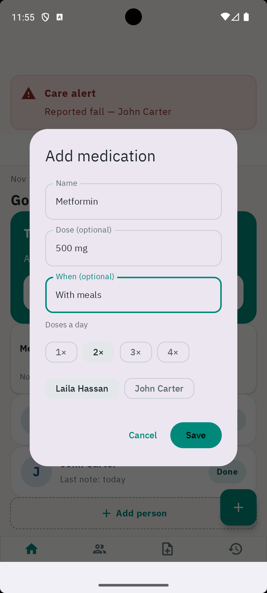

### عندما تتعارض السجلات

إذا لم تتطابق حالة الدواء في الملاحظة اليومية مع أحداث التناول المسجّلة في
اليوم نفسه، يعرض رفيق **تنبيه تعارض** على الملاحظة. يطلب التنبيه مراجعة
السجلين — **ولا يغيّر أيًّا منهما**. لا يُستنتج شيء ولا تُجرى تسوية صامتة.

## 7. تسجيل ملاحظة يومية

افتح **تسجيل ملاحظة يومية** (الشريط العلوي أو القائمة الجانبية في الويب؛
**كتابة ملاحظة** في أندرويد).

**القواعد:**

- اختر **مستفيدًا نشطًا** و**تاريخ الملاحظة**. تُسمح بملاحظة أصلية واحدة لكل
  مستفيد وتاريخ، ولا يمكن أن يكون التاريخ في المستقبل.
- تبدأ الحقول الاختيارية كـ**غير مسجّلة**. سجّل فقط ما أُبلغ عنه — دون تفسيره.
- الحقول النصية القصيرة تسمح حتى 40 حرفًا؛ النص الحر حتى 20,000 حرف. يُحفظ النص
  العربي والإنجليزي وفواصل الأسطر والنص المختلط كما أُدخل تمامًا.

  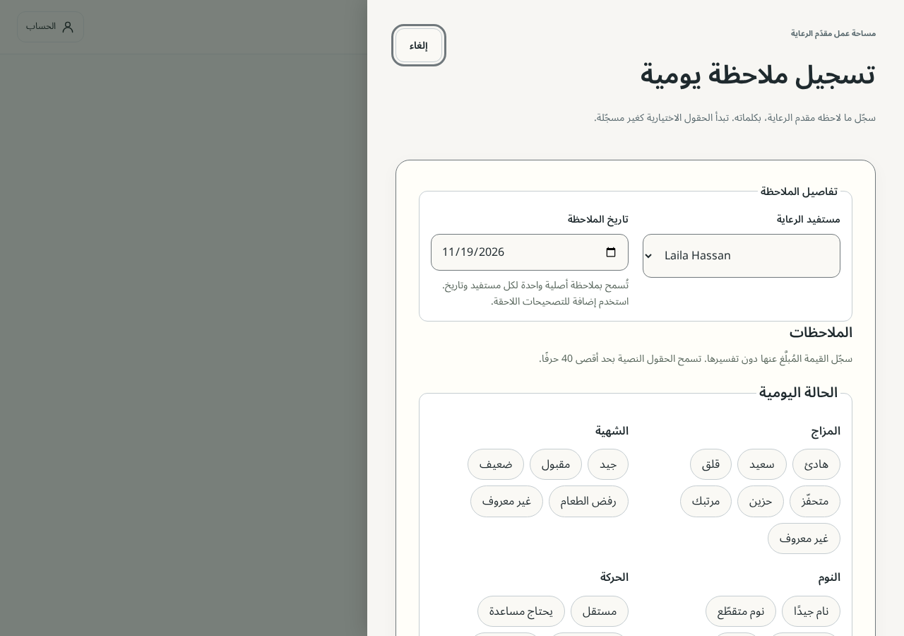

### الحقول

| المجموعة | الحقل | الخيارات |
|---|---|---|
| الحالة اليومية | **المزاج** | هادئ · سعيد · قلق · متحفّز · حزين · مرتبك |
| | **الشهية** | جيد · مقبول · ضعيف · رفض الطعام |
| | **النوم** | نام جيدًا · نوم متقطّع · نوم ضعيف · لم ينم |
| | **الحركة** | مستقل · يحتاج مساعدة · طريح الفراش |
| الدواء | **تناول الدواء** | تم تناوله · لم يتم تناوله · غير معروف / غير متأكد |
| | **تم التحقق من تقرير الدواء** | علامة تحقق مستقلة |
| الألم والسلامة | **درجة الألم (0–10)** | عدد صحيح من 0 إلى 10، أو اتركه فارغًا |
| | **سقوط مُبلَّغ عنه** | نعم · لا |
| ملاحظات إضافية | **ملاحظات نصية حرة** | حتى 20,000 حرف، بأي مزيج لغوي |

في أندرويد تُلتقط الملاحظة نفسها بأدوات مدمجة: **الدواء** (تم تناول الكل /
فات شيء / غير متأكد)، **هل حدث سقوط؟** (نعم / لا)، مقياس **الألم**
(0 = لا ألم · 10 = أسوأ ألم)، ونص حر **«أي شيء آخر؟»**. حفظ الملاحظة لا يستخدم
الذكاء الاصطناعي أبدًا.

  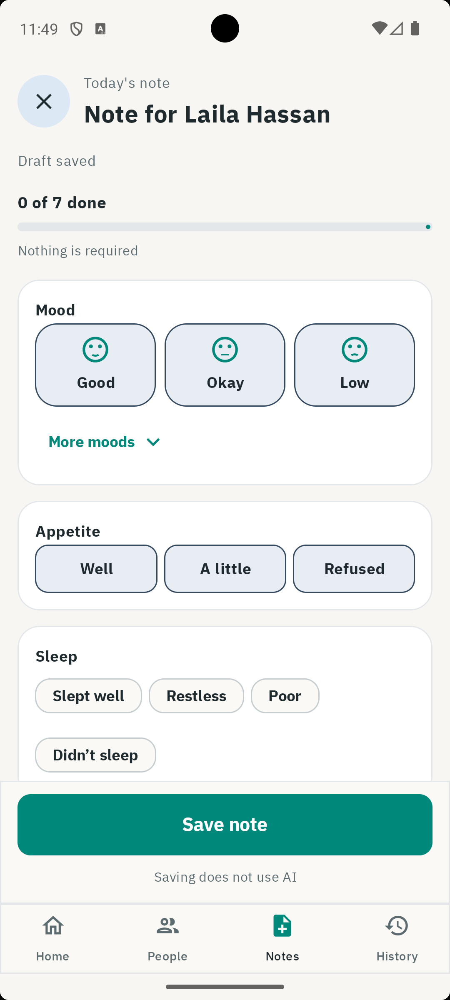
  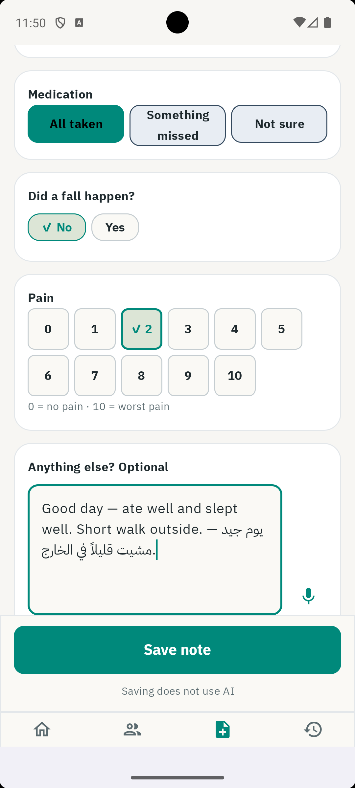

### حالة الملاحظة: عدم اليقين قيمة من الدرجة الأولى

كل مشاهدة تحمل حالة صريحة، ولا يدمج التطبيق إحداها في الأخرى أبدًا:

| الحالة | المعنى |
|---|---|
| **مسجّل** | تم التقاط قيمة محددة. |
| **غير معروف** | أبلغ مقدّم الرعاية أن القيمة غير معروفة أو غير متأكد منها. |
| **غير مسجّل** | تُركت هذه الملاحظة عمدًا دون تسجيل. |
| **غير منطبق** | هذه الملاحظة لا تنطبق في هذا الموقف. |

قد تظهر في البيانات التاريخية أيضًا حالة **قديم (غامض)** — بيانات لم يُثبت
معناها بدقة. تبقى غير مؤكدة بوضوح ولا تُعامل كحقيقة مؤكدة.

**التحقق مستقل عن التسجيل.** قد تكون القيمة مسجّلة لكنها غير متحقق منها؛
تسجيل شيء لا يعني أنه تحققت منه سريريًا. تقارير الدواء تتبع القاعدة نفسها:
*غير معروف* و*غير مسجّل* و*غير مُتحقق* قيم متمايزة، ولا يُستنتج شيء.

### الحفظ وإعادة المحاولة الآمنة

اختر **حفظ الملاحظة الأصلية**. إذا انقطع الاتصال أثناء الحفظ ولم يستطع
التطبيق تأكيد النتيجة، فإنه يقفل القيم المدخلة ويتيح **إعادة محاولة الحفظ
نفسه** — إعادة المحاولة آمنة ولا تنشئ سجلًا مكررًا. مغادرة الصفحة تفقدك إعادة
المحاولة الآمنة، لذا راجع السجل المحفوظ قبل الإرسال مجددًا.

## 8. قراءة ملاحظة محفوظة

تُفتح الملاحظة المحفوظة باسم **تفاصيل الملاحظة اليومية**:

- **مقفل — الملاحظة الأصلية للقراءة فقط.** المشاهدات والنص الأصلي كما حُفظت
  تمامًا، مع المستفيد وتاريخ الملاحظة ووقت الحفظ ومعرّف المصدر. لا يمكن تعديل
  الملاحظات المحفوظة.
- **التسلسل الزمني للتصحيحات.** كل تغيير لاحق بالترتيب: أحداث التصحيح المنظّمة
  والإضافات اللاحقة، لكل منها وقتها ومعرّف مصدرها. تعكس **القيم الفعّالة
  الحالية** للملاحظة السجل الكامل.
- **معلومات السلامة** المتعلقة بالملاحظة (مثل سقوط مُبلَّغ عنه) تبقى ظاهرة
  بجانب السجل.

  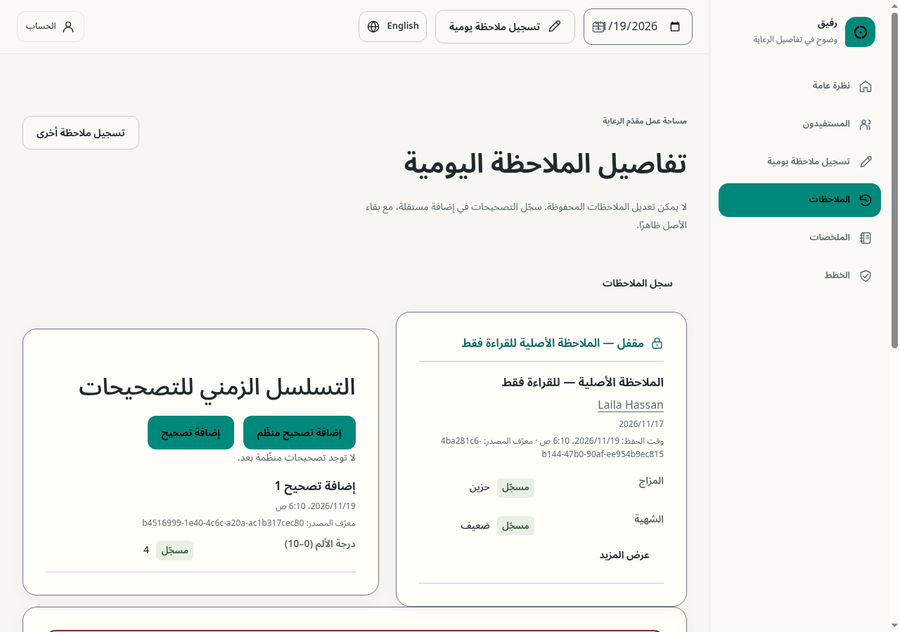

  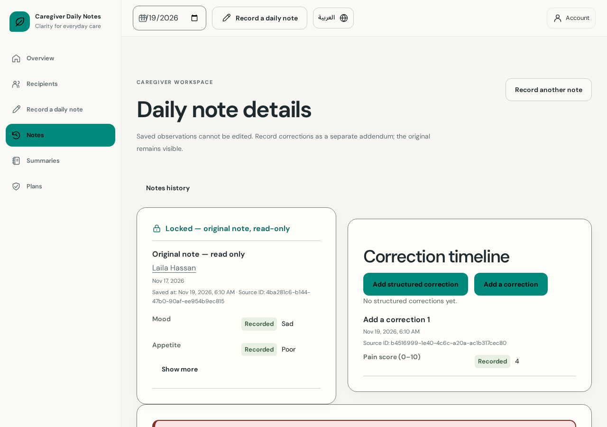

## 9. تصحيح ملاحظة

التصحيحات لا تستبدل الأصل ولا تمحوه أبدًا. توجد آليتان في الويب وواحدة في
أندرويد.

### الإضافة اللاحقة (الويب وأندرويد)

من الملاحظة اختر **إضافة تصحيح**. حدّد **فقط الحقول التي تريد تصحيحها** وأدخل
القيم البديلة؛ تبقى الحقول الأخرى كما هي. يعرض النموذج الأصل المقفل بجانب
تعديلاتك، ويصرّح بوضوح: *«التصحيحات سجلات مستقلة. لا يستبدل هذا النموذج
الملاحظة الأصلية ولا يمحوها.»* احفظ بـ**حفظ الإضافة**.

في أندرويد تفتح **إضافة تصحيح** إضافة نصية: *«الملاحظة الأصلية لا تُعدَّل.
يمكنك إضافة معلومات جديدة أو تصحيح مهم كإضافة لاحقة.»* اكتب نص التصحيح ثم
**حفظ التصحيح**.

  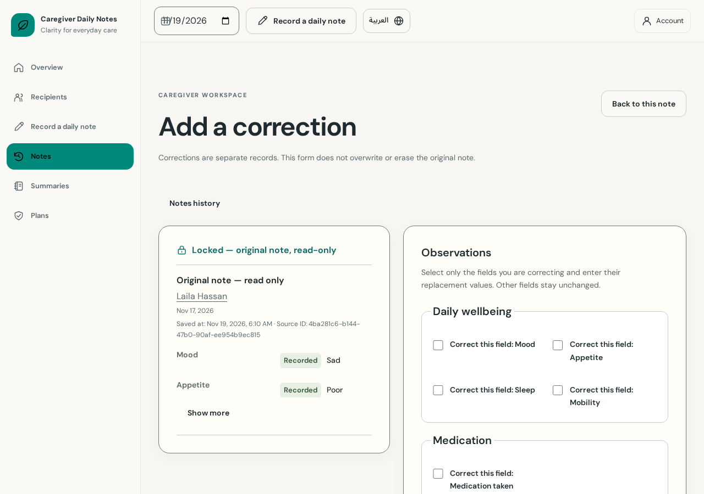

  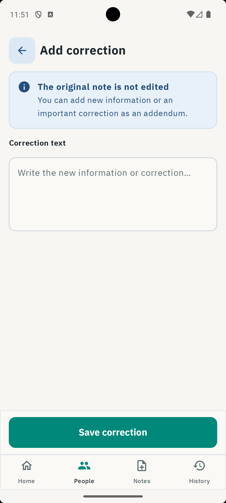
  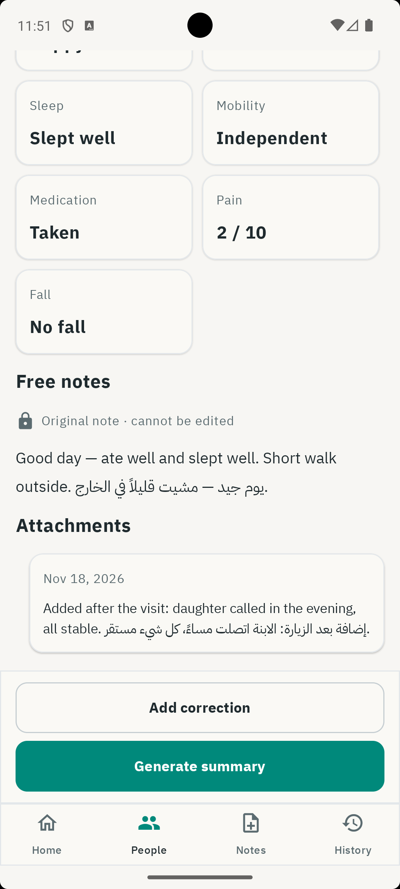

### التصحيحات المنظّمة (الويب)

للتغييرات الدقيقة على مستوى الحقول اختر **إضافة تصحيح منظّم**. لكل حقل تختار
عملية واحدة:

| العملية | الأثر |
|---|---|
| **تعيين قيمة** | استبدال القيمة الفعّالة للحقل بقيمة جديدة. |
| **مسح القيمة المسجّلة** | إزالة القيمة المسجّلة. |
| **تحديد القيمة كمجهولة** | تصبح القيمة غير معروفة صراحةً. |
| **تحديد أنها غير مسجّلة** | يصبح الحقل غير مسجّل صراحةً. |

يُحفظ كل اختيار **كحدث مستقل لا يتغير**. يعرض سجل التصحيحات لكل حدث القيمة
الفعّالة السابقة والقيمة الفعّالة الجديدة ومن سجّله ومتى. تُعاد القيمة
الفعّالة الحالية دائمًا بشكل حتمي من الأصل مضافًا إليه كل الأحداث — لا شيء
يُخمَّن.

### لماذا هذا التصميم

أي شخص يراجع السجل لاحقًا — فرد من العائلة أو ممرض أو طبيب — يستطيع رؤية ما
لوحظ في الأصل، وما صُحّح، ومتى. الثقة في السجل هي الغاية؛ التعديل الصامت
يدمّرها.

## 10. سجل الملاحظات

**الملاحظات** في القائمة الجانبية تفتح **سجل الملاحظات**: المشاهدات الأصلية
وتصحيحاتها، الأحدث حسب تاريخ الملاحظة أولًا.

- يعرض السجل افتراضيًا **آخر 30 يومًا، بما فيها اليوم**.
- صفّ حسب **جميع المستفيدين أو مستفيد واحد** (بمن فيهم غير النشطين)، وحسب
  **يوم واحد** أو **فترة زمنية شاملة الطرفين**. **تطبيق التصفية** يعتمد
  الاختيارات؛ **إعادة ضبط التصفية** تعيد الافتراضيات.
- أحجام الصفحات 20 أو 50 أو 100 ملاحظة؛ تعيش التصفية والصفحة في عنوان URL،
  فإعادة التحميل أو زر الرجوع يعيدان العرض نفسه.
- يتوسع كل صف ليعرض المشاهدات الأصلية والنص كما كُتب، ويرتبط بالملاحظة
  كاملة، ويمكنه **عرض التصحيحات** — الحقول المغيّرة فقط، بالترتيب الزمني، دون
  أن تحل محل الأصل أبدًا.

  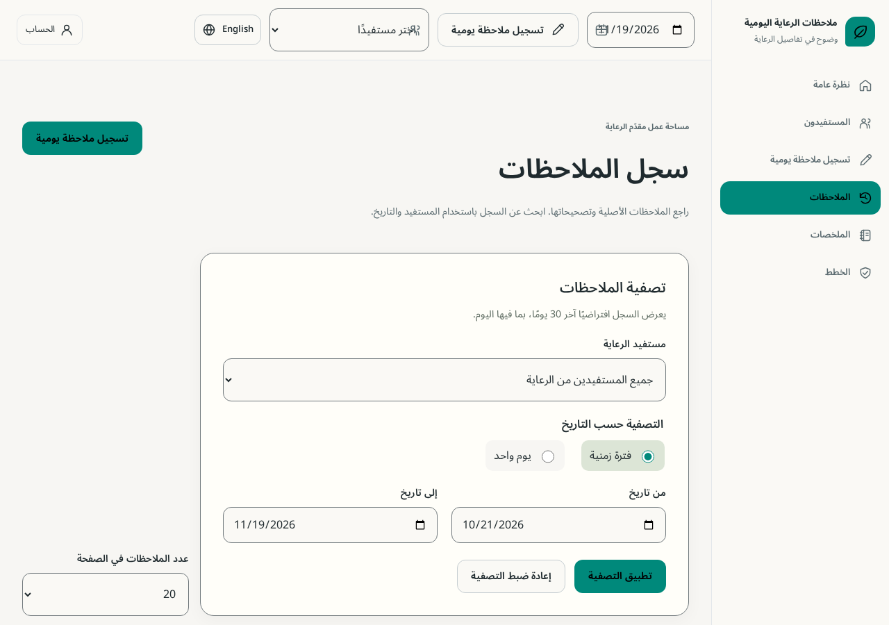

  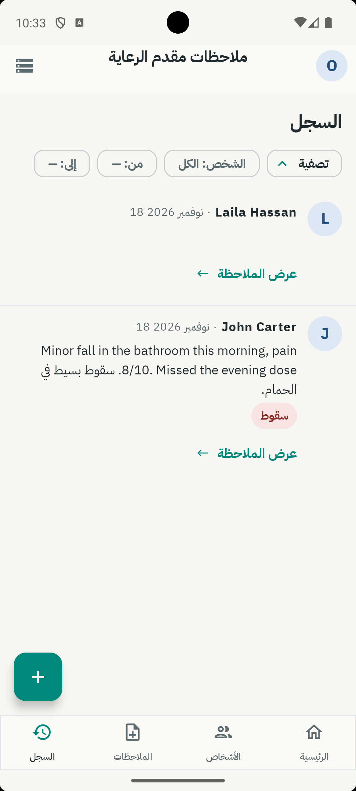
  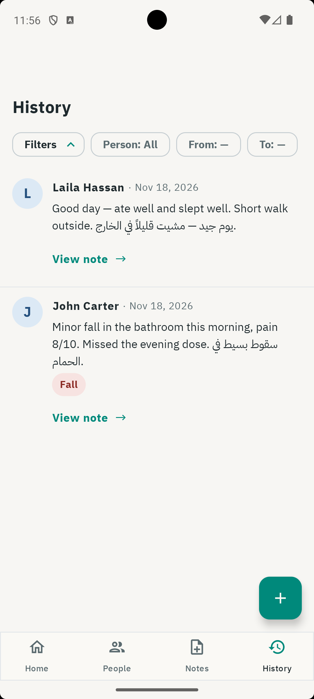

## 11. ملخصات الذكاء الاصطناعي

**الملخصات** تفتح **ملخص الذكاء الاصطناعي والسلامة**. لا يُنشأ أي ملخص
تلقائيًا: تختار المستفيد والفترة ثم تطلب الملخص. يحتاج الذكاء الاصطناعي مفتاح
مزود خاصًا بك — جهّزه أولًا (القسم 13).

### طلب ملخص

1. اختر **المستفيد من الرعاية**.
2. اختر **فترة الملخص**: **7 أو 14 أو 30 يومًا**.
3. حدد **تاريخ النهاية (شامل)** — تنتهي الفترة عند هذا التاريخ.
4. اختر **إنشاء ملخص**. تبقى النتيجة السابقة ظاهرة أثناء تنفيذ الطلب الجديد،
   وتحتفظ كل نتيجة بالمستفيد والتواريخ المعروضة معها.

  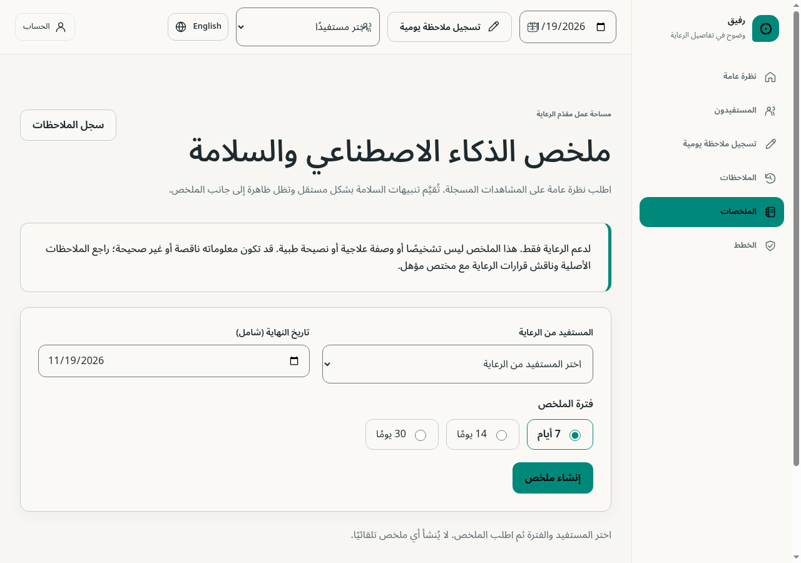

  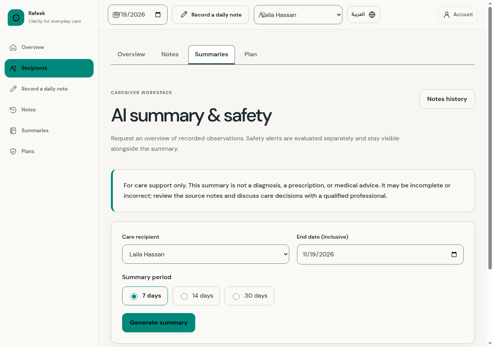

### معلومات السلامة أولًا — ومن قواعد ثابتة لا من النموذج

تُقيَّم إشارات السلامة **بقواعد حتمية في الخادم، بشكل مستقل عن النص المُولّد
بالذكاء الاصطناعي**. تظهر قبل محتوى النموذج ولا يستطيع النموذج إخفاءها:

| الإشارة | المعنى |
|---|---|
| **تم الإبلاغ عن سقوط** | أُبلغ عن سقوط خلال الفترة المحددة. |
| **تم تسجيل ألم شديد** | سُجّلت درجة ألم مرتفعة خلال الفترة. |
| **تكرر تفويت الدواء** | فُوّت الدواء في عدة أيام. |
| **ضعف الشهية في عدة أيام** | سُجّل ضعف شهية في عدة أيام. |
| **حالة الدواء غير واضحة** | حالة الدواء غير واضحة أو غير موثّقة خلال الفترة. |
| **مصدر قلق في نص الملاحظة** | يذكر نص الملاحظة أمرًا قد يستدعي المراجعة. |
| **تم تسجيل حالة ارتباك** | سُجّلت حالة ارتباك خلال الفترة. |

يمكنك **وضع علامة تمت المراجعة** للإقرار بإشارة؛ تبقى ظاهرة. تحذيران يستحقان
التأكيد:

- **«لا توجد إشارات تحذيرية» ليست شهادة سلامة.** لا تثبت سلامة الرعاية ولا
  اكتمال المعلومات.
- إذا تعذّر التحقق من اكتمال معلومات السلامة، يقول التطبيق ذلك صراحةً — غياب
  المعلومات لا يُعامل أبدًا على أنه أمان.

> إذا كنت تشك في وجود حالة طوارئ طبية، فاتصل بخدمات الطوارئ المحلية على الفور.

### ماذا يحتوي الملخص

- **مشاهدات الملخص** — نص مولّد بالنموذج، موسوم بوضوح بأنه كذلك، مع **اقتباس
  داعم** ورابط **الملاحظة المصدر** لكل ادعاء. تُطابق الاقتباسات مع الملاحظة
  المصدر؛ أما الادعاء نفسه فلم يُتحقق منه بشكل مستقل. تصبح المراجع الحقيقية
  للملاحظات روابط فقط — لا شيء مُختلق.
- **معلومات غير واضحة أو متعارضة** — يظهر عدم اليقين في قسم خاص، لا يُخفى.
  «لا توجد عناصر لعدم اليقين» لا تؤكد اليقين.
- **أعداد المشاهدات المسجلة** — أعداد بسيطة (حالات السقوط، الألم الشديد، أيام
  تفويت الدواء، أيام ضعف الشهية) مقارنة بالفترة السابقة، مع القيم الدقيقة
  وأحجام العينات. هذه أعداد مسجّلة وليست حسابات اتجاهات سريرية.
- **التغطية** — عدد الأيام التي توجد فيها ملاحظات فعلًا خلال الفترة. الفترة
  الفارغة تقول ذلك صراحةً بدل اختلاق محتوى.

يتحقق الخادم من مخرجات النموذج: تُزال المشاهدات التي تعذّر التحقق منها مقابل
الملاحظات، وتُزال العناصر التي تحتوي نصًا طبيًا، وتُبلغ بالعدد. إذا فشل
المزود، تبقى معلومات السلامة والأعداد المسجّلة — يتعطل جزء الذكاء الاصطناعي
ولا يتعطل جزء السلامة.

> **إخلاء المسؤولية المرافق لكل ملخص:** لدعم الرعاية فقط؛ ليس تشخيصًا أو
> وصفة علاجية أو نصيحة طبية؛ قد تكون معلوماته ناقصة أو غير صحيحة. راجع
> الملاحظات الأصلية وناقش قرارات الرعاية مع مختص مؤهل.

## 12. خطط الرعاية

**الخطط** تفتح **خطط الرعاية** للمستفيد: الخطة المقبولة النشطة، والاقتراحات
التي تنتظر المراجعة، وكل إصدار محفوظ.

> الاقتراحات **لا تصبح نشطة إلا بعد قبول مقدّم الرعاية لها**. أسماء الأدوية
> وجرعاتها ومواعيدها للقراءة فقط في كل مكان داخل الخطط.

### طلب اقتراح

**طلب اقتراح خطة بالذكاء الاصطناعي** يستخدم فترة الملاحظات المحددة (7/14/30
يومًا) والخطة المقبولة الحالية. يُبنى الاقتراح من الملخص وإشارات السلامة
الحتمية وآخر خطة مقبولة — أحداث تناول الدواء **ليست** مدخلًا عمدًا، فلا تؤكد
الخطة جرعةً ولا تسوّيها من تلك الأحداث. يُحفظ الاقتراح المُولّد لمراجعتك؛ ولا
يُقبل تلقائيًا أبدًا.

  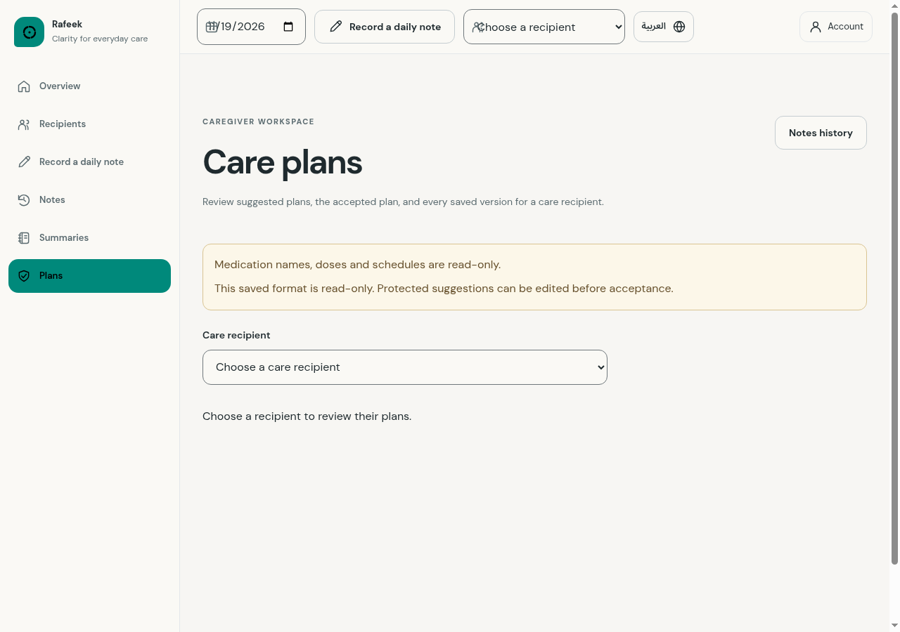

  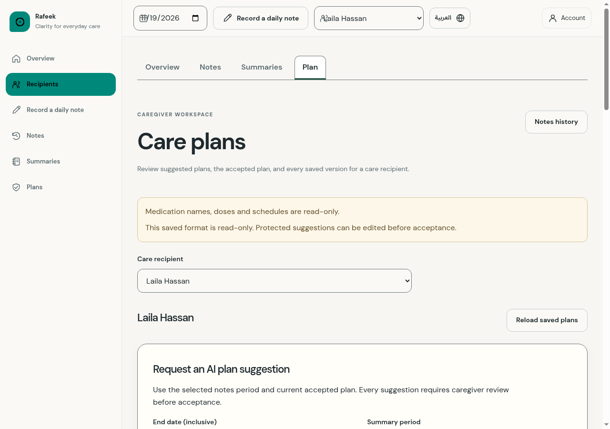

### قراراتك الثلاثة

| القرار | ماذا يحدث |
|---|---|
| **قبول الاقتراح** | بعد التأكيد يصبح الخطة المقبولة النشطة؛ وتُؤرشف أي خطة مقبولة نشطة سابقة. |
| **التعديل والقبول** | للاقتراحات المحمية: تعدّل قيم الإجراءات المسموح بها، وتراجع مقارنة قبل/بعد، ثم تؤكد. يحتفظ الخادم بالاقتراح الأصلي، وينشئ إصدارًا جديدًا *معدّلًا ومقبولًا*، ويؤرشف الخطة النشطة السابقة. |
| **استبعاد الاقتراح** | بعد التأكيد يُستبعد الاقتراح لكن يبقى إصداره المحفوظ في السجل. |

**ما يمكنك تعديله:** قيم الإجراءات المعروضة فقط — مثل *خلال عدد أيام*
(1–365)، والأوقات (نظام 24 ساعة HH:mm)، والنصوص القصيرة (≤500 حرف).
**ما لا يمكنك تعديله أبدًا:** أسماء الأدوية وجرعاتها ومواعيدها، وأنواع
الإجراءات، والأسباب، ومراجع الاستدلال والمصادر، وأرقام الإصدارات. يفرض الخادم
هذا القفل الصارم.

إجراءات الخطط من فهرس ثابت: **جدولة متابعة**، **تذكير بالوجبة**، **هدف
الحركة**، **موضوع توعية لمقدّم الرعاية**، **التواصل مع طبيب** — لكل منها
قيمه وسببه.

### الاقتراحات غير الصالحة والسجل

- الاقتراح المبني على خطة مقبولة سابقة يصبح **غير صالح** بمجرد أن تُقبل خطة أحدث؛
  لا يعود بالإمكان قبوله. أنشئ اقتراحًا جديدًا بدلًا منه.
- يعرض **سجل الخطط** كل الإصدارات المحفوظة، الأحدث أولًا: الإصدار، والحالة
  (*مقترح — غير مقبول*، *مقبول*، *معدّل ومقبول*، *مُستبعد*، *مؤرشف*)، وتاريخ
  الإنشاء، والمحتوى المحفوظ، و**مراجع المصادر** (الملخص المصدر، الخطة الأصلية
  المصدر، ملاحظات الاستدلال). المحتوى والمراجع للقراءة فقط؛ ويرتبط الإصدار
  المشتق بأصله لتتبع السلسلة.

### كتابة اقتراحك بنفسك (الويب)

**إنشاء مسودة منظمة** تتيح لك تأليف اقتراح من مقدّم الرعاية دون ذكاء اصطناعي:
أضف إجراءً أو أكثر من الفهرس، وأعطِ كل إجراء سببًا، وأرفق **ملاحظات
الاستدلال** — ملاحظة واحدة على الأقل من آخر 30 يومًا من السجل المحمّل لهذا
المستفيد. احفظها كمسودة مقترحة؛ وكأي اقتراح تبقى غير نشطة حتى تُقبل صراحةً.

## 13. إعداد الذكاء الاصطناعي (مفتاحك الخاص)

لا يأتي رفيق بحساب ذكاء اصطناعي جاهز. أنت تحضر المزود ومفتاح API الخاص بك
(**BYOK**)، فتتحكم في التكلفة واختيار النموذج وسياسة البيانات.

### ما الذي يُرسل إلى المزود

عند إنشاء ملخص، **يُرسل نص ملاحظات هذا المستفيد** إلى المزوّد الذي اخترته. لا
تُدرج حقول صلة القرابة وتفاصيل الرعاية. يجري الخادم استدعاء المزود — لا يستدعي
المتصفح النموذج مباشرة، ولا تُخزَّن بيانات الملاحظات أو الملخصات في تخزين
المتصفح.

### الويب: إعدادات الذكاء الاصطناعي

افتح **الإعدادات ← إعدادات الذكاء الاصطناعي** (حوار *إعدادات مزود الذكاء
الاصطناعي*):

1. **المزود** — OpenAI أو Gemini أو xAI أو OpenRouter.
2. **النموذج** — اختر من الفهرس المراجع، أو اختر **أخرى** واكتب معرّف نموذج
   (أحرف وأرقام و`. _ : / -`، حتى 128 حرفًا). أمثلة من الفهرس: نماذج Gemini
   Flash (تتوفر خطة مجانية حسب مفتاحك)، ونماذج OpenAI GPT (مدفوعة)، ونماذج
   Grok (مدفوعة)، ونماذج OpenRouter المجانية مثل NVIDIA Nemotron (مجانية،
   وتطبق سياسة بيانات المضيف).
3. **مفتاح API** — الصق مفتاحك.
4. اقرأ تنبيه المزود. مع **Gemini** و**نماذج OpenRouter المجانية** يجب أن
   تؤكد: *«أفهم أن مقدّم الخدمة قد يستخدم ملاحظات الرعاية لتحسين منتجاته.»*
   (Gemini: قد يُستخدم المحتوى المُرسل بمفتاح من الفئة المجانية لتحسين منتجات
   Google؛ مفتاح من مشروع مفعّل فيه الفوترة لا يُستخدم هكذا.)
5. **اختبار الاتصال.** تعديل الحقول لا يغيّر بيانات الاعتماد النشطة — لن
   تُفعّل بيانات الاعتماد الجديدة **إلا بعد نجاح الاختبار**. إذا فشل الاختبار
   يبقى المزود الذي تم التحقق منه سابقًا نشطًا.

**حفظ المفتاح في الويب:** يبقى مفتاحك **في ذاكرة علامة التبويب هذه فقط**.
ستحتاج إلى إدخاله مجددًا بعد إعادة التحميل أو إغلاق علامة التبويب. **إزالة
المفتاح** تعطّله فورًا.

### أندرويد: الإعدادات ← الذكاء الاصطناعي

  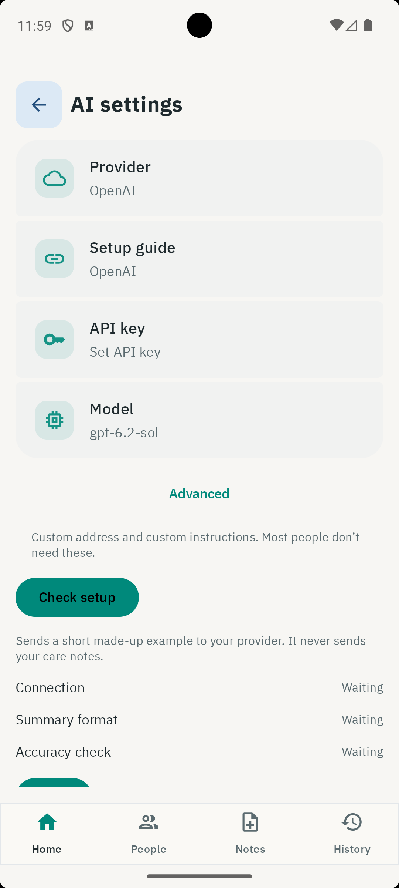

1. اختر **مزودًا** (OpenAI أو Anthropic أو Gemini أو xAI أو OpenRouter). يأخذك
   رابط **دليل الإعداد** إلى صفحة المفاتيح لدى المزود:
   - OpenAI: <https://platform.openai.com/api-keys>
   - Anthropic: <https://console.anthropic.com/settings/keys>
   - Gemini: <https://aistudio.google.com/app/apikey>
   - xAI: <https://console.x.ai>
   - OpenRouter: <https://openrouter.ai/keys>
2. **عيّن مفتاح API** واختر **النموذج**. تتيح *خيارات متقدمة* عنوانًا مخصصًا
   وتعليمات مخصصة — لا يحتاجها معظم الناس.
3. اضغط **فحص الإعداد**. تُجرى ثلاثة فحوص — **الاتصال**، **تنسيق الملخص**،
   **فحص الدقة** — باستخدام مثال قصير مُختلق. **لا يرسل الفحص ملاحظات الرعاية
   أبدًا.**
4. عند أول استخدام يشرح حوار الموافقة أن نص الملاحظات المستخدم في الملخص قد
   يُرسل إلى المزوّد المختار، وأن حقول صلة القرابة وتفاصيل الرعاية غير مشمولة.

**حفظ المفتاح في أندرويد:** تُخزَّن المفاتيح **مشفّرة في Android Keystore**،
في خانات منفصلة لكل حساب ومزود — تبديل المزود أو الحساب لا يعيد استخدام مفتاح
آخر. لاحظ أن قواعد بيانات التطبيق المحلية نفسها غير مشفّرة؛ فهي تعتمد على
ضوابط تخزين الجهاز في أندرويد.

## 14. أساسيات السلامة والخصوصية

- **ليست نصيحة طبية.** الملخصات والخطط معلومات لدعم الرعاية من مشروع تعليمي.
  قد تكون ناقصة أو غير صحيحة. قرارات الرعاية لك وللمختصين المؤهلين.
- **سلامة حتمية.** الإشارات من قواعد ثابتة في الخادم. مخرجات النموذج غير
  الصالحة لا تستطيع إزالة إشارة صحيحة؛ وطلبات الذكاء الاصطناعي الفاشلة تعيد
  معلومات السلامة رغم ذلك.
- **عدم اليقين محفوظ.** غير معروف وغير مسجّل وغير منطبق وغير متحقق حالات
  متمايزة ظاهرة — لا تُدمج في تخمينات أبدًا.
- **سجل يُضاف ولا يُستبدل.** الأصول لا تتغير؛ التصحيحات أحداث مؤرخة بأنواع
  محددة؛ والقيم الفعّالة تُعاد من السجل لا تُعدَّل.
- **قفل صارم للأدوية.** لا مخرجات ذكاء اصطناعي ولا تعديل خطة يستطيع إضافة اسم
  دواء أو جرعته أو جدوله أو حذفه أو تغييره.
- **مفتاحك ومزودك.** يعني BYOK أنك تختار من يعالج نص الملاحظات؛ ويعرض التطبيق
  سياسة بيانات كل مزود قبل التفعيل.
- **حالة طوارئ؟** اتصل بخدمات الطوارئ المحلية فورًا — لا تنتظر ملخصًا.

لبيان التعامل مع البيانات كاملًا انظر [وثيقة الخصوصية](../privacy/README.md).

## 15. حل المشكلات

| الرسالة / الموقف | المعنى | الإجراء |
|---|---|---|
| *رفض المزود هذا المفتاح* | المفتاح غير صالح أو ملغى | افتح إعدادات الذكاء الاصطناعي وتحقق من المفتاح ثم اختبر مجددًا |
| *لم يتعرف المزود على هذا النموذج* | معرّف نموذج خاطئ أو متقاعد | اختر نموذجًا آخر من الفهرس |
| *يحد المزود من الطلبات* | طلبات كثيرة على مفتاحك | انتظر دقيقة أو اختر نموذجًا آخر |
| *استغرق المزود وقتًا طويلًا للإجابة* | انتهت مهلة المزود | أعد المحاولة؛ تبقى النتائج والتحذيرات السابقة ظاهرة |
| *افتح إعدادات الذكاء الاصطناعي واضبط مفتاحًا* | لا توجد بيانات اعتماد نشطة | أكمل القسم 13 أولًا |
| *يتعارض هذا الحفظ مع سجل موجود* | توجد ملاحظة بالفعل لهذا المستفيد والتاريخ | افتح الملاحظة المحفوظة وراجعها قبل الإرسال مجددًا |
| *تعذّر التأكد من اكتمال الحفظ* | عدم يقين شبكي أثناء الحفظ | أبقِ الصفحة مفتوحة واستخدم **إعادة محاولة الحفظ نفسه**؛ القيم مقفلة لمنع التكرار |
| *انتهت صلاحية جلستك* | جلسة علامة التبويب لم تعد صالحة | سجّل الدخول مجددًا |
| *هذا المستفيد مؤرشف / غير نشط* | حالة قراءة فقط | راجع السجل بحرية؛ استعد المستفيد لتسجيل رعاية جديدة |
| *تتعارض سجلات الدواء* | حالة الملاحظة لا تطابق أحداث التناول | راجع السجلين؛ التنبيه لا يغيّر أيًّا منهما |
| *اقتراح لم يعد صالحًا* | مبني على خطة مقبولة سابقة | أنشئ اقتراحًا جديدًا |
| *الإجراءات متوقفة حتى تحميل أحدث الخطط* | ربما تغيّرت حالة الخادم بعد قرار | **أعد تحميل الخطط المحفوظة** ثم قرر |
| *تعذّر التحقق من بعض معلومات الملخص* | أزال الخادم محتوى نموذجيًا غير قابل للتحقق | اقرأ ما تبقى؛ تحذيرات السلامة غير متأثرة |

## 16. مسرد المصطلحات (عربي ↔ إنجليزي)

| العربية | English |
|---|---|
| المستفيد من الرعاية | Care recipient |
| الملاحظة اليومية | Daily note |
| الملاحظة الأصلية (للقراءة فقط) | Original note (read-only) |
| إضافة لاحقة | Addendum |
| تصحيح منظّم | Structured correction |
| حالة الملاحظة | Observation status |
| مسجّل / غير معروف / غير مسجّل / غير منطبق | Recorded / Unknown / Not recorded / Not applicable |
| التحقق: تم التحقق / لم يُتحقق / لم يُصرَّح | Verification: Verified / Unverified / Not asserted |
| حدث تناول (تم التناول / لم يتم التناول / غير متأكد) | Intake event (Taken / Missed / Unsure) |
| سجل الملاحظات | Notes history |
| ملخص الذكاء الاصطناعي والسلامة | AI summary & safety |
| إشارة سلامة | Safety signal |
| اقتباس داعم / الملاحظة المصدر | Supporting quote / Source note |
| خطة الرعاية | Care plan |
| مقترح / مقبول / معدّل ومقبول / مُستبعد / مؤرشف | Suggested / Accepted / Edited and accepted / Dismissed / Archived |
| قبول الاقتراح / التعديل والقبول / استبعاد الاقتراح | Accept suggestion / Edit and accept / Dismiss suggestion |
| إعدادات مزود الذكاء الاصطناعي | AI provider settings |
| مفتاح API / اختبار الاتصال | API key / Test connection |
| نظرة عامة / المستفيدون / الملاحظات / الملخصات / الخطط | Overview / Recipients / Notes / Summaries / Plans |
| الإعدادات | Settings |

## 17. وثائق ذات صلة

- [README المشروع](../../README.md) — نظرة عامة والتقنيات ومعرض اللقطات
- [بيان الخصوصية](../privacy/README.md)
- [عقد واجهة الملاحظات اليومية](../api/daily-notes.md) · [واجهة المستفيدين](../api/recipients.md)
- [استراتيجية الاختبار](../testing/README.md) — الجرد والتغطية وسجل العيوب
- [منظومة تقييم الذكاء الاصطناعي](../ai/eval-harness.md)
- [دليل نمط التصميم](../design-system/DESIGN-STYLE.md)
- [README أندرويد](../../android/README.md) — البناء والوضع المستقل والعرض التجريبي

---

*رفيق · مشروع DEPI التخرجي 2026 · بيانات اصطناعية فقط · معلومات لدعم الرعاية،
وليست نصيحة طبية.*

