# Rafeek — Caregiver User Guide (English)

**رفيق — دليل مقدّم الرعاية** · [النسخة العربية](caregiver-guide.ar.md) · [Guide index](README.md)

Rafeek (رفيق, "companion") keeps everyday care observations together: you record
what you notice, revisit it later, and — when you choose — ask AI for a summary
and a suggested care plan. This guide walks through every workflow on both the
**web app** and the **Android app**, using screenshots captured from the running
apps with synthetic demo data (the people shown, such as Laila Hassan and John
Carter, are not real).

> **Care-support information only. Not medical advice.** Rafeek is an educational
> capstone project (DEPI 2026, Software Testing track). It is not a diagnostic or
> medical-monitoring system. If you suspect a medical emergency, contact your
> local emergency services immediately.

---

## Contents

1. [What Rafeek does](#1-what-rafeek-does)
2. [The two apps at a glance](#2-the-two-apps-at-a-glance)
3. [Getting started](#3-getting-started)
4. [Home and navigation](#4-home-and-navigation)
5. [Care recipients](#5-care-recipients)
6. [Medications](#6-medications)
7. [Recording a daily note](#7-recording-a-daily-note)
8. [Reading a saved note](#8-reading-a-saved-note)
9. [Correcting a note](#9-correcting-a-note)
10. [Notes history](#10-notes-history)
11. [AI summaries](#11-ai-summaries)
12. [Care plans](#12-care-plans)
13. [Setting up AI (bring your own key)](#13-setting-up-ai-bring-your-own-key)
14. [Safety and privacy essentials](#14-safety-and-privacy-essentials)
15. [Troubleshooting](#15-troubleshooting)
16. [Glossary (English ↔ Arabic)](#16-glossary-english--arabic)
17. [Related documentation](#17-related-documentation)

---

## 1. What Rafeek does

The core loop is four steps:

1. **Add care recipients** — the people you care for.
2. **Record daily notes** — structured observations plus free text, in Arabic,
   English, or a mix of both.
3. **Request an AI summary** — an evidence-backed overview of the last 7, 14 or
   30 days, with safety information evaluated separately.
4. **Review a suggested care plan** — accept it, edit it, or dismiss it. Nothing
   is applied without your explicit decision.

Two ideas shape everything in the app:

- **The record is trustworthy.** Original notes are never edited or erased.
  Corrections are added as separate, dated records, and the app can always show
  you what was originally written and what changed afterwards.
- **The model never holds the pen on safety.** Safety flags are computed by
  fixed rules in the backend, independent of any AI model. The model can raise
  urgency, but it can never lower or remove a safety flag, and it can never add,
  remove or alter medications.

## 2. The two apps at a glance

| | Web app | Android app |
|---|---|---|
| What it is | Connected caregiver workspace | Standalone, local-first app |
| Account | Caregiver account on the server; sign-in is limited to the browser tab | Local accounts stored on the device; no backend required |
| Data | Server database (PostgreSQL) | Per-account database on the device |
| AI providers | OpenAI, Gemini, xAI, OpenRouter | OpenAI, Anthropic, Gemini, xAI, OpenRouter |
| API key storage | Kept only in the browser tab's memory; re-enter after reload | Encrypted in the Android Keystore, per account and provider |
| Corrections | Text addenda **and** structured per-field correction events | Text addenda ("The original note is not edited") |
| Medication tracking | Medication records + typed intake events on the recipient page | Medication list + quick dose checks on Home |
| Language | Arabic / English, full RTL/LTR | Arabic / English, full RTL/LTR |

Both apps share the same domain rules: one original note per recipient and date,
append-only corrections, distinct uncertainty states, and read-only medication
data inside plans.

## 3. Getting started

### Web app

1. Open the app and choose **Create an account** (or **Sign in** if you already
   have one).
2. Sign up with your **email address** and a **password** of at least 8
   characters (at most 72 UTF-8 bytes), then confirm the password.
3. After signing in you land on the **Overview**. For your privacy, the session
   is limited to the current browser tab — opening a new tab means signing in
   again.

  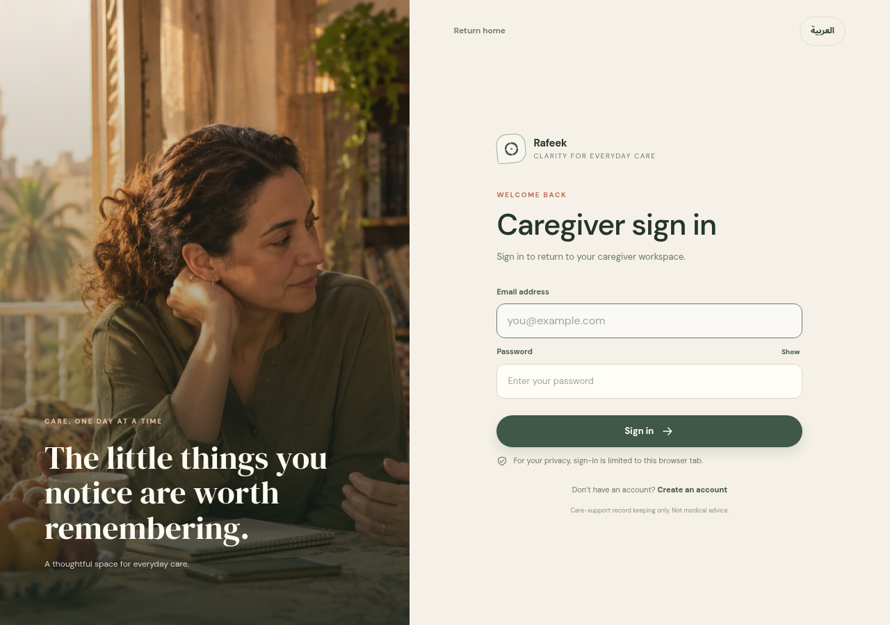

  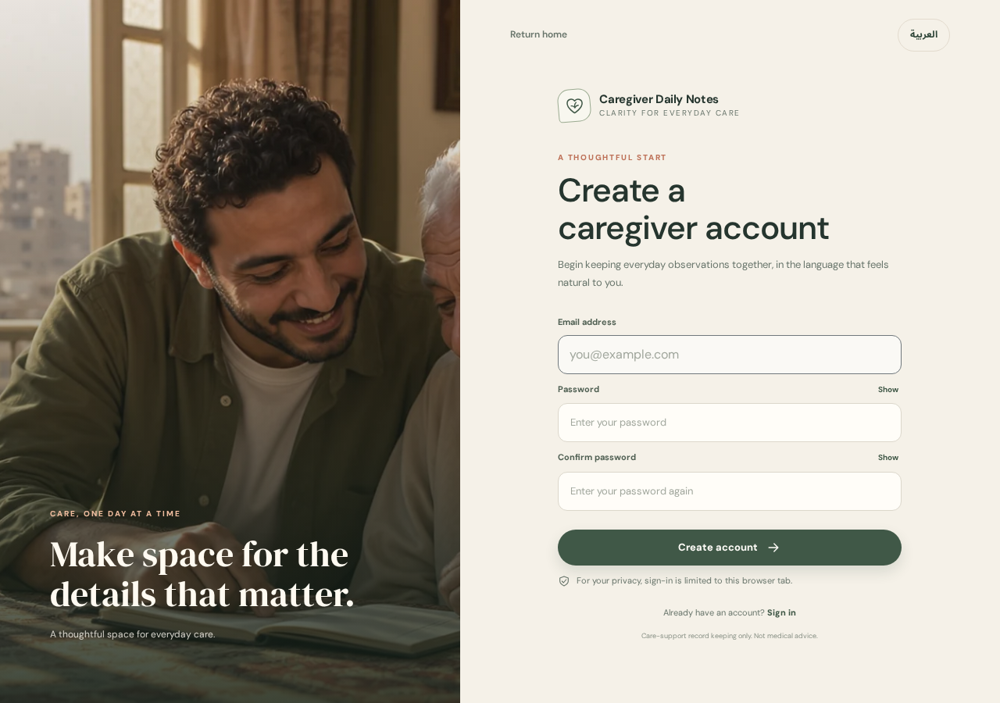

### Android app

1. Install the latest `app-release.apk` from the project's GitHub Releases page
   (allow installing from unknown sources when prompted).
2. On first launch, create a **local account** on the device. The release app
   works fully offline — no server is involved. Each account gets its own
   private database; the active account cannot be removed, and removing another
   account deletes that account's data after confirmation.
3. AI features (summaries and plan suggestions) need your own API key — see
   [section 13](#13-setting-up-ai-bring-your-own-key).

**Offline demo:** on the login screen, long-press the logo to reveal
**"Explore the demo (offline)"**. The demo uses illustrative synthetic data and
no network. The Android screenshots in this guide were captured from this demo.

## 4. Home and navigation

### Web workspace

The sidebar gives you **Overview**, **Recipients**, **Record a daily note**,
**Notes** (history), **Summaries** and **Plans**. The top bar holds the selected
date, a recipient selector, the language switch (**العربية** / **English**) and
the **Account** menu (sign out).

The **Overview** is a factual view of note availability for the selected date:

- **Selected date summary** — recipients shown, notes recorded, not yet
  recorded, and notes this month.
- **Today by recipient** — each person's status (*Note recorded* / *No note
  recorded*) with a direct action to open or record the note.
- **Recent activity** — the latest notes, corrections and addenda.

> A missing note means no note was found for that date. **It is not a negative
> observation.** The overview never infers how someone is doing from silence.

  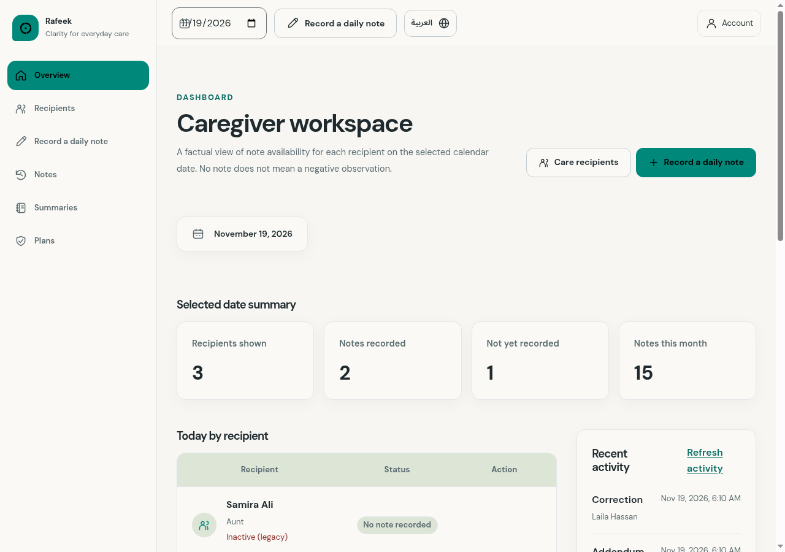

**Appearance:** Settings → Interface → **Theme and Colors** lets you choose
System, Light or Dark, with a live preview.

  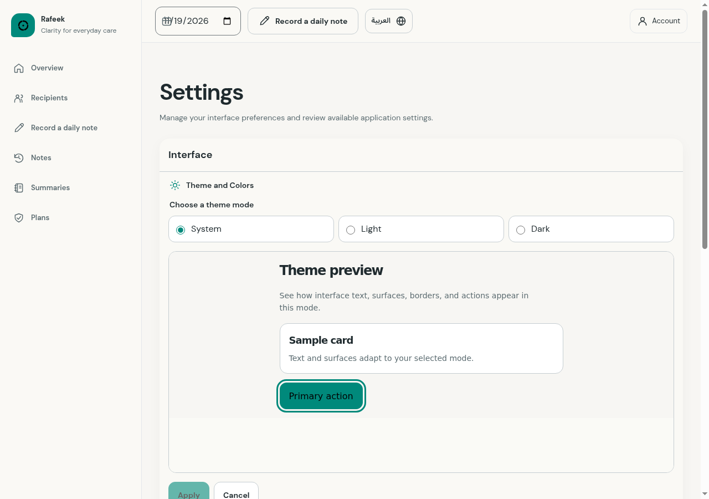

### Android app

Bottom navigation: **Home**, **People**, **Notes**, **History**. Home has three
tabs — **Today**, **Needs attention**, **All** — plus:

- a **Care alert** banner when a safety-relevant event (for example a reported
  fall) needs your attention,
- a **Today's notes** card with a **Write a note** shortcut,
- a **Medications** card with quick dose checks (section 6),
- your people list with each person's last-note status.

  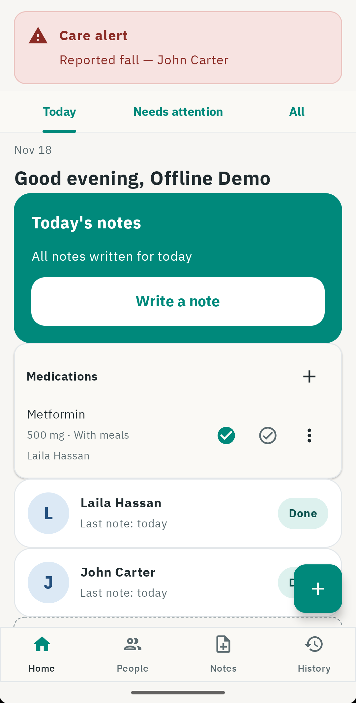
  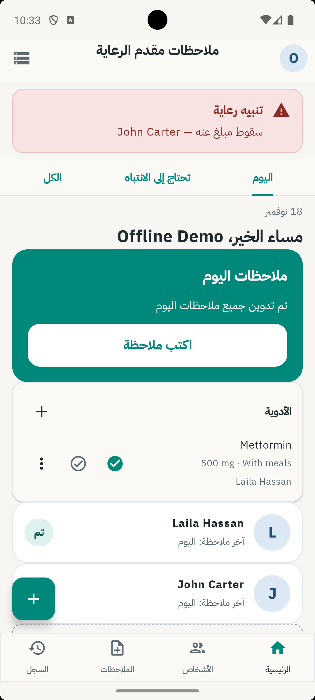

### Switching language

Both apps are Arabic-first with full English support. Use the language button
in the top bar (web) or settings (Android). Layouts flip fully between RTL and
LTR, and mixed Arabic/English text keeps its natural direction everywhere.

## 5. Care recipients

### Adding a recipient (web)

**Recipients → Add care recipient.** Start with a **name** (required, up to 120
characters). Optionally add your **relationship** — Mother, Father, Spouse,
Grandmother, Grandfather, Child, Sibling, Relative, Friend, Client, or Other
with a short description (up to 80 characters).

If a recipient with the same name already exists, Rafeek warns you and offers
**Open existing** or **Create anyway** — duplicates are allowed but discouraged,
because they make records hard to tell apart.

  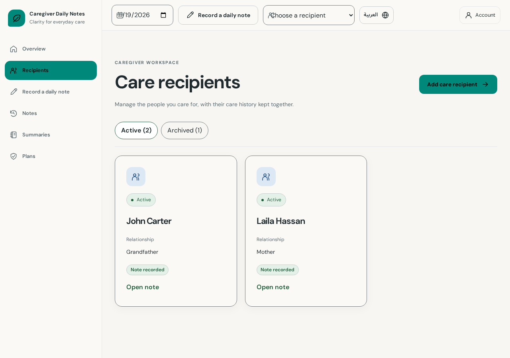

  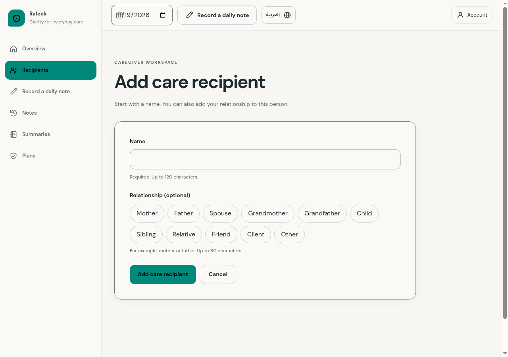

### The recipient page

Each recipient has four tabs: **Overview**, **Notes**, **Summaries**, **Plan**.
The Overview shows their status, today's note state (*Open today's note* /
*Record today's note*), relationship, added/updated dates, and **Care details**.

  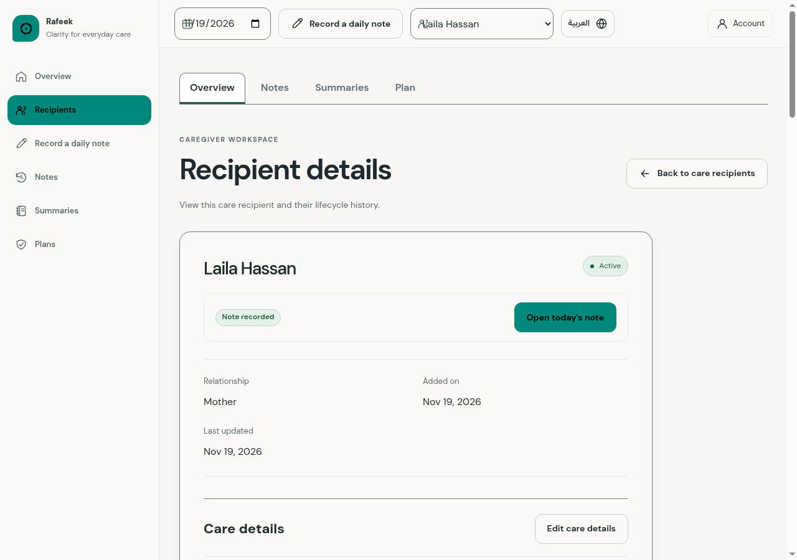

**Care details** (optional, and visible only to you): date of birth, allergies,
conditions, emergency contact name and phone. On Android, the same fields live
in the care-details form on the person's page.

  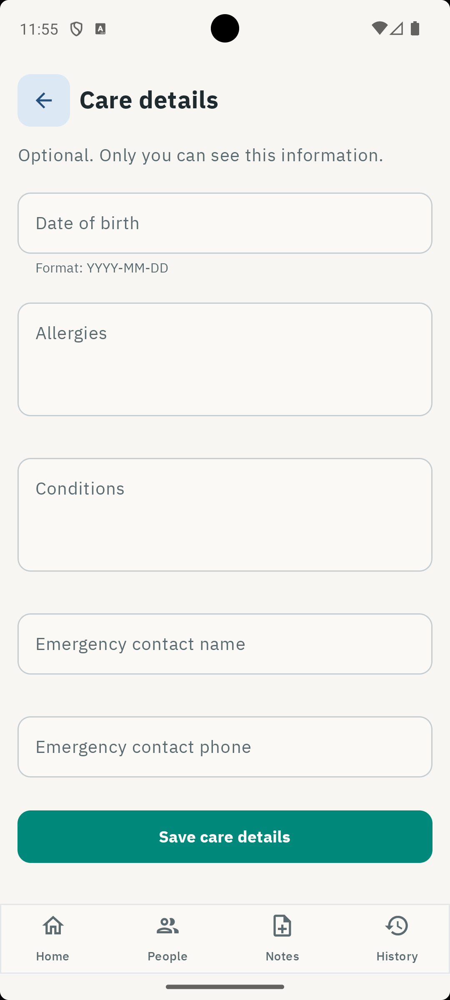
  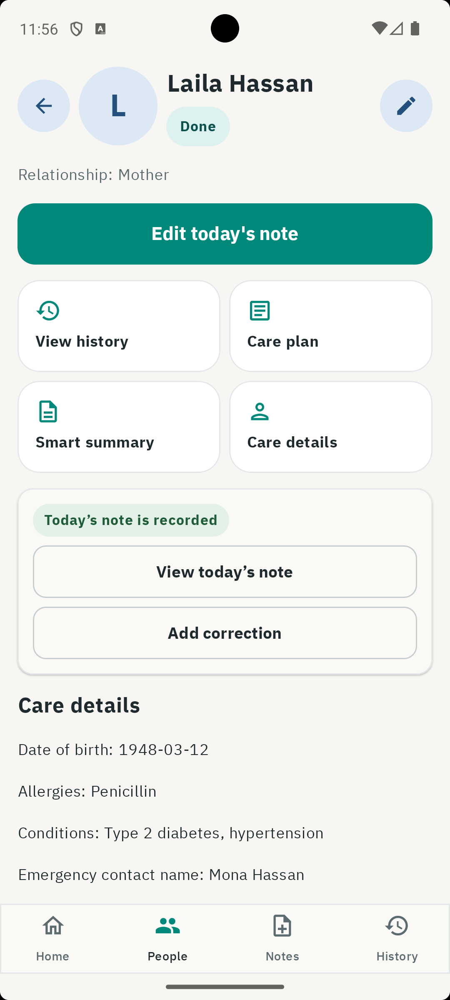

### Archiving and restoring

- **Archive recipient** moves someone out of active care workflows. Their
  notes, corrections, plans and history are **preserved**, and the recipient
  becomes read-only. Archiving is reversible — it is not deletion.
- **Restore recipient** returns them to active care; existing history stays
  unchanged.
- **Needs review** marks legacy inactive records whose historical meaning was
  never established. They stay read-only until you resolve them as archived or
  active.

Archived recipients can still be reviewed everywhere (history, summaries,
plans), but no new notes or decisions can be recorded for them until restored.

## 6. Medications

Medication records are descriptions you keep for reference — **Rafeek never
prescribes, changes or verifies a medication itself**, and medication data is
read-only inside AI plans.

### Web: medication records and intake events

On the recipient page, the **Medications** section lists each medication's
**name**, **dose** and **schedule**. An empty list does not mean no medication
is used — it only means nothing has been added.

- **Add medication** — name (required, ≤160 characters), dose description and
  schedule description (required, ≤500 characters each).
- **Edit** updates a record; **Archive** retires it while preserving its history.
- **Record intake event** — for each medication you can log what actually
  happened: **Taken / Missed / Unsure**, a **verification state** (Verified /
  Unverified / Not asserted), and the **time taken** (not in the future, not
  more than a year ago). The **Intake history** lists these events, newest
  activity loadable on demand.

### Android: medications and quick dose checks

On Home, the **Medications** card lists each medication (name, dose, when,
doses per day, assigned person). The two check controls next to a medication
record a dose as **taken** or **not taken** for the day; the overflow menu
offers edit and delete. **+** opens the add-medication dialog:

  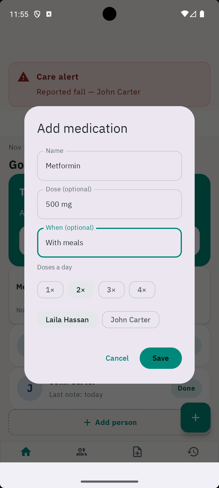

### When reports disagree

If the medication status on a daily note and the intake events recorded for the
same day do not match, Rafeek shows a **conflict warning** on the note. The
warning asks you to review both records — **it does not change either one**.
Nothing is inferred or silently reconciled.

## 7. Recording a daily note

Open **Record a daily note** (web top bar or sidebar; Android **Write a note**).

**The rules:**

- Choose an **active** care recipient and an **observation date**. One original
  note is allowed per recipient and date; the date cannot be in the future.
- Optional fields start as **Not recorded**. Record only what was reported —
  without interpreting it.
- Short text fields allow up to 40 characters; the free-text field allows up to
  20,000 characters. Arabic, English, line breaks and mixed text are saved
  exactly as entered.

  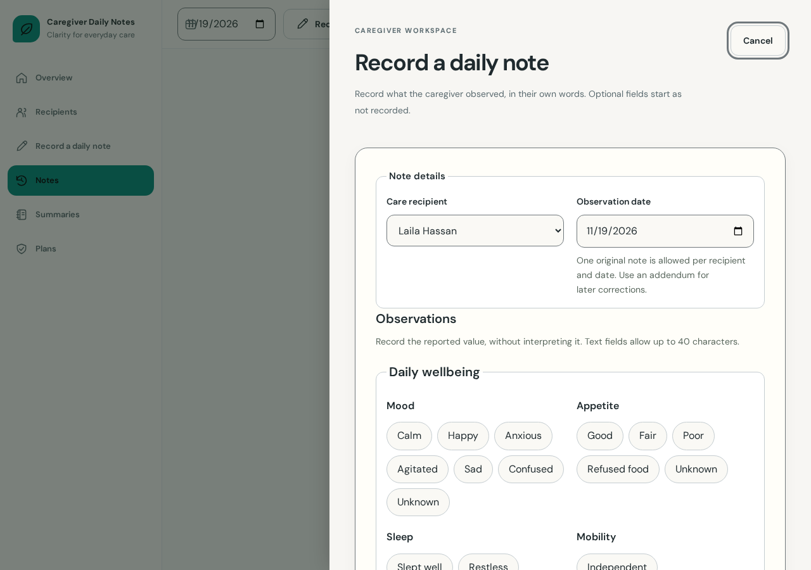

### The fields

| Group | Field | Options |
|---|---|---|
| Daily wellbeing | **Mood** | Calm · Happy · Anxious · Agitated · Sad · Confused |
| | **Appetite** | Good · Fair · Poor · Refused food |
| | **Sleep** | Slept well · Restless · Poor sleep · Did not sleep |
| | **Mobility** | Independent · Needs assistance · Bedridden |
| Medication | **Medication taken** | Taken · Missed · Unknown / unsure |
| | **Medication report verified** | Independent verification flag |
| Pain and safety | **Pain score (0–10)** | Whole number 0–10, or leave blank |
| | **Fall reported** | Yes · No |
| Additional notes | **Free-text observations** | Up to 20,000 characters, any language mix |

On Android the same note is captured with compact controls: **Medication**
(All taken / Something missed / Not sure), **Did a fall happen?** (Yes / No),
a **Pain** scale (0 = no pain · 10 = worst pain), and **Anything else?** free
text. Saving a note never uses AI.

  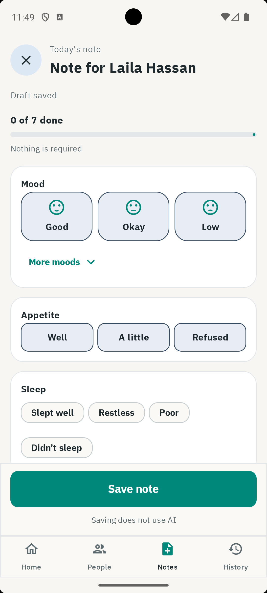
  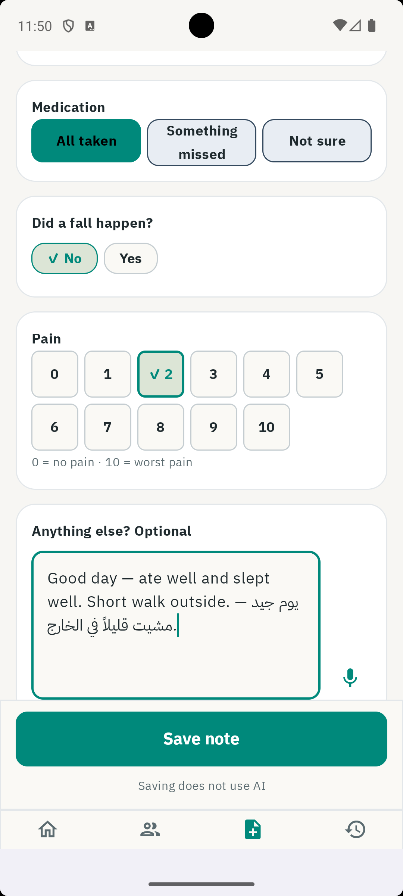

### Observation status: uncertainty is a first-class value

Every observation carries an explicit status, and the app never collapses one
into another:

| Status | Meaning |
|---|---|
| **Recorded** | A concrete value was captured. |
| **Unknown** | The caregiver reported the value is unknown or unsure. |
| **Not recorded** | The observation was intentionally left unrecorded. |
| **Not applicable** | The observation does not apply in this situation. |

Historical imports may also show **Legacy (ambiguous)** — data whose exact
meaning was never established. It is visibly uncertain and must not be treated
as a confirmed fact.

**Verification is independent of recording.** A value can be Recorded yet
Unverified; recording something does not mean it was clinically verified.
Medication reports follow the same rule: *Unknown*, *Not recorded* and *Not
verified* are distinct values, and nothing is inferred.

### Saving, and the safe retry

Choose **Save original note**. If the connection drops mid-save and the app
cannot confirm the result, it keeps your entered values locked and offers
**Retry the same save** — retrying is safe and will not create a duplicate.
Leaving the page loses that safe retry, so review the saved record before
submitting again.

## 8. Reading a saved note

A saved note opens as **Daily note details**:

- **Locked — original note, read-only.** The original observations and text,
  exactly as saved, with recipient, observation date, save time and source ID.
  Saved observations cannot be edited.
- **Correction timeline.** Every later change, in order: structured correction
  events and addenda, each with its own timestamp and source ID. The note's
  **current effective values** reflect the full history.
- **Safety information** relevant to the note (for example a reported fall)
  stays visible alongside the record.

  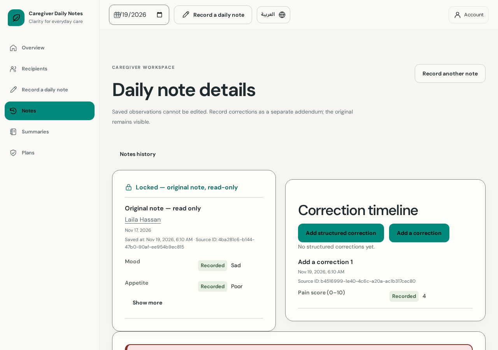

  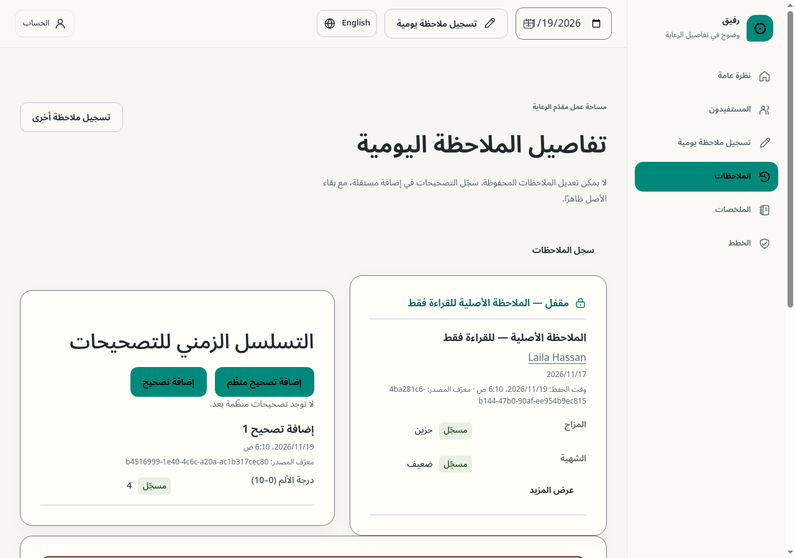

## 9. Correcting a note

Corrections never overwrite or erase the original. There are two mechanisms on
the web, and one on Android.

### Addendum (web and Android)

From the note, choose **Add a correction**. Select **only the fields you are
correcting** and enter their replacement values; every other field stays
unchanged. The form shows the locked original beside your edits, and states it
plainly: *"Corrections are separate records. This form does not overwrite or
erase the original note."* Save with **Save addendum**.

On Android, **Add correction** opens a text addendum: *"The original note is not
edited. You can add new information or an important correction as an addendum."*
Write the correction text and **Save correction**.

  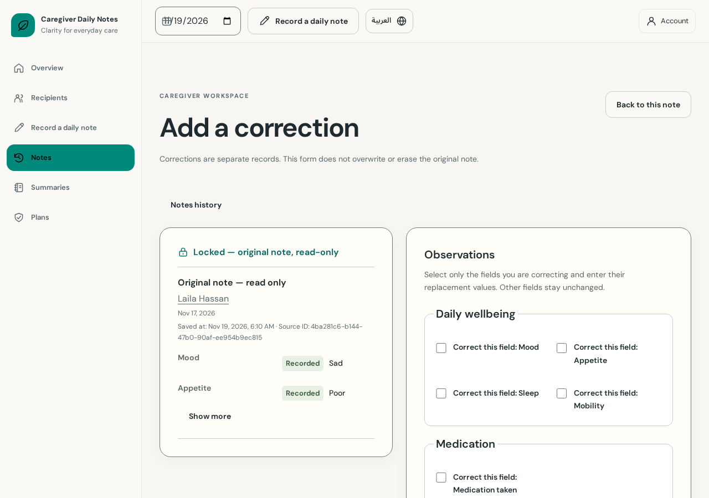

  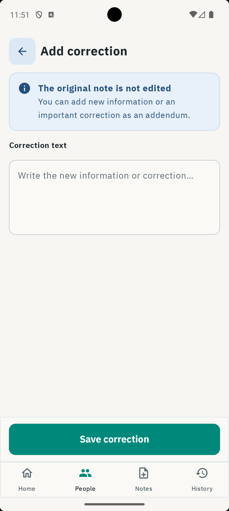
  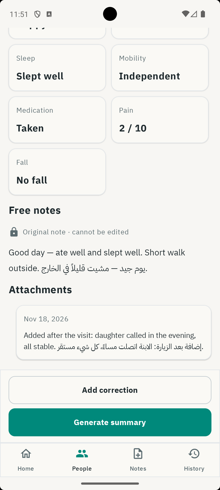

### Structured corrections (web)

For precise, field-level changes, choose **Add structured correction**. For each
field you select one operation:

| Operation | Effect |
|---|---|
| **Set a value** | Replace the field's effective value with a new one. |
| **Clear recorded value** | Remove the recorded value. |
| **Mark as unknown** | The value is now explicitly unknown. |
| **Mark as not recorded** | The field is now explicitly unrecorded. |

Each choice is saved as a **separate immutable event**. The correction history
shows, per event, the previous effective value, the new effective value, who
recorded it and when. The current effective value is always replayed
deterministically from the original plus every event — nothing is guessed.

### Why it works this way

Anyone reviewing the record later — a family member, a nurse, a doctor — can see
what was originally observed, what was corrected, and when. Trust in the history
is the point; a silent edit would destroy it.

## 10. Notes history

**Notes** in the sidebar opens **Notes history**: original observations and
their corrections, newest observation date first.

- The default view covers the **last 30 days, including today**.
- Filter by **all recipients or one recipient** (inactive recipients included),
  and by **single date** or an **inclusive date range**. **Apply filters**
  commits; **Reset filters** restores the defaults.
- Page sizes are 20, 50 or 100 notes; filters and page live in the URL, so
  reloading or the browser Back button restores the same view.
- Each row expands to the original observations and verbatim text, links to the
  full note, and can **Show corrections** — the changed fields only, in
  chronological order, never replacing the original.

  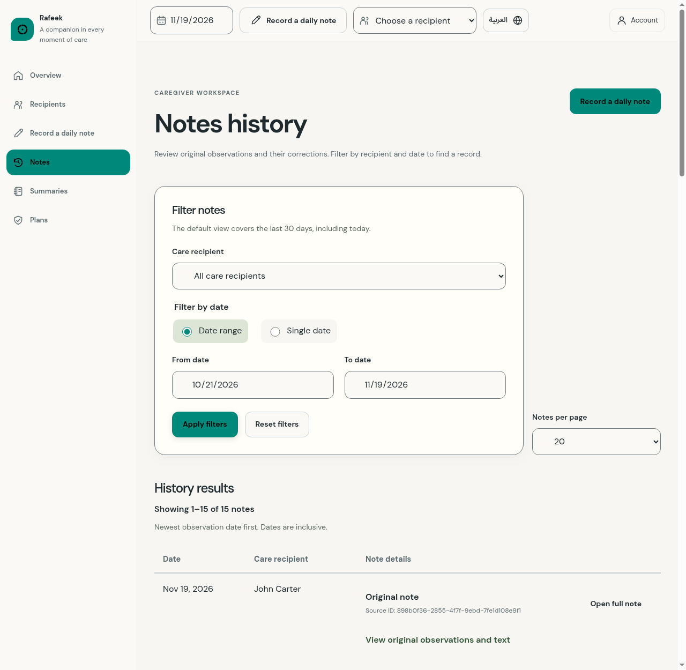

  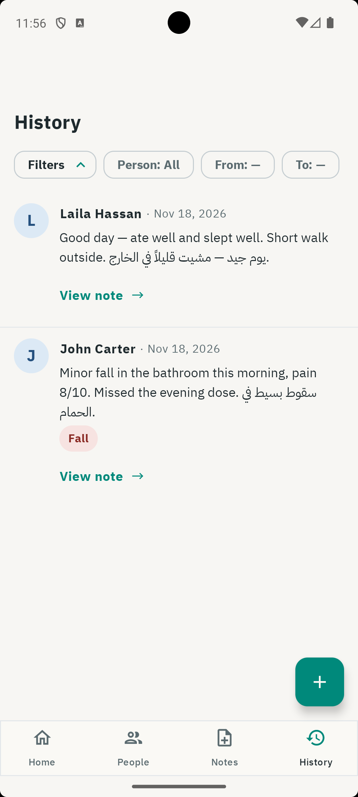
  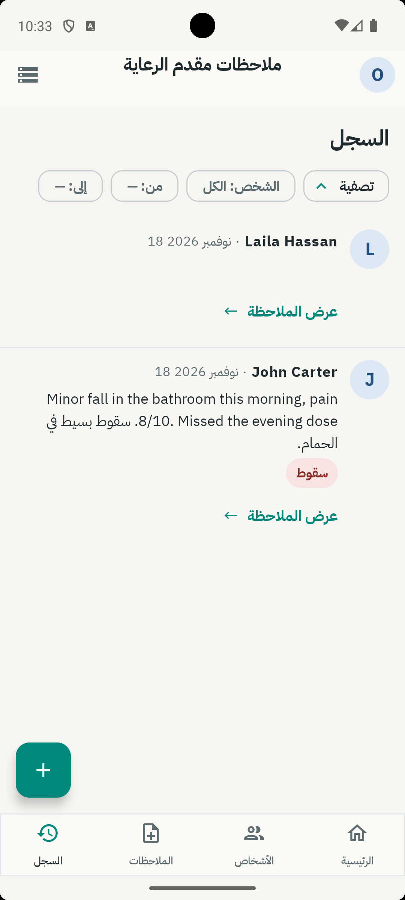

## 11. AI summaries

**Summaries** opens **AI summary & safety**. Nothing is generated automatically:
you choose a recipient and a period, then request a summary. AI requires your
own provider key — set it up first ([section 13](#13-setting-up-ai-bring-your-own-key)).

### Requesting a summary

1. Choose the **care recipient**.
2. Choose the **summary period**: **7, 14 or 30 days**.
3. Set the **end date (inclusive)** — the period ends on that date.
4. Choose **Generate summary**. The previous result stays visible while the new
   request runs, and each result keeps its own recipient and dates.

  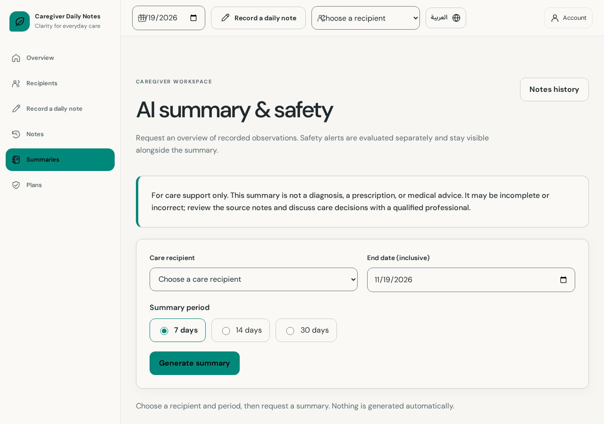

  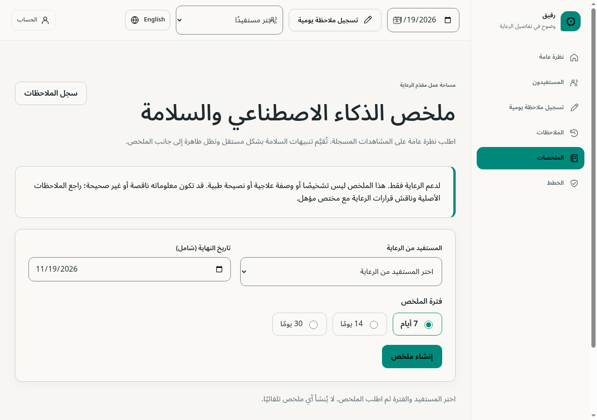

### Safety information comes first — and comes from rules, not the model

Safety signals are evaluated by **deterministic backend rules, independently of
the AI-generated narrative**. They render before the model content and cannot be
dismissed by it:

| Signal | What it means |
|---|---|
| **Fall detected** | A fall was reported in the selected period. |
| **High pain recorded** | A high pain score was recorded in the period. |
| **Repeated missed medication** | Medication was missed on multiple days. |
| **Poor appetite on several days** | Poor appetite was recorded on multiple days. |
| **Medication status unclear** | Medication status is unclear or unverified in the period. |
| **Concern in note text** | Note text mentions a possible concern that needs review. |
| **Confused mood recorded** | A confused mood was recorded in the period. |

You can **Mark as reviewed** to acknowledge a signal; it stays visible. Two
warnings deserve emphasis:

- **"No safety flags" is not an all-clear.** It does not establish that care is
  safe or that information is complete.
- If complete safety information could not be verified, the app says so —
  missing information is never treated as safety.

> If you suspect a medical emergency, contact your local emergency services
> immediately.

### What the summary contains

- **Summary observations** — model-generated text, clearly labeled as such, with
  a **supporting quote** and a **source note** link for each claim. Quotes are
  checked against the source note; the claim itself is not independently
  verified. Only real note references become links — nothing is fabricated.
- **Unclear or conflicting information** — uncertainty is surfaced as its own
  section, not hidden. "No uncertainty items" does not confirm certainty.
- **Recorded observation counts** — simple counts (falls, high pain, missed
  medication days, poor appetite days) compared with the previous period, with
  exact values and sample sizes. These are recorded counts, not clinical trend
  calculations.
- **Coverage** — how many days in the period actually have notes. An empty
  period says so plainly instead of inventing content.

The server validates model output: observations that cannot be verified against
the notes are removed, items containing medical advice are removed, and you are
told how many. If the provider fails, the safety information and recorded counts
remain — the AI part degrades, the safety part does not.

> **Disclaimer shown with every summary:** for care support only; not a
> diagnosis, a prescription, or medical advice; it may be incomplete or
> incorrect. Review the source notes and discuss care decisions with a qualified
> professional.

## 12. Care plans

**Plans** opens **Care plans** for a recipient: the active accepted plan,
suggestions awaiting review, and every saved version.

> Suggestions are **not active until a caregiver accepts them**. Medication
> names, doses and schedules are read-only everywhere in plans.

### Requesting a suggestion

**Request an AI plan suggestion** uses the selected notes period (7/14/30 days)
and the current accepted plan. The suggestion is built from the summary, the
deterministic safety flags and the last accepted plan — medication intake events
are deliberately **not** an input, so a plan never asserts or reconciles a dose
from them. A generated suggestion is saved for your review; it is never accepted
automatically.

  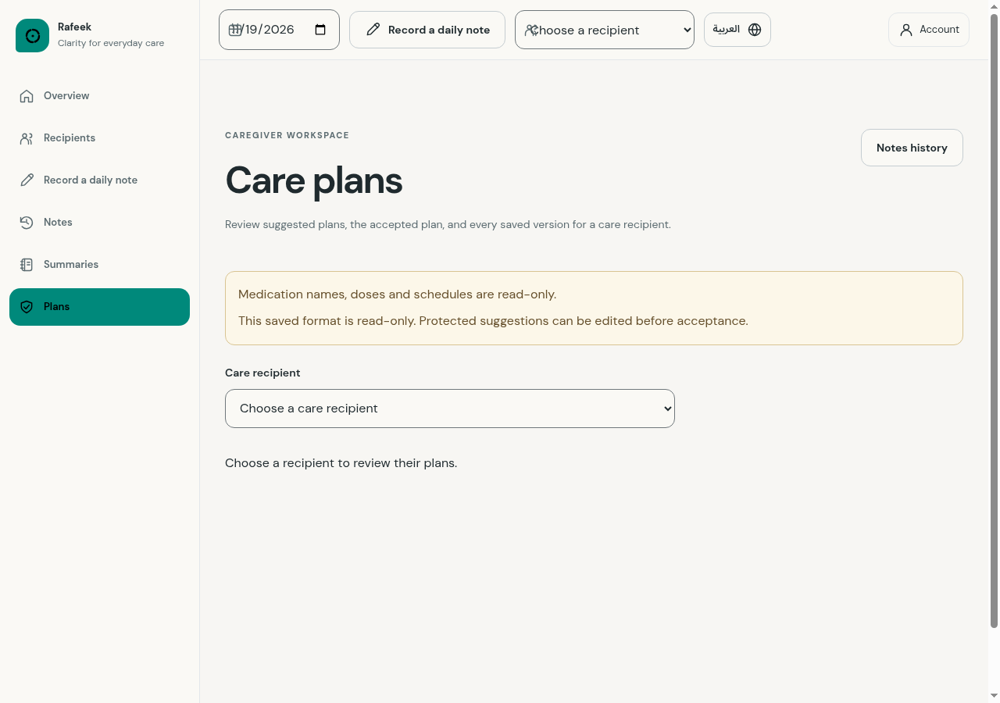

  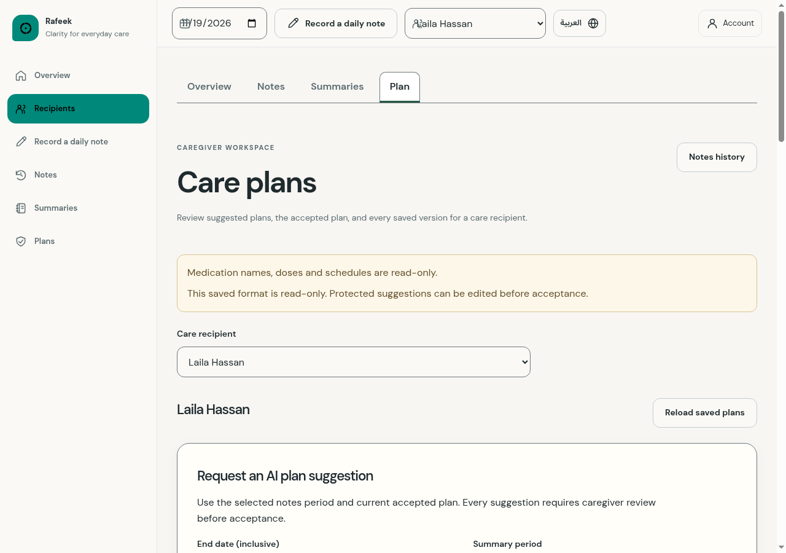

### Your three decisions

| Decision | What happens |
|---|---|
| **Accept suggestion** | After confirmation, it becomes the active accepted plan; any previously active plan is archived. |
| **Edit and accept** | For protected suggestions: edit the allowed action parameters, review a before/after comparison, then confirm. The server keeps the original suggestion, creates a new *edited and accepted* version, and archives the previous active plan. |
| **Dismiss suggestion** | After confirmation, the suggestion is dismissed but its saved version stays in history. |

**What you can edit:** only displayed action parameters — for example *within
days* (1–365), times (24-hour HH:mm), and short text (≤500 characters).
**What you can never edit:** medication names/doses/schedules, action types,
reasons, evidence, source references and version numbers. The server enforces
this hard lock.

Plan actions come from a fixed catalog: **Schedule check-in**, **Meal
reminder**, **Mobility goal**, **Caregiver education topic**, **Contact a
doctor** — each with its parameters and a reason.

### Outdated suggestions and history

- A suggestion built on an earlier accepted plan becomes **Outdated** once a
  newer plan is accepted; it can no longer be accepted. Generate a new
  suggestion instead.
- **Plan history** lists all saved versions, newest first: version, status
  (*Suggested — not accepted*, *Accepted*, *Edited and accepted*, *Dismissed*,
  *Archived*), creation date, saved content, and **source references** (source
  summary, original source plan, evidence notes). Content and references are
  read-only; a derived version links back to its parent so you can follow the
  chain.

### Writing your own suggestion (web)

**Create a structured draft** lets you compose a caregiver suggestion without
AI: add one or more actions from the catalog, give each a reason, and attach
**evidence notes** — at least one note from the recipient's most recent 30 days
of loaded history. Save it as a suggested draft; like any suggestion, it stays
inactive until explicitly accepted.

## 13. Setting up AI (bring your own key)

Rafeek does not ship with an AI account. You bring your own provider and API
key (**BYOK**), so you control cost, model choice and data policy.

### What is sent to the provider

When you generate a summary, **the note text for that care recipient** is sent
to the provider you chose. Relationship and care-detail fields are not included.
The backend makes the provider call — the browser never calls the model
directly, and no note or summary data is stored in browser storage.

### Web: AI Settings

Open **Settings → AI Settings** (the *AI provider settings* dialog):

1. **Provider** — OpenAI, Gemini, xAI or OpenRouter.
2. **Model** — pick from the reviewed catalog, or choose **Other** and type a
   model ID (letters, numbers and `. _ : / -`, up to 128 characters). Examples
   from the catalog: Gemini Flash models (free tier available, depending on your
   key), OpenAI GPT models (paid), Grok models (paid), and OpenRouter free
   models such as NVIDIA Nemotron (free, host data policy applies).
3. **API key** — paste your key.
4. Read the provider notice. For **Gemini** and **OpenRouter free models** you
   must confirm: *"I understand that my care notes may be used by the provider
   to improve its products."* (Gemini: content sent with a free-tier key may be
   used to improve Google's products; a key from a billing-enabled project is
   not used this way.)
5. **Test connection.** Editing the fields does not change active credentials —
   new credentials become active **only after a successful test**. If a test
   fails, your previously verified provider remains active.

**Key handling on the web:** your key is kept **only in this browser tab's
memory**. You will need to enter it again after reloading or closing the tab.
**Remove key** deactivates it immediately.

### Android: Settings → AI

  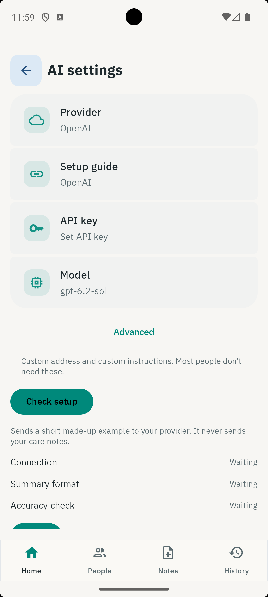

1. Pick a **provider** (OpenAI, Anthropic, Gemini, xAI or OpenRouter). The
   **Setup guide** link takes you to the provider's key page:
   - OpenAI: <https://platform.openai.com/api-keys>
   - Anthropic: <https://console.anthropic.com/settings/keys>
   - Gemini: <https://aistudio.google.com/app/apikey>
   - xAI: <https://console.x.ai>
   - OpenRouter: <https://openrouter.ai/keys>
2. **Set API key** and choose the **model**. *Advanced* offers a custom address
   and custom instructions — most people don't need these.
3. Tap **Check setup**. Three checks run — **Connection**, **Summary format**,
   **Accuracy check** — using a short made-up example. **The check never sends
   your care notes.**
4. On first use, a consent dialog explains that note text used for a summary can
   be sent to the chosen provider, and that relationship and care-detail fields
   are not included.

**Key handling on Android:** keys are stored **encrypted in the Android
Keystore**, in separate slots per account and provider — switching providers or
accounts never reuses another key. Note that the app's local databases
themselves are not encrypted; they rely on Android's device storage controls.

## 14. Safety and privacy essentials

- **Not medical advice.** Summaries and plans are care-support information from
  an educational project. They may be incomplete or incorrect. Care decisions
  belong to you and qualified professionals.
- **Deterministic safety.** Flags come from fixed backend rules. Invalid model
  output can never remove a valid flag; failed AI requests still return safety
  information.
- **Uncertainty is preserved.** Unknown, not recorded, not applicable and
  unverified are distinct, visible states — never collapsed into guesses.
- **Append-only history.** Originals are immutable; corrections are dated,
  typed events; effective values are replayed, not edited.
- **Medication hard lock.** No AI output and no plan edit can add, remove or
  change a medication name, dose or schedule.
- **Your key, your provider.** BYOK means you choose who processes note text;
  the app discloses each provider's data policy before activation.
- **Emergency?** Contact local emergency services immediately — do not wait for
  a summary.

For the full data-handling statement see [docs/privacy](../privacy/README.md).

## 15. Troubleshooting

| Message / situation | What it means | What to do |
|---|---|---|
| *The provider rejected this key* | Key invalid or revoked | Open AI Settings, check the key, test again |
| *The provider does not recognize this model* | Wrong or retired model ID | Choose another model from the catalog |
| *The provider is rate limiting requests* | Too many calls on your key | Wait a minute, or choose another model |
| *The provider took too long to answer* | Provider timeout | Retry; previous results and warnings remain visible |
| *Open AI Settings and configure a provider key* | No verified credentials active | Complete [section 13](#13-setting-up-ai-bring-your-own-key) first |
| *This save conflicts with an existing record* | A note already exists for that recipient/date | Open the saved note and review it before submitting again |
| *Could not confirm that the save completed* | Network uncertainty mid-save | Keep the page open and use **Retry the same save**; values are locked to prevent duplicates |
| *Your session has expired* | Tab session no longer valid | Sign in again |
| *This recipient is archived / inactive* | Read-only lifecycle state | Review history freely; restore the recipient to record new care |
| *Medication reports disagree* | Note status vs intake events mismatch | Review both records; the warning changes neither |
| *Outdated suggestion* | Built on a superseded accepted plan | Generate a new suggestion |
| *Actions are paused until the latest saved plans have been loaded* | A decision may have changed server state | **Reload saved plans**, then decide |
| *Some summary information could not be verified* | Server dropped unverifiable model content | Read what remains; safety warnings are unaffected |

## 16. Glossary (English ↔ Arabic)

| English | العربية |
|---|---|
| Care recipient | المستفيد من الرعاية |
| Daily note | الملاحظة اليومية |
| Original note (read-only) | الملاحظة الأصلية (للقراءة فقط) |
| Addendum | إضافة لاحقة |
| Structured correction | تصحيح منظّم |
| Observation status | حالة الملاحظة |
| Recorded / Unknown / Not recorded / Not applicable | مسجّل / غير معروف / غير مسجّل / غير منطبق |
| Verification: Verified / Unverified / Not asserted | التحقق: تم التحقق / لم يُتحقق / لم يُصرَّح |
| Intake event (Taken / Missed / Unsure) | حدث تناول (تم التناول / لم يتم التناول / غير متأكد) |
| Notes history | سجل الملاحظات |
| AI summary & safety | ملخص الذكاء الاصطناعي والسلامة |
| Safety signal | إشارة سلامة |
| Supporting quote / Source note | اقتباس داعم / الملاحظة المصدر |
| Care plan | خطة الرعاية |
| Suggested / Accepted / Edited and accepted / Dismissed / Archived | مقترح / مقبول / معدّل ومقبول / مُستبعد / مؤرشف |
| Accept suggestion / Edit and accept / Dismiss suggestion | قبول الاقتراح / التعديل والقبول / استبعاد الاقتراح |
| AI provider settings | إعدادات مزود الذكاء الاصطناعي |
| API key / Test connection | مفتاح API / اختبار الاتصال |
| Overview / Recipients / Notes / Summaries / Plans | نظرة عامة / المستفيدون / الملاحظات / الملخصات / الخطط |
| Settings | الإعدادات |

## 17. Related documentation

- [Project README](../../README.md) — overview, stack, screenshot gallery
- [Privacy statement](../privacy/README.md)
- [Daily notes API contract](../api/daily-notes.md) · [Recipients API](../api/recipients.md)
- [Test strategy](../testing/README.md) — inventory, coverage, defect log
- [AI evaluation harness](../ai/eval-harness.md)
- [Design style guide](../design-system/DESIGN-STYLE.md)
- [Android README](../../android/README.md) — builds, standalone mode, demo

---

*Rafeek · DEPI Capstone 2026 · Synthetic data only · Care-support information,
not medical advice.*