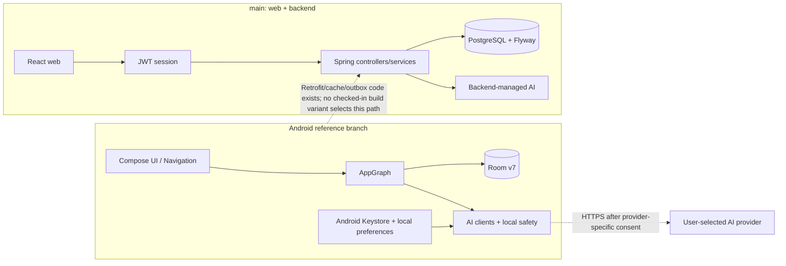

# Repository and architecture overview

## Inspection scope

This is a read-only comparison of **Android `feat/standalone-byok-ai` at `21876285ad808a6518593ea3974c51b6b1f6bb31`** and **web/backend `main` at `30b01f08bc51c8da2ed11bbc89dba1f3a73dfbe7`**. The trees were inspected independently; no branch was switched. Source links below are pinned to those revisions.

## Repository map and stack

| Area | Source and implementation |
|---|---|
| Android | `android/`; Kotlin, Jetpack Compose/Material 3, Navigation Compose, Coroutines/Flow, Room, DataStore/SharedPreferences, WorkManager, Retrofit/OkHttp, kotlinx.serialization. `CaregiverRoot` chooses onboarding, auth, or `MainScaffold`; `AppGraph` is a manual composition root. |
| Web | `web/`; React 18, TypeScript, React Router, CSS, Vitest/Testing Library, Playwright. `App` owns page routes; `AppShell` owns shared navigation; feature pages and hooks call typed API modules. |
| Backend | `backend/`; Java 21, Spring Boot 3.3, Spring Security/JWT, JPA, Flyway, PostgreSQL, springdoc OpenAPI. Controllers delegate to services and owner-scoped repositories. |
| Shared libraries | No shared Android/web business-logic module or shared client code was found. JSON contracts are independently represented in Kotlin, TypeScript, and Java. |
| Persistence | Android Room is the standalone local source of truth. Backend PostgreSQL stores caregiver, recipient, note/addendum, plan-version, and audit data. Web has no note cache or local database; its only persistent browser preferences are language and tab-scoped session material. |
| External services | Android optionally calls a caregiver-configured LLM directly. Backend calls environment-configured LLM providers for web summary/plan workflows. Android update checking reads the public GitHub Releases feed. |

## Current architecture

The diagram distinguishes implemented components from active links: **the checked-in Android release uses local Room, not the backend**. The Android reference's optional Retrofit/cache/outbox path exists in source but no current build type sets `LOCAL_MODE=false`; the app startup also bypasses login in local mode. The web client uses the backend directly and is not an offline client.

## Component relationships

- Android local screens use the `BackendApis` abstraction backed by `LocalBackendApis` and Room in local mode. The code also has Retrofit implementations, a Room-backed cache, and a note outbox for a server-backed graph. Provider selection is in [`CaregiverApp.kt`](https://github.com/alaa157/caregiver-daily-notes/blob/2187628/android/app/src/main/java/com/caregiver/mobile/CaregiverApp.kt#L84-L175); build flags are in [`build.gradle.kts`](https://github.com/alaa157/caregiver-daily-notes/blob/2187628/android/app/build.gradle.kts#L52-L87).
- Web authentication wraps a central fetch client; feature API modules perform response validation before UI display. The client sends bearer tokens and disables browser credentials/cache. See [`AuthProvider`](https://github.com/alaa157/caregiver-daily-notes/blob/30b01f0/web/src/features/auth/AuthProvider.tsx#L10-L110) and [`api.tsx`](https://github.com/alaa157/caregiver-daily-notes/blob/30b01f0/web/src/lib/api.tsx#L1-L78).
- Backend routes and owner scoping are server-owned. Stateless JWT auth allows only login/register and OpenAPI anonymously; other requests require authentication. PostgreSQL URL and credentials are runtime environment inputs; Flyway migrations define schema. See [`SecurityConfig`](https://github.com/alaa157/caregiver-daily-notes/blob/30b01f0/backend/src/main/java/com/caregiver/config/SecurityConfig.java#L47-L69) and [`application.yml`](https://github.com/alaa157/caregiver-daily-notes/blob/30b01f0/backend/src/main/resources/application.yml#L1-L24).

## Tests and delivery evidence

The Android tree contains JVM and instrumented tests; main contains backend and web test sources plus Playwright projects. These are separate suites, not a cross-branch contract suite. Main CI runs backend tests and has a Docker job marked `continue-on-error`; it does not run the web tests/build. Android CI is separately configured. No tests were run as part of this documentation-only investigation. See main [`ci.yml`](https://github.com/alaa157/caregiver-daily-notes/blob/30b01f0/.github/workflows/ci.yml#L1-L57), web [`package.json`](https://github.com/alaa157/caregiver-daily-notes/blob/30b01f0/web/package.json#L1-L17), and Android [`ApiContractTest`](https://github.com/alaa157/caregiver-daily-notes/blob/2187628/android/app/src/test/java/com/caregiver/mobile/data/api/ApiContractTest.kt#L1-L100).

## Important scope limits

This describes source-level architecture, not a live integrated Android-to-main API test. The Android wire fixtures document a different DTO shape than current main's controllers, so their comments are not evidence of compatibility. No runtime guarantee is made about an unselected Android server-backed variant.
