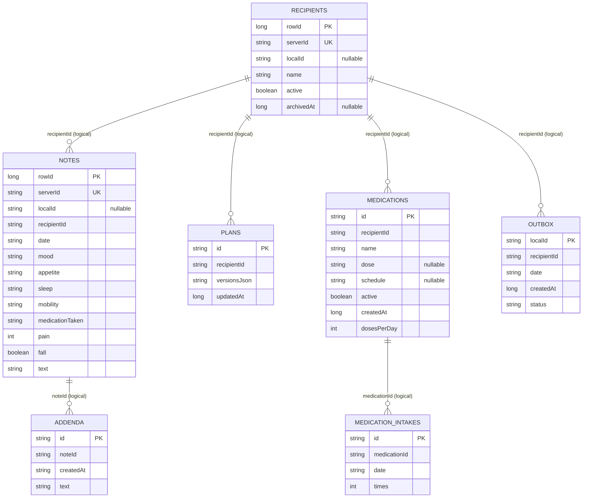

# Android data model

**Reference:** Android branch `feat/standalone-byok-ai`, commit `21876285ad808a6518593ea3974c51b6b1f6bb31`.

## Room schema

`AppDatabase` is version 7 with exported schemas and explicit migrations 1→2 through 6→7. It declares recipient, note, outbox, plan, addendum, medication and medication-intake entities. The source entity declarations have **no Room foreign keys**; links are string identifiers checked/removed by repository and transaction code. [`AppDatabase.kt`](https://github.com/alaa157/caregiver-daily-notes/blob/2187628/android/app/src/main/java/com/caregiver/mobile/data/local/AppDatabase.kt#L25-L53).

| Entity/table | Fields and constraints | Relationship / deletion |
|---|---|---|
| `RecipientEntity` / `recipients` | `rowId: Long` auto PK; `serverId: String` unique index; `localId: String?`; `name: String`; `active: Boolean`; `archivedAt: Long?`. | Logical parent of notes, plans, medications and outbox by string ID. `rowId` preserves ordering. |
| `NoteEntity` / `notes` | `rowId: Long` auto PK; `serverId: String` unique index; `localId: String?`; `recipientId: String`; ISO date `String`; mood/appetite/sleep/mobility/medicationTaken/text `String`; pain `Int`; fall `Boolean`. | Logical recipient reference; no DB FK. The entity omits note `createdAt`. See [`NoteEntity.kt`](https://github.com/alaa157/caregiver-daily-notes/blob/2187628/android/app/src/main/java/com/caregiver/mobile/data/local/NoteEntity.kt#L19-L60). |
| `OutboxEntity` / `outbox` | `localId: String` PK; recipient ID; same structured note strings/int/boolean; ISO date; `createdAt: Long`; status string (`pending`, `syncing`, `failed`). | Pending note payload; does not have a recipient FK. Successful server upload removes it. Only relevant to a non-local server graph. |
| `AddendumEntity` / `addenda` | `id: String` PK; `noteId: String`; `createdAt: String`; `text: String`. | Logical note reference; append-only in UI. |
| `PlanEntity` / `plans` | `id: String` PK; `recipientId: String`; `versionsJson: String`; `updatedAt: Long`. | Plan version list is serialized as JSON in one row, not normalized plan/version tables. |
| `MedicationEntity` / `medications` | `id: String` PK; `recipientId: String`; `name: String`; nullable dose/schedule; active; `createdAt: Long`; `dosesPerDay: Int = 1`; index on recipient ID. | Local-only medication catalogue. |
| `MedicationIntakeEntity` / `medication_intakes` | `id: String` PK (`<medicationId>:<date>:<doseIndex>`); medication ID; ISO date; `times: Int`. | Logical medication reference. Each dose/day is separately keyed; missing row means not marked taken. [`MedicationEntity.kt`](https://github.com/alaa157/caregiver-daily-notes/blob/2187628/android/app/src/main/java/com/caregiver/mobile/data/local/MedicationEntity.kt#L20-L61). |

The diagram's edges are **logical application references, not declared SQL foreign keys**.

## Migration history

| Version | Change |
|---|---|
| 1→2 | Add notes outbox. |
| 2→3 | Add plans with JSON version chain. |
| 3→4 | Add text addenda. |
| 4→5 | Add medication and intake tables plus recipient index. |
| 5→6 | Add `dosesPerDay`; rebuild intake primary keys to include dose index. |
| 6→7 | Add nullable recipient archive timestamp. |

The exact migration bodies are in [`AppDatabase.kt`](https://github.com/alaa157/caregiver-daily-notes/blob/2187628/android/app/src/main/java/com/caregiver/mobile/data/local/AppDatabase.kt#L92-L239); migration tests cover recipient and medication history.

## Dates, identity, and deletion

- IDs are strings in Room and UUID-like for locally created rows; server-backed cache rows use server IDs. Room auto-generated numeric `rowId` values are internal ordering keys and are not exported.
- Business dates use ISO `yyyy-MM-dd` strings. Some local timestamps use epoch milliseconds (`Long`); API/addendum timestamps use strings. These are not a single uniform timestamp policy.
- Archive is soft state. Confirmed permanent deletion removes all local dependent rows in one Room transaction; no local FK cascade enforces that policy.
- Backup restore retains stable IDs and references; it deliberately does not preserve Room surrogate row IDs.

## Data outside Room

AI keys are encrypted with Android Keystore and stored as encrypted preference values; provider, model, base URL, per-provider consent, and prompt preferences are also held locally. UI preferences/onboarding use app settings/DataStore. These are not included in full backups. Android document-picker files are handled as streams; CSV/backup and generated PDF output are not server uploads.

**Source:** [`AiKeyStore.kt`](https://github.com/alaa157/caregiver-daily-notes/blob/2187628/android/app/src/main/java/com/caregiver/mobile/ai/AiKeyStore.kt#L36-L130), [`BackupFormat.kt`](https://github.com/alaa157/caregiver-daily-notes/blob/2187628/android/app/src/main/java/com/caregiver/mobile/data/backup/BackupFormat.kt#L14-L145).
