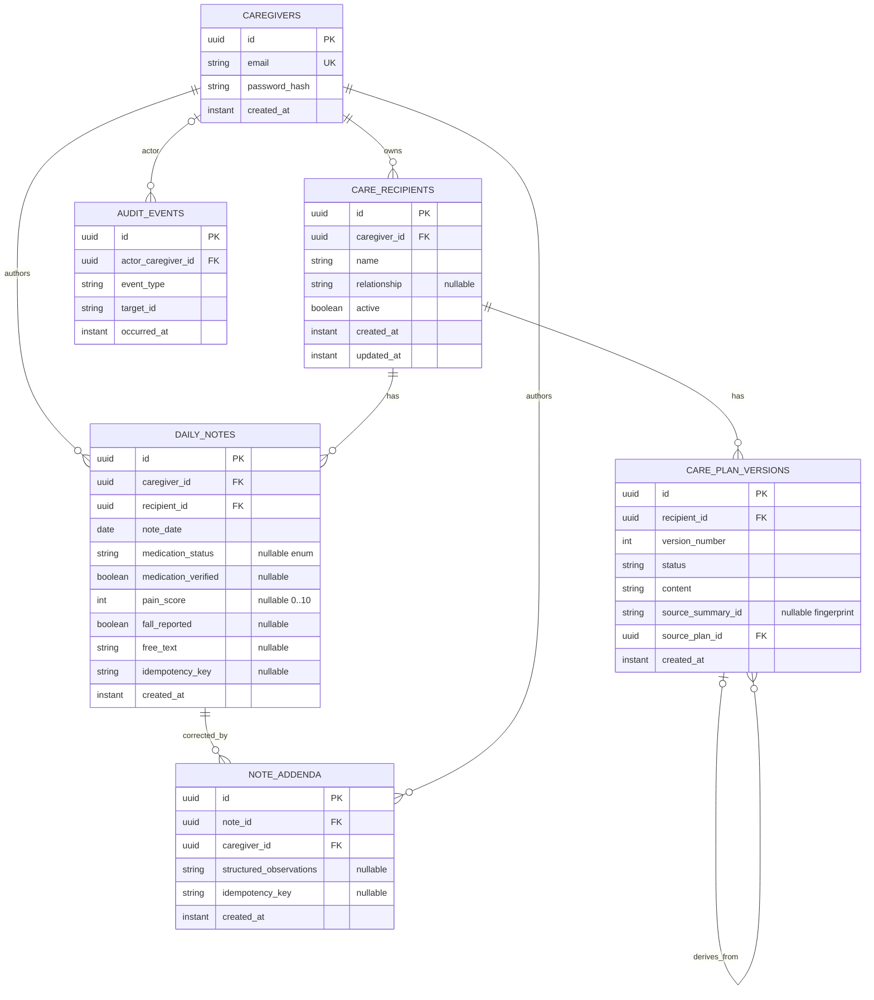

# Web and backend data model

**Reference:** web/backend `main`, commit `30b01f08bc51c8da2ed11bbc89dba1f3a73dfbe7`.

## Persisted entities

| Entity/table | Main fields and relationships |
|---|---|
| `caregivers` | UUID PK, normalized unique email, password hash, creation timestamp. |
| `care_recipients` | UUID PK; caregiver FK; name (required, max 120), optional relationship (max 80), active flag, created/updated instants. Deactivation is soft; related records remain. |
| `daily_notes` | UUID PK; caregiver and recipient FKs; local calendar date; nullable mood/appetite/sleep/mobility/medication status/verification/pain/fall/free text; creation instant; optional idempotency key. Constraints: pain 0–10, medication status `TAKEN|MISSED|UNKNOWN`, unique recipient/date and unique caregiver/idempotency key. |
| `note_addenda` | UUID PK; note and caregiver FKs; same nullable structured observation fields as notes, idempotency key and creation instant. Append-only API; no edit/delete route. |
| `care_plan_versions` | UUID PK; recipient FK; positive version number; status; immutable content/source metadata; optional source-summary fingerprint, source-plan self-FK and evidence note IDs; source type; creation instant. Unique recipient/version and at most one active accepted plan via nullable unique key. |
| `audit_events` | UUID PK; optional actor caregiver FK; event/target identifiers, bounded safe metadata and occurrence instant. No content field for note text; no mutation API. |

Flyway V1–V6 create these structures and constraints. There are **no persisted summary or medication catalogue/intake entities** in current backend migrations. Summaries are generated on demand; plan versions refer to source summary by fingerprint and note IDs as strings. See [`V1`](https://github.com/alaa157/caregiver-daily-notes/blob/30b01f0/backend/src/main/resources/db/migration/V1__create_caregivers.sql#L1-L7), [`V2`](https://github.com/alaa157/caregiver-daily-notes/blob/30b01f0/backend/src/main/resources/db/migration/V2__create_care_recipients.sql#L1-L19), [`V3`](https://github.com/alaa157/caregiver-daily-notes/blob/30b01f0/backend/src/main/resources/db/migration/V3__create_care_plan_versions.sql#L1-L27), [`V4`](https://github.com/alaa157/caregiver-daily-notes/blob/30b01f0/backend/src/main/resources/db/migration/V4__create_audit_events.sql#L1-L15), [`V5`](https://github.com/alaa157/caregiver-daily-notes/blob/30b01f0/backend/src/main/resources/db/migration/V5__create_daily_notes_and_addenda.sql#L1-L23), [`V6`](https://github.com/alaa157/caregiver-daily-notes/blob/30b01f0/backend/src/main/resources/db/migration/V6__plan_source_type.sql#L1-L3).

The ER diagram is derived from the JPA entities and migrations, not from assumptions about a managed hosting service. Java model examples: [`DailyNote`](https://github.com/alaa157/caregiver-daily-notes/blob/30b01f0/backend/src/main/java/com/caregiver/notes/DailyNote.java), [`CarePlan`](https://github.com/alaa157/caregiver-daily-notes/blob/30b01f0/backend/src/main/java/com/caregiver/plans/CarePlan.java), [`CareRecipient`](https://github.com/alaa157/caregiver-daily-notes/blob/30b01f0/backend/src/main/java/com/caregiver/recipient/CareRecipient.java).

## Effective API contract

| Capability | Current main endpoint / contract |
|---|---|
| Auth | `POST /api/auth/register`, `POST /api/auth/login`; bearer JWT thereafter. Web UI implements login only. |
| Recipients | `GET/POST /api/recipients`, `GET/PUT /api/recipients/{id}`, `PATCH /api/recipients/{id}/deactivate`; PUT body is name + relationship. |
| Notes | `POST /api/notes` requires recipient UUID and date; `GET /api/notes` returns a Spring `Page` with recipient/from/to/page/size; detail/by-recipient-date; append/list addenda. |
| Signals | `GET /api/notes/signals?recipientId&from&to`. |
| Summary | `POST /api/summaries` accepts `recipientId`, inclusive end date, and 7/14/30 days; result nests summary observations/uncertainties, authoritative safety, trends. |
| Plans | `POST /api/plans/generate`; per-recipient `/plans/suggestions`, `/active`, `/history`, `/{planId}/accept`, `/edit-and-accept`, `/dismiss`. |

Source: [`NoteController`](https://github.com/alaa157/caregiver-daily-notes/blob/30b01f0/backend/src/main/java/com/caregiver/notes/NoteController.java#L5-L15), [`NoteRequest`](https://github.com/alaa157/caregiver-daily-notes/blob/30b01f0/backend/src/main/java/com/caregiver/notes/NoteRequest.java#L1), [`SummaryRequest`](https://github.com/alaa157/caregiver-daily-notes/blob/30b01f0/backend/src/main/java/com/caregiver/ai/SummaryRequest.java#L1-L25), [`SummaryResult`](https://github.com/alaa157/caregiver-daily-notes/blob/30b01f0/backend/src/main/java/com/caregiver/ai/SummaryResult.java#L1-L21), [`PlanController`](https://github.com/alaa157/caregiver-daily-notes/blob/30b01f0/backend/src/main/java/com/caregiver/plans/PlanController.java#L12-L57).

## Ownership and security

JWT contains caregiver identity; services derive ownership from the authenticated principal instead of accepting owner IDs in request bodies. Owner-scoped reads intentionally make other caregivers' records indistinguishable from missing records. The security filter requires auth for all routes except login/register and OpenAPI. Database credentials and JWT signing secret are environment-supplied. CORS configuration was not found in backend source; browser live-test comments refer to proxy/CORS being configured externally. This is a deployment integration item, not an assertion that the API is insecure by itself.

## Persistence boundary

`application.yml` requires PostgreSQL connection variables and enables Flyway; no retention, backup/restore, export, or data-deletion policy is established by these model files. The web UI has no local durable note data. The backend has no medication schedule/intake API/entity and no web-mediated file transfer API.
