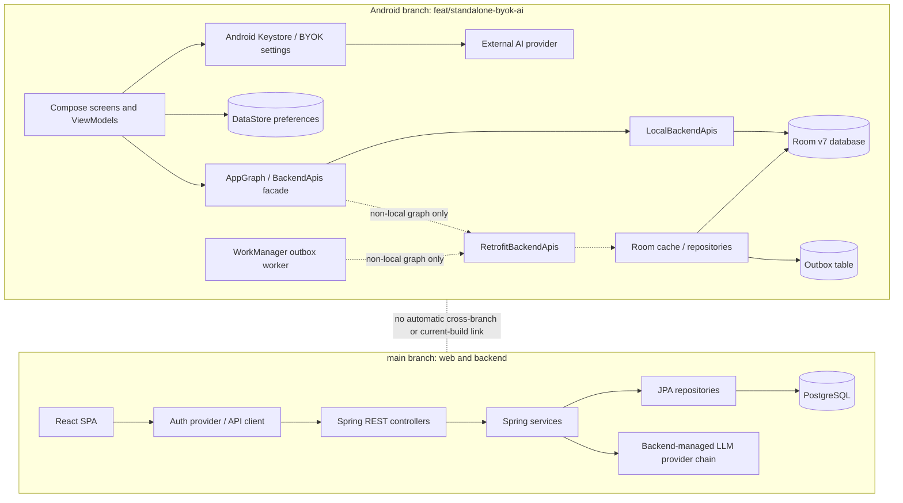
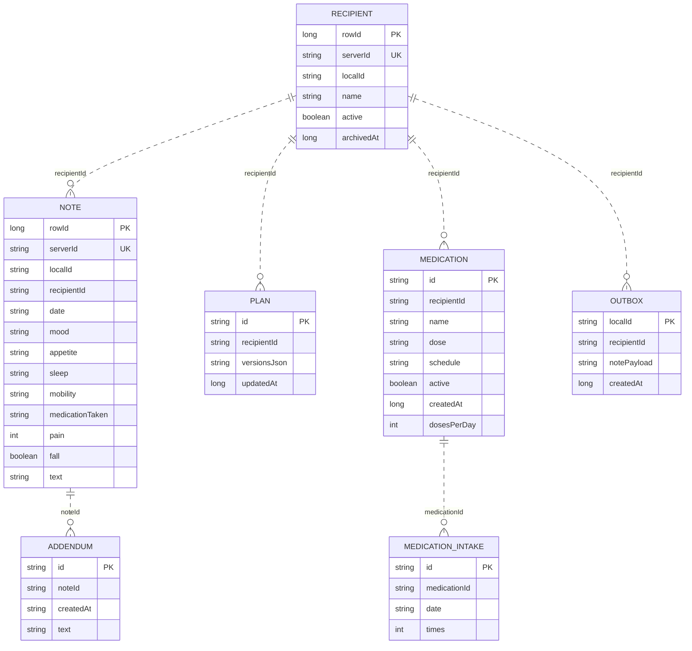
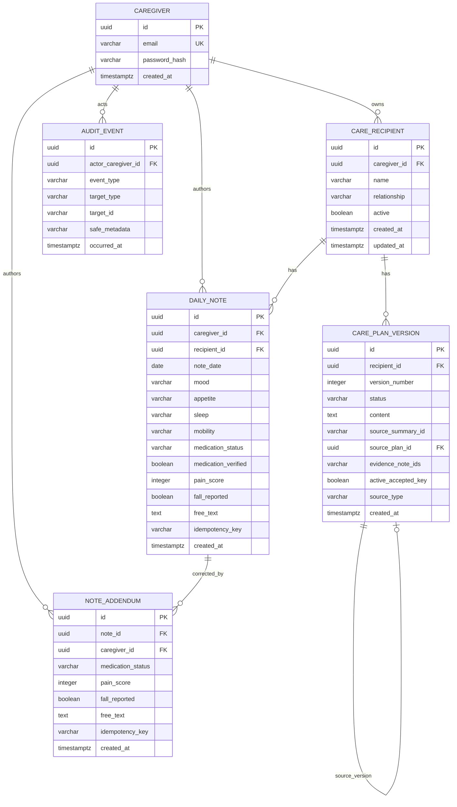

# Phase 1 — Comprehensive Product Discovery and Cross-Platform Alignment

> **AUTHORSHIP / REVIEW:** AI-assisted technical review and editorial consolidation by **ChatGPT (GPT-6)**. Repository inspection and initial document generation were performed with GitHub Copilot.
>
> **SOURCE-OF-TRUTH STATUS:** This is the consolidated Phase 1 baseline for future product-alignment work. Android defines the intended functional behavior; this document records the inspected implementation and differences at the exact commits listed below. Open decisions remain unresolved until explicitly decided.
>
> **Evidence policy:** Source links are pinned to the inspected commit snapshots. Revalidate findings if either branch advances. Static inspection does not imply runtime verification.

**Repository:** `alaa157/caregiver-daily-notes`  
**Android functional reference:** `feat/standalone-byok-ai`  
**Web/backend reference:** `main`  
**Document:** Consolidation of the 12 original Phase 1 deliverables.

## Table of contents

1. [Repository and architecture overview](#repository-and-architecture-overview)
2. [Android product specification — functional reference](#android-product-specification-functional-reference)
3. [Android data model](#android-data-model)
4. [Android offline-first architecture verification](#android-offline-first-architecture-verification)
5. [Web product specification — current implementation on `main`](#web-product-specification-current-implementation-on-main)
6. [Web and backend data model](#web-and-backend-data-model)
7. [Android vs web feature parity assessment](#android-vs-web-feature-parity-assessment)
8. [Business logic and AI behavior comparison](#business-logic-and-ai-behavior-comparison)
9. [Localization and design comparison](#localization-and-design-comparison)
10. [Import, export, backup and transfer readiness](#import-export-backup-and-transfer-readiness)
11. [Consolidated product specification](#consolidated-product-specification)
12. [Phase 1 findings and open questions](#phase-1-findings-and-open-questions)

---

## Repository and architecture overview

## Inspection scope

Repository: `alaa157/caregiver-daily-notes` (private GitHub repository). The two requested references were independently resolved and inspected:

| Role | Reference | Inspected commit |
|---|---|---|
| Android functional reference | `feat/standalone-byok-ai` | `21876285ad808a6518593ea3974c51b6b1f6bb31` |
| Web and backend reference | `main` | `30b01f08bc51c8da2ed11bbc89dba1f3a73dfbe7` |

The Android branch contains the `android/` application tree. The `main` branch contains `web/` and `backend/`; it does not contain the Android source tree in the inspected snapshot. This is a two-snapshot comparison, not a code merge. No branch was changed. Source links below are pinned to the inspected branch name and line range.

## Repository structure and technology

| Area | Location | Technologies / role | Evidence |
|---|---|---|---|
| Android | `android/` on `feat/standalone-byok-ai` | Kotlin, Jetpack Compose, AndroidX lifecycle, Room, DataStore, Retrofit/OkHttp, WorkManager, Kotlin serialization | [app Gradle configuration](https://github.com/alaa157/caregiver-daily-notes/blob/21876285ad808a6518593ea3974c51b6b1f6bb31/android/app/build.gradle.kts#L1-L90), [AppGraph](https://github.com/alaa157/caregiver-daily-notes/blob/21876285ad808a6518593ea3974c51b6b1f6bb31/android/app/src/main/java/com/caregiver/mobile/CaregiverApp.kt#L85-L276) |
| Web | `web/` on `main` | React, TypeScript, React Router, Vite, browser `fetch`, CSS, Vitest/Playwright-related tooling | [package manifest](https://github.com/alaa157/caregiver-daily-notes/blob/30b01f08bc51c8da2ed11bbc89dba1f3a73dfbe7/web/package.json), [entry point](https://github.com/alaa157/caregiver-daily-notes/blob/30b01f08bc51c8da2ed11bbc89dba1f3a73dfbe7/web/src/main.tsx#L1-L46), [application routes](https://github.com/alaa157/caregiver-daily-notes/blob/30b01f08bc51c8da2ed11bbc89dba1f3a73dfbe7/web/src/app/App.tsx#L1-L85) |
| Backend | `backend/` on `main` | Java 21, Spring Boot 3.3.4, Spring MVC/Security/Validation, JPA/Hibernate, Flyway, PostgreSQL, JWT, OpenAPI | [Maven manifest](https://github.com/alaa157/caregiver-daily-notes/blob/30b01f08bc51c8da2ed11bbc89dba1f3a73dfbe7/backend/pom.xml), [runtime configuration](https://github.com/alaa157/caregiver-daily-notes/blob/30b01f08bc51c8da2ed11bbc89dba1f3a73dfbe7/backend/src/main/resources/application.yml#L1-L56) |
| Shared libraries | No shared cross-platform module was identified | Android and web/backend define separate models and clients | Android DTOs in [`data/api`](https://github.com/alaa157/caregiver-daily-notes/tree/21876285ad808a6518593ea3974c51b6b1f6bb31/android/app/src/main/java/com/caregiver/mobile/data/api); backend DTOs in [`backend/...`](https://github.com/alaa157/caregiver-daily-notes/tree/30b01f08bc51c8da2ed11bbc89dba1f3a73dfbe7/backend/src/main/java/com/caregiver) |

## Android architecture

The Android app is a Kotlin/Compose application. `MainActivity` is the Android activity entry point; `CaregiverApp` initializes application graph and startup work; `CaregiverRoot` selects onboarding/authenticated or local entry; `MainScaffold` owns the primary tab scaffold and navigation. Presentation code is organized by feature under `presentation/`, with ViewModels exposing state flows to Compose screens. The app graph supplies API façades, persistence, settings, AI and transfer services.

- UI and navigation: Compose screens and a navigation graph; four primary destinations are Home, People, Notes and History. Secondary destinations include recipient details, note editor/detail/addendum, summary period/result, plans/proposals/edit/version history, Settings, AI settings, theme settings, About and server URL.
- State: ViewModels and Kotlin `StateFlow`/`MutableStateFlow`; Compose collects lifecycle-aware state.
- Persistence: Room v7 for local product records; DataStore for preferences/session-like settings. Android Keystore-backed encryption is used for provider credentials.
- Domain orchestration: repositories and services; local implementations are exposed through `BackendApis` to keep UI workflows on a common API surface.
- Optional remote path: Retrofit interfaces plus repositories/cache/outbox/WorkManager exist in source, but current declared build variants do not select that path.

Evidence: [startup and graph selection](https://github.com/alaa157/caregiver-daily-notes/blob/21876285ad808a6518593ea3974c51b6b1f6bb31/android/app/src/main/java/com/caregiver/mobile/CaregiverApp.kt#L41-L82), [AppGraph wiring](https://github.com/alaa157/caregiver-daily-notes/blob/21876285ad808a6518593ea3974c51b6b1f6bb31/android/app/src/main/java/com/caregiver/mobile/CaregiverApp.kt#L85-L276), [main scaffold](https://github.com/alaa157/caregiver-daily-notes/blob/21876285ad808a6518593ea3974c51b6b1f6bb31/android/app/src/main/java/com/caregiver/mobile/MainScaffold.kt#L1-L320), [route definitions](https://github.com/alaa157/caregiver-daily-notes/blob/21876285ad808a6518593ea3974c51b6b1f6bb31/android/app/src/main/java/com/caregiver/mobile/core/navigation/Routes.kt#L1-L57).

## Web and backend architecture

The web application is a React SPA. `main.tsx` loads public runtime configuration and composes API, auth, localization and router providers. `App.tsx` separates public home/login routes from protected workspace routes. Feature pages call typed API modules; `createApiClient` centralizes HTTP behavior. Browser session state is held in memory and `sessionStorage` (scoped to the current tab), while the backend remains authoritative for JWT signature verification and ownership.

The backend is a Spring MVC application. Controllers expose REST endpoints; services own validation, authorization/ownership, transactional business operations and audit recording; Spring Data repositories persist JPA entities. Flyway migrations define the database schema; Hibernate is configured to validate rather than create/alter the schema. The backend LLM configuration is environment-driven and provider calls happen server-side.

Evidence: [web startup](https://github.com/alaa157/caregiver-daily-notes/blob/30b01f08bc51c8da2ed11bbc89dba1f3a73dfbe7/web/src/main.tsx#L1-L46), [web routing](https://github.com/alaa157/caregiver-daily-notes/blob/30b01f08bc51c8da2ed11bbc89dba1f3a73dfbe7/web/src/app/App.tsx#L1-L85), [API transport](https://github.com/alaa157/caregiver-daily-notes/blob/30b01f08bc51c8da2ed11bbc89dba1f3a73dfbe7/web/src/lib/api.tsx#L26-L67), [session storage](https://github.com/alaa157/caregiver-daily-notes/blob/30b01f08bc51c8da2ed11bbc89dba1f3a73dfbe7/web/src/features/auth/session.ts#L1-L55), [security configuration](https://github.com/alaa157/caregiver-daily-notes/blob/30b01f08bc51c8da2ed11bbc89dba1f3a73dfbe7/backend/src/main/java/com/caregiver/config/SecurityConfig.java#L20-L68).

## Current component relationships

The diagram represents the inspected architecture, not a proposed design. Dashed relationships are optional or conditional paths, not automatic communication merely because source code exists.

## Databases, API contracts and persistence

Android Room is the primary local store in the current local build. It contains recipient, note, addendum, plan, medication, medication-intake and outbox tables. No shared runtime database connection with web/backend was identified. The web client uses its backend APIs and has no inspected local IndexedDB/Room-like application store. The backend uses PostgreSQL configured through environment values and Flyway migrations. The repository does not prove that the deployment environment provisions durable storage or that a backend instance is continuously available.

Android `BackendApis` is an interface with local and Retrofit implementations. The web app calls Spring endpoints using typed API modules. Similar concepts exist across both stacks, but request/response contracts differ; see documents 06–08.

## Authentication and authorization

The web app has caregiver email/password sign-in. The backend issues JWTs and validates them using stateless Spring Security; service methods scope recipient and dependent records to the authenticated caregiver. Android’s current local mode bypasses login; the local adapter returns a local placeholder token for API compatibility. Android’s optional non-local path has Retrofit auth/token handling. The present release variant does not select the authenticated remote path.

Evidence: [Android local root selection](https://github.com/alaa157/caregiver-daily-notes/blob/21876285ad808a6518593ea3974c51b6b1f6bb31/android/app/src/main/java/com/caregiver/mobile/CaregiverRoot.kt#L18-L73), [local auth facade](https://github.com/alaa157/caregiver-daily-notes/blob/21876285ad808a6518593ea3974c51b6b1f6bb31/android/app/src/main/java/com/caregiver/mobile/data/local/LocalBackendApis.kt#L42-L90), [web auth provider](https://github.com/alaa157/caregiver-daily-notes/blob/30b01f08bc51c8da2ed11bbc89dba1f3a73dfbe7/web/src/features/auth/AuthProvider.tsx#L1-L127), [backend auth/security](https://github.com/alaa157/caregiver-daily-notes/tree/30b01f08bc51c8da2ed11bbc89dba1f3a73dfbe7/backend/src/main/java/com/caregiver/auth).

## AI integrations

Android configures provider credentials/model/base URL and prompt preferences on-device. Keys are stored through an Android Keystore-backed credential store; user consent is provider-scoped and checked before BYOK data calls. Calls are made directly from the device to the configured provider. The web browser does not call an LLM; it requests backend summary and plan endpoints. Backend provider keys/configuration are environment supplied and provider failover/fallback is server-managed. These are deliberately distinct infrastructure patterns.

Evidence: [Android AI settings](https://github.com/alaa157/caregiver-daily-notes/blob/21876285ad808a6518593ea3974c51b6b1f6bb31/android/app/src/main/java/com/caregiver/mobile/presentation/settings/AiSettingsScreen.kt#L72-L192), [key store](https://github.com/alaa157/caregiver-daily-notes/tree/21876285ad808a6518593ea3974c51b6b1f6bb31/android/app/src/main/java/com/caregiver/mobile/ai), [backend LLM config](https://github.com/alaa157/caregiver-daily-notes/blob/30b01f08bc51c8da2ed11bbc89dba1f3a73dfbe7/backend/src/main/resources/application.yml#L20-L56).

## Transfer, import/export and deployment

Android has local CSV and versioned JSON full backup/restore and PDF summary sharing. An optional remote Android note outbox path is present in source, but it is not active in current declared variants. No mobile-to-web transfer/upload endpoint or general attachment management workflow was identified in `main`. The web app depends on the configured API base URL; the backend expects configured PostgreSQL and AI provider environment variables. No source-level evidence establishes persistent hosting, operational backup, retention policy or always-on uptime.

## Tests and build configuration

Android has JVM unit and instrumentation/UI test source trees; web has component/API tests; backend has JUnit tests. File inventory found 131 Android test source files and 76 backend/web test source files in the inspected snapshots. These are inventory counts only: **no tests or builds were executed in this investigation**. No result should be inferred from test presence alone.

## Scope limitations

This was static source inspection of the two branch snapshots. Runtime behavior, installed APK configuration, deployment persistence, real network/provider availability, device permission flows and actual browser rendering were not verified. This session had read-only access to repository contents and no writable project checkout; the generated Phase 1 documents are therefore delivered separately rather than represented as committed files in the private repository.

---

## Android product specification — functional reference

## Reference and implementation status

Reference: `feat/standalone-byok-ai` at commit `21876285ad808a6518593ea3974c51b6b1f6bb31`. Android is the functional reference for cross-platform product capability. The UI is Kotlin + Jetpack Compose with ViewModels exposing state; a local `BackendApis` adapter lets current screens use the Room-backed product model without requiring the backend. The current declared build variants use `LOCAL_MODE=true`; optional remote implementations remain in the source.

Status vocabulary used here: **Implemented** means a code path and associated data operation are present; **Partial** means only a subset or one implementation path is present; **Experimental/conditional** means gated or dependent on provider/network/configuration; **Not established** means static source does not prove runtime behavior.

## Application structure and navigation

| Screen / workflow | Purpose and user actions | Inputs / outputs and rules | Data / offline / status | Evidence |
|---|---|---|---|---|
| Onboarding | First-run introduction/consent-style entry flow and completion | Persists onboarding completion in app settings; exact product acceptance criteria are not independently specified | DataStore; local UI path | [OnboardingScreen](https://github.com/alaa157/caregiver-daily-notes/blob/21876285ad808a6518593ea3974c51b6b1f6bb31/android/app/src/main/java/com/caregiver/mobile/presentation/onboarding/OnboardingScreen.kt) |
| Main scaffold | Home, People, Notes, History tabs; global add-note action | Navigation to recipient/note/summary/plan/settings workflows; back stack owns secondary destinations | Local graph in current builds | [MainScaffold](https://github.com/alaa157/caregiver-daily-notes/blob/21876285ad808a6518593ea3974c51b6b1f6bb31/android/app/src/main/java/com/caregiver/mobile/MainScaffold.kt#L1-L320), [routes](https://github.com/alaa157/caregiver-daily-notes/blob/21876285ad808a6518593ea3974c51b6b1f6bb31/android/app/src/main/java/com/caregiver/mobile/core/navigation/Routes.kt#L1-L57) |
| Account popup / settings navigation | Open account actions and Settings destination | Settings is pushed as a destination; login/register are bypassed in local mode | Local mode has no mandatory server session | [AccountPopupMenu](https://github.com/alaa157/caregiver-daily-notes/blob/21876285ad808a6518593ea3974c51b6b1f6bb31/android/app/src/main/java/com/caregiver/mobile/presentation/common/AccountPopupMenu.kt), [CaregiverRoot](https://github.com/alaa157/caregiver-daily-notes/blob/21876285ad808a6518593ea3974c51b6b1f6bb31/android/app/src/main/java/com/caregiver/mobile/CaregiverRoot.kt#L18-L73) |
| Authentication | Remote-graph login/register and token session | Email/password form and auth API; unavailable as mandatory step for local mode | Network-required only in remote configuration; current variants bypass it | [AuthScreens](https://github.com/alaa157/caregiver-daily-notes/blob/21876285ad808a6518593ea3974c51b6b1f6bb31/android/app/src/main/java/com/caregiver/mobile/presentation/auth/AuthScreens.kt), [AuthRepository](https://github.com/alaa157/caregiver-daily-notes/blob/21876285ad808a6518593ea3974c51b6b1f6bb31/android/app/src/main/java/com/caregiver/mobile/data/AuthRepository.kt) |

## Care recipient management

**Purpose:** keep separate people whose daily observations and plans are recorded.

- Screen: People/recipient list, recipient detail, archive filter, archived detail and deletion confirmation.
- Actions: create recipient; inspect details; archive; unarchive; undo most recent archive; view counts before permanent deletion; permanently delete only an archived recipient. Archived recipients are read-only for writes.
- Inputs: recipient display name (must be nonblank in local code); active/archive state. The local recipient entity does not have a relationship field.
- Outputs: local UUID-like stable ID, active state, archive timestamp, list/detail state and deletion counts.
- Rules: active and archived collections are distinct; archive preserves the recipient and related data; permanent deletion removes related notes, addenda, plans, medication records/intakes and outbox rows transactionally. Missing recipient during delete is a no-op; deleting an unarchived record is refused.
- Offline/dependency: fully local in selected Room graph.
- Status: implemented for local workflow. Editing recipient name/relationship is not equivalent to the backend’s full update model; see parity report.

Evidence: [RecipientsViewModel](https://github.com/alaa157/caregiver-daily-notes/blob/21876285ad808a6518593ea3974c51b6b1f6bb31/android/app/src/main/java/com/caregiver/mobile/presentation/recipients/RecipientsViewModel.kt#L21-L277), [RecipientDetailViewModel](https://github.com/alaa157/caregiver-daily-notes/blob/21876285ad808a6518593ea3974c51b6b1f6bb31/android/app/src/main/java/com/caregiver/mobile/presentation/recipients/RecipientDetailViewModel.kt#L20-L205), [RecipientAdmin/local adapter](https://github.com/alaa157/caregiver-daily-notes/blob/21876285ad808a6518593ea3974c51b6b1f6bb31/android/app/src/main/java/com/caregiver/mobile/data/local/LocalBackendApis.kt#L42-L116), [transactional deletion](https://github.com/alaa157/caregiver-daily-notes/blob/21876285ad808a6518593ea3974c51b6b1f6bb31/android/app/src/main/java/com/caregiver/mobile/data/local/AppDatabase.kt#L52-L86).

## Home and medication tracker

Home presents Today / Needs attention / All sub-tabs, per-recipient note status chips, latest observation, and a fall-report banner. The dashboard derives a seven-calendar-day window from local `LocalDate`, filters recipients client-side and classifies high pain at 7/10 or above. It supports refresh and loading/error/empty states.

A separate medication tracker appears on the Home screen when a local medication store is available. Medication records include name, optional dose/schedule, active flag and doses-per-day (1–4 in the store logic). User actions include add/edit/delete and mark/clear an intake per date and per dose. Missing intake rows are interpreted as not taken; this is tracker behavior, not an assertion about actual ingestion. The tracker is local-only and is not represented in backend medication endpoints in the inspected branch.

Evidence: [HomeViewModel](https://github.com/alaa157/caregiver-daily-notes/blob/21876285ad808a6518593ea3974c51b6b1f6bb31/android/app/src/main/java/com/caregiver/mobile/presentation/home/HomeViewModel.kt#L21-L193), [HomeScreen](https://github.com/alaa157/caregiver-daily-notes/blob/21876285ad808a6518593ea3974c51b6b1f6bb31/android/app/src/main/java/com/caregiver/mobile/presentation/home/HomeScreen.kt#L81-L306), [MedicationEntity/DAO](https://github.com/alaa157/caregiver-daily-notes/blob/21876285ad808a6518593ea3974c51b6b1f6bb31/android/app/src/main/java/com/caregiver/mobile/data/local/MedicationEntity.kt#L21-L131), [MedicationViewModel](https://github.com/alaa157/caregiver-daily-notes/blob/21876285ad808a6518593ea3974c51b6b1f6bb31/android/app/src/main/java/com/caregiver/mobile/presentation/home/MedicationViewModel.kt).

## Daily notes

**Purpose:** create a dated record for one care recipient.

- Screen: note editor, saved confirmation, note detail, global Add Note flow and recipient picker.
- Inputs: recipient; mood; appetite; sleep; mobility; medication-taken/status value; fall yes/no; pain score (0–10); free-text observation. The local editor requires mood and nonblank note text; pain is bounded 0–10 in the local contract.
- Create behavior: local adapter generates a stable ID and assigns the current device `LocalDate`; the caller does not select arbitrary historical date in the standalone editor. The row is stored in Room.
- Detail behavior: note’s original content is displayed as immutable/read-only; addenda are shown separately in a dated timeline. The detail workflow offers addendum and summary navigation.
- Error cases: invalid/missing required values; archived recipient blocked; storage/operation failure surfaces editor errors. Runtime validation against physical devices was not executed.
- Offline: fully local under current selected graph.
- Status: implemented locally; date semantics and field representation differ from web/backend (see data contract).

Evidence: [NoteScreens editor/detail/addendum](https://github.com/alaa157/caregiver-daily-notes/blob/21876285ad808a6518593ea3974c51b6b1f6bb31/android/app/src/main/java/com/caregiver/mobile/presentation/notes/NoteScreens.kt#L79-L229), [detail and addendum](https://github.com/alaa157/caregiver-daily-notes/blob/21876285ad808a6518593ea3974c51b6b1f6bb31/android/app/src/main/java/com/caregiver/mobile/presentation/notes/NoteScreens.kt#L366-L622), [local create/detail/history implementation](https://github.com/alaa157/caregiver-daily-notes/blob/21876285ad808a6518593ea3974c51b6b1f6bb31/android/app/src/main/java/com/caregiver/mobile/data/local/LocalBackendApis.kt#L117-L182), [NoteEditorViewModel](https://github.com/alaa157/caregiver-daily-notes/blob/21876285ad808a6518593ea3974c51b6b1f6bb31/android/app/src/main/java/com/caregiver/mobile/presentation/notes/NoteEditorViewModel.kt).

## Addenda

Addenda are append-only, separate records linked to an original note. In the local standalone UI they contain text and creation time; the original note is not overwritten. Detail screen lists the addenda and allows adding another. No local edit/delete addendum action was identified. Local store creates a new addendum ID and associates it with the selected note; archived recipient prevents append.

Status: implemented text-only local addendum; web/backend supports a richer structured-correction record that can override specific observation fields for derived safety/signal calculations. This is a product contract difference, not a rendering difference.

Evidence: [Note detail and addendum screens](https://github.com/alaa157/caregiver-daily-notes/blob/21876285ad808a6518593ea3974c51b6b1f6bb31/android/app/src/main/java/com/caregiver/mobile/presentation/notes/NoteScreens.kt#L480-L622), [LocalBackendApis](https://github.com/alaa157/caregiver-daily-notes/blob/21876285ad808a6518593ea3974c51b6b1f6bb31/android/app/src/main/java/com/caregiver/mobile/data/local/LocalBackendApis.kt#L139-L182), [AddendumEntity](https://github.com/alaa157/caregiver-daily-notes/blob/21876285ad808a6518593ea3974c51b6b1f6bb31/android/app/src/main/java/com/caregiver/mobile/data/local/AddendumEntity.kt#L7-L19).

## History and trends

History allows a recipient filter and optional from/to ISO date filters. The local history screen loads the filtered notes without server paging; refresh and load failures have UI state. A separate Care Trends screen aggregates observations and displays calculated changes/trends. Trend calculations should be treated as application analytics, not validated clinical conclusions.

Evidence: [HistoryViewModel](https://github.com/alaa157/caregiver-daily-notes/blob/21876285ad808a6518593ea3974c51b6b1f6bb31/android/app/src/main/java/com/caregiver/mobile/presentation/history/HistoryViewModel.kt#L36-L116), [HistoryScreen](https://github.com/alaa157/caregiver-daily-notes/blob/21876285ad808a6518593ea3974c51b6b1f6bb31/android/app/src/main/java/com/caregiver/mobile/presentation/history/HistoryScreen.kt), [CareTrendsScreen](https://github.com/alaa157/caregiver-daily-notes/blob/21876285ad808a6518593ea3974c51b6b1f6bb31/android/app/src/main/java/com/caregiver/mobile/presentation/trends/CareTrendsScreen.kt).

## AI summary and safety support

Summary selection offers 7, 14 or 30 days and an inclusive period ending on the current local date. The ViewModel retrieves notes/signals for the selected recipient and window, constructs provider input and generates on demand. Android can use a direct BYOK provider when a key and provider consent exist. With no usable AI configuration, local deterministic signals and an explicit unavailable/uncertainty state remain available; lack of AI key is not intended to hide safety observations.

The Android safety evaluator uses deterministic logic for signals including reported fall, high pain, repeated missed medication, poor appetite, unverified medication state and selected free-text patterns. The evaluator is code, not a clinically validated instrument. AI summary output is constrained to structured output, source note IDs/quotes are checked, and unsupported claims are filtered or represented as uncertainties. The system prompt constrains the model not to diagnose or prescribe.

- Inputs: recipient ID, period days, end date implied by local date, relevant structured note fields and free text/addenda.
- Output: summary text/observations, evidence, uncertainties, deterministic red flags and trend information.
- Failure modes: no key, consent absent/revoked, invalidated credential, provider timeout/failure, malformed model response, ungrounded evidence, no qualifying notes. Safety output is handled separately from model availability.
- Network: direct provider call requires internet; local note browsing and deterministic calculations do not.
- Status: implemented with conditional network-based AI generation; runtime provider behavior was not tested.

Evidence: [SummaryScreen](https://github.com/alaa157/caregiver-daily-notes/blob/21876285ad808a6518593ea3974c51b6b1f6bb31/android/app/src/main/java/com/caregiver/mobile/presentation/summary/SummaryScreen.kt#L92-L267), [SummaryViewModel](https://github.com/alaa157/caregiver-daily-notes/blob/21876285ad808a6518593ea3974c51b6b1f6bb31/android/app/src/main/java/com/caregiver/mobile/presentation/summary/SummaryViewModel.kt#L59-L422), [SummaryAiService](https://github.com/alaa157/caregiver-daily-notes/tree/21876285ad808a6518593ea3974c51b6b1f6bb31/android/app/src/main/java/com/caregiver/mobile/ai), [SafetySignalEvaluator](https://github.com/alaa157/caregiver-daily-notes/blob/21876285ad808a6518593ea3974c51b6b1f6bb31/android/app/src/main/java/com/caregiver/mobile/ai/SafetySignalEvaluator.kt#L1-L109), [ClaimGrounding](https://github.com/alaa157/caregiver-daily-notes/blob/21876285ad808a6518593ea3974c51b6b1f6bb31/android/app/src/main/java/com/caregiver/mobile/ai/ClaimGrounding.kt#L1-L120), [Prompts](https://github.com/alaa157/caregiver-daily-notes/blob/21876285ad808a6518593ea3974c51b6b1f6bb31/android/app/src/main/java/com/caregiver/mobile/ai/Prompts.kt#L1-L103).

## Care plans

The local plan feature generates AI suggestions from an eligible summary, validates allowed actions and medication constraints, and persists plan versions. Users can review a proposal, accept, dismiss, archive, and edit/accept through dedicated detail/edit flows. Version history is stored as a JSON list within one Room plan entity. The local state machine restricts transitions; plan persistence uses compare-and-set against the previously read version chain to avoid silently overwriting a concurrent change.

The plan suggestion workflow depends on summary input and BYOK provider readiness/consent; local plan viewing and lifecycle operations are local. Medication changes are guarded by a hard-lock rule in AI suggestion code.

Evidence: [Plan screens](https://github.com/alaa157/caregiver-daily-notes/blob/21876285ad808a6518593ea3974c51b6b1f6bb31/android/app/src/main/java/com/caregiver/mobile/presentation/plans/PlanScreens.kt), [plan detail actions](https://github.com/alaa157/caregiver-daily-notes/blob/21876285ad808a6518593ea3974c51b6b1f6bb31/android/app/src/main/java/com/caregiver/mobile/presentation/plans/PlanDetailViewModel.kt#L19-L125), [plan edit](https://github.com/alaa157/caregiver-daily-notes/blob/21876285ad808a6518593ea3974c51b6b1f6bb31/android/app/src/main/java/com/caregiver/mobile/presentation/plans/PlanEditViewModel.kt#L19-L149), [local state machine](https://github.com/alaa157/caregiver-daily-notes/blob/21876285ad808a6518593ea3974c51b6b1f6bb31/android/app/src/main/java/com/caregiver/mobile/data/plan/PlanStateMachine.kt#L1-L126), [plan persistence](https://github.com/alaa157/caregiver-daily-notes/blob/21876285ad808a6518593ea3974c51b6b1f6bb31/android/app/src/main/java/com/caregiver/mobile/data/local/LocalBackendApis.kt#L239-L366).

## Settings and customization

| Setting | Behavior / persisted data | Status / dependencies | Evidence |
|---|---|---|---|
| Language | Arabic and English; app string resources and locale-aware formatting; RTL handling | Implemented locally | [SettingsScreens](https://github.com/alaa157/caregiver-daily-notes/blob/21876285ad808a6518593ea3974c51b6b1f6bb31/android/app/src/main/java/com/caregiver/mobile/presentation/settings/SettingsScreens.kt#L110-L151), [locale tests](https://github.com/alaa157/caregiver-daily-notes/tree/21876285ad808a6518593ea3974c51b6b1f6bb31/android/app/src/test/java/com/caregiver/mobile/core/i18n) |
| Theme | System/light/dark modes, pure-black option, selectable palettes; visual preview | Implemented locally | [ThemeColorsScreen](https://github.com/alaa157/caregiver-daily-notes/blob/21876285ad808a6518593ea3974c51b6b1f6bb31/android/app/src/main/java/com/caregiver/mobile/presentation/settings/ThemeColorsScreen.kt#L85-L202) |
| AI | Provider, key, model, base URL, provider-specific consent, system/summary/plan prompts, connection and format checks | Implemented; outbound provider call needs network and user consent | [AiSettingsScreen](https://github.com/alaa157/caregiver-daily-notes/blob/21876285ad808a6518593ea3974c51b6b1f6bb31/android/app/src/main/java/com/caregiver/mobile/presentation/settings/AiSettingsScreen.kt#L72-L192), [validation](https://github.com/alaa157/caregiver-daily-notes/blob/21876285ad808a6518593ea3974c51b6b1f6bb31/android/app/src/main/java/com/caregiver/mobile/presentation/settings/AiSettingsValidation.kt#L15-L89) |
| Data & Backup | CSV import/export; full backup/restore | Implemented for Room local configuration | [SettingsScreens](https://github.com/alaa157/caregiver-daily-notes/blob/21876285ad808a6518593ea3974c51b6b1f6bb31/android/app/src/main/java/com/caregiver/mobile/presentation/settings/SettingsScreens.kt#L175-L237) |
| Server URL | Remote graph base URL setting and connection check | Conditional; does not switch current release build away from `LOCAL_MODE` | [ServerUrlScreen](https://github.com/alaa157/caregiver-daily-notes/blob/21876285ad808a6518593ea3974c51b6b1f6bb31/android/app/src/main/java/com/caregiver/mobile/presentation/settings/SettingsScreens.kt#L307-L376) |
| About/update | App info, GitHub release checker, download/release links; some UI slots disabled | Partial/conditional; update check is online | [AboutScreen](https://github.com/alaa157/caregiver-daily-notes/blob/21876285ad808a6518593ea3974c51b6b1f6bb31/android/app/src/main/java/com/caregiver/mobile/presentation/settings/AboutScreen.kt#L81-L255), [UpdateChecker](https://github.com/alaa157/caregiver-daily-notes/blob/21876285ad808a6518593ea3974c51b6b1f6bb31/android/app/src/main/java/com/caregiver/mobile/data/update/UpdateChecker.kt#L18-L138) |

## Import, export, backup, PDF and sharing

CSV export snapshots every note visible to the active store, not just the currently filtered list. It exports date, recipient ID/name, categorical fields, medication status, pain, fall and free text. CSV uses UTF-8 with BOM for spreadsheet/Arabic compatibility. It does not represent addenda, plan history, medication tracker rows, credentials or preferences. Import parses and validates rows, shows a reviewable plan, resolves unmatched recipients explicitly, and skips duplicates rather than overwriting existing notes. Room import preserves CSV dates and creates IDs; optional API-backed import cannot preserve arbitrary historical dates because the API assigns server date.

Full backup is a separate versioned `.carebackup.json` document (writer version 3; reads v1/v2). It includes recipients, notes, addenda, plan JSON, medications and medication intakes; preserves stable domain IDs and references; excludes Room row IDs, sync mapping/outbox, AI keys, settings and tokens. It has a checksum for accidental/corruption detection (not authenticity). Restore validates and previews before confirmation and performs all-table replacement in a single Room transaction with a pre-commit state digest check. The operation can replace local data; it is not an additive sync.

Summary PDF export/share creates a PDF from summary, flags, evidence, recorded observations and uncertainty content; sharing invokes Android’s native chooser only after a privacy confirmation. No general-purpose arbitrary attachment management was identified.

Evidence: [CSV format](https://github.com/alaa157/caregiver-daily-notes/blob/21876285ad808a6518593ea3974c51b6b1f6bb31/android/app/src/main/java/com/caregiver/mobile/data/csv/CareNoteCsv.kt#L61-L220), [CSV planner](https://github.com/alaa157/caregiver-daily-notes/blob/21876285ad808a6518593ea3974c51b6b1f6bb31/android/app/src/main/java/com/caregiver/mobile/data/csv/CsvImportPlanner.kt#L73-L129), [CSV store](https://github.com/alaa157/caregiver-daily-notes/blob/21876285ad808a6518593ea3974c51b6b1f6bb31/android/app/src/main/java/com/caregiver/mobile/data/csv/CsvNoteStore.kt#L30-L183), [backup format](https://github.com/alaa157/caregiver-daily-notes/blob/21876285ad808a6518593ea3974c51b6b1f6bb31/android/app/src/main/java/com/caregiver/mobile/data/backup/BackupFormat.kt#L6-L152), [backup store](https://github.com/alaa157/caregiver-daily-notes/blob/21876285ad808a6518593ea3974c51b6b1f6bb31/android/app/src/main/java/com/caregiver/mobile/data/backup/BackupStore.kt#L20-L107), [restore service](https://github.com/alaa157/caregiver-daily-notes/blob/21876285ad808a6518593ea3974c51b6b1f6bb31/android/app/src/main/java/com/caregiver/mobile/data/backup/BackupRestoreService.kt#L46-L132), [PDF exporter](https://github.com/alaa157/caregiver-daily-notes/blob/21876285ad808a6518593ea3974c51b6b1f6bb31/android/app/src/main/java/com/caregiver/mobile/data/export/CareSummaryPdfExporter.kt#L24-L243), [share helper](https://github.com/alaa157/caregiver-daily-notes/blob/21876285ad808a6518593ea3974c51b6b1f6bb31/android/app/src/main/java/com/caregiver/mobile/presentation/summary/CareSummaryShare.kt#L13-L87).

## Product boundaries and unresolved behavior

- Android is intended to function without the backend in the inspected release configuration. Provider generation and release/update checks still require external network access.
- The Android local API adapter does not provide full recipient relationship management or the richer correction model found in the backend.
- No complete general attachment/file management feature was found; PDF sharing is a specific export workflow.
- Runtime behavior on physical devices and the exact installed APK artifact were not verified.
- Static code does not establish clinical validity, deployment data retention, or provider uptime.

---

## Android data model

## Scope

Source: Android branch `feat/standalone-byok-ai`, commit `21876285ad808a6518593ea3974c51b6b1f6bb31`. This document distinguishes Room tables from DataStore preferences, Android Keystore credentials, transient ViewModel state, and files. Room schema v7 is the authoritative local structured store in the current local build.

## Room database and migration history

`AppDatabase` declares version 7 with schema export enabled. Tables/entities currently registered are `recipients`, `notes`, `outbox`, `plans`, `addenda`, `medications`, and `medication_intakes`. There are no Room `ForeignKey` annotations on the listed entities; references are string IDs and integrity is enforced in application logic and transactional workflows rather than database FK constraints.

| Schema transition | Change | Evidence |
|---|---|---|
| 1 → 2 | Add note outbox table | [AppDatabase migrations](https://github.com/alaa157/caregiver-daily-notes/blob/21876285ad808a6518593ea3974c51b6b1f6bb31/android/app/src/main/java/com/caregiver/mobile/data/local/AppDatabase.kt#L91-L120) |
| 2 → 3 | Add plans table with JSON version list | [AppDatabase](https://github.com/alaa157/caregiver-daily-notes/blob/21876285ad808a6518593ea3974c51b6b1f6bb31/android/app/src/main/java/com/caregiver/mobile/data/local/AppDatabase.kt#L121-L137) |
| 3 → 4 | Add addenda table | [AppDatabase](https://github.com/alaa157/caregiver-daily-notes/blob/21876285ad808a6518593ea3974c51b6b1f6bb31/android/app/src/main/java/com/caregiver/mobile/data/local/AppDatabase.kt#L138-L149) |
| 4 → 5 | Add medication and medication-intake tables | [AppDatabase](https://github.com/alaa157/caregiver-daily-notes/blob/21876285ad808a6518593ea3974c51b6b1f6bb31/android/app/src/main/java/com/caregiver/mobile/data/local/AppDatabase.kt#L151-L183) |
| 5 → 6 | Add dose-per-day value; rebuild/re-key intake table so each dose per date is distinct | [AppDatabase](https://github.com/alaa157/caregiver-daily-notes/blob/21876285ad808a6518593ea3974c51b6b1f6bb31/android/app/src/main/java/com/caregiver/mobile/data/local/AppDatabase.kt#L185-L218) |
| 6 → 7 | Add recipient archive timestamp | [AppDatabase](https://github.com/alaa157/caregiver-daily-notes/blob/21876285ad808a6518593ea3974c51b6b1f6bb31/android/app/src/main/java/com/caregiver/mobile/data/local/AppDatabase.kt) |

The committed Room schema JSON files are in `android/app/schemas/`. The current inspection identifies the migration code and version, but did not execute migrations on a device/emulator.

## Entity specification

Types below are Kotlin/Room property types. `String` and primitive values are non-null unless explicitly marked `?`. Room primary key and index declarations are called out. There are no created/updated timestamps on the recipient/note/addendum rows except where shown.

### RecipientEntity — `recipients`

| Field | Type | Nullability / default | Constraint / meaning |
|---|---|---|---|
| `rowId` | `Long` | non-null, `0` default | Auto-generated primary key; local list-order surrogate |
| `serverId` | `String` | non-null | Stable logical recipient ID; unique index |
| `localId` | `String?` | nullable, null | Optional mapping for records created before server confirmation; no current local path use required |
| `name` | `String` | non-null | Recipient display name |
| `active` | `Boolean` | non-null | Selection/status flag |
| `archivedAt` | `Long?` | nullable, null | Local epoch-millisecond archive marker |

Source: [RecipientEntity](https://github.com/alaa157/caregiver-daily-notes/blob/21876285ad808a6518593ea3974c51b6b1f6bb31/android/app/src/main/java/com/caregiver/mobile/data/local/RecipientEntity.kt#L14-L35). No Room relationship/FK to caregiver; standalone local mode has no caregiver table.

### NoteEntity — `notes`

| Field | Type | Nullability / default | Constraint / meaning |
|---|---|---|---|
| `rowId` | `Long` | non-null, `0` default | Auto-generated PK; ordering/surrogate key |
| `serverId` | `String` | non-null | Stable note ID; unique index |
| `localId` | `String?` | nullable, null | Outbox-to-server ID mapping after optional sync |
| `recipientId` | `String` | non-null | Logical recipient ID; application-level relationship |
| `date` | `String` | non-null | ISO local date (`yyyy-MM-dd`) |
| `mood`, `appetite`, `sleep`, `mobility` | `String` | non-null | Categorical values |
| `medicationTaken` | `String` | non-null | Medication status field in Android local contract |
| `pain` | `Int` | non-null | Pain rating; UI/validator range 0–10 |
| `fall` | `Boolean` | non-null | Reported fall flag |
| `text` | `String` | non-null | Free-text observation |

The DAO supports date/recipient filters, descending date ordering, lookup by IDs and replacement of a queried cache scope. The entity has no explicit unique recipient/date index in Room. The app’s import logic treats recipient/date as duplicate identity, but that is not proof of a database uniqueness constraint.

Source: [NoteEntity and DAO](https://github.com/alaa157/caregiver-daily-notes/blob/21876285ad808a6518593ea3974c51b6b1f6bb31/android/app/src/main/java/com/caregiver/mobile/data/local/NoteEntity.kt#L15-L161).

### AddendumEntity — `addenda`

| Field | Type | Nullability / default | Constraint / meaning |
|---|---|---|---|
| `id` | `String` | non-null | Primary key |
| `noteId` | `String` | non-null | Application-level reference to original note ID |
| `createdAt` | `String` | non-null | Local date-time string |
| `text` | `String` | non-null | Append-only correction/late detail text |

No explicit Room FK or secondary index is declared on this entity. DAO queries link addenda to notes by `noteId`.

Source: [AddendumEntity](https://github.com/alaa157/caregiver-daily-notes/blob/21876285ad808a6518593ea3974c51b6b1f6bb31/android/app/src/main/java/com/caregiver/mobile/data/local/AddendumEntity.kt#L1-L19), [AddendumDao](https://github.com/alaa157/caregiver-daily-notes/blob/21876285ad808a6518593ea3974c51b6b1f6bb31/android/app/src/main/java/com/caregiver/mobile/data/local/AddendumDao.kt).

### PlanEntity — `plans`

| Field | Type | Nullability / default | Constraint / meaning |
|---|---|---|---|
| `id` | `String` | non-null | Primary key; one logical plan ID |
| `recipientId` | `String` | non-null | Application-level recipient reference |
| `versionsJson` | `String` | non-null | Entire plan version chain serialized as JSON |
| `updatedAt` | `Long` | non-null | Epoch milliseconds updated timestamp |

Each logical plan occupies one local row; multiple lifecycle versions live inside `versionsJson`. DAO compare-and-set updates require the previously read JSON to match, preventing silent replacement by a concurrent mutation. No Room FK or SQL version uniqueness is declared; the plan state machine enforces lifecycle constraints.

Source: [PlanEntity](https://github.com/alaa157/caregiver-daily-notes/blob/21876285ad808a6518593ea3974c51b6b1f6bb31/android/app/src/main/java/com/caregiver/mobile/data/local/PlanEntity.kt#L1-L16), [PlanDao](https://github.com/alaa157/caregiver-daily-notes/blob/21876285ad808a6518593ea3974c51b6b1f6bb31/android/app/src/main/java/com/caregiver/mobile/data/local/PlanDao.kt), [PlanStateMachine](https://github.com/alaa157/caregiver-daily-notes/blob/21876285ad808a6518593ea3974c51b6b1f6bb31/android/app/src/main/java/com/caregiver/mobile/data/plan/PlanStateMachine.kt#L1-L126).

### MedicationEntity — `medications`

| Field | Type | Nullability / default | Constraint / meaning |
|---|---|---|---|
| `id` | `String` | non-null | Primary key |
| `recipientId` | `String` | non-null | Application-level recipient reference; indexed |
| `name` | `String` | non-null | Medication name |
| `dose` | `String?` | nullable | Dose text |
| `schedule` | `String?` | nullable | Schedule text |
| `active` | `Boolean` | non-null | Active/inactive tracker state |
| `createdAt` | `Long` | non-null | Epoch milliseconds |
| `dosesPerDay` | `Int` | non-null, default `1` | Store validation permits 1–4 |

### MedicationIntakeEntity — `medication_intakes`

| Field | Type | Nullability / default | Constraint / meaning |
|---|---|---|---|
| `id` | `String` | non-null | Primary key; composed as `<medicationId>:<date>:<doseIndex>` |
| `medicationId` | `String` | non-null | Application-level medication reference |
| `date` | `String` | non-null | ISO local date |
| `times` | `Int` | non-null | Marked-taken count for this dose record; normally one row per dose/date |

Absence of an intake row means “not marked taken”; it is not an independently verified medication-adherence fact. Neither medication entity declares an explicit Room FK. Deleting a medication clears associated intake rows in store logic/transactional paths.

Source: [Medication entities and DAO](https://github.com/alaa157/caregiver-daily-notes/blob/21876285ad808a6518593ea3974c51b6b1f6bb31/android/app/src/main/java/com/caregiver/mobile/data/local/MedicationEntity.kt#L13-L131), [MedicationStore](https://github.com/alaa157/caregiver-daily-notes/blob/21876285ad808a6518593ea3974c51b6b1f6bb31/android/app/src/main/java/com/caregiver/mobile/data/local/MedicationStore.kt).

### OutboxEntity — `outbox`

The outbox stores locally-created notes that have not yet been acknowledged by the optional remote path. The entity carries a local UUID, recipient ID, note fields, date, and creation timestamp, allowing the worker to retry and map the confirmed server note back to the originating local note. Its DAO tracks pending work and retry state. It is not exported in a backup and is not part of the current `LOCAL_MODE` operation path.

Source: [OutboxEntity](https://github.com/alaa157/caregiver-daily-notes/blob/21876285ad808a6518593ea3974c51b6b1f6bb31/android/app/src/main/java/com/caregiver/mobile/data/local/OutboxEntity.kt), [outbox DAO/migration](https://github.com/alaa157/caregiver-daily-notes/blob/21876285ad808a6518593ea3974c51b6b1f6bb31/android/app/src/main/java/com/caregiver/mobile/data/local/AppDatabase.kt#L91-L120), [worker](https://github.com/alaa157/caregiver-daily-notes/blob/21876285ad808a6518593ea3974c51b6b1f6bb31/android/app/src/main/java/com/caregiver/mobile/data/OutboxSyncWorker.kt).

## ER diagram — local logical relationships

Room does not declare foreign keys for these relationships. Dashed connectors show application-level ID references, not database-enforced constraints.

The outbox diagram fields are conceptual labels; exact storage declaration must be read from [OutboxEntity.kt](https://github.com/alaa157/caregiver-daily-notes/blob/21876285ad808a6518593ea3974c51b6b1f6bb31/android/app/src/main/java/com/caregiver/mobile/data/local/OutboxEntity.kt), which defines the full column shape. It has no declared Room FK to recipient.

## Business and lifecycle rules

- A note references a recipient by the logical `serverId`/recipient ID. Local create is wrapped in a Room transaction and refuses archived recipients.
- An addendum references a note ID and is stored separately; original note content is not rewritten.
- A plan references a recipient; its versions are represented in an embedded JSON chain. State transitions are limited by `PlanStateMachine`; writes use optimistic compare-and-set.
- A medication references a recipient. Intake references medication ID and date/dose key. Recipient hard delete explicitly clears related rows.
- Recipient archive is soft state; hard deletion is allowed only for archived recipients and removes owned local rows within one transaction.
- Note dates are ISO date strings; addendum timestamps are local date-time strings; medication timestamps and plan update timestamps are epoch milliseconds. This is not one unified timestamp convention.
- `rowId` exists to preserve stable display ordering in Room and is excluded from backup. Domain identifiers (`serverId`, `id`) are preserved in backup.

Evidence: [LocalBackendApis note and plan operations](https://github.com/alaa157/caregiver-daily-notes/blob/21876285ad808a6518593ea3974c51b6b1f6bb31/android/app/src/main/java/com/caregiver/mobile/data/local/LocalBackendApis.kt#L117-L366), [AppDatabase recipient delete](https://github.com/alaa157/caregiver-daily-notes/blob/21876285ad808a6518593ea3974c51b6b1f6bb31/android/app/src/main/java/com/caregiver/mobile/data/local/AppDatabase.kt#L52-L86).

## Data stored outside Room

| Storage | Contents | Privacy/persistence observations |
|---|---|---|
| Preferences DataStore | Language, theme mode, palette, pure black mode, onboarding completion, server URL and remote session-related settings | Separate from Room. Backup document excludes these preferences. [SettingsStore](https://github.com/alaa157/caregiver-daily-notes/blob/21876285ad808a6518593ea3974c51b6b1f6bb31/android/app/src/main/java/com/caregiver/mobile/data/SettingsStore.kt#L1-L121) |
| Android Keystore + app preferences | Provider API keys encrypted per provider; selected provider, model/base URL, consent flags, custom prompts | Key material is not put in backup. Invalidated/unavailable key state is distinguished. [AiKeyStore](https://github.com/alaa157/caregiver-daily-notes/tree/21876285ad808a6518593ea3974c51b6b1f6bb31/android/app/src/main/java/com/caregiver/mobile/ai) |
| App files/cache | Generated PDF files in cache/report location, selected backup/CSV file IO through Android document provider | Documents are user-selected through system document picker. The inspected source does not establish long-term cache retention. [PDF exporter](https://github.com/alaa157/caregiver-daily-notes/blob/21876285ad808a6518593ea3974c51b6b1f6bb31/android/app/src/main/java/com/caregiver/mobile/data/export/CareSummaryPdfExporter.kt#L24-L243) |
| Transient ViewModel state | Form drafts, loading/error/preview state, selected filters and result state | Not a durable cross-device data store. |

## Backup data contract

The backup document (schema version 3) serializes recipients, notes, addenda, plans, medications and intakes. Stable logical IDs and foreign-reference values are kept. Room surrogate row IDs, outbox and local sync mappings, AI credentials, settings and tokens are deliberately excluded. Restore replaces the restorable tables atomically, with a digest check between preview and confirmation. The digest detects accidental change/corruption but is not a signature and does not prove origin/authenticity.

Sources: [BackupFormat](https://github.com/alaa157/caregiver-daily-notes/blob/21876285ad808a6518593ea3974c51b6b1f6bb31/android/app/src/main/java/com/caregiver/mobile/data/backup/BackupFormat.kt#L6-L152), [RoomBackupStore](https://github.com/alaa157/caregiver-daily-notes/blob/21876285ad808a6518593ea3974c51b6b1f6bb31/android/app/src/main/java/com/caregiver/mobile/data/backup/BackupStore.kt#L20-L107), [BackupRestoreService](https://github.com/alaa157/caregiver-daily-notes/blob/21876285ad808a6518593ea3974c51b6b1f6bb31/android/app/src/main/java/com/caregiver/mobile/data/backup/BackupRestoreService.kt#L46-L132).

## Model gaps and unresolved items

- No Room FK constraints were found for recipient→note, note→addendum, recipient→plan, recipient→medication or medication→intake. Application validation/transaction code provides some referential enforcement.
- No local server-side caregiver identity or multi-tenant ownership entity exists in standalone mode.
- Android backup preserves app-level IDs but excludes the sync outbox; restored content must not be assumed automatically server-synchronized.
- No Android Room medication equivalent exists in the inspected backend/web data model.
- The migration source and schema JSON exist, but migration execution and compatibility against actual installed user databases were not run in this phase.

---

## Android offline-first architecture verification

## Finding summary

<mark>Verified from source:</mark> the declared Android build variants set `LOCAL_MODE=true`; the current graph therefore selects Room-backed local APIs. Core records and plan/medication workflows do not need the backend in this configuration. Direct BYOK AI generation and GitHub update checks are external network operations and therefore cannot run offline. Source contains a separate Retrofit/cache/outbox path for non-local configurations, but it is not selected by the declared debug/release/minified variants inspected here.

This report does not recommend replacing Room. Room is the primary local data store and must remain independent of server availability under the project’s requirements.

## Startup and dependency selection

`CaregiverApp` creates `AppGraph`; graph selection reads `BuildConfig.LOCAL_MODE` and the force-production state. In local mode it opens the Room database and uses `LocalBackendApis`. In non-local mode it wires Retrofit-backed APIs and repositories/cache. The local graph also enables the Room CSV store and Room backup store; the remote graph uses the API-backed CSV store and does not expose a Room backup store. Medication store is attached only when local database support is present.

`CaregiverRoot` enters the local app after onboarding rather than requiring remote login. In remote mode, auth state gates the application. `CaregiverApp` schedules outbox worker only for non-demo, non-local graph, not for local demo/standalone operation.

Evidence: [Build variants](https://github.com/alaa157/caregiver-daily-notes/blob/21876285ad808a6518593ea3974c51b6b1f6bb31/android/app/build.gradle.kts#L37-L90), [graph initialization and selector](https://github.com/alaa157/caregiver-daily-notes/blob/21876285ad808a6518593ea3974c51b6b1f6bb31/android/app/src/main/java/com/caregiver/mobile/CaregiverApp.kt#L41-L82), [AppGraph wiring](https://github.com/alaa157/caregiver-daily-notes/blob/21876285ad808a6518593ea3974c51b6b1f6bb31/android/app/src/main/java/com/caregiver/mobile/CaregiverApp.kt#L85-L276), [root selection](https://github.com/alaa157/caregiver-daily-notes/blob/21876285ad808a6518593ea3974c51b6b1f6bb31/android/app/src/main/java/com/caregiver/mobile/CaregiverRoot.kt#L18-L73).

## Build variant matrix

| Variant | `DEMO_BACKEND` | `LOCAL_MODE` | Graph consequence established by source |
|---|---:|---:|---|
| Debug | true | true | Local Room graph selected; demo backend not selected while local mode is true |
| Release | false | true | Local Room graph selected; no backend dependency for normal product-record operations |
| Minified | true | true | Local Room graph selected; demo backend not selected while local mode is true |

The build file is the source of these values; an actual packaged APK’s merged BuildConfig and installed artifact were not inspected. Build variants are in [android/app/build.gradle.kts](https://github.com/alaa157/caregiver-daily-notes/blob/21876285ad808a6518593ea3974c51b6b1f6bb31/android/app/build.gradle.kts#L52-L87).

## Data path and operation categories

| Capability | Local-mode path | External dependency | Assessment |
|---|---|---|---|
| App startup / local navigation | AppGraph → Room / local API facade; auth bypass in local mode | None identified for core startup; first-run platform services may still apply | Fully local by source; runtime verification not performed |
| Recipient CRUD/lifecycle | `LocalBackendApis` → Room DAOs | None | Fully local |
| Note create/detail/history | `LocalBackendApis` → Room transaction/DAOs | None | Fully local |
| Addenda | Local API facade → Room addenda DAO | None | Fully local |
| Plan list/version/accept/dismiss/archive | Local API facade → Room `plans` and `PlanStateMachine` | None for viewing and lifecycle state | Fully local |
| Medication tracker/intake marks | MedicationStore → Room | None | Fully local; local-only capability |
| Home status chips / trends / deterministic safety | Local data + Kotlin calculations | None for local calculations | Fully local |
| AI summary generation | On-device BYOK client → configured provider | Internet + configured key + provider-specific user consent | Local with optional network functionality; network required for generated AI content |
| No-key summary fallback | Local deterministic summary/safety path | None | Fully local fallback; AI unavailable state remains explicit |
| AI plan suggestion | Android BYOK provider; validated suggestion stored through local plan API | Internet + provider key + consent | Network required for AI suggestion; local plan records remain available |
| Settings/language/theme | DataStore | None | Fully local |
| CSV import/export | Room snapshot / transaction + system document picker | None for local file operation; Android document provider grants user-selected access | Fully local |
| Full backup/restore | Room snapshot and transaction + document picker | None for local DB operation | Fully local; restore deliberately replaces restorable tables after preview/confirmation |
| PDF generation/share | Local summary/note data; Android PdfDocument/FileProvider/share chooser | No backend; share destination may be an external app/network | Local generation; external app chosen by user for sharing |
| App update check | GitHub Releases HTTP request | Internet/GitHub | Requires internet |
| Optional outbox sync | Outbox worker → Retrofit API | Internet + reachable backend + auth | Not selected by current variants; future/conditional path |

## Local data store details

Room v7 is instantiated in local mode. It persists recipients, notes, addenda, plan JSON/version chains, medications/intake marks and an outbox table used in the optional remote path. DataStore is a separate preferences store. Android Keystore protects provider credentials. Full backup includes user records and deliberately excludes outbox/sync mappings, settings and credentials; see data model document.

Evidence: [AppDatabase](https://github.com/alaa157/caregiver-daily-notes/blob/21876285ad808a6518593ea3974c51b6b1f6bb31/android/app/src/main/java/com/caregiver/mobile/data/local/AppDatabase.kt#L25-L86), [Room entities](https://github.com/alaa157/caregiver-daily-notes/tree/21876285ad808a6518593ea3974c51b6b1f6bb31/android/app/src/main/java/com/caregiver/mobile/data/local), [SettingsStore](https://github.com/alaa157/caregiver-daily-notes/blob/21876285ad808a6518593ea3974c51b6b1f6bb31/android/app/src/main/java/com/caregiver/mobile/data/SettingsStore.kt#L1-L121).

## Optional remote/cache/outbox path in source

The source contains Retrofit implementations for auth, recipients, notes, summaries and plans. Note and recipient repositories combine a remote API with Room caches. Note creation can queue an outbox row locally when configured for remote operation; `OutboxSyncWorker` is network-constrained and retries eligible failures. Source comments also identify known API limitations such as lack of updated-since/deletion marker support. This is not evidence of a complete bidirectional synchronization system: the available queue centers on note creation, and no equivalent general transfer/sync protocol for every local entity was identified.

Evidence: [BackendApis](https://github.com/alaa157/caregiver-daily-notes/blob/21876285ad808a6518593ea3974c51b6b1f6bb31/android/app/src/main/java/com/caregiver/mobile/data/api/BackendApis.kt#L11-L54), [NoteRepository](https://github.com/alaa157/caregiver-daily-notes/blob/21876285ad808a6518593ea3974c51b6b1f6bb31/android/app/src/main/java/com/caregiver/mobile/data/NoteRepository.kt), [OutboxSyncWorker](https://github.com/alaa157/caregiver-daily-notes/blob/21876285ad808a6518593ea3974c51b6b1f6bb31/android/app/src/main/java/com/caregiver/mobile/data/OutboxSyncWorker.kt), [outbox entity](https://github.com/alaa157/caregiver-daily-notes/blob/21876285ad808a6518593ea3974c51b6b1f6bb31/android/app/src/main/java/com/caregiver/mobile/data/local/OutboxEntity.kt).

## BYOK isolation and consent

Android AI provider clients are created in the mobile app and send requests to the provider endpoint directly; backend is not used as a proxy in the local BYOK path. API keys are encrypted using Android Keystore-backed storage and slots are provider-specific. The UI checks provider-scoped consent; switching provider changes the associated consent scope. The user can revoke consent. A configured key alone is not enough to establish permission to send care data.

Network-dependent BYOK generation will fail or return an explicit unavailable/error state without connectivity. The local records, deterministic indicators, settings and backups remain on device. Provider calls were established from static client construction/source, not observed in a live network capture.

Evidence: [AI settings flow](https://github.com/alaa157/caregiver-daily-notes/blob/21876285ad808a6518593ea3974c51b6b1f6bb31/android/app/src/main/java/com/caregiver/mobile/presentation/settings/AiSettingsScreen.kt#L72-L192), [key storage/consent implementation](https://github.com/alaa157/caregiver-daily-notes/tree/21876285ad808a6518593ea3974c51b6b1f6bb31/android/app/src/main/java/com/caregiver/mobile/ai), [LLM client factory](https://github.com/alaa157/caregiver-daily-notes/tree/21876285ad808a6518593ea3974c51b6b1f6bb31/android/app/src/main/java/com/caregiver/mobile/ai).

## Accidental remote fallback assessment

For the current release variant, `LOCAL_MODE=true` selects `LocalBackendApis`; therefore normal recipient/note/plan operations do not fall back to the backend in that selected graph. The local summary fallback is a deterministic on-device path when AI is not configured/unavailable; it is not a silent server fallback. In the non-local graph, repositories intentionally use remote APIs and cache/outbox behavior. The optional path must be treated separately from standalone release operation.

No evidence was found that current core local-mode startup requires backend availability. This is a static conclusion. It does not prove every Android OS service, file picker, update action or AI provider call works without internet.

## Offline capability matrix (required product classification)

| Feature | Classification | Notes |
|---|---|---|
| Recipient management | Fully local | Room-backed in current build |
| Daily notes | Fully local | Local creation and read paths use Room |
| Addenda | Fully local | Text-only local addenda |
| History | Fully local | Local DAO filters |
| Care plans and plan history | Fully local | Local JSON chain and state machine; AI suggestion is separate network operation |
| Medication tracker | Fully local | Local Room tables; absent from web/backend model |
| Deterministic safety/trends | Fully local | Calculation from local note data |
| AI summary with configured BYOK | Requires internet | Direct external provider request |
| Summary fallback/no key | Fully local | Safety and explicit availability uncertainty retained |
| AI care-plan suggestion | Requires internet | Provider generation; local persistence after response |
| Language/theme/settings | Fully local | DataStore/preferences |
| CSV import/export | Fully local | Local build uses Room store and system picker |
| Full backup/restore | Fully local | Room snapshot/replace and file picker |
| PDF generation | Fully local | Native PDF creation from local records |
| Share to another app/service | Local with optional network functionality | Android system chooser; selected receiving app determines external transmission |
| Update check | Requires internet | GitHub releases request |
| Optional server/outbox transfer | Requires backend | Not active in the currently declared local variants |

## Risks and open verification points

1. The remote API contracts on `main` are not aligned with the Android Retrofit interfaces; do not treat the outbox/Retrofit path as an interoperable sync solution yet.
2. Current source shows a note outbox, not a general user-selected transfer of recipients, notes, addenda, plans, meds and files.
3. Outbox rows are excluded from full backup; local records are retained, but a backup is not a sync checkpoint.
4. There is no source evidence that server persistence is durable or always available; backend requires database configuration and deployment must decide retention/backup.
5. Physical device offline operation and APK variant flags should be manually confirmed in a later validation step. They were not tested in this source-only phase.

---

## Web product specification — current implementation on `main`

## Scope and architecture

Reference: `main` at commit `30b01f08bc51c8da2ed11bbc89dba1f3a73dfbe7`. The web client is a React/TypeScript SPA. The inspected feature routes are authentication, recipients, notes, history, summaries and plans. The client is API-backed; no IndexedDB or local-first application persistence layer was identified in the inspected source. A web offline mode must therefore be classified as unimplemented rather than inferred from browser caching or transient React state.

Evidence: [web package](https://github.com/alaa157/caregiver-daily-notes/blob/30b01f08bc51c8da2ed11bbc89dba1f3a73dfbe7/web/package.json), [entry point](https://github.com/alaa157/caregiver-daily-notes/blob/30b01f08bc51c8da2ed11bbc89dba1f3a73dfbe7/web/src/main.tsx#L1-L46), [route composition](https://github.com/alaa157/caregiver-daily-notes/blob/30b01f08bc51c8da2ed11bbc89dba1f3a73dfbe7/web/src/app/App.tsx#L1-L85), [AppShell](https://github.com/alaa157/caregiver-daily-notes/blob/30b01f08bc51c8da2ed11bbc89dba1f3a73dfbe7/web/src/components/AppShell.tsx).

## Navigation and authentication

The app exposes a public home/login entry and protected `/app` workspace. The workspace navigation includes dashboard/home, recipients, summary, notes/history, plans and logout. Authentication UI supports email/password login; the backend also exposes registration, but an in-app registration page/workflow was not identified in the inspected route set. The `AuthProvider` calls auth endpoints, stores a token in memory and sessionStorage scoped to the configured API URL, and uses it as a Bearer token for API requests. Session parsing reads JWT expiry/subject for client UX only; signature validation remains backend-owned. A failed/expired session returns the user to the authentication experience.

- Inputs: email and password.
- Validation: API error mapping and auth form constraints; session parser validates token structure/expiry for restore UX.
- Outputs: authenticated API client and protected workspace.
- Network: required for auth and protected data requests.
- Status: implemented for login; registration UI not established.

Evidence: [LoginPage](https://github.com/alaa157/caregiver-daily-notes/blob/30b01f08bc51c8da2ed11bbc89dba1f3a73dfbe7/web/src/features/auth/LoginPage.tsx), [AuthProvider](https://github.com/alaa157/caregiver-daily-notes/blob/30b01f08bc51c8da2ed11bbc89dba1f3a73dfbe7/web/src/features/auth/AuthProvider.tsx#L1-L127), [session](https://github.com/alaa157/caregiver-daily-notes/blob/30b01f08bc51c8da2ed11bbc89dba1f3a73dfbe7/web/src/features/auth/session.ts#L1-L55), [backend AuthController](https://github.com/alaa157/caregiver-daily-notes/blob/30b01f08bc51c8da2ed11bbc89dba1f3a73dfbe7/backend/src/main/java/com/caregiver/auth/AuthController.java), [SecurityConfig](https://github.com/alaa157/caregiver-daily-notes/blob/30b01f08bc51c8da2ed11bbc89dba1f3a73dfbe7/backend/src/main/java/com/caregiver/config/SecurityConfig.java#L20-L68).

## Recipients

**Screens:** recipients list, create, details, edit and not-found. The list shows active/inactive state, name and relationship. Create and edit use a shared form; detail shows name, relationship, created/updated timestamps. Active recipients can be edited or deactivated. Deactivation requires a dialog; it marks the recipient inactive without deleting historical notes/plans. Inactive recipients are displayed and cannot be updated or used for certain write workflows.

- Inputs: name required, max 120 characters; optional relationship max 80. Client trims values and sends null for an empty relationship.
- Outputs: UUID ID, name, nullable relationship, active state, timestamps.
- Rules: user sees only caregiver-owned recipients; service checks authenticated ownership. Deactivation is soft. No unarchive/reactivate or permanent-delete action is exposed in this web UI/API controller.
- Offline: requires API.
- Status: implemented for create/list/read/edit/deactivate; lifecycle differs from Android archive/unarchive/hard-delete.

Evidence: [RecipientsPages](https://github.com/alaa157/caregiver-daily-notes/blob/30b01f08bc51c8da2ed11bbc89dba1f3a73dfbe7/web/src/features/recipients/RecipientsPages.tsx#L36-L129), [recipient API validation](https://github.com/alaa157/caregiver-daily-notes/blob/30b01f08bc51c8da2ed11bbc89dba1f3a73dfbe7/web/src/api/recipients.ts#L4-L89), [RecipientController](https://github.com/alaa157/caregiver-daily-notes/blob/30b01f08bc51c8da2ed11bbc89dba1f3a73dfbe7/backend/src/main/java/com/caregiver/recipient/RecipientController.java#L20-L63), [RecipientService](https://github.com/alaa157/caregiver-daily-notes/blob/30b01f08bc51c8da2ed11bbc89dba1f3a73dfbe7/backend/src/main/java/com/caregiver/recipient/RecipientService.java#L14-L78).

## Daily notes

**Screens:** notes workspace/list, create note form, open existing note by recipient/date, note detail, append correction/addendum flow. The shared `NoteForm` is used in create and append modes. The create form collects recipient and date plus structured observations and free text. Append mode lets the caregiver select which fields are corrections and add text. The form uses an idempotency key generated once per save attempt; if the result is uncertain, it retains the same key and disables editing/repeated mutation until the user resolves/retries, reducing duplicate risk.

- Fields: mood, appetite, sleep, mobility, medication status (`TAKEN`, `MISSED`, `UNKNOWN`), medication verified state, fall flag, pain score 0–10, free text (maximum 20,000 characters). Categorical fields use maximum length 40 in the client input. Create requires recipient and date. Required observation validation is in `noteForm.ts` and backend validation.
- The web allows a manually selected ISO date; backend enforces one note per recipient/day. Server `POST /api/notes` stores the supplied `noteDate` and enforces uniqueness.
- Existing note lookup uses recipient/date and handles not found separately.
- Error handling maps validation/network/conflict failures; uncertain create/addendum results prevent blind repeat submissions and preserve idempotency key.
- Offline: requires backend; no local persistent note store identified.
- Status: implemented with richer structured correction contract than Android local text addenda.

Evidence: [NoteForm](https://github.com/alaa157/caregiver-daily-notes/blob/30b01f08bc51c8da2ed11bbc89dba1f3a73dfbe7/web/src/features/notes/NoteForm.tsx#L19-L159), [note form validation/helpers](https://github.com/alaa157/caregiver-daily-notes/blob/30b01f08bc51c8da2ed11bbc89dba1f3a73dfbe7/web/src/features/notes/noteForm.ts), [notes pages](https://github.com/alaa157/caregiver-daily-notes/blob/30b01f08bc51c8da2ed11bbc89dba1f3a73dfbe7/web/src/features/notes/NotesPages.tsx), [notes API](https://github.com/alaa157/caregiver-daily-notes/blob/30b01f08bc51c8da2ed11bbc89dba1f3a73dfbe7/web/src/api/notes.ts), [NoteController](https://github.com/alaa157/caregiver-daily-notes/blob/30b01f08bc51c8da2ed11bbc89dba1f3a73dfbe7/backend/src/main/java/com/caregiver/notes/NoteController.java), [DailyNoteService](https://github.com/alaa157/caregiver-daily-notes/blob/30b01f08bc51c8da2ed11bbc89dba1f3a73dfbe7/backend/src/main/java/com/caregiver/notes/DailyNoteService.java).

## Addenda / corrections

The web correction form is an append-to-original-note operation with checkboxes controlling which structured fields are being corrected. It can submit corrected mood/appetite/sleep/mobility/medication status/verification/fall/pain/free-text fields. Backend stores a separate `NoteAddendum` linked to a note and authenticated caregiver, with creation timestamp and idempotency. The original note entity is not overwritten. `NoteSignalService` folds correction addenda into effective signals; medication contradictions can be marked unverified.

Status: implemented as structured correction history. Web UI/backend source does not expose a generic edit or delete of an existing addendum.

Evidence: [NoteForm append mode](https://github.com/alaa157/caregiver-daily-notes/blob/30b01f08bc51c8da2ed11bbc89dba1f3a73dfbe7/web/src/features/notes/NoteForm.tsx#L56-L153), [AddendumRequest](https://github.com/alaa157/caregiver-daily-notes/blob/30b01f08bc51c8da2ed11bbc89dba1f3a73dfbe7/backend/src/main/java/com/caregiver/notes/AddendumRequest.java), [NoteAddendum entity](https://github.com/alaa157/caregiver-daily-notes/blob/30b01f08bc51c8da2ed11bbc89dba1f3a73dfbe7/backend/src/main/java/com/caregiver/notes/NoteAddendum.java), [NoteSignalService](https://github.com/alaa157/caregiver-daily-notes/blob/30b01f08bc51c8da2ed11bbc89dba1f3a73dfbe7/backend/src/main/java/com/caregiver/notes/NoteSignalService.java#L20-L143).

## History

History supports recipient, date-from and date-to filters. Default date range is the current local browser date minus 29 days through today. Filters are validated (recipient UUID, valid date values, from≤to), and encoded into URL query parameters alongside page/size. Page sizes are 20, 50 and 100. Results show total count, page range and previous/next controls. There are loading, empty, error and retry states.

- Inputs: recipient optional, date range required/validated, page and size.
- Data: paginated server result; latest first.
- Offline: requires API.
- Status: implemented; Android’s local history has no corresponding server pagination behavior.

Evidence: [HistoryPage](https://github.com/alaa157/caregiver-daily-notes/blob/30b01f08bc51c8da2ed11bbc89dba1f3a73dfbe7/web/src/features/history/HistoryPage.tsx#L15-L77), [history filters](https://github.com/alaa157/caregiver-daily-notes/blob/30b01f08bc51c8da2ed11bbc89dba1f3a73dfbe7/web/src/features/history/historyFilters.ts#L1-L42), [HistoryFilterForm](https://github.com/alaa157/caregiver-daily-notes/blob/30b01f08bc51c8da2ed11bbc89dba1f3a73dfbe7/web/src/features/history/HistoryFilterForm.tsx).

## Summary and safety results

The summary page selects a recipient, supported period (7, 14 or 30 days) and inclusive period end date. The browser submits `recipientId`, `periodDays` and `periodEndInclusive` to the backend. The page manages loading, cancellation/timeouts and errors. The result includes a summary overview, evidence references, uncertainties, deterministic safety information and trends. Evidence is associated with note IDs/quotes; the UI can navigate to supporting notes. It has explicit behavior for invalid/unavailable model output and does not substitute a browser-generated AI result.

The web browser does not use Android-style user BYOK credentials. The API invokes backend-managed AI. Summary/safety output is server generated from caregiver-owned notes and server-calculated deterministic signals. The exact summary behavior and contract are documented in files 06 and 08.

Status: implemented but not behavior-identical to Android summary window anchoring, data contract or provider architecture. Online backend required.

Evidence: [SummaryPage](https://github.com/alaa157/caregiver-daily-notes/blob/30b01f08bc51c8da2ed11bbc89dba1f3a73dfbe7/web/src/features/summary/SummaryPage.tsx), [SummaryResult](https://github.com/alaa157/caregiver-daily-notes/blob/30b01f08bc51c8da2ed11bbc89dba1f3a73dfbe7/web/src/features/summary/SummaryResult.tsx), [summary API](https://github.com/alaa157/caregiver-daily-notes/blob/30b01f08bc51c8da2ed11bbc89dba1f3a73dfbe7/web/src/api/summary.ts), [SummaryController](https://github.com/alaa157/caregiver-daily-notes/blob/30b01f08bc51c8da2ed11bbc89dba1f3a73dfbe7/backend/src/main/java/com/caregiver/ai/SummaryController.java), [SummaryApplicationService](https://github.com/alaa157/caregiver-daily-notes/blob/30b01f08bc51c8da2ed11bbc89dba1f3a73dfbe7/backend/src/main/java/com/caregiver/ai/SummaryApplicationService.java).

## Care plans

The Plans page selects a recipient and loads recipient, active plan and history. It checks that the independently fetched active plan is consistent with the history snapshot before presenting lifecycle actions. It allows plan generation, viewing suggested and accepted plans, accepting/dismissing suggestions, editing/accepting an eligible structured AI suggestion, and browsing version history. Mutations use cancellation, bounded timeouts and a blocked/uncertain state when the request result cannot be confirmed. The client reloads committed server state rather than fabricating state from the response to a transition call.

- Inputs to generation: recipient, summary period and period end date.
- Edit request: expected version plus indexed parameter changes; UI/API preserves action catalog and parameter keys rather than letting the browser modify protected action types or medications.
- Output: server plan version and deterministic safety overlay.
- Backend rule: only one active accepted plan per recipient; transition and baseline compatibility rules are backend owned.
- Offline: requires backend and AI provider for generation; plan reading/actions also require API.
- Status: implemented; wire routes/status/edit semantics differ from Android API façade and local store.

Evidence: [PlansPage](https://github.com/alaa157/caregiver-daily-notes/blob/30b01f08bc51c8da2ed11bbc89dba1f3a73dfbe7/web/src/features/plans/PlansPage.tsx#L19-L240), [plans API](https://github.com/alaa157/caregiver-daily-notes/blob/30b01f08bc51c8da2ed11bbc89dba1f3a73dfbe7/web/src/api/plans.ts#L7-L147), [PlanService](https://github.com/alaa157/caregiver-daily-notes/blob/30b01f08bc51c8da2ed11bbc89dba1f3a73dfbe7/backend/src/main/java/com/caregiver/plans/PlanService.java#L19-L206), [PlanGenerationService](https://github.com/alaa157/caregiver-daily-notes/blob/30b01f08bc51c8da2ed11bbc89dba1f3a73dfbe7/backend/src/main/java/com/caregiver/ai/PlanGenerationService.java#L19-L59).

## Localization and presentation

Web supports English and Arabic dictionaries. `I18nProvider` applies document language and `dir=rtl` for Arabic. Layouts use semantic HTML and CSS responsive behavior. `NoteForm` uses `dir="auto"` for mixed-language free text and LTR direction for ISO date. Arabic number formatting is used for history/paging. Web theme configuration/palette preferences comparable to Android’s System/Light/Dark plus selectable palettes were not identified. Accessibility features in the inspected components include labels, validation descriptions, status/alert roles, focus management, and semantic buttons/links; this is a source inspection, not a full WCAG audit.

Evidence: [I18nProvider](https://github.com/alaa157/caregiver-daily-notes/blob/30b01f08bc51c8da2ed11bbc89dba1f3a73dfbe7/web/src/i18n/I18nProvider.tsx), [translations](https://github.com/alaa157/caregiver-daily-notes/blob/30b01f08bc51c8da2ed11bbc89dba1f3a73dfbe7/web/src/i18n/translations.ts), [base stylesheet](https://github.com/alaa157/caregiver-daily-notes/blob/30b01f08bc51c8da2ed11bbc89dba1f3a73dfbe7/web/src/styles/base.css), [note form](https://github.com/alaa157/caregiver-daily-notes/blob/30b01f08bc51c8da2ed11bbc89dba1f3a73dfbe7/web/src/features/notes/NoteForm.tsx#L101-L145).

## Other feature inventory and omissions

| Capability | Observed status on web `main` | Source / notes |
|---|---|---|
| Medication list, dose schedules and intake tracker | Not implemented in inspected web feature/backend model | Android local medication feature has no corresponding backend entity/API |
| Android BYOK key/provider configuration and per-provider consent | Not implemented in web UI | Web relies on backend-managed LLM configuration |
| Custom system/summary/plan prompt editor | Not implemented in web UI | Backend prompt behavior is server-side |
| Theme/palette selector and preview | Not identified | Language preference is implemented; color palette settings are not |
| CSV import/export | Not identified in web feature routes/API | Android has local flow |
| Full backup/restore | Not identified | Web server database backups/deployment policy are not application-level user backup |
| PDF summary export / native share sheet | Not identified in inspected web summary result | Android has native PDF/share flow |
| About/version updater | Not identified as a web feature | Android has GitHub Release checker |
| General attachment/document management | Not identified | No upload/download attachments API found in inspected route set |
| Local offline record store / queued edits | Not identified | Browser app depends on online API |
| Audit history UI | Backend audit events exist; no user-facing audit UI route identified | Do not assume data access merely from entity presence |

## Error handling and limitations

The web app has loading/error/empty/retry patterns. Note writes include idempotency and uncertain-result protection. Plan mutations guard uncertain outcomes and require reload. API transport uses authenticated Bearer headers and safe fetch defaults. Static inspection does not establish behavior under all browser storage/privacy modes, server outages, concurrency or actual deployment CORS/TLS settings. No web test suite was executed in this investigation.

---

## Web and backend data model

## Scope

Reference: `main`, commit `30b01f08bc51c8da2ed11bbc89dba1f3a73dfbe7`. This document describes actual Spring/JPA/Flyway persistence and the corresponding web API client contracts. Backend source defines the server-side data model. Web TypeScript interfaces validate many response shapes before UI use. Android local entities are compared in document 03 and parity in document 07.

## Persistence technology and configuration

The backend uses Spring Boot 3.3.4 / Java 21, Spring Data JPA/Hibernate, PostgreSQL and Flyway. `spring.jpa.hibernate.ddl-auto=validate` means Hibernate validates the database schema rather than creating/updating it; Flyway migrations are enabled. Database URL, username, password and JWT signing secret are environment-provided. AI provider key settings are also environment-supplied; secrets are not reproduced here.

Evidence: [Maven dependencies](https://github.com/alaa157/caregiver-daily-notes/blob/30b01f08bc51c8da2ed11bbc89dba1f3a73dfbe7/backend/pom.xml), [application.yml](https://github.com/alaa157/caregiver-daily-notes/blob/30b01f08bc51c8da2ed11bbc89dba1f3a73dfbe7/backend/src/main/resources/application.yml#L1-L56).

## Entity inventory

### Caregiver — `caregivers`

- `id`: UUID primary key generated by Hibernate.
- `email`: non-null, unique, max 320 characters.
- `password_hash`: non-null, max 100 characters.
- `created_at`: non-null timestamp with time zone, created automatically.
- Email normalized in entity lifecycle callbacks.

The password hash is persisted, not the plaintext password. Authentication uses backend-owned password verification and JWT handling. Evidence: [Caregiver entity](https://github.com/alaa157/caregiver-daily-notes/blob/30b01f08bc51c8da2ed11bbc89dba1f3a73dfbe7/backend/src/main/java/com/caregiver/auth/Caregiver.java#L17-L73), [V1 migration](https://github.com/alaa157/caregiver-daily-notes/blob/30b01f08bc51c8da2ed11bbc89dba1f3a73dfbe7/backend/src/main/resources/db/migration/V1__create_caregivers.sql#L1-L7).

### CareRecipient — `care_recipients`

| Field | DB / Java type | Nullability / constraints |
|---|---|---|
| `id` | UUID | PK, not null, generated |
| `caregiver` | many-to-one Caregiver / UUID FK | required; `ON DELETE RESTRICT` in migration |
| `name` | varchar(120) | not null; trimmed nonblank check in schema |
| `relationship` | varchar(80) | nullable |
| `active` | boolean | not null; defaults true |
| `createdAt` | Instant / timestamp with time zone | not null, creation timestamp |
| `updatedAt` | Instant / timestamp with time zone | not null, update timestamp |

Indexes: caregiver ID and `(caregiver_id, active)`. Deactivation is soft: it flips `active=false`; associated notes and plans are retained. There is no `archivedAt` column in backend entity/migration. Evidence: [CareRecipient](https://github.com/alaa157/caregiver-daily-notes/blob/30b01f08bc51c8da2ed11bbc89dba1f3a73dfbe7/backend/src/main/java/com/caregiver/recipient/CareRecipient.java#L19-L83), [V2 migration](https://github.com/alaa157/caregiver-daily-notes/blob/30b01f08bc51c8da2ed11bbc89dba1f3a73dfbe7/backend/src/main/resources/db/migration/V2__create_care_recipients.sql#L1-L20).

### DailyNote — `daily_notes`

| Field | DB / Java type | Nullability / constraints |
|---|---|---|
| `id` | UUID | PK |
| `caregiver_id` | UUID FK | required; caregiver delete restrict |
| `recipient_id` | UUID FK | required; recipient delete restrict |
| `note_date` | DATE / `LocalDate` | required; unique with recipient ID |
| `mood`, `appetite`, `sleep`, `mobility` | varchar(40) | nullable |
| `medication_status` | varchar(20) / enum-like string | nullable; constrained to `TAKEN`, `MISSED`, `UNKNOWN` |
| `medication_verified` | Boolean | nullable |
| `pain_score` | Integer | nullable; DB check 0–10 |
| `fall_reported` | Boolean | nullable |
| `free_text` | TEXT / String | nullable |
| `idempotency_key` | varchar(100) | nullable; unique with caregiver ID |
| `created_at` | timestamp with time zone / Instant | not null, creation timestamp |

Unique constraints: `(recipient_id,note_date)` prevents more than one original daily note per recipient/date; `(caregiver_id,idempotency_key)` prevents duplicate submission within caregiver scope. Indexes by caregiver/date and recipient/date. Evidence: [DailyNote](https://github.com/alaa157/caregiver-daily-notes/blob/30b01f08bc51c8da2ed11bbc89dba1f3a73dfbe7/backend/src/main/java/com/caregiver/notes/DailyNote.java), [V5 migration](https://github.com/alaa157/caregiver-daily-notes/blob/30b01f08bc51c8da2ed11bbc89dba1f3a73dfbe7/backend/src/main/resources/db/migration/V5__create_daily_notes_and_addenda.sql#L1-L13), [NoteRequest](https://github.com/alaa157/caregiver-daily-notes/blob/30b01f08bc51c8da2ed11bbc89dba1f3a73dfbe7/backend/src/main/java/com/caregiver/notes/NoteRequest.java).

### NoteAddendum — `note_addenda`

- UUID `id` primary key.
- Required `note_id` FK to daily_notes and `caregiver_id` FK to caregivers, both delete-restrict.
- Nullable structured correction fields: mood/appetite/sleep/mobility (varchar 40), medication status (varchar20 with `TAKEN`/`MISSED`/`UNKNOWN` constraint), medication verified, pain score (nullable 0–10), fall reported, free text.
- Nullable idempotency key, unique with caregiver ID.
- Non-null `created_at` timestamp with time zone.
- Index on note ID/created time/ID.

Addenda are separate rows and are not destructive updates of the original note. Signal derivation consumes addenda in creation order and applies later non-null corrections to effective values. Medication status contradictions can mark medication as unverified.

Evidence: [NoteAddendum](https://github.com/alaa157/caregiver-daily-notes/blob/30b01f08bc51c8da2ed11bbc89dba1f3a73dfbe7/backend/src/main/java/com/caregiver/notes/NoteAddendum.java), [V5 migration](https://github.com/alaa157/caregiver-daily-notes/blob/30b01f08bc51c8da2ed11bbc89dba1f3a73dfbe7/backend/src/main/resources/db/migration/V5__create_daily_notes_and_addenda.sql#L14-L23), [NoteSignalService](https://github.com/alaa157/caregiver-daily-notes/blob/30b01f08bc51c8da2ed11bbc89dba1f3a73dfbe7/backend/src/main/java/com/caregiver/notes/NoteSignalService.java#L20-L143).

### CarePlan — `care_plan_versions`

Each database row represents one immutable content version of a logical recipient plan; lifecycle status can change. Fields:

- `id` UUID primary key.
- `recipient_id` required FK to `care_recipients` with delete restrict.
- `version_number` int, required and positive; unique per recipient.
- `status` varchar(32), required; allowed values `SUGGESTED`, `ACCEPTED`, `EDITED_AND_ACCEPTED`, `DISMISSED`, `ARCHIVED`.
- `content` text, required and immutable once persisted by entity mapping.
- `source_summary_id` varchar160 nullable.
- `source_plan_id` UUID nullable self-reference FK to prior plan version, delete restrict.
- `evidence_note_ids` varchar4000 nullable.
- `active_accepted_key` Boolean nullable; unique with recipient ID, where active accepted plan is represented by true and historical rows by null.
- `source_type` varchar32 not null from V6: `UNSPECIFIED`, `CAREGIVER_SUBMITTED`, `AI_GENERATED`, `CAREGIVER_EDITED`.
- `created_at` Instant, not null, creation timestamp.

Indexes support `(recipient_id, version_number)` and `(recipient_id,status)`. Content may hold a protected JSON plan document; the backend codec limits document size to 20,000 characters and rejects unknown document properties. `PlanService` enforces ownership, status transitions, accepted-baseline compatibility and medication hard lock.

Evidence: [CarePlan](https://github.com/alaa157/caregiver-daily-notes/blob/30b01f08bc51c8da2ed11bbc89dba1f3a73dfbe7/backend/src/main/java/com/caregiver/plans/CarePlan.java#L21-L121), [V3 migration](https://github.com/alaa157/caregiver-daily-notes/blob/30b01f08bc51c8da2ed11bbc89dba1f3a73dfbe7/backend/src/main/resources/db/migration/V3__create_care_plan_versions.sql#L1-L28), [V6 migration](https://github.com/alaa157/caregiver-daily-notes/blob/30b01f08bc51c8da2ed11bbc89dba1f3a73dfbe7/backend/src/main/resources/db/migration/V6__plan_source_type.sql#L1-L4), [PlanService](https://github.com/alaa157/caregiver-daily-notes/blob/30b01f08bc51c8da2ed11bbc89dba1f3a73dfbe7/backend/src/main/java/com/caregiver/plans/PlanService.java#L19-L206), [PlanDocumentCodec](https://github.com/alaa157/caregiver-daily-notes/blob/30b01f08bc51c8da2ed11bbc89dba1f3a73dfbe7/backend/src/main/java/com/caregiver/plans/PlanDocumentCodec.java#L7-L24).

### AuditEvent — `audit_events`

Fields: UUID ID; nullable actor caregiver UUID FK; required event type varchar80; nullable target type varchar80 and target ID varchar160; nullable safe metadata varchar1000; required occurred-at Instant. Indexes cover actor/time, target and event time. This is a backend audit record, not a user-facing web audit-history feature in the inspected routes.

Evidence: [AuditEvent](https://github.com/alaa157/caregiver-daily-notes/blob/30b01f08bc51c8da2ed11bbc89dba1f3a73dfbe7/backend/src/main/java/com/caregiver/audit/AuditEvent.java#L14-L58), [V4 migration](https://github.com/alaa157/caregiver-daily-notes/blob/30b01f08bc51c8da2ed11bbc89dba1f3a73dfbe7/backend/src/main/resources/db/migration/V4__create_audit_events.sql#L1-L15).

## Entity relationship diagram

## API endpoints and contracts

Paths below are derived from backend controller mappings and web API modules. Authentication applies to protected `/api/**` operations; auth endpoints are public. DTO fields shown are the actual web/backend semantics, not Android Retrofit assumptions.

| Capability | Endpoint(s) / method | Request/response contract (high-level) | Controller / client evidence |
|---|---|---|---|
| Register/login | `POST /api/auth/register`, `POST /api/auth/login` | Email/password; JWT auth response | [AuthController](https://github.com/alaa157/caregiver-daily-notes/blob/30b01f08bc51c8da2ed11bbc89dba1f3a73dfbe7/backend/src/main/java/com/caregiver/auth/AuthController.java), [LoginPage](https://github.com/alaa157/caregiver-daily-notes/blob/30b01f08bc51c8da2ed11bbc89dba1f3a73dfbe7/web/src/features/auth/LoginPage.tsx) |
| Recipients | `GET/POST /api/recipients`, `GET/PUT /api/recipients/{id}`, `PATCH /api/recipients/{id}/deactivate` | Create/update name and relationship; response ID, active, relationship, createdAt, updatedAt | [RecipientController](https://github.com/alaa157/caregiver-daily-notes/blob/30b01f08bc51c8da2ed11bbc89dba1f3a73dfbe7/backend/src/main/java/com/caregiver/recipient/RecipientController.java#L20-L63), [web API](https://github.com/alaa157/caregiver-daily-notes/blob/30b01f08bc51c8da2ed11bbc89dba1f3a73dfbe7/web/src/api/recipients.ts#L4-L89) |
| Notes | `POST /api/notes`, `GET /api/notes`, `GET /api/notes/{id}`, `POST /api/notes/{id}/addenda` | Request includes `noteDate`, structured fields, free text, optional idempotency key; history paginated/filterable | [NoteController](https://github.com/alaa157/caregiver-daily-notes/blob/30b01f08bc51c8da2ed11bbc89dba1f3a73dfbe7/backend/src/main/java/com/caregiver/notes/NoteController.java), [web notes API](https://github.com/alaa157/caregiver-daily-notes/blob/30b01f08bc51c8da2ed11bbc89dba1f3a73dfbe7/web/src/api/notes.ts) |
| Signals | `GET /api/notes/signals?recipientId=&from=&to=` | Structured effective observation signals derived from notes/addenda | [NoteSignalService](https://github.com/alaa157/caregiver-daily-notes/blob/30b01f08bc51c8da2ed11bbc89dba1f3a73dfbe7/backend/src/main/java/com/caregiver/notes/NoteSignalService.java) |
| Summary | `POST /api/summaries` | recipient UUID, inclusive period end date, periodDays; response includes summary, safety, trends and validity/uncertainty data | [SummaryController](https://github.com/alaa157/caregiver-daily-notes/blob/30b01f08bc51c8da2ed11bbc89dba1f3a73dfbe7/backend/src/main/java/com/caregiver/ai/SummaryController.java), [SummaryRequest](https://github.com/alaa157/caregiver-daily-notes/blob/30b01f08bc51c8da2ed11bbc89dba1f3a73dfbe7/backend/src/main/java/com/caregiver/ai/SummaryRequest.java) |
| Plan generation | `POST /api/plans/generate` | summary window input; response contains plan/null, AI availability and safety | [PlanGenerationController](https://github.com/alaa157/caregiver-daily-notes/blob/30b01f08bc51c8da2ed11bbc89dba1f3a73dfbe7/backend/src/main/java/com/caregiver/ai/PlanGenerationController.java), [web plans API](https://github.com/alaa157/caregiver-daily-notes/blob/30b01f08bc51c8da2ed11bbc89dba1f3a73dfbe7/web/src/api/plans.ts#L93-L147) |
| Plan workspace | `/api/recipients/{recipientId}/plans/active`, `/history`, `/{planId}/accept`, `/{planId}/dismiss`, `/{planId}/edit-and-accept` | Version-specific plan responses, statuses, structured content/editable metadata | [PlanController](https://github.com/alaa157/caregiver-daily-notes/blob/30b01f08bc51c8da2ed11bbc89dba1f3a73dfbe7/backend/src/main/java/com/caregiver/plans/PlanController.java), [PlanService](https://github.com/alaa157/caregiver-daily-notes/blob/30b01f08bc51c8da2ed11bbc89dba1f3a73dfbe7/backend/src/main/java/com/caregiver/plans/PlanService.java#L33-L206) |

There is no corresponding backend medication tracker controller/entity, general attachment upload API, user backup/restore API or CSV transfer API identified in the inspected tree.

## Key contract semantics

- IDs: UUIDs at the server boundary. Caregiver ownership is server-enforced and not included as user-editable request data.
- Date fields: note date is SQL `DATE` / Java `LocalDate`; entity creation/update/audit timestamps are `Instant` serialized to ISO date-time strings. Summary end date is explicit inclusive date.
- Optional observation fields: backend generally allows null, unlike Android Room which uses non-null strings/primitive values.
- Addenda: append-only structured correction records; original note stays intact. Derived signals may be updated by corrections.
- Recipient deletion: backend uses deactivate and FK `ON DELETE RESTRICT`, not hard-delete cascade. Android local hard-delete explicitly clears associated rows after archive.
- Plan versioning: a backend row per version, while Android Room stores a version JSON chain in one plan row. Web exposes flattened version rows as a list.
- Persistence: source requires PostgreSQL via configuration. Whether an actual environment retains data across redeployments, is backed up, or is continuously available is a deployment question, not established by source.

---

## Android vs web feature parity assessment

## Comparison basis

Android reference: `feat/standalone-byok-ai` (`21876285ad808a6518593ea3974c51b6b1f6bb31`). Web/backend reference: `main` (`30b01f08bc51c8da2ed11bbc89dba1f3a73dfbe7`). The comparison concerns behavior, data, rules and outcomes, not pixel-identical layouts. Android defines the target product capability. The current Android build is Room-backed/local; web is a server-backed authenticated SPA.

## Status totals

| Status | Count | Interpretation |
|---|---:|---|
| MATCH | 1 | English/Arabic language choice exists on both platforms; RTL quality is assessed separately |
| PARTIAL | 17 | Same broad feature exists, but behavior, fields, states, validation or workflows differ |
| DIFFERENT IMPLEMENTATION | 4 | Capability exists but uses a materially different ownership, business or infrastructure model |
| MISSING ON WEB | 10 | Android product capability has no corresponding web feature in the inspected `main` source |
| MISSING ON ANDROID | 1 | Web/backend includes a field/capability absent from the Android functional reference |
| PLACEHOLDER | 0 | No row was classified as placeholder as the primary parity state |
| UNVERIFIED | 0 | No row needed this as the primary state; runtime-only claims remain separately marked unverified |
| **Total feature rows** | **33** | Includes grouped capabilities; secondary controls and component-level variations are described below |

Counts describe the matrix rows, not the number of code files or all UI components. The matrix is broad feature parity, not a formal acceptance-test pass.

## Feature parity matrix

| # | Feature | Android implementation | Web implementation | Parity status | Behavioral differences / evidence |
|---:|---|---|---|---|---|
| 1 | Home / overview | Today, Needs attention, All tabs; last 7 days, per-recipient chips and pinned fall banner | Protected workspace shell/home; no equivalent Android seven-day card classification established | PARTIAL | Android derives DoneToday/MissedToday/HighPain/FallFlag/NoNote and threshold 7 from local note window. Web has dashboard entry/navigation but same card rules not established. [Android HomeViewModel](https://github.com/alaa157/caregiver-daily-notes/blob/21876285ad808a6518593ea3974c51b6b1f6bb31/android/app/src/main/java/com/caregiver/mobile/presentation/home/HomeViewModel.kt#L21-L193), [web AppShell](https://github.com/alaa157/caregiver-daily-notes/blob/30b01f08bc51c8da2ed11bbc89dba1f3a73dfbe7/web/src/components/AppShell.tsx) |
| 2 | Main navigation | Native bottom/tab scaffold with four main tabs and native back stack to secondary routes | Browser route-based protected workspace with links and URL state | PARTIAL | Both provide core destinations, but navigation and secondary destinations are different. [Android MainScaffold](https://github.com/alaa157/caregiver-daily-notes/blob/21876285ad808a6518593ea3974c51b6b1f6bb31/android/app/src/main/java/com/caregiver/mobile/MainScaffold.kt#L1-L320), [web App](https://github.com/alaa157/caregiver-daily-notes/blob/30b01f08bc51c8da2ed11bbc89dba1f3a73dfbe7/web/src/app/App.tsx#L1-L85) |
| 3 | Onboarding | First-run flow; completion stored in DataStore | No matching product onboarding workflow identified | MISSING ON WEB | [Android OnboardingScreen](https://github.com/alaa157/caregiver-daily-notes/blob/21876285ad808a6518593ea3974c51b6b1f6bb31/android/app/src/main/java/com/caregiver/mobile/presentation/onboarding/OnboardingScreen.kt), [SettingsStore](https://github.com/alaa157/caregiver-daily-notes/blob/21876285ad808a6518593ea3974c51b6b1f6bb31/android/app/src/main/java/com/caregiver/mobile/data/SettingsStore.kt#L1-L121) |
| 4 | Recipient creation | Local UUID record; name validation; local Room persistence | API creation with name and optional relationship; server UUID and ownership | PARTIAL | Web has a relationship field absent from local Android entity. Storage and identity scopes differ. [Android LocalBackendApis](https://github.com/alaa157/caregiver-daily-notes/blob/21876285ad808a6518593ea3974c51b6b1f6bb31/android/app/src/main/java/com/caregiver/mobile/data/local/LocalBackendApis.kt#L94-L116), [web RecipientForm](https://github.com/alaa157/caregiver-daily-notes/blob/30b01f08bc51c8da2ed11bbc89dba1f3a73dfbe7/web/src/features/recipients/RecipientForm.tsx), [web recipients API](https://github.com/alaa157/caregiver-daily-notes/blob/30b01f08bc51c8da2ed11bbc89dba1f3a73dfbe7/web/src/api/recipients.ts#L14-L54) |
| 5 | Recipient edit | Local implementation supports active state management; no equivalent local name/relationship edit contract | Edit name and relationship for active recipient | PARTIAL | Web fields/validation are richer; the Android local facade’s update API is active-state request. [Android local recipient API](https://github.com/alaa157/caregiver-daily-notes/blob/21876285ad808a6518593ea3974c51b6b1f6bb31/android/app/src/main/java/com/caregiver/mobile/data/local/LocalBackendApis.kt#L94-L116), [web RecipientsPages](https://github.com/alaa157/caregiver-daily-notes/blob/30b01f08bc51c8da2ed11bbc89dba1f3a73dfbe7/web/src/features/recipients/RecipientsPages.tsx#L90-L109) |
| 6 | Recipient lifecycle | Archive/unarchive, undo latest archive, deletion counts, hard-delete archived recipient plus child records | Active/inactive status; deactivate only; backend FK prevents simple delete | DIFFERENT IMPLEMENTATION | Archive timestamp and recoverable archived list on Android versus backend soft-deactivation. Backend has no unarchive or permanent delete UI. [Android RecipientsViewModel](https://github.com/alaa157/caregiver-daily-notes/blob/21876285ad808a6518593ea3974c51b6b1f6bb31/android/app/src/main/java/com/caregiver/mobile/presentation/recipients/RecipientsViewModel.kt#L117-L277), [Android delete transaction](https://github.com/alaa157/caregiver-daily-notes/blob/21876285ad808a6518593ea3974c51b6b1f6bb31/android/app/src/main/java/com/caregiver/mobile/data/local/AppDatabase.kt#L52-L86), [backend RecipientService](https://github.com/alaa157/caregiver-daily-notes/blob/30b01f08bc51c8da2ed11bbc89dba1f3a73dfbe7/backend/src/main/java/com/caregiver/recipient/RecipientService.java#L52-L78) |
| 7 | Recipient relationship data | Local recipient has no relationship property | Nullable relationship is persisted, validated and shown | MISSING ON ANDROID | A product data field exists on web but not Android Room local entity/editor. [Android RecipientEntity](https://github.com/alaa157/caregiver-daily-notes/blob/21876285ad808a6518593ea3974c51b6b1f6bb31/android/app/src/main/java/com/caregiver/mobile/data/local/RecipientEntity.kt#L21-L29), [backend CareRecipient](https://github.com/alaa157/caregiver-daily-notes/blob/30b01f08bc51c8da2ed11bbc89dba1f3a73dfbe7/backend/src/main/java/com/caregiver/recipient/CareRecipient.java#L38-L53) |
| 8 | Daily note creation | Local UI requires mood/text and assigns current local date in local adapter; Room stores non-null fields | Browser selects recipient/date; nullable structured observation fields; backend unique recipient/date and idempotency | PARTIAL | Date input and date ownership differ. Android local model is non-null and maps medicationTaken/pain/fall/text; web uses medication status/verification/pain score/fall reported/free text. [Android NoteScreens](https://github.com/alaa157/caregiver-daily-notes/blob/21876285ad808a6518593ea3974c51b6b1f6bb31/android/app/src/main/java/com/caregiver/mobile/presentation/notes/NoteScreens.kt#L79-L229), [local note create](https://github.com/alaa157/caregiver-daily-notes/blob/21876285ad808a6518593ea3974c51b6b1f6bb31/android/app/src/main/java/com/caregiver/mobile/data/local/LocalBackendApis.kt#L117-L137), [web NoteForm](https://github.com/alaa157/caregiver-daily-notes/blob/30b01f08bc51c8da2ed11bbc89dba1f3a73dfbe7/web/src/features/notes/NoteForm.tsx#L56-L145) |
| 9 | Note detail | Detail screen shows stored note, locked original text, addenda timeline and summary action | Detail route shows note/observations and append workflow | PARTIAL | Similar purpose, but web data includes optional structured status/verification and server timestamps; Android DTO fields and local timeline contract differ. [Android detail](https://github.com/alaa157/caregiver-daily-notes/blob/21876285ad808a6518593ea3974c51b6b1f6bb31/android/app/src/main/java/com/caregiver/mobile/presentation/notes/NoteScreens.kt#L366-L535), [web NotesPages](https://github.com/alaa157/caregiver-daily-notes/blob/30b01f08bc51c8da2ed11bbc89dba1f3a73dfbe7/web/src/features/notes/NotesPages.tsx) |
| 10 | Addendum/correction | Append-only text addendum with creation date | Append-only structured corrections for selected observation fields plus free text | PARTIAL | Backend effective safety signals consume corrected fields; Android local addendum is text-only. [Android addendum](https://github.com/alaa157/caregiver-daily-notes/blob/21876285ad808a6518593ea3974c51b6b1f6bb31/android/app/src/main/java/com/caregiver/mobile/presentation/notes/NoteScreens.kt#L553-L622), [backend NoteSignalService](https://github.com/alaa157/caregiver-daily-notes/blob/30b01f08bc51c8da2ed11bbc89dba1f3a73dfbe7/backend/src/main/java/com/caregiver/notes/NoteSignalService.java#L54-L126) |
| 11 | History search/filter | Recipient and date-range filters, full local result, no server pagination | Recipient/date filters with URL query state and page sizes 20/50/100 | PARTIAL | Filter goals overlap; pagination and defaults differ. [Android HistoryViewModel](https://github.com/alaa157/caregiver-daily-notes/blob/21876285ad808a6518593ea3974c51b6b1f6bb31/android/app/src/main/java/com/caregiver/mobile/presentation/history/HistoryViewModel.kt#L36-L110), [web HistoryPage](https://github.com/alaa157/caregiver-daily-notes/blob/30b01f08bc51c8da2ed11bbc89dba1f3a73dfbe7/web/src/features/history/HistoryPage.tsx#L15-L77) |
| 12 | Care trends | Dedicated trends screen and local calculation | Trends returned/displayed within summary result | PARTIAL | Not the same navigation/interaction; formula inputs/windows require alignment. [Android CareTrendsScreen](https://github.com/alaa157/caregiver-daily-notes/blob/21876285ad808a6518593ea3974c51b6b1f6bb31/android/app/src/main/java/com/caregiver/mobile/presentation/trends/CareTrendsScreen.kt), [backend TrendCalculator](https://github.com/alaa157/caregiver-daily-notes/blob/30b01f08bc51c8da2ed11bbc89dba1f3a73dfbe7/backend/src/main/java/com/caregiver/ai/TrendCalculator.java#L7-L51) |
| 13 | Summary window selection | 7/14/30 day choices; period ends at current local date | 7/14/30 days plus explicit inclusive end date | PARTIAL | Android screen does not expose an arbitrary past end-date selection. Backend request uses explicit `periodEndInclusive`. [Android SummaryScreen](https://github.com/alaa157/caregiver-daily-notes/blob/21876285ad808a6518593ea3974c51b6b1f6bb31/android/app/src/main/java/com/caregiver/mobile/presentation/summary/SummaryScreen.kt#L92-L144), [web SummaryPage](https://github.com/alaa157/caregiver-daily-notes/blob/30b01f08bc51c8da2ed11bbc89dba1f3a73dfbe7/web/src/features/summary/SummaryPage.tsx), [SummaryRequest](https://github.com/alaa157/caregiver-daily-notes/blob/30b01f08bc51c8da2ed11bbc89dba1f3a73dfbe7/backend/src/main/java/com/caregiver/ai/SummaryRequest.java#L8-L24) |
| 14 | Summary result/evidence | Local BYOK summary, evidence quotes and uncertainties, deterministic safety banner | Backend-managed summary, evidence, uncertainty, safety and trends | PARTIAL | Both expose evidence/safety but output DTOs and providers differ; Android direct model vs server model. [Android SummaryViewModel](https://github.com/alaa157/caregiver-daily-notes/blob/21876285ad808a6518593ea3974c51b6b1f6bb31/android/app/src/main/java/com/caregiver/mobile/presentation/summary/SummaryViewModel.kt#L59-L422), [web SummaryResult](https://github.com/alaa157/caregiver-daily-notes/blob/30b01f08bc51c8da2ed11bbc89dba1f3a73dfbe7/web/src/features/summary/SummaryResult.tsx), [backend SummaryService](https://github.com/alaa157/caregiver-daily-notes/blob/30b01f08bc51c8da2ed11bbc89dba1f3a73dfbe7/backend/src/main/java/com/caregiver/ai/SummaryService.java#L13-L99) |
| 15 | Deterministic safety logic | Pain/fall/medication/appetite plus additional text-pattern signals and medication verification rules | Server evaluator uses structured fall, pain, verified missed-medication dates and poor-appetite days | DIFFERENT IMPLEMENTATION | Rules and signal set differ; same source record can yield different safety result. No clinical validity is implied. [Android evaluator](https://github.com/alaa157/caregiver-daily-notes/blob/21876285ad808a6518593ea3974c51b6b1f6bb31/android/app/src/main/java/com/caregiver/mobile/ai/SafetySignalEvaluator.kt#L1-L109), [backend evaluator](https://github.com/alaa157/caregiver-daily-notes/blob/30b01f08bc51c8da2ed11bbc89dba1f3a73dfbe7/backend/src/main/java/com/caregiver/ai/SafetySignalEvaluator.java#L14-L70) |
| 16 | AI provider configuration | BYOK provider/key/model/base URL, per-provider consent and custom prompts on device | Backend-managed provider chain configured by environment; no user API-key settings in web UI | DIFFERENT IMPLEMENTATION | Intended provider infrastructure is different by design; keep both. [Android AiSettingsScreen](https://github.com/alaa157/caregiver-daily-notes/blob/21876285ad808a6518593ea3974c51b6b1f6bb31/android/app/src/main/java/com/caregiver/mobile/presentation/settings/AiSettingsScreen.kt#L72-L192), [backend LLM config](https://github.com/alaa157/caregiver-daily-notes/blob/30b01f08bc51c8da2ed11bbc89dba1f3a73dfbe7/backend/src/main/resources/application.yml#L20-L56) |
| 17 | AI consent and prompt customization | Explicit per-provider consent/revocation, custom system/summary/plan prompts | No equivalent caregiver-facing settings found; backend prompt is server-owned | MISSING ON WEB | [Android AI settings](https://github.com/alaa157/caregiver-daily-notes/blob/21876285ad808a6518593ea3974c51b6b1f6bb31/android/app/src/main/java/com/caregiver/mobile/presentation/settings/AiSettingsScreen.kt#L574-L628) |
| 18 | Plan generation | BYOK summary-derived local suggestion, action catalog validation, local persistence | Backend endpoint generates plan using backend LLM; safety returned with generation | PARTIAL | Same product outcome but generation/data contracts and AI paths differ. [Android local plan API](https://github.com/alaa157/caregiver-daily-notes/blob/21876285ad808a6518593ea3974c51b6b1f6bb31/android/app/src/main/java/com/caregiver/mobile/data/local/LocalBackendApis.kt#L239-L284), [web PlansPage](https://github.com/alaa157/caregiver-daily-notes/blob/30b01f08bc51c8da2ed11bbc89dba1f3a73dfbe7/web/src/features/plans/PlansPage.tsx#L133-L170), [backend PlanGenerationService](https://github.com/alaa157/caregiver-daily-notes/blob/30b01f08bc51c8da2ed11bbc89dba1f3a73dfbe7/backend/src/main/java/com/caregiver/ai/PlanGenerationService.java#L19-L53) |
| 19 | Plan lifecycle | Local state machine with suggested/accepted/edited-accepted/dismissed/archived | Backend state transitions, one active accepted plan, deactivate/archive transition rules | PARTIAL | Status meanings mostly overlap but persistence granularity and route/action contracts differ. [Android PlanStateMachine](https://github.com/alaa157/caregiver-daily-notes/blob/21876285ad808a6518593ea3974c51b6b1f6bb31/android/app/src/main/java/com/caregiver/mobile/data/plan/PlanStateMachine.kt#L1-L126), [backend PlanService](https://github.com/alaa157/caregiver-daily-notes/blob/30b01f08bc51c8da2ed11bbc89dba1f3a73dfbe7/backend/src/main/java/com/caregiver/plans/PlanService.java#L58-L120) |
| 20 | Plan edit and version history | Edit plan lines/append version in local JSON chain; detail shows versions | Structured indexed parameter edits of eligible AI-generated suggestion; backend persists one row per version | PARTIAL | Edit capabilities differ. Web keeps action identity/parameter schema and expectedVersion; Android line-item model uses string items. [Android PlanEditViewModel](https://github.com/alaa157/caregiver-daily-notes/blob/21876285ad808a6518593ea3974c51b6b1f6bb31/android/app/src/main/java/com/caregiver/mobile/presentation/plans/PlanEditViewModel.kt#L19-L149), [web PlanEditor](https://github.com/alaa157/caregiver-daily-notes/blob/30b01f08bc51c8da2ed11bbc89dba1f3a73dfbe7/web/src/features/plans/PlanEditor.tsx), [backend PlanService](https://github.com/alaa157/caregiver-daily-notes/blob/30b01f08bc51c8da2ed11bbc89dba1f3a73dfbe7/backend/src/main/java/com/caregiver/plans/PlanService.java#L74-L107) |
| 21 | Medication tracker | Room-only medication catalog and per-dose/date intake tracker | No backend entity/API or web screen identified | MISSING ON WEB | [Android MedicationEntity](https://github.com/alaa157/caregiver-daily-notes/blob/21876285ad808a6518593ea3974c51b6b1f6bb31/android/app/src/main/java/com/caregiver/mobile/data/local/MedicationEntity.kt#L13-L131), [HomeScreen](https://github.com/alaa157/caregiver-daily-notes/blob/21876285ad808a6518593ea3974c51b6b1f6bb31/android/app/src/main/java/com/caregiver/mobile/presentation/home/HomeScreen.kt#L251-L270) |
| 22 | Language choice | Arabic/English with resource localization | Arabic/English dictionaries | MATCH | Both expose language selection. RTL implementation quality is separately partial. [Android Settings](https://github.com/alaa157/caregiver-daily-notes/blob/21876285ad808a6518593ea3974c51b6b1f6bb31/android/app/src/main/java/com/caregiver/mobile/presentation/settings/SettingsScreens.kt#L110-L151), [web I18nProvider](https://github.com/alaa157/caregiver-daily-notes/blob/30b01f08bc51c8da2ed11bbc89dba1f3a73dfbe7/web/src/i18n/I18nProvider.tsx) |
| 23 | RTL / mixed text direction | Compose RTL, locale-aware labels/formatting and bidi helpers | Root direction `rtl` for Arabic; `dir=auto` for free text; specific components manage LTR date | PARTIAL | Platform support exists but component-level bidi and visual behavior are not proven equivalent. [Android bidi](https://github.com/alaa157/caregiver-daily-notes/tree/21876285ad808a6518593ea3974c51b6b1f6bb31/android/app/src/main/java/com/caregiver/mobile/core/i18n), [web NoteForm](https://github.com/alaa157/caregiver-daily-notes/blob/30b01f08bc51c8da2ed11bbc89dba1f3a73dfbe7/web/src/features/notes/NoteForm.tsx#L101-L145) |
| 24 | Theme modes and palettes | System/light/dark, pure black, palette choices and preview | No equivalent theme/palette settings found | MISSING ON WEB | [Android ThemeColorsScreen](https://github.com/alaa157/caregiver-daily-notes/blob/21876285ad808a6518593ea3974c51b6b1f6bb31/android/app/src/main/java/com/caregiver/mobile/presentation/settings/ThemeColorsScreen.kt#L85-L202) |
| 25 | Settings hub | Language, AI, theme, CSV/backup, sample data, About, server URL and logout | No matching full Settings hub; language is offered in shell | PARTIAL | Web covers language but not Android settings capabilities. [Android SettingsScreens](https://github.com/alaa157/caregiver-daily-notes/blob/21876285ad808a6518593ea3974c51b6b1f6bb31/android/app/src/main/java/com/caregiver/mobile/presentation/settings/SettingsScreens.kt#L77-L287), [web AppShell](https://github.com/alaa157/caregiver-daily-notes/blob/30b01f08bc51c8da2ed11bbc89dba1f3a73dfbe7/web/src/components/AppShell.tsx) |
| 26 | CSV import/export | Local note CSV import/export with preview and duplicate skip | No web API/UI flow identified | MISSING ON WEB | [Android CsvTransferService](https://github.com/alaa157/caregiver-daily-notes/blob/21876285ad808a6518593ea3974c51b6b1f6bb31/android/app/src/main/java/com/caregiver/mobile/data/csv/CsvTransferService.kt), [CSV contract](https://github.com/alaa157/caregiver-daily-notes/blob/21876285ad808a6518593ea3974c51b6b1f6bb31/android/app/src/main/java/com/caregiver/mobile/data/csv/CareNoteCsv.kt#L61-L220) |
| 27 | Full backup/restore | Local versioned JSON snapshot/restore of full local data set | No application-level user backup/restore UI/API found | MISSING ON WEB | [BackupFormat](https://github.com/alaa157/caregiver-daily-notes/blob/21876285ad808a6518593ea3974c51b6b1f6bb31/android/app/src/main/java/com/caregiver/mobile/data/backup/BackupFormat.kt#L6-L152), [BackupRestoreService](https://github.com/alaa157/caregiver-daily-notes/blob/21876285ad808a6518593ea3974c51b6b1f6bb31/android/app/src/main/java/com/caregiver/mobile/data/backup/BackupRestoreService.kt#L46-L132) |
| 28 | PDF summary/share | PDF generated locally; native system chooser after privacy confirmation | No equivalent PDF/report/share workflow identified | MISSING ON WEB | [Android PDF exporter](https://github.com/alaa157/caregiver-daily-notes/blob/21876285ad808a6518593ea3974c51b6b1f6bb31/android/app/src/main/java/com/caregiver/mobile/data/export/CareSummaryPdfExporter.kt#L24-L243), [share helper](https://github.com/alaa157/caregiver-daily-notes/blob/21876285ad808a6518593ea3974c51b6b1f6bb31/android/app/src/main/java/com/caregiver/mobile/presentation/summary/CareSummaryShare.kt#L13-L87) |
| 29 | About / app updater | About/version display and GitHub Release check/link | No web About/update flow identified | MISSING ON WEB | [Android AboutScreen](https://github.com/alaa157/caregiver-daily-notes/blob/21876285ad808a6518593ea3974c51b6b1f6bb31/android/app/src/main/java/com/caregiver/mobile/presentation/settings/AboutScreen.kt#L81-L255), [UpdateChecker](https://github.com/alaa157/caregiver-daily-notes/blob/21876285ad808a6518593ea3974c51b6b1f6bb31/android/app/src/main/java/com/caregiver/mobile/data/update/UpdateChecker.kt#L18-L138) |
| 30 | Backend URL / connection selection | Android settings expose remote base URL for remote graph; current local variant still selects Room | Web runtime API base URL loaded through public configuration; no caregiver-editable server address | DIFFERENT IMPLEMENTATION | Deployment/runtime config versus per-install Android setting; Android URL setting does not change the declared build flag. [Android ServerUrlScreen](https://github.com/alaa157/caregiver-daily-notes/blob/21876285ad808a6518593ea3974c51b6b1f6bb31/android/app/src/main/java/com/caregiver/mobile/presentation/settings/SettingsScreens.kt#L307-L376), [web config](https://github.com/alaa157/caregiver-daily-notes/blob/30b01f08bc51c8da2ed11bbc89dba1f3a73dfbe7/web/src/lib/config.ts) |
| 31 | Authentication / access | Local mode bypasses auth; optional remote graph has auth API/token repository | Web login with backend JWT; protected workspace; no signup page found | PARTIAL | Local-first Android does not require a web-style account in release variant; remote Android auth source exists but API contract must be aligned. [Android CaregiverRoot](https://github.com/alaa157/caregiver-daily-notes/blob/21876285ad808a6518593ea3974c51b6b1f6bb31/android/app/src/main/java/com/caregiver/mobile/CaregiverRoot.kt#L18-L73), [web AuthProvider](https://github.com/alaa157/caregiver-daily-notes/blob/30b01f08bc51c8da2ed11bbc89dba1f3a73dfbe7/web/src/features/auth/AuthProvider.tsx#L1-L127) |
| 32 | Sample/demo data | Android Settings can load sample data in local app | No matching web sample-data workflow identified | MISSING ON WEB | [Android SettingsScreens](https://github.com/alaa157/caregiver-daily-notes/blob/21876285ad808a6518593ea3974c51b6b1f6bb31/android/app/src/main/java/com/caregiver/mobile/presentation/settings/SettingsScreens.kt#L242-L252), [SampleDataLoader](https://github.com/alaa157/caregiver-daily-notes/blob/21876285ad808a6518593ea3974c51b6b1f6bb31/android/app/src/main/java/com/caregiver/mobile/data/SampleDataLoader.kt) |
| 33 | Optional offline outbox/transfer | Note outbox/worker implementation present in source but not selected by current local variants; not a complete all-record upload flow | No mobile upload receipt/outbox counterpart in web app/backend | MISSING ON WEB | Source demonstrates a conditional note queue only, not a finished selected-data transfer contract. [OutboxSyncWorker](https://github.com/alaa157/caregiver-daily-notes/blob/21876285ad808a6518593ea3974c51b6b1f6bb31/android/app/src/main/java/com/caregiver/mobile/data/OutboxSyncWorker.kt), [OutboxEntity](https://github.com/alaa157/caregiver-daily-notes/blob/21876285ad808a6518593ea3974c51b6b1f6bb31/android/app/src/main/java/com/caregiver/mobile/data/local/OutboxEntity.kt) |

## Exact integration blockers

The Android Retrofit interface layer and `main` backend controllers are not mutually compatible as currently written:

1. **Recipients:** Android Retrofit `PUT /api/recipients/{id}` sends `{active}` and models an `archivedAt` field; backend `PUT` expects recipient name/relationship and exposes `PATCH /{id}/deactivate`, with `createdAt/updatedAt` response and no archive timestamp.
2. **Notes:** Android `CreateNoteRequest` omits a date and sends `medicationTaken`, `pain`, `fall`, `text`. Backend requires `noteDate` and uses `medicationStatus`, `medicationVerified`, `painScore`, `fallReported`, `freeText`. Android API history expects a list; backend web history is paginated.
3. **Addenda:** Android request body is `{text}`; backend addendum request is a structured correction record with optional observation fields and idempotency.
4. **Summary:** Android expects `/api/recipients/{id}/signals` and `POST /api/summaries` with `recipientId, periodDays`; backend signal route is based on `/api/notes/signals` and summary request requires `periodEndInclusive` plus `periodDays`.
5. **Plans:** Android Retrofit routes are `/api/plans`, `/api/plans/suggest`, and `/api/plans/{id}/...`; current backend separates generation at `/api/plans/generate` and plan workspace under `/api/recipients/{recipientId}/plans/...`.

The current local release does not select Retrofit, so these findings are blockers for optional remote interoperability, not evidence that the standalone local app must contact the server.

Evidence: [Android APIs](https://github.com/alaa157/caregiver-daily-notes/tree/21876285ad808a6518593ea3974c51b6b1f6bb31/android/app/src/main/java/com/caregiver/mobile/data/api), [backend controllers](https://github.com/alaa157/caregiver-daily-notes/tree/30b01f08bc51c8da2ed11bbc89dba1f3a73dfbe7/backend/src/main/java/com/caregiver), [web API contracts](https://github.com/alaa157/caregiver-daily-notes/tree/30b01f08bc51c8da2ed11bbc89dba1f3a73dfbe7/web/src/api).

## Findings by priority (documentation only)

- **CRITICAL:** current Android Retrofit/API DTO contracts do not match the backend contracts; do not attempt transfer against those routes without a separately specified compatibility contract. Current Android local release remains independent.
- **CRITICAL:** offline-first Android and optional backend transfer require stable IDs, explicit scope/consent, and conflict semantics; existing note outbox is not a generic sync protocol.
- **HIGH:** recipient lifecycle, note date, addendum shape, summary signals, plan data and medication model diverge.
- **HIGH:** web lacks Android’s local-only medication tracker, full backup/restore, CSV, PDF/share and theme/AI consent settings.
- **MEDIUM:** navigation, trends placement, pagination and settings terminology differ.
- **LOW:** small UI/terminology inconsistencies and platform-specific presentation differences.

## Interpretation

The two clients implement overlapping capabilities but not one shared effective product contract yet. Android’s local workflows are the product reference, while web/backend implementations are existing capabilities to map and align. Provider infrastructure may remain different (Android BYOK; web backend-managed AI). Native layouts and navigation may remain different as long as user-observable behavior and data semantics are reconciled.

---

## Business logic and AI behavior comparison

## Summary

Both platforms use deterministic safety calculations alongside AI-generated narrative/plan content, but the rules, input models, time windows and failure/grounding pipelines are not the same. Android AI is device-configured BYOK and direct to the external provider. Web AI is server-managed through Spring. The product target can preserve these different provider infrastructures, but the input/output/business rules need a shared behavioral contract.

## Summary date-range behavior

| Aspect | Android reference | Web/backend on `main` | Assessment |
|---|---|---|---|
| Supported periods | 7, 14, 30 days | 7, 14, 30 days | Same choices |
| Window end | Current device local date (`LocalDate.now`) | Explicit `periodEndInclusive` in request; web defaults to today but user can choose end date | Partial behavioral difference |
| Start calculation | Inclusive start = end minus `periodDays - 1` | Backend uses same inclusive window when filtering | Equivalent when end date is identical |
| Source data | Local `NoteDto`/signals from local API | Server-owned note rows and addenda, scope checked to caregiver/recipient | Ownership/store differs |
| Source text | Android prompt construction uses local notes/addenda and source IDs | Backend loader constructs text from server notes plus structured corrections | Different input representation |

Evidence: [Android SummaryWindow](https://github.com/alaa157/caregiver-daily-notes/blob/21876285ad808a6518593ea3974c51b6b1f6bb31/android/app/src/main/java/com/caregiver/mobile/ai/SummaryWindow.kt), [Android SummaryViewModel](https://github.com/alaa157/caregiver-daily-notes/blob/21876285ad808a6518593ea3974c51b6b1f6bb31/android/app/src/main/java/com/caregiver/mobile/presentation/summary/SummaryViewModel.kt#L59-L422), [web summary API](https://github.com/alaa157/caregiver-daily-notes/blob/30b01f08bc51c8da2ed11bbc89dba1f3a73dfbe7/web/src/api/summary.ts), [backend SummaryRequest](https://github.com/alaa157/caregiver-daily-notes/blob/30b01f08bc51c8da2ed11bbc89dba1f3a73dfbe7/backend/src/main/java/com/caregiver/ai/SummaryRequest.java#L8-L24), [SummaryService](https://github.com/alaa157/caregiver-daily-notes/blob/30b01f08bc51c8da2ed11bbc89dba1f3a73dfbe7/backend/src/main/java/com/caregiver/ai/SummaryService.java#L32-L65).

## Deterministic safety evaluation

### Android implementation

Android `SafetySignalEvaluator` evaluates local structured signals and includes a broader set of conditions than the server evaluator: reported falls; high pain (threshold 7); repeated verified missed medication; poor appetite over multiple days; medication unverified; and selected free-text/Arabic-normalized text pattern indicators such as chest-pain/breathing/loss-of-consciousness language. The evaluator is application logic only. It is not a validated medical score or certification.

### Backend implementation

Backend `SafetySignalEvaluator` has explicit thresholds: high pain 7; missed medication on at least 2 dates, excluding unverified values; poor appetite on at least 3 dates; and any fall reported in the chosen period. It sets signal severities and a doctor-banner indicator. It does not use the same broader Android free-text text-pattern scan in this evaluator.

### Assessment

This is a **duplicated business rule / potentially inconsistent result**, not merely a platform implementation detail. The same note set may produce a different alert set. In addition, backend `NoteSignalService` folds structured addenda into effective data, while Android local text addenda do not modify structured fields. Thresholds and interpretation require an explicit product decision before claiming parity.

Evidence: [Android SafetySignalEvaluator](https://github.com/alaa157/caregiver-daily-notes/blob/21876285ad808a6518593ea3974c51b6b1f6bb31/android/app/src/main/java/com/caregiver/mobile/ai/SafetySignalEvaluator.kt#L1-L109), [Android option/Arabic support](https://github.com/alaa157/caregiver-daily-notes/tree/21876285ad808a6518593ea3974c51b6b1f6bb31/android/app/src/main/java/com/caregiver/mobile/ai), [backend SafetySignalEvaluator](https://github.com/alaa157/caregiver-daily-notes/blob/30b01f08bc51c8da2ed11bbc89dba1f3a73dfbe7/backend/src/main/java/com/caregiver/ai/SafetySignalEvaluator.java#L14-L70), [backend NoteSignalService](https://github.com/alaa157/caregiver-daily-notes/blob/30b01f08bc51c8da2ed11bbc89dba1f3a73dfbe7/backend/src/main/java/com/caregiver/notes/NoteSignalService.java#L33-L143).

## Trend calculation

Both platforms calculate changes in metrics using a current period and a previous period. Backend `TrendCalculator` compares selected structured counts (including falls, pain-related and observation signals) between windows. Android has a local Care Trends screen and local calculation code. Even where the displayed metrics overlap, the source field model and addendum interpretation differ. Exact formula-by-formula equivalence was not established from a single shared specification or common cross-platform test vectors.

Assessment: potentially inconsistent duplicated logic; formula equivalence remains unresolved.

Evidence: [backend TrendCalculator](https://github.com/alaa157/caregiver-daily-notes/blob/30b01f08bc51c8da2ed11bbc89dba1f3a73dfbe7/backend/src/main/java/com/caregiver/ai/TrendCalculator.java#L7-L51), [Android CareTrendsScreen](https://github.com/alaa157/caregiver-daily-notes/blob/21876285ad808a6518593ea3974c51b6b1f6bb31/android/app/src/main/java/com/caregiver/mobile/presentation/trends/CareTrendsScreen.kt), [Android HomeViewModel](https://github.com/alaa157/caregiver-daily-notes/blob/21876285ad808a6518593ea3974c51b6b1f6bb31/android/app/src/main/java/com/caregiver/mobile/presentation/home/HomeViewModel.kt#L103-L193).

## AI provider architecture

| Concern | Android | Web/backend |
|---|---|---|
| Provider owner | Caregiver selects provider and supplies own key | Backend deployment operator controls provider configuration |
| Key storage | Android Keystore-backed encrypted store | Environment configuration on server |
| Data transmission | Device directly calls configured provider after consent | Browser calls backend; backend calls provider |
| Provider selection | Android code includes OpenAI-compatible, Anthropic, Gemini, xAI and OpenRouter provider clients | Server `LlmClientConfig` wires configured primary and backup provider chain |
| User controls | provider/model/base URL/key, provider-scoped consent/revocation, custom system/summary/plan prompts | no end-user key/model/prompt settings in web UI identified |
| Offline | UI/local data remains usable offline; generated AI requires internet | summary/plan APIs require backend and external provider availability |

This infrastructure split is an intended platform distinction in the product brief. Do not replace Android BYOK with server-managed AI to force parity.

Evidence: [Android AiSettingsScreen](https://github.com/alaa157/caregiver-daily-notes/blob/21876285ad808a6518593ea3974c51b6b1f6bb31/android/app/src/main/java/com/caregiver/mobile/presentation/settings/AiSettingsScreen.kt#L72-L192), [Android AiKeyStore tree](https://github.com/alaa157/caregiver-daily-notes/tree/21876285ad808a6518593ea3974c51b6b1f6bb31/android/app/src/main/java/com/caregiver/mobile/ai), [backend LLM configuration](https://github.com/alaa157/caregiver-daily-notes/blob/30b01f08bc51c8da2ed11bbc89dba1f3a73dfbe7/backend/src/main/java/com/caregiver/config/LlmClientConfig.java), [backend properties](https://github.com/alaa157/caregiver-daily-notes/blob/30b01f08bc51c8da2ed11bbc89dba1f3a73dfbe7/backend/src/main/resources/application.yml#L20-L56).

## Prompt construction and source selection

Android `SummaryViewModel` retrieves the selected recipient’s local note history and signals for the requested window, then uses `SummaryAiService` and `Prompts` to format provider input. The prompt instructs the model to treat caregiver text as untrusted source data, avoid diagnosis/prescribing and respond in the app language. The app’s prompt editor allows system, summary and plan prompt customization.

Backend `SummarySourceLoader` first verifies that the recipient is owned by the authenticated caregiver, reads notes and addenda for the requested period, and builds source text. `SummaryService` builds a delimited data block and calls a server-side `LlmClient`; prompts are held in backend source/configuration. Backend plan generation obtains a generated summary and note map server-side before calling `PlanSuggestionService`.

Assessment: same high-level process (retrieve bounded note evidence → request summary → validate output), but different data types and provider boundaries. Not identical source payloads.

Evidence: [Android SummaryAiService](https://github.com/alaa157/caregiver-daily-notes/tree/21876285ad808a6518593ea3974c51b6b1f6bb31/android/app/src/main/java/com/caregiver/mobile/ai), [Android Prompts](https://github.com/alaa157/caregiver-daily-notes/blob/21876285ad808a6518593ea3974c51b6b1f6bb31/android/app/src/main/java/com/caregiver/mobile/ai/Prompts.kt#L1-L103), [backend SummarySourceLoader](https://github.com/alaa157/caregiver-daily-notes/blob/30b01f08bc51c8da2ed11bbc89dba1f3a73dfbe7/backend/src/main/java/com/caregiver/ai/SummarySourceLoader.java#L21-L71), [SummaryDataBuilder](https://github.com/alaa157/caregiver-daily-notes/blob/30b01f08bc51c8da2ed11bbc89dba1f3a73dfbe7/backend/src/main/java/com/caregiver/ai/SummaryDataBuilder.java), [SummaryService](https://github.com/alaa157/caregiver-daily-notes/blob/30b01f08bc51c8da2ed11bbc89dba1f3a73dfbe7/backend/src/main/java/com/caregiver/ai/SummaryService.java#L32-L65).

## Output structure and evidence validation

Android summary response handling expects structured observations/uncertainties and supports note IDs, quote grounding, language and content-safety constraints. `ClaimGrounding` validates that evidence belongs to the loaded source notes and rejects unsupported or unsafe claim forms. A failed/invalid result is not accepted as a valid summary. `SummaryViewModel` retains deterministic safety information separately.

Backend `SummaryService` strictly parses a JSON shape of `observations` and `uncertainties`, builds a note-ID-to-text map, and invokes `EvidenceValidator.validate` before returning a grounded summary. Server summary result also includes safety and trends. Backend fallback produces an explicit unavailable summary while preserving deterministic safety/trends.

Assessment: conceptually similar fail-closed grounding but separate implementations. No shared library/test vectors establish identical quote validation or language behavior.

Evidence: [Android ClaimGrounding](https://github.com/alaa157/caregiver-daily-notes/blob/21876285ad808a6518593ea3974c51b6b1f6bb31/android/app/src/main/java/com/caregiver/mobile/ai/ClaimGrounding.kt#L1-L120), [Android SummaryAiService tree](https://github.com/alaa157/caregiver-daily-notes/tree/21876285ad808a6518593ea3974c51b6b1f6bb31/android/app/src/main/java/com/caregiver/mobile/ai), [backend EvidenceValidator](https://github.com/alaa157/caregiver-daily-notes/blob/30b01f08bc51c8da2ed11bbc89dba1f3a73dfbe7/backend/src/main/java/com/caregiver/ai/EvidenceValidator.java), [backend SummaryService](https://github.com/alaa157/caregiver-daily-notes/blob/30b01f08bc51c8da2ed11bbc89dba1f3a73dfbe7/backend/src/main/java/com/caregiver/ai/SummaryService.java#L52-L65).

## Error and fallback behavior

### Android

- No provider key / no provider consent: AI generation is not silently presumed successful; summary can show local deterministic output and explicit AI-not-configured/consent state.
- Provider fallback or malformed response: ViewModel exposes unavailable/rejected states and retains deterministic safety data.
- Cancellation and provider timeout are considered in UI/ViewModel flow; AI settings include connection and output-format validation.
- User can configure/revoke provider consent.

### Backend

- Provider chain is configured through server properties and uses a deadline/retry/fallback strategy.
- `SummaryApplicationService.generate` catches provider/validation runtime failure after source ownership and data load; it returns explicit AI-unavailable summary but includes deterministic safety/trends.
- Strict JSON parse/evidence validation rejects malformed or unsupported output.

Assessment: both preserve safety data on AI failure at the orchestration level, but provider fallback, errors and user-facing consent model differ. The backend provider chain’s retries and fallback are deployment-controlled; Android key/provider availability is caregiver-controlled.

Evidence: [Android SummaryViewModel](https://github.com/alaa157/caregiver-daily-notes/blob/21876285ad808a6518593ea3974c51b6b1f6bb31/android/app/src/main/java/com/caregiver/mobile/presentation/summary/SummaryViewModel.kt#L59-L422), [Android AiSettingsScreen](https://github.com/alaa157/caregiver-daily-notes/blob/21876285ad808a6518593ea3974c51b6b1f6bb31/android/app/src/main/java/com/caregiver/mobile/presentation/settings/AiSettingsScreen.kt#L327-L568), [backend SummaryApplicationService](https://github.com/alaa157/caregiver-daily-notes/blob/30b01f08bc51c8da2ed11bbc89dba1f3a73dfbe7/backend/src/main/java/com/caregiver/ai/SummaryApplicationService.java#L8-L41), [backend LLM config](https://github.com/alaa157/caregiver-daily-notes/blob/30b01f08bc51c8da2ed11bbc89dba1f3a73dfbe7/backend/src/main/java/com/caregiver/config/LlmClientConfig.java).

## Care-plan generation and validation

Android local plan suggestions are generated from summary/evidence and validated against the locally coded action catalog and medication hard lock before persistence. Plan data is represented by local `PlanVersionDto` items and JSON chain. User actions are accepted/dismissed/archived/edited through `PlanStateMachine` and local DAO compare-and-set.

Backend plan generation loads owned notes, summary and active plan baseline; prompts only allow actions from a fixed catalogue, require supporting note IDs, and explicitly forbid medication changes/doses/schedules. `PlanSuggestionService` validates action IDs/params, checks every cited note ID exists, applies `MedicationHardLock`, and persists only after validation. `PlanService` rechecks accepted-plan baseline under lock, assigns a new version row and enforces a single active accepted plan per recipient.

Assessment: backend structured plan document and action parameter schema differs from Android’s line-item plan model. It is a data contract incompatibility and duplicated business rule, although both seek deterministic validation and medication preservation.

Evidence: [Android local plan implementation](https://github.com/alaa157/caregiver-daily-notes/blob/21876285ad808a6518593ea3974c51b6b1f6bb31/android/app/src/main/java/com/caregiver/mobile/data/local/LocalBackendApis.kt#L239-L366), [Android PlanStateMachine](https://github.com/alaa157/caregiver-daily-notes/blob/21876285ad808a6518593ea3974c51b6b1f6bb31/android/app/src/main/java/com/caregiver/mobile/data/plan/PlanStateMachine.kt#L1-L126), [backend PlanSuggestionService](https://github.com/alaa157/caregiver-daily-notes/blob/30b01f08bc51c8da2ed11bbc89dba1f3a73dfbe7/backend/src/main/java/com/caregiver/ai/PlanSuggestionService.java#L17-L142), [backend PlanGenerationService](https://github.com/alaa157/caregiver-daily-notes/blob/30b01f08bc51c8da2ed11bbc89dba1f3a73dfbe7/backend/src/main/java/com/caregiver/ai/PlanGenerationService.java#L19-L59), [backend PlanService](https://github.com/alaa157/caregiver-daily-notes/blob/30b01f08bc51c8da2ed11bbc89dba1f3a73dfbe7/backend/src/main/java/com/caregiver/plans/PlanService.java#L120-L179).

## Difference classification

| Difference | Classification | Explanation |
|---|---|---|
| Android BYOK vs backend-managed provider chain | Platform-specific implementation | Keep both configurations and align product-visible AI capability/consent rules. |
| Android fixed end=today vs web explicit end-date | Genuine behavior difference | Web can request historical windows; Android user flow anchors to today. |
| Android vs backend safety thresholds/signals | Duplicated business rule / potentially inconsistent result | Same data may produce different flags; needs single product rule definition. |
| Local text-only addendum vs structured backend correction | Data contract incompatibility | Backend can alter effective structured signals; local Android addendum cannot. |
| Android plan string-item versions vs backend JSON action catalogue | Data contract incompatibility | Cannot assume lossless conversion. |
| Android and backend quote grounding | Duplicated business rule | Conceptually similar but independent validators without shared test corpus. |
| Backend provider retry chain vs Android selected provider | Platform-specific implementation | Error state semantics should be compatible without forcing identical provider setup. |

## Tests inspected (not executed)

Android test-source inventory includes `SafetySignalEvaluatorTest`, `ClaimGroundingTest`, `SummaryAiServiceTest`, `SummaryWindowBoundaryTest`, `PlanSuggestionServiceTest`, `SummaryViewModelTest` and model-resolution tests. Backend includes `SafetySignalEvaluatorTest`, `SafetyMetamorphicTest`, `EvidenceValidatorTest`, `SummaryServiceTest`, `PlanSuggestionServiceTest`, `PlanSuggestionIntegrationTest` and `SummaryPlanHttpTest`. Their existence is evidence of intended test coverage only; no test suite was run.

---

## Localization and design comparison

## Scope

Comparison covers source-level language settings, text resources, layout direction, terminology, navigation, theme capability and accessibility markers. It is not a visual device/browser audit. Android is the functional and product-behavior reference, but visual patterns may remain native to each platform.

## Language support

| Area | Android `feat/standalone-byok-ai` | Web `main` | Assessment |
|---|---|---|---|
| English | String resources and language preference | English translation dictionary | Present |
| Arabic | String resources, Arabic locale, bidi/date helpers | Arabic translation dictionary | Present |
| Language choice | Settings screen, stored in DataStore | Language control in web app shell/provider, stored in browser preference | Similar product capability; separate persistence |
| Default | Android `SettingsStore.DEFAULT_LANGUAGE` is Arabic | Web i18n provider default is English | Inconsistent default; user-observable difference |
| Direction | Compose locale/configuration, bidi helpers in mixed content | Root `dir=rtl` when language is Arabic; selective `dir=auto` and `dir=ltr` | Both support RTL, behavior requires visual verification |
| Numbers/dates | Android date/number formatting helpers and local dates | Browser `Intl` with Arabic locale formatting; ISO date form kept LTR | Similar intent; not guaranteed identical output |

Evidence: [Android SettingsStore](https://github.com/alaa157/caregiver-daily-notes/blob/21876285ad808a6518593ea3974c51b6b1f6bb31/android/app/src/main/java/com/caregiver/mobile/data/SettingsStore.kt#L1-L121), [Android SettingsScreens](https://github.com/alaa157/caregiver-daily-notes/blob/21876285ad808a6518593ea3974c51b6b1f6bb31/android/app/src/main/java/com/caregiver/mobile/presentation/settings/SettingsScreens.kt#L110-L151), [Android localization tests](https://github.com/alaa157/caregiver-daily-notes/tree/21876285ad808a6518593ea3974c51b6b1f6bb31/android/app/src/test/java/com/caregiver/mobile/core/i18n), [web I18nProvider](https://github.com/alaa157/caregiver-daily-notes/blob/30b01f08bc51c8da2ed11bbc89dba1f3a73dfbe7/web/src/i18n/I18nProvider.tsx), [web translations](https://github.com/alaa157/caregiver-daily-notes/blob/30b01f08bc51c8da2ed11bbc89dba1f3a73dfbe7/web/src/i18n/translations.ts).

## Terminology and product language

The apps share core concepts (recipient, note/history, summary, safety, plan) but use separate resource dictionaries and UI architecture. A term-by-term semantic comparison was not established for every key, so exact label equivalence should not be assumed. Product language should distinguish:

- A **care recipient** from an authenticated **caregiver** account.
- A **daily note** from an **addendum/correction**; the original record remains historically distinct.
- A deterministic **safety signal/flag** from AI-generated narrative or suggestion.
- A **suggested** plan from an **accepted** plan and from edited/accepted history.
- An AI **unavailable/uncertain** result from a successfully generated summary.
- A local medication **intake mark** from verified actual ingestion.

Potential inconsistencies include Android’s local `medicationTaken` representation versus backend `medicationStatus` plus `medicationVerified`, Android archive wording/state versus backend deactivate/inactive, and the distinct labels/status handling in plan models. These are not just translation differences; the underlying data semantics differ.

Evidence: [Android option labels](https://github.com/alaa157/caregiver-daily-notes/blob/21876285ad808a6518593ea3974c51b6b1f6bb31/android/app/src/main/java/com/caregiver/mobile/presentation/notes/NoteOptions.kt), [Android PlanStatusText](https://github.com/alaa157/caregiver-daily-notes/blob/21876285ad808a6518593ea3974c51b6b1f6bb31/android/app/src/main/java/com/caregiver/mobile/presentation/plans/PlanStatusText.kt), [web translations](https://github.com/alaa157/caregiver-daily-notes/blob/30b01f08bc51c8da2ed11bbc89dba1f3a73dfbe7/web/src/i18n/translations.ts), [backend note model](https://github.com/alaa157/caregiver-daily-notes/blob/30b01f08bc51c8da2ed11bbc89dba1f3a73dfbe7/backend/src/main/java/com/caregiver/notes/DailyNote.java), [backend plan statuses](https://github.com/alaa157/caregiver-daily-notes/blob/30b01f08bc51c8da2ed11bbc89dba1f3a73dfbe7/backend/src/main/java/com/caregiver/plans/PlanStatus.java).

## Navigation and interaction consistency

Android uses native Compose tab navigation, native back stack and native system file/document/share pickers. Web uses browser routes, links, query parameters and browser history. These are appropriately platform-specific.

Consistent product expectations that still need to hold across both:

1. Every secondary screen must have an understandable return path.
2. Destructive lifecycle actions (recipient deletion/deactivation, data restore) must describe consequences before confirmation.
3. Loading, empty, error, success and uncertain outcomes should be semantically equivalent even if their visual form differs.
4. Summary/plan generation must expose unavailable/error/uncertainty state and never imply that a failed AI response is a generated result.
5. The user should be able to identify which recipient and date range a summary/plan is based on.

The web client includes explicit focus management, alert/status roles, request cancellation and uncertain mutation messaging in forms/pages. Android uses native Compose controls, dialogs and state flows; it has UI tests for navigation, RTL, settings and feature flows. This document does not certify equivalent accessibility or interaction quality without runtime audits.

Evidence: [Android navigation routes](https://github.com/alaa157/caregiver-daily-notes/blob/21876285ad808a6518593ea3974c51b6b1f6bb31/android/app/src/main/java/com/caregiver/mobile/core/navigation/Routes.kt#L1-L57), [web history focus and status](https://github.com/alaa157/caregiver-daily-notes/blob/30b01f08bc51c8da2ed11bbc89dba1f3a73dfbe7/web/src/features/history/HistoryPage.tsx#L19-L42), [web note errors and focus](https://github.com/alaa157/caregiver-daily-notes/blob/30b01f08bc51c8da2ed11bbc89dba1f3a73dfbe7/web/src/features/notes/NoteForm.tsx#L27-L47), [Android RTL UI tests](https://github.com/alaa157/caregiver-daily-notes/tree/21876285ad808a6518593ea3974c51b6b1f6bb31/android/app/src/androidTest/java/com/caregiver/mobile/presentation/rtl).

## Theme, color and typography

### Android

Android has System/Light/Dark modes, a pure-black option and selectable color palettes including named color families and Dynamic. `ThemeColorsScreen` includes a preview/mock UI reflecting selected appearance. Theme preference is persisted locally. The Compose theme applies Material 3 system colors and theme palette.

Evidence: [ThemeColorsScreen](https://github.com/alaa157/caregiver-daily-notes/blob/21876285ad808a6518593ea3974c51b6b1f6bb31/android/app/src/main/java/com/caregiver/mobile/presentation/settings/ThemeColorsScreen.kt#L85-L202), [theme package](https://github.com/alaa157/caregiver-daily-notes/tree/21876285ad808a6518593ea3974c51b6b1f6bb31/android/app/src/main/java/com/caregiver/mobile/core/theme), [SettingsStore](https://github.com/alaa157/caregiver-daily-notes/blob/21876285ad808a6518593ea3974c51b6b1f6bb31/android/app/src/main/java/com/caregiver/mobile/data/SettingsStore.kt#L1-L121).

### Web

Web CSS establishes responsive layout and type system. The inspected web settings do not provide a corresponding user-facing theme mode/palette selector or preview, and no persisted theme preference equivalent to Android’s palette settings was found. The web uses DM Sans and Noto Sans Arabic fonts as its declared font choices in stylesheet/asset setup.

Evidence: [web base stylesheet](https://github.com/alaa157/caregiver-daily-notes/blob/30b01f08bc51c8da2ed11bbc89dba1f3a73dfbe7/web/src/styles/base.css), [web app package](https://github.com/alaa157/caregiver-daily-notes/blob/30b01f08bc51c8da2ed11bbc89dba1f3a73dfbe7/web/package.json).

### Assessment

Theme and palette are a missing web product capability relative to Android. The same exact color rendering is not required across platforms, but shared theme names, semantic color roles, contrast expectations and palette identity could be product-wide concepts. Whether web should offer System/Light/Dark and which palette family to expose remains a product requirement to decide in a later phase.

## Accessibility and responsive behavior

Static source evidence found:

- Web uses labels associated with form controls, validation descriptions, role=alert/status, semantic headings/lists/nav, visible button/link names and focus restoration/management in several feature workflows.
- Web note free-text fields use `dir=auto`; date input uses LTR direction; Arabic number formatting is present in history/plan output.
- Android uses Compose Material controls, content descriptions/test tags in important flows, locale/bidi helpers, native focus/back patterns and UI tests for RTL, screen flows and rotation.
- Android UI naturally adapts to device orientation/window size at Compose layout level; a comprehensive large-screen/foldable responsive audit was not carried out.

A full accessibility review requires runtime inspection with TalkBack, keyboard navigation, screen magnification, browser accessibility tree, contrast checks and representative viewport/device sizes. No certification is claimed.

## Design parity findings

| Finding | Priority | Why |
|---|---|---|
| Android default language Arabic vs web default English | MEDIUM | First-run language and user expectation differ |
| Web lacks Android theme/palette settings | MEDIUM | Core customization capability is not at feature parity |
| Recipient archive vs deactivate terminology/lifecycle | HIGH | Same word may hide different reversibility and data-delete semantics |
| Medication state terminology differs (`medicationTaken` vs status/verification) | HIGH | Could change safety interpretation |
| Plan version representation/status labels differ | HIGH | History/action language can imply different lifecycle |
| Separate error/uncertainty message catalogs | MEDIUM | Same failure may appear with different severity/meaning |
| Platform navigation and native interactions | Intentional difference | Must preserve familiar platform behavior while aligning underlying flows |

## Unverified points

No screenshots or live builds were inspected. No screen-reader or keyboard audit was performed. No typography/icon inventory comparison was completed at rendered-pixel level. The source tree indicates the font families and theming systems, but it does not establish that every translation fits or every layout renders correctly at all font scales/viewports.

---

## Import, export, backup and transfer readiness

## Executive finding

Android has local note CSV import/export, full local JSON backup/restore and summary PDF generation/sharing. These are separate workflows with different data coverage. No equivalent application-level web CSV, user backup/restore, PDF share or general attachment flow was identified on `main`. The optional Android outbox is a conditional note-create upload mechanism, not a completed selectable-record transfer or bidirectional sync protocol.

## 1. CSV export

- Format: UTF-8 CSV with BOM; quoted CSV parsing/encoding handles commas, quote marks and newlines. Stable header order: `date,recipient_id,recipient_name,mood,appetite,sleep,mobility,medication_taken,pain,fall,note_text`.
- Data included: every note visible to the active store, including pending outbox notes where the optional path is active; recipient ID and display name; fields shown in header.
- Data excluded: addenda, plan versions, medications/intake data, user preferences, AI configuration/credentials, account tokens and other file attachments.
- Identity: CSV has no note ID column. Exported recipient IDs are included; no separate note record identity is preserved.
- Ordering/deduplication: notes sorted newest first; duplicate pending rows may be deduplicated against confirmed rows by content identity.
- Locality: current graph selects Room-backed exporter; file is written through system document provider.
- Errors: codec/parser errors return typed failures; visible UI maps failure reasons. No explicit file-size cap was identified in the inspected format service.

Evidence: [CareNoteCsv](https://github.com/alaa157/caregiver-daily-notes/blob/21876285ad808a6518593ea3974c51b6b1f6bb31/android/app/src/main/java/com/caregiver/mobile/data/csv/CareNoteCsv.kt#L61-L220), [CsvExport](https://github.com/alaa157/caregiver-daily-notes/blob/21876285ad808a6518593ea3974c51b6b1f6bb31/android/app/src/main/java/com/caregiver/mobile/data/csv/CsvExport.kt#L6-L77), [CsvTransferService](https://github.com/alaa157/caregiver-daily-notes/blob/21876285ad808a6518593ea3974c51b6b1f6bb31/android/app/src/main/java/com/caregiver/mobile/data/csv/CsvTransferService.kt).

## 2. CSV import

- Parse: validates non-empty CSV, syntax, required/duplicate/missing headers and row values; accepts recipient ID or recipient name fallback. Extra headers are detected.
- Preview: planner resolves recipient matches, rejects malformed rows and checks duplicate recipient/date identities before write.
- Duplicate handling: existing note is skipped; import does not overwrite existing notes. The Room insert path rechecks the recipient and duplicate condition inside the transaction.
- IDs: new note IDs are generated because CSV carries no note ID. A recipient ID can be preserved when valid; fallback name matching is less stable and requires unambiguous matching.
- Date preservation: Room implementation keeps CSV date. The API-backed implementation rejects rows whose date is not today because remote `POST /api/notes` assigns current server date rather than accepting imported historical dates.
- Atomicity: Room import writes all planned rows within a transaction (all-or-nothing). API-backed import reports results per row and can be partial.
- No fixed maximum CSV file size was identified in source; practical OS/file/provider limits are unknown.

Evidence: [CsvImportPlanner](https://github.com/alaa157/caregiver-daily-notes/blob/21876285ad808a6518593ea3974c51b6b1f6bb31/android/app/src/main/java/com/caregiver/mobile/data/csv/CsvImportPlanner.kt), [CsvNoteStore](https://github.com/alaa157/caregiver-daily-notes/blob/21876285ad808a6518593ea3974c51b6b1f6bb31/android/app/src/main/java/com/caregiver/mobile/data/csv/CsvNoteStore.kt#L30-L183), [CsvCodec](https://github.com/alaa157/caregiver-daily-notes/blob/21876285ad808a6518593ea3974c51b6b1f6bb31/android/app/src/main/java/com/caregiver/mobile/data/csv/CsvCodec.kt).

## 3. Full backup

- Format: versioned `.carebackup.json` envelope; writer schema version 3; supports older v1 and v2 restore formats.
- Data included: recipients, notes, addenda, plans, medications and medication intake marks.
- Data excluded: Room surrogate row IDs, local sync ID mapping, outbox queue, AI API keys, settings/preferences and auth tokens.
- Identity: stable app/domain IDs and relationship references are preserved. Row order is kept for relevant lists; local implementation metadata is intentionally omitted.
- Integrity: SHA-256 digest over canonical payload detects accidental corruption or edit; digest is not a signature and does not prove a trusted origin.
- Locality: snapshot/read/restore operate directly on Room and Android document picker; no server required.
- Status: implemented for local data snapshot; not an upload or server sync.

Evidence: [BackupFormat](https://github.com/alaa157/caregiver-daily-notes/blob/21876285ad808a6518593ea3974c51b6b1f6bb31/android/app/src/main/java/com/caregiver/mobile/data/backup/BackupFormat.kt#L6-L152), [BackupCodec](https://github.com/alaa157/caregiver-daily-notes/blob/21876285ad808a6518593ea3974c51b6b1f6bb31/android/app/src/main/java/com/caregiver/mobile/data/backup/BackupCodec.kt), [RoomBackupStore](https://github.com/alaa157/caregiver-daily-notes/blob/21876285ad808a6518593ea3974c51b6b1f6bb31/android/app/src/main/java/com/caregiver/mobile/data/backup/BackupStore.kt#L20-L107).

## 4. Restore

Restore validates the backup envelope and all referenced records, provides a preview of counts, and requires an explicit confirmation. Before replacement it compares a digest/token representing current local database state with the state captured at preview; if the DB changed while preview remained open, restore refuses rather than blindly overwriting. Replacement clears/restores all backup-supported tables inside one Room transaction (all-or-nothing). Stable IDs are preserved; Room surrogate row IDs are regenerated. No network communication is involved.

Important distinction: restore is destructive replacement of the selected local database contents, not additive merge. The explicit preview/confirm flow and state comparison are part of its safety behavior. It does not restore outbox, sync mappings, AI credentials, tokens or settings because those fields are not in the archive.

Evidence: [BackupRestoreService](https://github.com/alaa157/caregiver-daily-notes/blob/21876285ad808a6518593ea3974c51b6b1f6bb31/android/app/src/main/java/com/caregiver/mobile/data/backup/BackupRestoreService.kt#L46-L132), [RoomBackupStore](https://github.com/alaa157/caregiver-daily-notes/blob/21876285ad808a6518593ea3974c51b6b1f6bb31/android/app/src/main/java/com/caregiver/mobile/data/backup/BackupStore.kt#L20-L107), [BackupValidator](https://github.com/alaa157/caregiver-daily-notes/blob/21876285ad808a6518593ea3974c51b6b1f6bb31/android/app/src/main/java/com/caregiver/mobile/data/backup/BackupValidator.kt).

## 5. PDF export

The Android PDF exporter builds a care-summary report using the selected summary, care flags, evidence quotes, recorded observations and uncertainty content. It supports Arabic/bidi handling and creates a PDF in app cache via Android `PdfDocument`; a `FileProvider` URI is returned. The PDF is a derived report, not a backup of all application records. It may omit fields not explicitly rendered by the exporter. No equivalent PDF generator was identified on web.

Evidence: [CareSummaryPdfExporter](https://github.com/alaa157/caregiver-daily-notes/blob/21876285ad808a6518593ea3974c51b6b1f6bb31/android/app/src/main/java/com/caregiver/mobile/data/export/CareSummaryPdfExporter.kt#L24-L243).

## 6. Share

Summary share constructs a message and PDF URI and invokes Android’s native share chooser. The UI first presents a privacy confirmation; only the user’s explicit continuation launches the chooser. The user selects a receiving app. This does not establish that the recipient app is secure, that message transmission succeeds or that the project controls what an external app retains. It is an Android-native share workflow, not an app-specific API upload.

Evidence: [CareSummaryShare](https://github.com/alaa157/caregiver-daily-notes/blob/21876285ad808a6518593ea3974c51b6b1f6bb31/android/app/src/main/java/com/caregiver/mobile/presentation/summary/CareSummaryShare.kt#L13-L87), [summary share UI](https://github.com/alaa157/caregiver-daily-notes/blob/21876285ad808a6518593ea3974c51b6b1f6bb31/android/app/src/main/java/com/caregiver/mobile/presentation/summary/SummaryScreen.kt#L434-L554).

## 7. Attachments and arbitrary files

A general record attachment system was not identified: no Android attachment entity/relationship or web/backend attachment upload/storage endpoints were found in inspected feature areas. Android’s PDF export and document picker for import/export/backup are distinct and should not be described as general attachment management.

## 8. Web/backend counterparts

| Capability | Web UI/API on `main` | Backend persistence/API on `main` |
|---|---|---|
| CSV import/export | Not identified | No CSV endpoint identified |
| Full user backup/restore | Not identified | No user backup/restore endpoint identified |
| PDF report | Not identified | No PDF endpoint identified |
| Native share | Browser link/share-specific behavior not established | No app share endpoint identified |
| Attachments | No feature route | No upload/file entity or controller identified |
| Server durability | User-facing backup not identified | PostgreSQL is configured; deployment persistence/backups are not inferable from source |

## 9. Future mobile-to-server transfer readiness

### What exists today

- Android has stable local IDs for recipients/notes/addenda/plans/medications and persistent Room tables.
- Android source has a conditional note outbox and worker for create operations in a non-local graph.
- Backend has authenticated caregiver-owned recipient/note/addendum/plan APIs, idempotency on note writes and audit events.
- Android Retrofit DTOs and backend contracts currently diverge for recipients, notes, addenda, summaries/signals and plans. See document 07.
- No general selected records upload UI, file upload endpoint, transfer session, upload state model, full dataset reconciliation or transfer receipt protocol was identified.

### Requirements not implemented / not verified

| Requirement | Current evidence/status | Future contract question |
|---|---|---|
| User-selected records | Not implemented as transfer UI; note outbox is automatic in optional path | Define user-selectable recipients, records and date ranges; prevent silent broad upload |
| Structured records | Android Room and backend entities exist but contracts differ | Define canonical payload and schema version per entity |
| Files | PDF and file-picker flows exist; no upload API | Decide supported file types, size limits, content validation, storage and virus scanning |
| Stable IDs | Android IDs/server IDs exist; import CSV regenerates note IDs | Define origin IDs, UUID generation, idempotent destination mapping and cross-device uniqueness |
| Duplicate detection | Local CSV skips recipient/date duplicates; backend note idempotency; outbox client mapping | Define per-record key, duplicate scope and non-destructive behavior |
| Upload progress | No general transfer tracking | Define queued/uploading/complete/partial/failed per item and batch |
| Retry | Outbox worker has conditional note retries | Define exponential backoff, auth expiry, retry cap, cancellation and resume semantics |
| Conflict handling | Plan compare-and-set and note uniqueness exist independently | Define field-level conflict, immutable history merge, server/local winner policy and manual resolution |
| Authorization | Backend JWT caregiver ownership exists | Define explicit transfer token/session and re-auth/authorization scope |
| Temporary server | Backend URL and optional worker exist; availability not assured | Queue locally, pause safely, resume when server returns; local app must continue working |
| Data persistence | Backend requires PostgreSQL via environment; durable provision unknown | Define demo environment lifespan, persistence, backups, restore and retention |
| Deletion/retention | Backend deactivation/FK restriction; Android hard delete child records | Define remote delete/tombstone policy and how deleted/archived data propagates without destroying local copy |
| User consent/privacy | Android BYOK consent is scoped to AI providers, not transfer | Separate transfer consent explaining recipient, fields, purpose, retention and revocation |
| Auditability | Backend audit events exist | Define user-visible transfer receipt/audit without exposing sensitive contents |

## Key safety constraint

A future transfer must be additive/non-destructive by default. Sending selected data must not silently delete, replace or mutate local Room records. Full backup restore is a separate explicitly destructive operation with preview and confirmation; it must not be reused as a sync mechanism.

## Readiness classification

**Partial foundation only.** The codebase contains local persistence, stable IDs, backend owned-record APIs, API clients and a narrow note outbox path. It does not yet provide compatible cross-platform data contracts or an explicit user-selected data/file transfer workflow. Current Retrofit APIs do not match the server contracts sufficiently to claim end-to-end interoperability. No transfer was attempted and no runtime test was performed.

---

## Consolidated product specification

## 1. Product definition

The product is a caregiver daily-notes and care-support application offered through two interfaces: native Android and web. It supports caregiver-managed care recipients, structured daily observations, append-only corrections, searchable history, evidence-grounded summaries, deterministic safety indicators and versioned care-plan suggestions. Android must remain offline-first with Room as the primary local store. Web is currently backend-backed. The product may use different internal architectures and provider infrastructure by platform, but the user-visible capabilities, field meaning, lifecycle semantics, safety interpretation and shared terminology should be equivalent unless a platform-specific difference is intentional and documented.

**Functional reference:** Android `feat/standalone-byok-ai` at `21876285ad808a6518593ea3974c51b6b1f6bb31`. This specification reflects implemented Android behavior; where Android behavior is ambiguous or the web/server contract differs, the requirement is marked unresolved rather than invented.

## 2. Non-negotiable architectural requirements

1. Android core features must operate without backend availability.
2. Room remains the primary Android local product data store. No migration to server-only persistence is implied or permitted by this specification.
3. Users can create, read, update/manage and locally retain supported records offline.
4. Android BYOK AI remains independent of backend-managed AI. The caregiver chooses provider/key, grants provider-specific consent and can revoke it.
5. The server is an optional communication/processing layer, not a mandatory normal-operation dependency for Android.
6. Sending data to a server must be explicitly user-directed, scoped to selected records/files and non-destructive to local data.
7. Local backup/restore must remain usable without server availability. Restore is a separately confirmed, potentially destructive replacement operation.
8. Web/backend AI may remain backend-managed; provider architecture need not match Android so long as functional behavior, evidence and error semantics are compatible.
9. The project must tolerate temporary backend unavailability and demo infrastructure. Server persistence/retention cannot be assumed from an API existing.
10. Native UI and web UI may differ in layout, navigation and platform interaction; they should share a consistent product vocabulary and behavior.

Evidence: [Android build variants](https://github.com/alaa157/caregiver-daily-notes/blob/21876285ad808a6518593ea3974c51b6b1f6bb31/android/app/build.gradle.kts#L52-L87), [AppGraph](https://github.com/alaa157/caregiver-daily-notes/blob/21876285ad808a6518593ea3974c51b6b1f6bb31/android/app/src/main/java/com/caregiver/mobile/CaregiverApp.kt#L85-L276), [AppDatabase](https://github.com/alaa157/caregiver-daily-notes/blob/21876285ad808a6518593ea3974c51b6b1f6bb31/android/app/src/main/java/com/caregiver/mobile/data/local/AppDatabase.kt#L25-L86), [AiKeyStore source](https://github.com/alaa157/caregiver-daily-notes/tree/21876285ad808a6518593ea3974c51b6b1f6bb31/android/app/src/main/java/com/caregiver/mobile/ai).

## 3. Product capability requirements

### 3.1 Care recipient management

**User goal:** maintain a list of people receiving care and keep their records associated with the correct person.

**Inputs:** recipient name; relationship information is supported on backend/web but absent from Android local reference model (unresolved cross-platform product field decision).

**Expected behavior grounded in Android:** create a local recipient; view recipient detail; classify active/archived; archive/unarchive; undo most recent archive; inspect dependent-data counts before permanent deletion; permit hard deletion only for archived recipient. Archived recipient is read-only. Hard delete removes its local notes, addenda, plans, medications/intakes and outbox transactionally.

**Output/data:** stable logical recipient ID, display name, active state, optional archive timestamp. Local entity references use IDs; Android Room does not declare relational FK constraints.

**Offline:** must be fully local on Android. Web currently requires API.

**Unresolved:** whether recipient relationship is a core product field, and whether the web will support recoverable archive/unarchive plus permanent deletion or maintain a distinct account-side deactivate concept. Do not collapse these semantics without a product decision.

### 3.2 Daily notes

**User goal:** capture one dated observation record for a recipient.

**Inputs:** recipient, date and observations: mood, appetite, sleep, mobility, medication state, medication verification (backend/web), pain 0–10, reported fall and free text.

**Expected Android behavior:** note is stored locally; the standalone editor requires mood and nonblank text and local adapter assigns the current device date. The original note remains distinct from later addenda. The current Android local note model uses non-null category strings/primitive values and a compact set of field names.

**Business rules from code:** pain is bounded 0–10; archived recipient is not writable. Android local note date is ISO local-date text. Backend/web currently allow an explicit historical date and enforce one original note per recipient/day. Android local Room schema does not have the backend’s SQL uniqueness constraint; CSV import performs duplicate checks in its planner/store.

**Output:** note with stable ID and associated recipient ID; note history/detail and note evidence used in summary.

**Offline:** fully local in Android.

**Unresolved:** whether a note is always one-per-recipient/day or may have multiple records per day; whether missing observation values should map to null versus explicit unknown; whether local editor date should remain fixed to today or support historical note creation.

### 3.3 Addenda / corrections

**User goal:** append a late detail or correction without erasing original note history.

**Android behavior:** append-only text entry associated with note ID, with creation timestamp. No local edit/delete of addendum was identified.

**Backend/web behavior:** append-only structured correction object can identify selected fields and store corrected values. Signal service folds corrections in time order; later non-null values can become effective derived values. Contradictory medication status can be marked unverified.

**Output/data:** append record linked to original note and creator/owner on server. Android stores only note ID and text/time; backend stores structured fields and caregiver ID.

**Offline:** Android text addendum is local.

**Unresolved:** canonical product correction schema and rules for multiple conflicting addenda. This is a priority data-contract issue because it changes safety/summaries.

### 3.4 History and trends

**User goal:** retrieve observations for a recipient/time window and recognize changes over time.

**Expected behavior:** filter by recipient and optional date range; sort newest first; preserve date range and recipient context; display empty/error/loading appropriately. Android history is local and not server paginated. Web history uses URL filters and server paging sizes 20/50/100. Android has a separate Care Trends destination; web displays trends in summary result.

**Data:** observations and effective signal values for inclusive date windows. Date representation is ISO local date.

**Offline:** Android history/trends must remain available from Room. Web currently requires API.

**Unresolved:** exact trend metrics, formula definitions, current-vs-previous windows, treatment of missing days and addenda corrections. Do not claim parity based only on similar trend labels.

### 3.5 Deterministic safety support

**User goal:** show transparent deterministic indicators derived from documented observations, separate from AI narrative.

**Android code currently detects:** reported falls; high pain (7+); repeated verified missed medication; poor appetite over multiple dates; medication uncertainty and selected free-text danger patterns (including normalized Arabic patterns).

**Backend code currently detects:** a fall in period; max pain >=7; at least two dates with verified missed medication; poor appetite on at least three dates. Server derives structured effective values from notes and addenda.

**Expected product rule:** deterministic flags are not generated or suppressed by AI. AI must not override/clear a deterministic flag. Every indicator should be attributable to a data rule and source evidence. These indicators are not clinical diagnoses, treatment instructions or medically validated risk assessments.

**Offline:** Android deterministic calculations remain local.

**Unresolved (high priority):** one explicit canonical signal catalog, field definitions, thresholds, language/text analysis scope, severity, uncertainty rules and evidence references. Current implementations can disagree for the same logical source record.

### 3.6 AI summaries

**User goal:** receive a bounded, source-grounded narrative summary of a selected recipient’s recent observations.

**Expected common capability:** select one recipient and period 7/14/30 days; load records inside an inclusive window; build prompt from source data; request AI narrative; validate format and evidence; display source quotes and uncertainties; display deterministic safety separately; clearly represent no-key/provider-failure/invalid-output/no-evidence states.

**Android-specific:** BYOK providers/keys/model/base URL/custom prompts live on device; provider-specific consent must be granted before care content is transmitted to that provider. Direct provider requests require network. No-key local summary path still retains deterministic safety and explicit AI-not-configured uncertainty.

**Web-specific:** browser sends a summary request to backend; server owns provider credentials and provider fallback. The current web request includes explicit `periodEndInclusive`; Android UI anchors end to today.

**Outputs:** text/observations, evidence (note ID + quote), uncertainties, red flags/safety and trends. Exact field schema differs today.

**Offline:** Android can read source data and produce deterministic fallback offline; generation by external LLM requires internet. Web requires backend and provider.

**Unresolved:** shared summary response schema, period-end selection behavior, data normalization, evidence matching rules/test corpus, safety overlay contract, localization guarantees and fallback message semantics.

### 3.7 Care plans

**User goal:** review optional care-support suggestions based on current evidence and maintain plan history.

**Expected common capability:** generate a suggestion from a selected recipient/window and current accepted baseline; validate supported action catalog and evidence IDs; prevent AI medication/dose/schedule modification; caregiver can accept, dismiss, edit/accept where allowed, view previous versions and archive current accepted plan as new accepted version replaces it.

**Android-specific:** direct BYOK model call, local plan JSON version chain, local state machine and compare-and-set update.

**Web/backend-specific:** backend-managed generation; structured schema (`schemaVersion`, action catalog, params, reason, evidence note IDs, medications), protected indexed parameter edits with expected version, one DB row per version and server-side baseline locking.

**Offline:** local plan history and lifecycle operations are available on Android; AI generation requires internet. Web requires backend.

**Unresolved:** canonical plan document, how existing Android string-item plans map to action catalog, version number and IDs, and whether user edits retain current restrictions.

### 3.8 Medication tracker

**Android behavior:** standalone local medication list per recipient, optional dose/schedule, doses-per-day 1–4, active flag, and per-dose/date intake marks. Intake row absence means not marked taken. Medication tracker does not flow through Android note outbox.

**Web/backend:** no corresponding entity/API or screen identified.

**Product intent:** feature exists in Android functional reference and therefore remains an Android-originating capability to be assessed for web parity. The current state is not a shared medication record contract.

**Unresolved:** whether medication tracker is separate from note-reported medication status; reconciliation between prescribed schedule, tracker mark, note report and verified intake is not defined by existing code.

### 3.9 Settings, privacy and customization

Android offers Arabic/English, System/Light/Dark and palette selection, pure black mode, provider/key/model/base URL/prompt settings, provider-scoped AI consent/revocation, server URL settings for remote graph, sample data, CSV import/export, backup/restore, About and update check. Persisted preferences are separate from Room; AI keys are separately protected by Android Keystore.

Web exposes language selection and auth; no corresponding complete Settings page/theme/palette/backup/CSV/AI BYOK configuration was identified. Backend AI settings are server deployment settings, not per-user BYOK controls.

**Product rule:** keep Android BYOK controls and consent. The web’s backend-managed AI is an allowed platform-specific alternative. Do not conflate consent for AI data transmission with consent for future server transfer.

### 3.10 Import, export, backup and sharing

Android capabilities and formats are documented in document 10. CSV covers notes only; full backup covers all local record types but excludes outbox/settings/credentials/tokens; PDF is a summary report; share sheet is native and user-confirmed. These operations must remain local-first on Android.

**Unresolved:** whether web later needs user-import/export, server-managed backups, PDF generation or shareable reports. No equivalent web user workflow currently exists.

### 3.11 User identity, accounts and backend access

Android local release mode bypasses login and remains usable as a standalone app. Optional remote graph contains auth/token code. Web requires login to use authenticated API. Server ownership is caregiver-scoped.

**Unresolved:** identity linking / transfer authorization between an offline Android-only identity and a caregiver account. Current code does not define a safe account merge/import conflict process.

## 4. Shared domain vocabulary (provisional)

| Term | Provisional meaning | Open semantic issue |
|---|---|---|
| Care recipient | Person whose care observations are recorded | Relationship field currently web-only |
| Caregiver | Person using product; backend authenticated owner | Android local mode does not require this account entity |
| Daily note | Original dated observation record | Single-note-per-day rule differs/needs local confirmation |
| Addendum | Separate append-only late detail/correction linked to note | Android is free text; backend is structured field corrections |
| Observation | One recorded value such as mood/pain/sleep/appetite | Canonical null/unknown/value enum mapping not shared |
| Safety signal | Deterministic indicator based on recorded evidence/rules | Rule catalog differs by platform |
| AI summary | Model-generated narrative with validated source evidence | Response DTO and provider/fallback details differ |
| Plan suggestion | Proposed non-prescriptive care-support action set | Android text list vs backend structured action catalog |
| Accepted plan | Caregiver-approved current version | Lifecycle/status versioning needs cross-platform mapping |
| Medication tracker mark | Local indication that a dose was marked as taken | Not equivalent to verified actual ingestion or note medication report |

## 5. Shared data requirements (not yet a wire schema)

Every record type that may transfer between platforms needs a defined canonical ID, origin, creation timestamp, update/version semantics, relationship references, null/unknown representation, enum values and deletion/archive semantics. Dates must be distinguished from instants and timezone offsets. Addenda/history must preserve provenance and chronological order. Existing Android Room IDs and backend UUIDs look similar in shape but cannot be assumed to be globally conflict-free or already linked. The Android backup contract preserves IDs but omits sync mappings and outbox.

No canonical transfer schema is defined here because current branch contracts conflict; schema design belongs in a future phase.

## 6. Shared non-functional requirements

- Offline Android core reads/writes must not wait for server, provider or account authentication.
- Any network transfer must have explicit user direction, visible scope and outcome.
- Data transfer failures must not lose or replace local records.
- Retry must be idempotent and safe when server result is uncertain.
- Conflict handling must preserve the original local record and history; no last-write-wins assumption is approved by existing source.
- Sensitive care data must not be included in diagnostic logs or exported credentials.
- Authentication/ownership must be server-enforced in web and remote modes.
- User backup and server retention are separate concerns; deployment durability must be documented operationally.
- AI output is not a substitute for deterministic safety rules or clinical judgement; claims must remain traceable to source records.
- Arabic/English labels, RTL and mixed-direction text must remain understandable on both platforms.

## 7. Explicit unresolved product decisions

1. Recipient relationship: core field or web-specific extension?
2. Recipient lifecycle: archive/unarchive/hard delete vs deactivate-only server model?
3. Note cardinality: exactly one original note per recipient/day or multiple?
4. Historical note entry: allow arbitrary date from Android?
5. Canonical null/unknown values for mood, appetite, medication status and verification?
6. Addendum: text-only or structured correction; how multiple corrections combine?
7. Safety signal catalog: exact rules, thresholds, severity and Arabic/free-text policy?
8. Summary end date: always today or caregiver-selectable historical end date?
9. Canonical AI summary response schema and validation test vectors?
10. Canonical plan action catalogue and mapping from existing Android text plans?
11. Medication tracker data model and how it differs from note-reported medication state?
12. Account linking and authorization for optional Android-to-server transfer?
13. Server persistence/retention guarantees in demo/capstone deployments?
14. Web support for Android-local backup, CSV, theme/palette, medication and PDF/share capabilities?

## 8. Acceptance basis for future alignment

A feature should be counted as equivalent only when tests or traceable implementation evidence prove equivalent user actions, inputs, persisted data, business rules, outputs and failure/edge states. A shared screen title or HTTP endpoint name is not sufficient. Android offline behavior and BYOK boundaries are architectural acceptance criteria, not optional implementation preferences. This document establishes the current baseline; it does not authorize or describe implementation work for Phase 2.

---

## Phase 1 findings and open questions

## 1. Investigation record

| Item | Result |
|---|---|
| Repository | `alaa157/caregiver-daily-notes` |
| Android branch | `feat/standalone-byok-ai` — commit `21876285ad808a6518593ea3974c51b6b1f6bb31` |
| Web/backend branch | `main` — commit `30b01f08bc51c8da2ed11bbc89dba1f3a73dfbe7` |
| Source inspection | GitHub tree + targeted source file/line inspection on both refs |
| Android feature source inventory | 52 Kotlin source files under Android `presentation/` inspected as screen/feature/UI workflow surface; includes shared components and ViewModels, not 52 distinct screens |
| Android main navigation | 4 main destinations: Home, People, Notes, History; multiple secondary destinations and dialogs |
| Web feature source inventory | 18 non-test TSX feature modules in `web/src/features` (the 19th indexed TSX is a test file); backend and API modules inspected separately |
| Tests | 131 Android JVM/instrumentation test source files; 76 combined backend/web test source files inventoried. No tests executed. |
| Deliverables | 12 Markdown documents created in this folder |
| Runtime verification | Not performed; static source analysis only |

## 2. Most important architectural discoveries

### A. Android release variants select standalone Room mode

All declared Android build types in the inspected branch set `LOCAL_MODE=true`, including release. `AppGraph` therefore opens Room and selects `LocalBackendApis`. Local mode bypasses required remote authentication. The optional Retrofit/cache/outbox path is wired only for graphs where local mode is false; the worker is not scheduled in local mode.

**Priority: CRITICAL (architecture acceptance).** Room must stay the primary local store. Do not redesign Android as server-dependent. The exact installed APK flags were not independently verified from a packaged artifact; source Gradle settings are the evidence.

Evidence: [Gradle variants](https://github.com/alaa157/caregiver-daily-notes/blob/21876285ad808a6518593ea3974c51b6b1f6bb31/android/app/build.gradle.kts#L52-L87), [AppGraph](https://github.com/alaa157/caregiver-daily-notes/blob/21876285ad808a6518593ea3974c51b6b1f6bb31/android/app/src/main/java/com/caregiver/mobile/CaregiverApp.kt#L85-L276), [CaregiverRoot](https://github.com/alaa157/caregiver-daily-notes/blob/21876285ad808a6518593ea3974c51b6b1f6bb31/android/app/src/main/java/com/caregiver/mobile/CaregiverRoot.kt#L18-L73).

### B. A narrow optional note outbox exists, not general synchronization

Android has a conditional note outbox and WorkManager path, but it is not enabled by the current declared local variants. It does not define a completed transfer mechanism for selected recipients, historical notes, addenda, plans, medication tracker data and attachments. Backup excludes outbox and sync mappings.

**Priority: CRITICAL** for future transfer design because current partial mechanisms can be mistaken for a general sync solution.

Evidence: [OutboxSyncWorker](https://github.com/alaa157/caregiver-daily-notes/blob/21876285ad808a6518593ea3974c51b6b1f6bb31/android/app/src/main/java/com/caregiver/mobile/data/OutboxSyncWorker.kt), [OutboxEntity](https://github.com/alaa157/caregiver-daily-notes/blob/21876285ad808a6518593ea3974c51b6b1f6bb31/android/app/src/main/java/com/caregiver/mobile/data/local/OutboxEntity.kt), [BackupFormat](https://github.com/alaa157/caregiver-daily-notes/blob/21876285ad808a6518593ea3974c51b6b1f6bb31/android/app/src/main/java/com/caregiver/mobile/data/backup/BackupFormat.kt#L6-L152).

### C. Retrofit API contracts are incompatible with current backend APIs

The Android Retrofit interface DTOs/routes do not align with main’s Spring controllers for recipient update/lifecycle, note request/date/observation field names, addendum structure, signal/summary routes/period parameters, plan generation/workspace routes and plan response shapes. Therefore optional Android remote APIs cannot be assumed interoperable with the backend as currently inspected.

**Priority: CRITICAL** for remote interoperability; this does not compromise current local Room operation.

Evidence: [Android APIs](https://github.com/alaa157/caregiver-daily-notes/tree/21876285ad808a6518593ea3974c51b6b1f6bb31/android/app/src/main/java/com/caregiver/mobile/data/api), [backend controllers](https://github.com/alaa157/caregiver-daily-notes/tree/30b01f08bc51c8da2ed11bbc89dba1f3a73dfbe7/backend/src/main/java/com/caregiver), [web typed API modules](https://github.com/alaa157/caregiver-daily-notes/tree/30b01f08bc51c8da2ed11bbc89dba1f3a73dfbe7/web/src/api).

### D. Safety business logic is duplicated and divergent

Android evaluator and backend evaluator use different inputs/conditions. Backend processes structured addenda into effective signals; Android local addenda are text-only. Same real-world observations could create different safety alerts.

**Priority: CRITICAL/HIGH** because safety-support behavior is a core product feature. These are not clinical conclusions; no clinical validation is claimed.

Evidence: [Android SafetySignalEvaluator](https://github.com/alaa157/caregiver-daily-notes/blob/21876285ad808a6518593ea3974c51b6b1f6bb31/android/app/src/main/java/com/caregiver/mobile/ai/SafetySignalEvaluator.kt#L1-L109), [backend evaluator](https://github.com/alaa157/caregiver-daily-notes/blob/30b01f08bc51c8da2ed11bbc89dba1f3a73dfbe7/backend/src/main/java/com/caregiver/ai/SafetySignalEvaluator.java#L14-L70), [backend signal derivation](https://github.com/alaa157/caregiver-daily-notes/blob/30b01f08bc51c8da2ed11bbc89dba1f3a73dfbe7/backend/src/main/java/com/caregiver/notes/NoteSignalService.java#L33-L143).

### E. Data model is not a shared canonical schema

Android Room records use strings and local integer surrogates; backend uses UUID entity relationships, nullability, `LocalDate` and `Instant`. Android stores a plan version chain as JSON in one row, backend stores one DB row per version. Android medication tables are local-only and have no backend equivalents. Android addenda are text-only, backend addenda contain structured corrections.

**Priority: CRITICAL** for record transfer; **HIGH** for feature parity.

### F. AI architectures are intentionally distinct, but AI outputs need common semantics

Android BYOK is on device, encrypted in Android Keystore and gated by provider-specific user consent. Web requests server-managed AI from backend provider configuration. This distinction is permissible and should remain. Summary windows, data source mapping, safety overlays, evidence validators and plan structures need alignment.

**Priority: HIGH** for output consistency; BYOK architecture itself is not a defect.

## 3. Important parity results

The 33-row feature matrix in document 07 classifies:

| Status | Count |
|---|---:|
| MATCH | 1 |
| PARTIAL | 17 |
| DIFFERENT IMPLEMENTATION | 4 |
| MISSING ON WEB | 10 |
| MISSING ON ANDROID | 1 |
| PLACEHOLDER | 0 |
| UNVERIFIED (as primary matrix status) | 0 |

The `UNVERIFIED=0` count means every row received a main parity category from available source; it does **not** mean runtime behavior is fully verified. Runtime-specific details are marked separately.

Main web gaps relative to Android: onboarding, AI provider consent/custom prompts, medication tracker, theme/palette settings, CSV import/export, full backup/restore, PDF/share report, About/update check, sample data, optional mobile outbox/transfer workflow. Backend-managed AI is not considered missing; it is a platform-specific implementation of AI capability.

Android-only absence: recipient relationship field exists in backend/web, but not in Android local reference entity/editor.

## 4. Data compatibility and integrity risks

1. **Recipient lifecycle:** Android archive/unarchive/hard delete versus backend deactivate-only; Android child records are deleted after archive on hard delete, while backend foreign keys are restrict and no delete endpoint was identified.
2. **Note cardinality/date:** backend enforces one note per recipient/date and accepts `noteDate`; Android local note creation sets today and Room entity has no matching SQL unique index. CSV import separately checks duplicates.
3. **Observation types:** Android fields are non-null strings/primitive values; backend supports nullable fields and medication verification as separate Boolean.
4. **Addenda:** Android text-only versus backend structured correction values, owner and idempotency.
5. **Plans:** Android JSON list per plan; backend one immutable-content row per plan version and structured plan document. Action catalog and edit protocol differ.
6. **Medication:** Android medication records/intake marks are not exposed by backend/web.
7. **Timestamps:** Android mixes ISO date, local date-time and epoch milliseconds; backend uses LocalDate and Instant.
8. **IDs:** Android domain IDs are UUID-like strings; Room row IDs are local surrogates. Backup preserves domain ID but excludes row IDs/outbox mappings. Backend owns UUID and FK relationships.
9. **Deletion:** transfer contract needs tombstones/retention rules; current Android local hard-delete and backend deactivate have different semantics.

## 5. Deployment and persistence unknowns

Backend configuration expects PostgreSQL URL/credentials, JWT secret and optional LLM keys from environment. This shows required runtime configuration, not a persistent deployment. The repository does not establish whether the Capstone environment keeps the server running, survives redeployments, retains uploaded data, backs up PostgreSQL or enforces retention/deletion. These are operational decisions requiring an explicit deployment statement. Android local app and backup cannot depend on those assumptions.

## 6. Prioritized open questions

### CRITICAL

1. What exact data is permitted to move from Android to web/backend, and how does the caregiver explicitly select recipient(s), date range and record types?
2. What canonical recipient/note/addendum/plan/medication/file payloads and ID strategy will the transfer use?
3. How will transfer preserve local data and avoid silent overwrite/deletion after retries or partial failures?
4. What is the canonical safety-signal definition across Android and backend?
5. What is the canonical addendum correction model and how do corrections affect summary/safety values?
6. What are the API routes/request/response contracts for optional Android communication, given the current Retrofit mismatch?
7. How does an offline Android user authenticate/authorize a selected upload to a caregiver account without making the app server-dependent?

### HIGH

8. Should recipient relationship be added to Android local product model?
9. Should Android accept a historical note date or remain current-date-only?
10. Should original notes be unique per recipient/day on all platforms?
11. What fields may be null versus explicit unknown/unverified?
12. What is the canonical structured plan format and version model?
13. What is the medication tracker’s relation to medication observations and whether it should transfer?
14. How should Android fixed-to-today summary windows map to the web historical end-date picker?
15. What should be the standard offline/AI-unavailable/uncertain mutation messages on both platforms?
16. What database persistence and retention guarantees exist in the actual demonstration deployment?

### MEDIUM

17. Does web need onboarding, theme/palette settings, About/version info, CSV, full backup/restore and PDF/share report?
18. What shared terminology should distinguish archive vs deactivate, addendum vs correction, and medication intake mark vs verification?
19. Should language defaults be aligned (Android Arabic default; web English default)?
20. What design system tokens should be shared while respecting Compose and responsive web layouts?
21. Should history page sizes/filters differ due to local vs server storage, while preserving same date filtering semantics?

### LOW

22. Which minor copy/icon/spacing inconsistencies matter for a shared product identity and which are native-platform allowances?

## 7. Runtime verification not completed

The following statements require runtime or deployment confirmation and are not claimed as observed outcomes:

- The installed release APK uses the expected `LOCAL_MODE=true` configuration.
- The app can create/read/edit all core local data in airplane mode on a physical device.
- Migration paths pass on supported existing app installations.
- BYOK provider requests occur only after user consent in real network traces and provider failure UX is correct for each provider.
- Backup/restore and CSV picker behave identically across supported Android OS versions and external document providers.
- Web responsive behavior, browser storage edge cases, keyboard/screen-reader UX and exact RTL rendering meet accessibility expectations.
- Backend demo database survives process/container restart or is backed up.
- Real server API and Android Retrofit interface interoperability works; source contract comparison currently indicates incompatibility.
- No tests/builds were run. Test source presence is reported only as inventory.

## 8. Inspection limitations and integrity statement

The investigation used read-only GitHub repository tree and file retrieval against the two pinned branch references, then created local documentation artifacts. No application source, Gradle/package configuration, database schema, branch, commit or dependency was intentionally changed. No branch switch, commit or push was performed. A writable checkout and working-tree status were not available in this session, so a `git status`-based verification of the private repository was not possible. The 12 report files are provided as generated artifacts; they have not been committed or uploaded into the private GitHub repository.

A limited number of class-level details are presented from the relevant source and migration definitions; line ranges are linked wherever identified. Where source did not establish a behavior, the documents explicitly state that the point is unverified or unresolved. No tests were executed and no clinical or deployment guarantees are claimed.