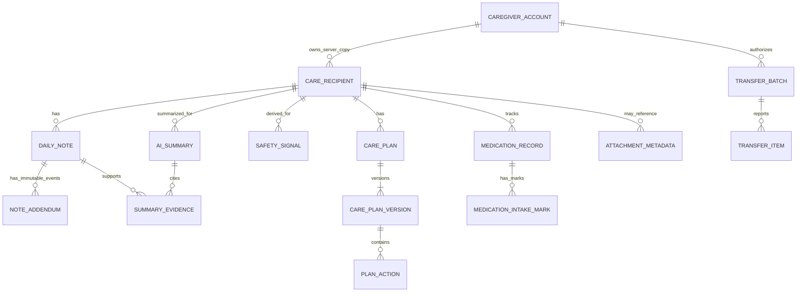
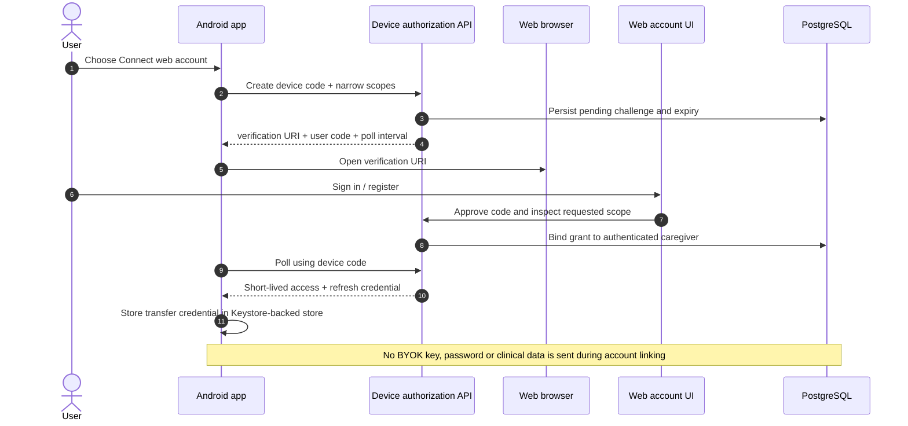
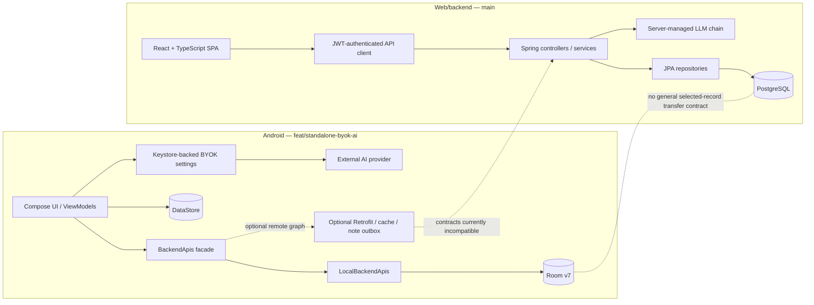
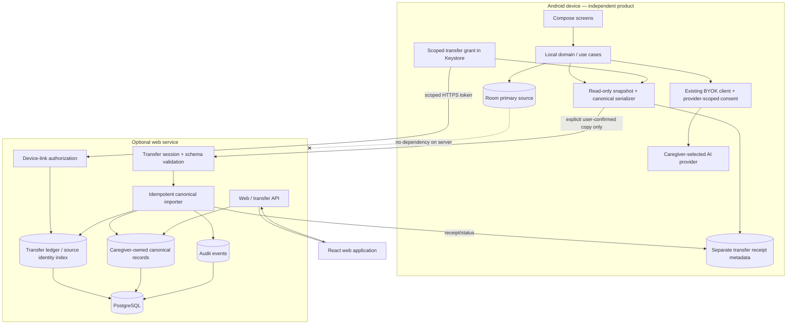
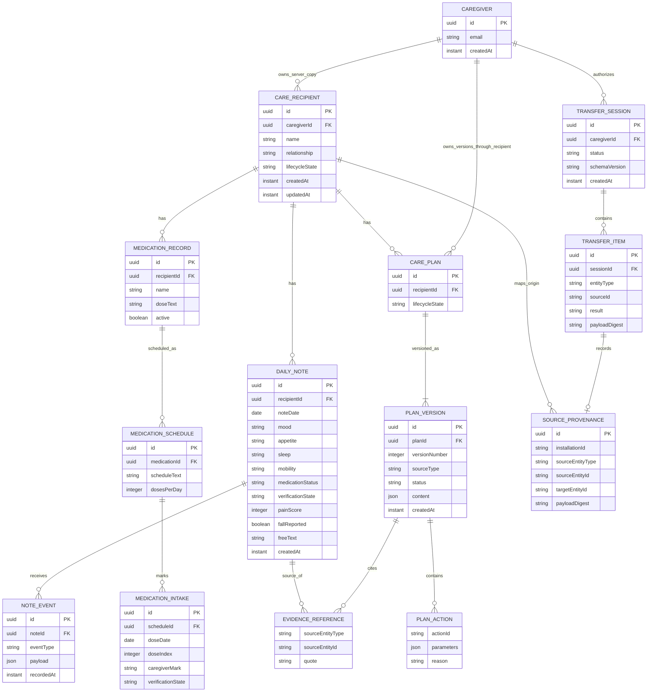
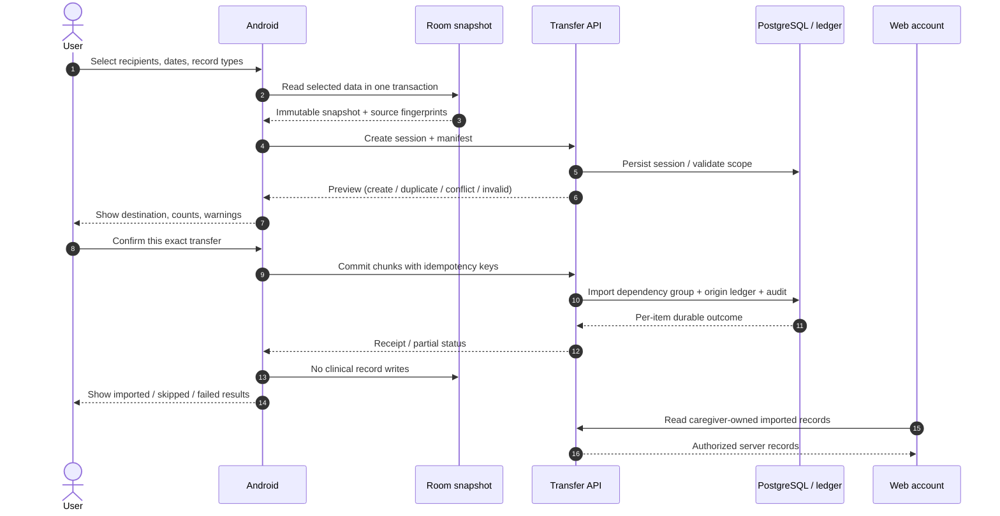
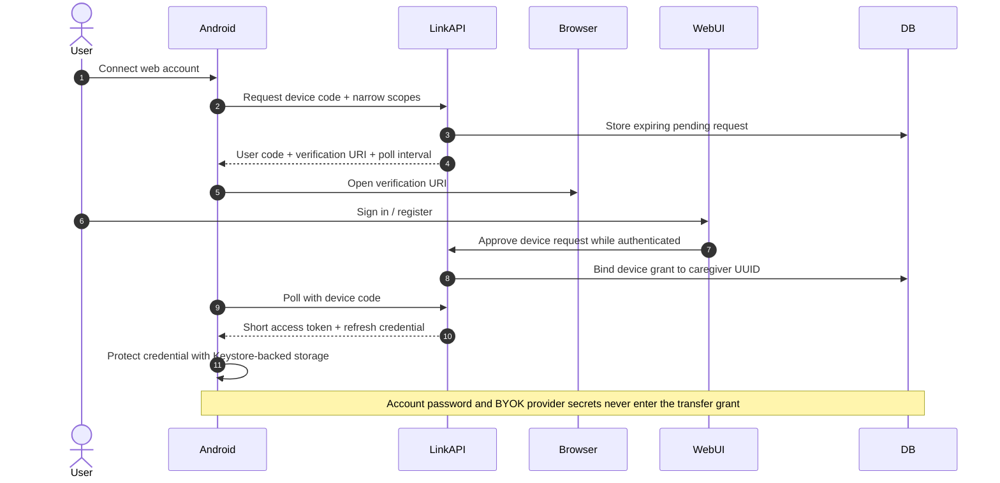
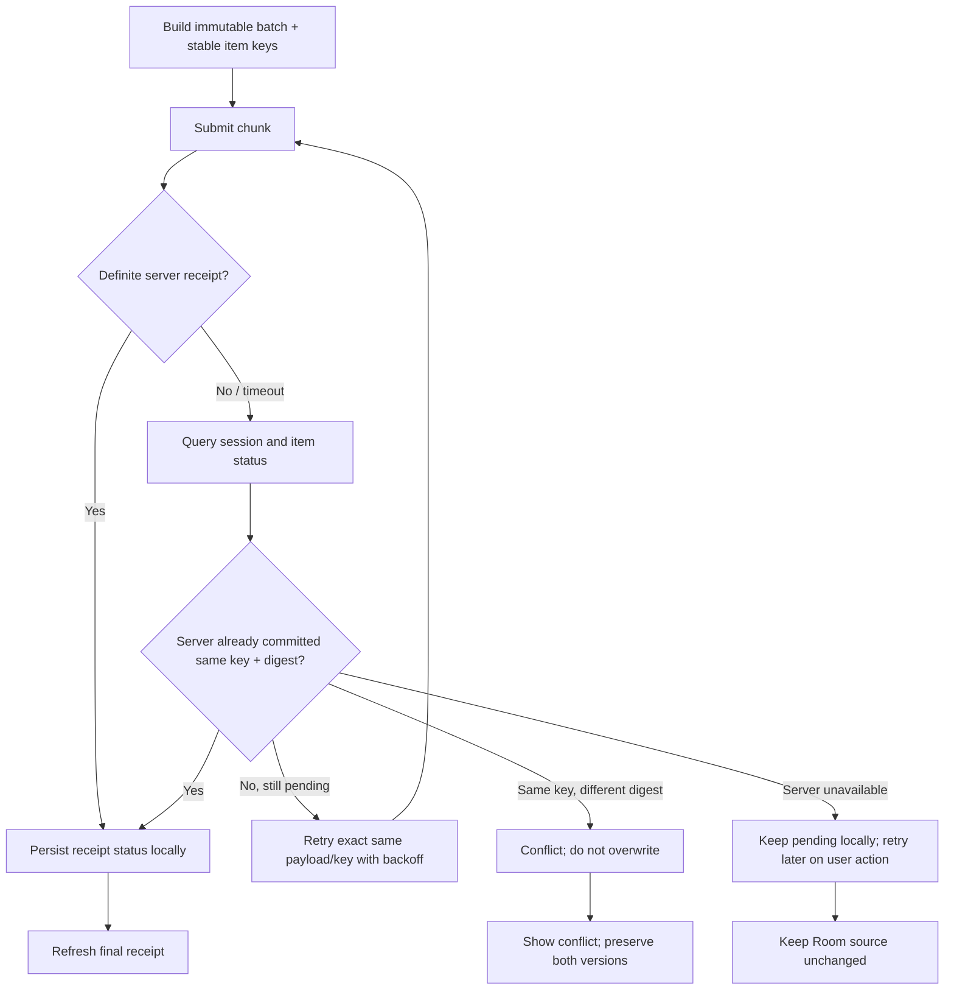
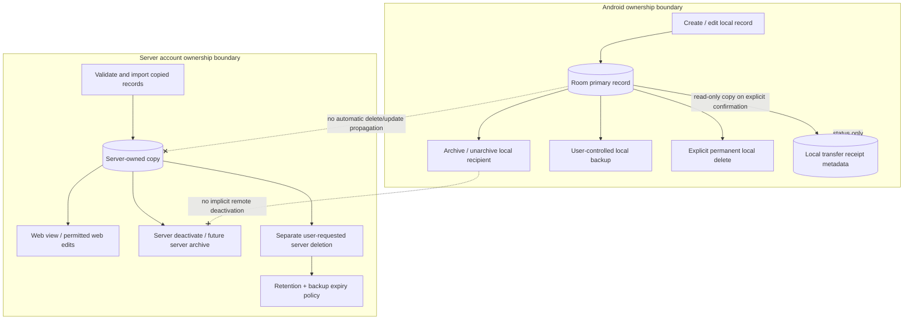

# Phase 2 — Canonical Data Model, Shared API Contracts & Cross-Platform Architecture Design

> **Document status:** Proposed architecture for product-owner review. No proposed decision is an approved requirement until explicitly accepted.
>
> **Scope:** Design and documentation only. This document does not authorize implementation, migrations, API changes, synchronization, authentication changes, or changes to either application.
>
> **Authorship:** Architecture synthesis and documentation by ChatGPT (GPT-6), based on the complete Phase 1 baseline and read-only inspection of the current reference branches.

**Repository:** `alaa157/caregiver-daily-notes`  
**Android reference:** `feat/standalone-byok-ai` at `21876285ad808a6518593ea3974c51b6b1f6bb31`  
**Web/backend reference:** `main` at `14dfff2b7a7049d4ac6285fe340b29c59ba5b595`  
**Phase 1 historical web/backend baseline:** `30b01f08bc51c8da2ed11bbc89dba1f3a73dfbe7`  
**Mandatory baseline:** [`docs/product-alignment/phase-1/README.md`](../phase-1/README.md)

---

## 1. Executive summary

### 1.1 Architecture recommendation

Adopt a **versioned canonical domain contract** and a **user-initiated, one-way Android-to-web import workflow**. Do not turn the current Android outbox into general synchronization and do not make Android depend on the server.

- **Android owns the original local record set.** Room remains the primary Android store. The app must open, read, create, edit, archive, and locally manage core care records without a web account or reachable backend.
- **The web account owns the server-side imported copy.** Importing a record does not transfer ownership away from Android and does not establish bidirectional synchronization.
- **A transfer is a user-authorized copy operation.** The caregiver selects recipient(s), date range, record types, account destination, and confirms the preview. A transfer may add server data, but cannot delete, overwrite, archive, or mutate Android source records.
- **Android BYOK stays on Android.** Provider, API key, model, base URL, consent, and prompts stay device-side. No BYOK credential or private AI configuration enters a transfer payload. Android AI calls continue directly from the device to the selected provider when the user has separately consented and the network is available.
- **The web may retain its server-managed AI architecture.** The shared contract aligns summary, evidence, safety, and plan semantics—not provider infrastructure or credentials.
- **No automatic bidirectional sync is proposed for the first release.** The existing Android outbox is a conditional note-create queue, not a multi-entity transfer or conflict protocol.

### 1.2 Recommended first transfer scope

Subject to product-owner approval:

| Include in first transfer | Defer pending decisions or additional design |
|---|---|
| Recipient identity/display data needed to associate records | Medication catalog and medication intake marks |
| Original daily notes | Care-plan versions until the canonical action model and legacy mapping are approved |
| Existing append-only text addenda, preserved as text events | Android-generated AI summaries as authoritative data; potentially offer later as labelled derived reports |
| Provenance, source IDs, source hashes, transfer receipt metadata | Arbitrary attachments and file uploads; no general attachment model exists today |

The initial import is **additive and non-destructive**. It must reject or quarantine conflicts rather than replace existing web notes. Existing daily-note uniqueness on the backend makes recipient/date conflicts especially important.

### 1.3 Non-negotiable architecture rules

1. No server dependency for Android core functionality. A failed, absent, reset, or permanently unavailable server must not block or corrupt the local app.
2. No server operation may delete or overwrite Room user data. Only a separately confirmed Android-local action can change or remove the local record.
3. No “last write wins” across platforms. Source history is immutable or versioned; collisions become explicit conflicts.
4. Stable origin identity is not the same as a backend primary key. Preserve source platform, installation identity, entity type, source ID, source version, and payload hash.
5. Retries must be idempotent at batch and record level. Retrying an uncertain commit must recover the original result, not create duplicates.
6. Authorization is server-enforced. The client never supplies a trusted caregiver/owner ID; every target recipient must be proven to belong to the authenticated caregiver.
7. Preview/transfer consent is separate from BYOK AI consent. Permission to send data to an AI provider is not permission to upload it to the project backend.
8. Deployment durability is unknown until operations prove it. A PostgreSQL connection string and Flyway configuration do not establish persistent volumes, backups, restore drills, retention, or uptime.

### 1.4 Most important unresolved decisions

Require product-owner approval before implementation: recipient relationship as a core field; recipient archive/delete semantics; historical note entry; one-original-note-per-recipient-per-day; observation null/unknown semantics for legacy values; structured addenda; canonical safety rule catalogue and clinical review; canonical plan action catalogue and legacy mapping; medication tracker transfer; first-release transfer scope and multi-recipient support; account-link flow; server retention/durability guarantees.

---

## 2. Phase 1 baseline and current branch verification

### 2.1 Mandatory baseline read

The complete `docs/product-alignment/phase-1/README.md` was read from beginning to end (all 1,707 lines). It remains the mandatory baseline and was not edited or replaced. This Phase 2 document extends it; it does not supersede its product findings or turn unresolved Phase 1 decisions into approved requirements.

### 2.2 Current branch and commit verification

Both required references exist and their current HEAD commits were recorded:

| Role | Branch | Current HEAD | Commit date / message |
|---|---|---|---|
| Android functional reference | `feat/standalone-byok-ai` | `21876285ad808a6518593ea3974c51b6b1f6bb31` | 2026-10-30 — `fix(cache): report cache-write failures through observable health state` |
| Web/backend reference | `main` | `14dfff2b7a7049d4ac6285fe340b29c59ba5b595` | 2026-11-02 — `docs: consolidate Phase 1 into canonical product alignment source` |

Phase 1 pinned Android to the same Android commit and web/backend to `30b01f08bc51c8da2ed11bbc89dba1f3a73dfbe7`.

### 2.3 Changes since Phase 1

A commit comparison from Phase 1 main (`30b01f08bc51c8da2ed11bbc89dba1f3a73dfbe7`) to current main (`14dfff2b7a7049d4ac6285fe340b29c59ba5b595`) shows:

- `main` is two commits ahead and has no commits behind the Phase 1 baseline.
- The only changed/added path is `docs/product-alignment/phase-1/README.md`, the consolidated 1,707-line source-of-truth document.
- No Android source commit exists after the Android Phase 1 pinned commit; branch comparison is identical.
- No web or backend implementation file changed between the Phase 1 main commit and current main HEAD.

Therefore Phase 1 implementation findings remain applicable to these source snapshots. Newer main commits are documentation changes, not implementation changes.

### 2.4 Verification limits

This is a static source and branch comparison. No APK was installed or inspected, no deployment was accessed, no network transfer was attempted, and no build or automated test suite was run for this Phase 2 design. Current source does not prove that a deployed PostgreSQL instance is durable or that a packaged APK behaves exactly as Gradle source configuration suggests.

---

## 3. Current architecture findings

### 3.1 Android

Android is a Kotlin/Jetpack Compose application whose local product graph uses Room and a local `BackendApis` adapter. The declared `debug`, `release`, and `minified` build types set `LOCAL_MODE=true`; the app graph selects local behavior rather than requiring the web backend. Room registers recipient, note, outbox, plan, addendum, medication, and medication-intake entities. DataStore contains app preferences; Android Keystore-backed storage protects BYOK credentials.

Core local workflows include recipient management, note creation/browsing, text addenda, plans/history, deterministic safety calculations, medication tracking, CSV operations, local backup/restore, and local PDF generation. External AI-provider requests and GitHub update checks are network operations; those services do not make core local records server-dependent.

The optional remote source graph contains Retrofit clients, cache repositories, and a WorkManager note outbox. That path is not a complete transfer design. The outbox contains note-create payloads only; it does not model user-selected recipient/date scope, all record types, transfer receipts, recipient matching, structured migration, or a complete conflict protocol.

**Evidence:** [Gradle build types](https://github.com/alaa157/caregiver-daily-notes/blob/21876285ad808a6518593ea3974c51b6b1f6bb31/android/app/build.gradle.kts#L52-L90); [CaregiverApp/AppGraph](https://github.com/alaa157/caregiver-daily-notes/blob/21876285ad808a6518593ea3974c51b6b1f6bb31/android/app/src/main/java/com/caregiver/mobile/CaregiverApp.kt#L41-L82); [Room database](https://github.com/alaa157/caregiver-daily-notes/blob/21876285ad808a6518593ea3974c51b6b1f6bb31/android/app/src/main/java/com/caregiver/mobile/data/local/AppDatabase.kt#L25-L86); [LocalBackendApis](https://github.com/alaa157/caregiver-daily-notes/blob/21876285ad808a6518593ea3974c51b6b1f6bb31/android/app/src/main/java/com/caregiver/mobile/data/local/LocalBackendApis.kt); [OutboxEntity](https://github.com/alaa157/caregiver-daily-notes/blob/21876285ad808a6518593ea3974c51b6b1f6bb31/android/app/src/main/java/com/caregiver/mobile/data/local/OutboxEntity.kt).

### 3.2 Web/backend

The web client is a React/TypeScript SPA that calls typed API modules. Its inspected data workflows require the backend; no local persistent browser data store equivalent to Room was identified. Web authentication uses a caregiver account session and Bearer-token API requests.

The backend is Spring Boot with Spring MVC/Security, JPA/Hibernate, Flyway, and PostgreSQL configuration. It owns caregiver authentication and caregiver-scoped authorization. Existing entities include caregiver, recipient, daily note, note addendum, plan version, and audit event. Backend AI provider configuration is server-managed through environment configuration and intentionally separate from Android BYOK.

**Evidence:** [web main](https://github.com/alaa157/caregiver-daily-notes/blob/14dfff2b7a7049d4ac6285fe340b29c59ba5b595/web/src/main.tsx); [web routes](https://github.com/alaa157/caregiver-daily-notes/blob/14dfff2b7a7049d4ac6285fe340b29c59ba5b595/web/src/app/App.tsx); [web API modules](https://github.com/alaa157/caregiver-daily-notes/tree/14dfff2b7a7049d4ac6285fe340b29c59ba5b595/web/src/api); [backend SecurityConfig](https://github.com/alaa157/caregiver-daily-notes/blob/14dfff2b7a7049d4ac6285fe340b29c59ba5b595/backend/src/main/java/com/caregiver/config/SecurityConfig.java#L20-L68); [application.yml](https://github.com/alaa157/caregiver-daily-notes/blob/14dfff2b7a7049d4ac6285fe340b29c59ba5b595/backend/src/main/resources/application.yml#L1-L56).

### 3.3 Existing backend API surface

| Capability | Existing route(s) | Observed behavior |
|---|---|---|
| Account | `POST /api/auth/register`, `POST /api/auth/login` | Public registration/login; backend returns JWT |
| Recipients | `GET/POST /api/recipients`; `GET/PUT /api/recipients/{id}`; `PATCH /api/recipients/{id}/deactivate` | Caregiver-owned; update changes name/relationship; deactivate preserves history |
| Notes | `POST /api/notes`; `GET /api/notes/{id}`; `GET /api/notes/by-recipient/{recipientId}?date=`; `GET /api/notes?recipientId=&from=&to=&page=&size=` | Historical date accepted; DB enforces recipient/date uniqueness and owner-scoped idempotency |
| Addenda | `POST /api/notes/{id}/addenda`; `GET /api/notes/{id}/addenda` | Append-only structured corrections; optional idempotency header |
| Signals | `GET /api/notes/signals?recipientId=&from=&to=` | Server derives signals from owned note/addendum history |
| Summary | `POST /api/summaries` | Request includes recipient, period length, inclusive period end date |
| Plan generation | `POST /api/plans/generate` | Backend-managed AI generation and validation |
| Plans | `/api/recipients/{recipientId}/plans/...` | Version rows; ownership and active-plan rules enforced |

No transfer-session endpoint, device-link endpoint, medication controller/entity, general attachment API, or user backup/restore endpoint was found.

**Evidence:** [NoteController](https://github.com/alaa157/caregiver-daily-notes/blob/14dfff2b7a7049d4ac6285fe340b29c59ba5b595/backend/src/main/java/com/caregiver/notes/NoteController.java); [DailyNoteService](https://github.com/alaa157/caregiver-daily-notes/blob/14dfff2b7a7049d4ac6285fe340b29c59ba5b595/backend/src/main/java/com/caregiver/notes/DailyNoteService.java); [RecipientController](https://github.com/alaa157/caregiver-daily-notes/blob/14dfff2b7a7049d4ac6285fe340b29c59ba5b595/backend/src/main/java/com/caregiver/recipient/RecipientController.java); [PlanController](https://github.com/alaa157/caregiver-daily-notes/blob/14dfff2b7a7049d4ac6285fe340b29c59ba5b595/backend/src/main/java/com/caregiver/plans/PlanController.java); [SummaryController](https://github.com/alaa157/caregiver-daily-notes/blob/14dfff2b7a7049d4ac6285fe340b29c59ba5b595/backend/src/main/java/com/caregiver/ai/SummaryController.java).

### 3.4 Android Retrofit/backend incompatibilities

| Concern | Android Retrofit contract | Backend contract | Consequence |
|---|---|---|---|
| Recipient update | `PUT /api/recipients/{id}` body `{active}`; DTO carries `archivedAt` | `PUT` expects name/relationship; lifecycle uses `PATCH /{id}/deactivate` | Incompatible body and lifecycle |
| Note create | recipient + values + `idempotencyKey` in body; no date | Requires `date`; uses `medicationStatus`, `medicationVerified`, `painScore`, `fallReported`, `freeText`; idempotency uses HTTP header | Date and field meaning cannot be sent losslessly |
| Note history | Returns `List<NoteDto>` | Returns paginated `Page<NoteResponse>` and requires from/to | Response decoder mismatch |
| Addendum | `{text}` | Structured correction fields + free text | Must preserve Android text addendum as event |
| Signals | `/api/recipients/{id}/signals` | `/api/notes/signals?recipientId=&from=&to=` | Route mismatch |
| Summary | `{recipientId,periodDays}` | Also requires `periodEndInclusive` | Request mismatch |
| Plans | `/api/plans/...`; string items | Nested recipient route; structured versions/actions | Route and payload mismatch |

The current Android local build is not broken by these mismatches because it selects the Room-backed local graph. They block optional remote interoperability; they are not grounds to make core Android features server-dependent.

**Evidence:** [Android NoteApi](https://github.com/alaa157/caregiver-daily-notes/blob/21876285ad808a6518593ea3974c51b6b1f6bb31/android/app/src/main/java/com/caregiver/mobile/data/api/NoteApi.kt); [RecipientApi](https://github.com/alaa157/caregiver-daily-notes/blob/21876285ad808a6518593ea3974c51b6b1f6bb31/android/app/src/main/java/com/caregiver/mobile/data/api/RecipientApi.kt); [SummaryApi](https://github.com/alaa157/caregiver-daily-notes/blob/21876285ad808a6518593ea3974c51b6b1f6bb31/android/app/src/main/java/com/caregiver/mobile/data/api/SummaryApi.kt); [PlanApi](https://github.com/alaa157/caregiver-daily-notes/blob/21876285ad808a6518593ea3974c51b6b1f6bb31/android/app/src/main/java/com/caregiver/mobile/data/api/PlanApi.kt); [backend NoteController](https://github.com/alaa157/caregiver-daily-notes/blob/14dfff2b7a7049d4ac6285fe340b29c59ba5b595/backend/src/main/java/com/caregiver/notes/NoteController.java).

---

## 4. Canonical domain model

### 4.1 Modelling principles

The canonical model is a platform-neutral **transfer and interoperability contract**, not a demand to replace Room or JPA with one shared runtime database.

1. Canonical payloads are versioned (`schemaVersion`) and reject unsupported major versions without guessed coercion.
2. Each entity has a canonical UUID where the destination needs a stable server identifier. Source identity is separately preserved as `(sourcePlatform, sourceInstallationId, entityType, sourceEntityId)` plus `sourceVersion` and `contentHash`.
3. The same UUID-like string from two installations is not assumed globally unique. The provenance tuple—not a display name, date, or raw UUID alone—is the imported-record identity.
4. New mutable entities carry `createdAt`, `updatedAt`, and monotonic `entityVersion`. Immutable events carry `occurredAt` and immutable event ID. Legacy rows lacking timestamps retain a precision marker rather than receiving invented times.
5. `LocalDate` and `Instant` are distinct. `noteDate` remains a calendar date and is never shifted by UTC conversion. `timeZoneId` is provenance, not a rule for rewriting dates.
6. Unknown legacy enum values are preserved as raw source values; they are not discarded or mapped to a nearby enum/confirmed negative.
7. Derived safety flags and AI summaries retain source evidence and rule/prompt/model version. They are not substitutes for source notes.
8. Additions and corrections are events. The original note and prior correction events remain traceable.
9. No transfer payload contains API keys, passwords, access/refresh tokens, private provider URLs, custom prompts, or local preferences.

### 4.2 Shared types and null/unknown semantics

Canonical JSON uses `string`, `integer`, `boolean`, `number`, `array`, `object`; UUIDs are strings; dates are `YYYY-MM-DD`; instants are RFC 3339; zones are IANA identifiers such as `Africa/Cairo`.

Do not use bare `null` to represent multiple meanings. Use an observation wrapper:

```json
{"state":"RECORDED","value":"good","rawValue":null}
```

| State | Meaning |
|---|---|
| `RECORDED` | A caregiver recorded a value; `false` can be an explicit negative only if source capture proves it |
| `UNKNOWN` | Explicitly unknown/not known |
| `NOT_RECORDED` | No value was recorded |
| `NOT_APPLICABLE` | Field does not apply, when explicitly indicated |
| `UNVERIFIED` | A value was reported but its truth/verification is not established |
| `LEGACY_AMBIGUOUS` | Old storage cannot distinguish an explicit value from a default or establish its meaning |

For categorical values, preserve known canonical `value`; if a source value is unrecognized, retain exact `rawValue` and use a namespaced `OTHER` only if required. Do not coerce unfamiliar values to `UNKNOWN`.

For booleans, `false` is an explicit negative only if the source UI/flow proves the caregiver actively selected “No”. Otherwise preserve it as `LEGACY_AMBIGUOUS`. Pain `0` is recorded zero only if the capture UI confirms it was intentionally selectable; otherwise preserve legacy ambiguity.

Medication status (`TAKEN`, `MISSED`, `UNKNOWN`) and verification (`VERIFIED`, `UNVERIFIED`, `NOT_ASSERTED`) are independent. Android `UNSURE` is not `MISSED`; unverified `TAKEN` is not adherence evidence.

### 4.3 Canonical entity relationships



This is a logical target model, not the current Room/JPA ER diagram. Android Room currently uses application-level string-ID references without declared foreign keys. Target server storage should enforce relational integrity and caregiver ownership with foreign keys and service-layer authorization.

### 4.4 Field-level canonical entities

`Required` means required for a new canonical record. Legacy imports can use an explicit unknown/ambiguous wrapper when the source cannot provide a value. First-transfer scope is a recommendation, not approved scope.

#### 4.4.1 Caregiver identity/account

| Field | Type | Required? | Meaning |
|---|---|---:|---|
| `id` | UUID string | Server-required | Backend caregiver account ID; never trusted from transfer JSON |
| `email` | string | Server-required | Backend login identity; not copied from Android local profile |
| `createdAt` | Instant | Server-required | Account creation time |
| `localProfileId` | UUID string | Optional/local-only | Proposed pseudonymous local profile ID if later needed; no current Android caregiver Room entity exists |
| `linkedInstallations` | collection | Optional | Server-side device links, not shared caregiver data |

A local Android installation is not automatically the same identity as the web `Caregiver` entity. Linking authorizes a device to import to an existing account; it does not merge identities or transfer local ownership.

Evidence: [backend Caregiver](https://github.com/alaa157/caregiver-daily-notes/blob/14dfff2b7a7049d4ac6285fe340b29c59ba5b595/backend/src/main/java/com/caregiver/auth/Caregiver.java); [Android CaregiverRoot](https://github.com/alaa157/caregiver-daily-notes/blob/21876285ad808a6518593ea3974c51b6b1f6bb31/android/app/src/main/java/com/caregiver/mobile/CaregiverRoot.kt).

#### 4.4.2 Care recipient

| Field | Type | Required? | Meaning / rule |
|---|---|---:|---|
| `id` | UUID string | Yes | Canonical server ID; source ID stored in provenance |
| `name` | string (backend max 120) | Yes | Nonblank display name |
| `relationship` | string (backend max 80) | Optional | Exists backend-side; absent from Android Room; PO decision before adding to Android |
| `lifecycle.state` | enum | Yes | Proposed `ACTIVE`, `ARCHIVED`, `DEACTIVATED`, `DELETION_REQUESTED`, `DELETED_TOMBSTONE`; approval pending |
| `lifecycle.archivedAt` | Instant | Optional | Archive time, not deletion time |
| `lifecycle.deactivatedAt` | Instant | Optional | Account-side disable time if distinct semantics are approved |
| `createdAt` | Instant | New records | Backend has it; Android local recipient currently does not |
| `updatedAt` | Instant | Mutable records | Backend has it; Android local recipient does not |
| `entityVersion` | integer | Mutable records | Monotonic revision; Android source has no equivalent |
| `provenance` | object | Imported records | Source platform/install/source ID/hash |

Android `RecipientEntity` has `rowId`, `serverId`, nullable `localId`, `name`, `active`, nullable `archivedAt` epoch ms; no relationship/createdAt/updatedAt. Backend `CareRecipient` has UUID, owner FK, name, nullable relationship, active, createdAt/updatedAt; no `archivedAt`. `rowId` is local ordering only and must not transfer.

#### 4.4.3 Daily note

| Field | Type | Required? | Null/semantic rules |
|---|---|---:|---|
| `id` | UUID string | Yes | Canonical ID; source ID in provenance |
| `recipientId` | UUID string | Yes | Parent recipient must belong to authenticated destination account |
| `noteDate` | LocalDate | Yes | `YYYY-MM-DD`; preserve source calendar date |
| `timeZoneId` | IANA zone | Recommended | Zone used for caregiver's local day; absent on legacy Android rows |
| `observations.mood` | Observation<string> | Yes | Android known values `good`, `fair`, `bad` |
| `observations.appetite` | Observation<string> | Yes | `good`, `reduced`, `poor` |
| `observations.sleep` | Observation<string> | Yes | `good`, `broken`, `poor` |
| `observations.mobility` | Observation<string> | Yes | `walks`, `assisted`, `bed` |
| `observations.painScore` | Observation<integer> | Yes | 0–10 if explicitly recorded; preserve legacy ambiguity |
| `observations.fallReported` | Observation<boolean> | Yes | `true` positive; legacy `false` semantics depend on capture path |
| `observations.medication.status` | Observation<enum> | Yes | `TAKEN`, `MISSED`, `UNKNOWN` |
| `observations.medication.verification` | enum | Yes | `VERIFIED`, `UNVERIFIED`, `NOT_ASSERTED`; Android lacks separate field |
| `freeText` | string/explicit text state | Optional | Exact Unicode preserved |
| `createdAt` | Instant | Optional for legacy Android | Backend has it; Android note row does not |
| `updatedAt` | Instant | Optional | Prefer correction events instead of rewriting original |
| `entityVersion` | integer | Yes | Starts at 1 |
| `provenance` | object | Yes | Platform/install/source ID/hash |

Original note is immutable after creation. If direct editing is later allowed, represent it as an append-only event or preserved revision, not an untracked overwrite.

#### 4.4.4 Observation value

| Field | Type | Required? | Meaning |
|---|---|---:|---|
| `state` | enum | Yes | States defined in 4.2 |
| `value` | typed scalar | Conditional | Set for a recorded value |
| `rawValue` | string | Optional | Exact value where canonical mapping is not lossless |
| `sourceField` | string | Optional | Original source field name |
| `recordedAt` | Instant | Optional | Capture time if known |

An explicit negative is `RECORDED,false`; it is not `NOT_RECORDED`. Explicit medication `unsure` becomes `UNKNOWN`/`UNVERIFIED`. Missing nullable backend field maps to `NOT_RECORDED` unless evidence establishes another state.

#### 4.4.5 Addendum/correction event

| Field | Type | Required? | Meaning |
|---|---|---:|---|
| `id` | UUID | Yes | Immutable event ID |
| `noteId` | UUID | Yes | Original note parent |
| `eventType` | enum | Yes | `TEXT_APPEND`, `STRUCTURED_CORRECTION`, `TEXT_AND_CORRECTION`, `LEGACY_UNCLASSIFIED` |
| `text` | string | Optional | Exact additional narrative |
| `corrections` | array | Optional | Field operations; each is explicit `SET` or `CLEAR` |
| `occurredAt` | Instant | New events | Legacy local time without offset must preserve local string and timestamp precision marker |
| `sequence` | integer | New event stream | Stable tie-breaker; do not order solely by locale-formatted timestamp |
| `author` | source/actor ref | Optional | Local actor or authenticated caregiver where known |
| `idempotencyKey` | string | Optional | Per source operation |
| `provenance` | object | Imported | Source ID/version/hash |

Example correction:

```json
{"field":"painScore","operation":"SET","value":{"state":"RECORDED","value":3}}
```

`CLEAR` differs from a field omitted from the patch. Corrections never erase previous events. Effective values are computed by replay in `(occurredAt,sequence,id)` order.

#### 4.4.6 Safety signal/rule specification

| Field | Type | Required? | Meaning |
|---|---|---:|---|
| `id` | string | Yes | Stable rule ID such as `HIGH_PAIN` |
| `ruleVersion` | string/integer | Yes | Exact deterministic rule version |
| `severity` | enum | Yes | Proposed `INFO`, `WATCH`, `HIGH`; approval required |
| `recipientId` | UUID | Yes | Recipient context |
| `window.startInclusive/endInclusive` | LocalDate | Yes | Evaluation window |
| `triggeredAt` | Instant | Optional | Calculation time |
| `evidenceRefs` | array | Yes | Note/addendum IDs and field references |
| `explanationKey` | string | Yes | Stable localized explanation key |
| `explanationParams` | object | Optional | Safe counts/values for display |
| `acknowledgement.state` | enum | Optional | `NOT_ACKNOWLEDGED`, `ACKNOWLEDGED`; dismissal unresolved |
| `acknowledgement.actor/at` | actor/Instant | Optional | Who acknowledged and when |
| `source` | enum | Yes | `ANDROID_RULE_ENGINE`, `SERVER_RULE_ENGINE`, `IMPORTED_DERIVED` |

A signal is derived output, not an independent diagnosis. It must be reproducible from source observations and a named rule version. Receiving platforms may recalculate using the approved rule engine and preserve imported calculations as historical provenance.

A separate **SafetyRuleDefinition** describes the executable, versioned rule rather than one evaluated result:

| Field | Type | Required? | Meaning |
|---|---|---:|---|
| `ruleId` | string | Yes | Stable signal identifier |
| `ruleVersion` | string/integer | Yes | Immutable rule definition revision |
| `inputFieldPaths` | array | Yes | Canonical observation fields used by the predicate |
| `conditionDefinition` | versioned JSON/DSL | Yes | Reviewed predicate; no arbitrary executable code from a client or model |
| `parameters` | object | Conditional | Threshold/count/window values only after product/clinical approval |
| `windowStrategy` | enum/object | Yes | `SINGLE_RECORD`, `DISTINCT_DATES`, `CONSECUTIVE_DATES`, or approved rolling window |
| `missingDataPolicy` | enum | Yes | Whether missing/unknown/unverified is ignored, produces uncertainty, or blocks evaluation |
| `severity` | enum | Yes | `INFO`, `WATCH`, `HIGH` only after approval |
| `explanationKey` | string | Yes | Localizable caregiver-facing explanation |
| `evidenceSelection` | object | Yes | Deterministic rule for the source references returned |
| `effectiveFrom/effectiveTo` | date/Instant | Yes/optional | Rule deployment interval |
| `clinicalReviewState` | enum | Required for clinical-like rules | `NOT_REVIEWED`, `REVIEWED`, `REJECTED`; approval metadata |
| `acknowledgementPolicy` | enum | Yes | Whether an event may be acknowledged; acknowledgement never removes the computed signal |

Rules are data/configuration reviewed and versioned by the product, not generated dynamically by AI. The existing code does not persist a shared rule-definition catalogue or signal acknowledgement entity; both are proposed capabilities.

#### 4.4.7 AI summary

| Field | Type | Required? | Meaning |
|---|---|---:|---|
| `id` | UUID | Yes | Summary run ID |
| `recipientId` | UUID | Yes | Recipient summarized |
| `period.startInclusive/endInclusive` | LocalDate | Yes | Date range |
| `period.days` | integer | Yes | Inclusive period length; current product supports 7/14/30 |
| `generationMode` | enum | Yes | `DEVICE_BYOK`, `SERVER_MANAGED`, `DETERMINISTIC_FALLBACK`, `IMPORTED` |
| `summaryText` | string | Optional | Empty/unavailable output must not be labelled generated AI |
| `observations` | array | Optional | Narrative claims with evidence |
| `uncertainties` | array | Optional | Explicit limitations |
| `evidenceRefs` | array | Yes | Note/addendum references and quote spans |
| `safetyRuleSetVersion` | string | Optional | Rule version for separate safety overlay |
| `promptVersion` | string | Optional | Version identifier only; never prompt contents |
| `modelId` | string | Optional | Model identifier only; no API key/endpoint |
| `generatedAt` | Instant | Optional for legacy | Generation time, not period date |
| `validationStatus` | enum | Yes | `VALIDATED`, `UNAVAILABLE`, `REJECTED`, `DETERMINISTIC_ONLY`, `LEGACY_UNKNOWN` |

No API key, auth token, custom prompt, private base URL, or device secret is serialized. An imported summary is historical derived content. Web may generate a separate fresh summary from imported notes; it must not overwrite or misrepresent the historical run.

#### 4.4.8 Summary evidence/source reference

| Field | Type | Required? | Meaning |
|---|---|---:|---|
| `id` | UUID | Yes | Evidence link ID |
| `summaryId` | UUID | Yes | Parent summary |
| `sourceEntityType` | enum | Yes | `DAILY_NOTE` or `NOTE_ADDENDUM` |
| `sourceEntityId` | UUID/source ID | Yes | Immutable source reference |
| `quote` | string | Optional | Exact sensitive quote; include only if summary transfer selected |
| `fieldPath` | string | Optional | Structured source field |
| `claimIndex` | integer | Optional | Claim to which evidence applies |

Validate evidence against uploaded source records and account ownership.

#### 4.4.9 Care plan and plan versions

Separate the logical plan from immutable version history.

**Care plan header**

| Field | Type | Required? | Meaning |
|---|---|---:|---|
| `id` | UUID | Yes | Logical plan ID |
| `recipientId` | UUID | Yes | Parent recipient |
| `lifecycleState` | enum | Yes | `OPEN`, `ARCHIVED` |
| `activeAcceptedVersionId` | UUID | Optional | At most one active accepted version per recipient under current backend rule |
| `createdAt`, `updatedAt` | Instant | Yes | Header timestamps |
| `provenance` | object | Yes | Original source ID/install |

**Plan version**

| Field | Type | Required? | Meaning |
|---|---|---:|---|
| `id` | UUID | Yes | Immutable version ID |
| `planId` | UUID | Yes | Plan header |
| `versionNumber` | integer | Yes | Monotonic version; exact scope to standardize |
| `status` | enum | Yes | `SUGGESTED`, `ACCEPTED`, `EDITED_AND_ACCEPTED`, `DISMISSED`, `ARCHIVED` |
| `sourceType` | enum | Yes | `AI_GENERATED`, `CAREGIVER_SUBMITTED`, `CAREGIVER_EDITED`, `IMPORTED_LEGACY`, `UNSPECIFIED` |
| `schemaVersion` | integer | Optional | Structured document version |
| `actions` | array | Optional | Closed action catalogue and exact params |
| `legacyTextItems` | array | Optional | Original Android text lines not safely mappable |
| `reason` | string | Optional | Action rationale |
| `evidenceNoteIds` | array | Optional | Must resolve to notes owned by recipient/account |
| `sourceSummaryId` | string | Optional | Source summary |
| `sourcePlanVersionId` | UUID | Optional | Baseline version |
| `medicationsSnapshot` | array | Optional | Read-only; never edited by plan workflow |
| `createdAt` | Instant | Yes | Version creation time |

Backend action catalogue: `SCHEDULE_CHECK_IN(withinDays)`, `UPDATE_MEAL_REMINDER(meal,time)`, `LOG_MOBILITY_GOAL(activity,frequency)`, `CAREGIVER_EDUCATION_TOPIC(topic)`, `ESCALATE_TO_DOCTOR(reason)`. The server validates exact parameter keys, evidence, and medication immutability. Android `items: List<String>` cannot be safely converted based on wording alone; preserve unknown strings as legacy text until explicitly mapped.

No plan action may prescribe, add, remove, or modify medication, dose, schedule, or medication identity. Medication hard-lock remains mandatory.

#### 4.4.10 Medication record

| Field | Type | Required? | Meaning |
|---|---|---:|---|
| `id` | UUID/source ID | Yes | Medication tracker identity |
| `recipientId` | UUID | Yes | Parent recipient |
| `name` | string | Yes | Caregiver-entered name, not verified prescription |
| `doseText` | string | Optional | Existing free-text dose |
| `scheduleText` | string | Optional | Existing free-text schedule; do not infer dose times |
| `dosesPerDay` | integer | Yes | Android validation currently 1–4 |
| `active` | boolean | Yes | Tracker state |
| `createdAt` | Instant | Yes canonically | Android currently stores epoch milliseconds |
| `updatedAt` | Instant | Optional | Not in Android entity |
| `provenance` | object | Yes | Source device and ID |

This is a caregiver-maintained tracker, not a prescription order. It does not prove a dose was scheduled at a precise time or taken.

#### 4.4.11 Medication intake mark

| Field | Type | Required? | Meaning |
|---|---|---:|---|
| `id` | UUID/source ID | Yes | Mark identity; Android key includes medication/date/dose index |
| `medicationId` | UUID/source ID | Yes | Parent medication |
| `localDate` | LocalDate | Yes | Calendar day |
| `doseIndex` | integer | Yes | Index base must be normalized explicitly |
| `markState` | enum | Yes | `MARKED_TAKEN`; `NOT_MARKED` is derived from absence, not fabricated as an ingestion event |
| `markedAt` | Instant | Optional | Android does not record this |
| `verifiedIngestion` | enum | Yes | `NOT_VERIFIED` by default |
| `provenance` | object | Yes | Source installation and mark ID |

Android `times` and the derived key need a lossless adapter. If multiple marks can exist per dose/day, preserve count as legacy metadata. An absent row means “not marked taken”, not “missed” or verified non-ingestion.

#### 4.4.12 Attachments and exported files

No general attachment entity, arbitrary file upload, or secure file API was found. Android PDF reports, CSV, and backup files are **export artifacts**, not care-record attachments.

If approved later, `Attachment` needs: ID; owner/recipient; optional note ID; safe name; MIME type; byte size; SHA-256; content storage reference; createdAt; provenance; malware-scan state; retention/deletion state; access policy. Raw content belongs in a separately secured object store with size/type validation and malware scanning.

`ExportArtifact` is separate: backup/CSV/PDF format, schema/version, generatedAt, optional checksum. Exporting does not upload or guarantee durable server storage.

#### 4.4.13 Archive/deletion lifecycle

| Field | Type | Meaning |
|---|---|---|
| `state` | enum | `ACTIVE`, `ARCHIVED`, `DEACTIVATED`, `DELETION_REQUESTED`, `DELETED_TOMBSTONE` |
| `changedAt` | Instant | Event time |
| `changedBy` | actor/source ref | Local user, authenticated caregiver, or system |
| `reason` | optional enum/text | User-selected reason only |
| `previousState` | enum | Prior state |
| `retentionUntil` | Instant optional | Server policy metadata |

These are proposed states, not current exact enums. `ARCHIVED` should be reversible, preserve children, and block writes as Android currently does. `DEACTIVATED` remains separate only if product semantics require it. Deletion-request/tombstone states are server retention concepts and must never trigger Android deletion.

#### 4.4.14 Transfer provenance and receipt metadata

| Field | Type | Required? | Meaning |
|---|---|---:|---|
| `sourcePlatform` | enum | Yes | `ANDROID`, `WEB`, `BACKEND`, `LEGACY_IMPORT` |
| `sourceInstallationId` | UUID | Android source | Stable installation identity, not a secret |
| `sourceEntityType` | enum | Yes | Entity type |
| `sourceEntityId` | string | Yes | Original source record ID |
| `sourceVersion` | integer/string | Yes | Source revision or `1` for immutable legacy rows |
| `contentHash` | SHA-256 | Yes | Canonical payload hash excluding volatile transfer metadata |
| `sourceCreatedAt` | Instant/legacy local | Optional | Preserve unknown timestamp precision |
| `importedAt` | Instant | Server-set | Destination acceptance time |
| `transferId` | UUID | Server-set | Batch receipt |

Store transfer receipts separately on Android so receipt updates never rewrite source recipient/note/addendum/plan/medication rows.

### 4.5 Example canonical note

```json
{
  "schemaVersion": 1,
  "entityType": "DAILY_NOTE",
  "id": "f2a3b1a8-3fbb-4ef8-8ff5-1c03a511a100",
  "recipientId": "c0aa2a3b-2c2a-4a4d-b63f-7fabc1221000",
  "noteDate": "2026-10-30",
  "timeZoneId": "Africa/Cairo",
  "observations": {
    "mood": {"state":"RECORDED","value":"good"},
    "appetite": {"state":"RECORDED","value":"reduced"},
    "sleep": {"state":"RECORDED","value":"broken"},
    "mobility": {"state":"RECORDED","value":"assisted"},
    "painScore": {"state":"RECORDED","value":0},
    "fallReported": {"state":"RECORDED","value":false},
    "medication": {
      "status":{"state":"RECORDED","value":"TAKEN"},
      "verification":"NOT_ASSERTED"
    }
  },
  "freeText": "Caregiver-entered note text is preserved exactly.",
  "createdAt": null,
  "updatedAt": null,
  "entityVersion": 1,
  "provenance": {
    "sourcePlatform":"ANDROID",
    "sourceInstallationId":"d230be8d-dc5b-4f20-b149-4a6a2d321111",
    "sourceEntityType":"DAILY_NOTE",
    "sourceEntityId":"f2a3b1a8-3fbb-4ef8-8ff5-1c03a511a100",
    "sourceVersion":1,
    "contentHash":"sha256:REPLACE_WITH_HASH"
  }
}
```

The sample uses explicit zero/false. Legacy rows must use `LEGACY_AMBIGUOUS` unless source capture semantics prove that the caregiver explicitly recorded these values.

## 5. Android-to-canonical mapping

### 5.1 Entity mapping

| Android Room/API source | Current fields and behavior | Canonical mapping | Lossless? / handling |
|---|---|---|---|
| `RecipientEntity` / `RecipientDto` | `rowId`, `serverId`, `localId?`, `name`, `active`, `archivedAt?` | `CareRecipient.name`, lifecycle state, provenance | Partial: no relationship/createdAt/updatedAt; omit `rowId`; do not assume `serverId` is a web server ID |
| `NoteEntity` / `NoteDto` | `serverId`, `localId?`, recipient, ISO date, non-null category strings, medication status, pain Int, fall Boolean, text | `DailyNote` + observation wrappers + provenance | Partial: no createdAt/updatedAt, no medication verification, primitive defaults may be ambiguous, ID namespace is local |
| `AddendumEntity` | `id`, `noteId`, local date-time string, `text` | `NOTE_ADDENDUM` with `TEXT_APPEND` and legacy timestamp provenance | Partial: no offset/zone, author, source version or structured patch |
| `PlanEntity` | `id`, `recipientId`, `versionsJson`, `updatedAt` epoch ms | `CarePlan` + decoded `CarePlanVersion` records | Partial: string items cannot be mapped safely to backend action catalogue; preserve as legacy text |
| `MedicationEntity` | `id`, recipient, name, optional dose/schedule text, active, createdAt epoch ms, dosesPerDay 1–4 | `MedicationRecord` | Fields largely preserved; schedule/dose remain raw text, not normalized prescription |
| `MedicationIntakeEntity` | `id`, medicationId, ISO date, `times` | `MedicationIntakeMark` | Partial: markedAt absent; verify `times` and dose-index base; absence is not a stored missed-dose event |
| Android safety evaluator | Deterministic flags | `SafetySignal` with evaluator/rule version and evidence | Partial: output may not expose complete evidence or rule metadata; preserve as derived result |
| Android AI summary | Narrative, evidence quotes, uncertainty, red flags; direct BYOK | `AiSummary` + evidence + separate safety overlay | Partial: no credentials/endpoints/prompts; include only selected historical output |
| Android outbox | Note-only pending row and status | Not the transfer ledger | Not a transfer contract; do not reuse as batch state |
| Android `.carebackup.json` | Backup schema v3 contains recipients, notes, addenda, plans, medication/intakes; excludes outbox, settings, credentials | Input to a local snapshot adapter, not API envelope | Backup is replacement restore format; never upload as opaque transfer bundle |
| CSV export | Notes-only, no note ID; recipient/date/observations/text | Optional legacy import input only | Lossy: no stable note IDs, addenda, plans, meds or complete provenance |
| PDF report | Derived export shared through Android chooser | `ExportArtifact` | Not a care record or automatic attachment |

### 5.2 Android details that matter

- Note option values are `mood: good/fair/bad`, `appetite: good/reduced/poor`, `sleep: good/broken/poor`, `mobility: walks/assisted/bed`, medication `taken/missed/unsure`. Preserve codes exactly.
- `NoteEntity` fields are non-null strings/primitives; that shape cannot represent backend nullable observation values without additional semantics.
- Local note creation assigns `LocalDate.now()`; the local create contract has no historical-date input, although the persisted entity stores an ISO date.
- Addenda use `LocalDateTime.now().toString()` without zone offset. Do not fabricate UTC instants for them.
- Plan history is JSON in one Room row; backend uses relational rows per version. Decode full history but preserve source JSON if exact round-trip fidelity is required.
- Medication and intake tables have no backend equivalent.

**Evidence:** [NoteOptions.kt](https://github.com/alaa157/caregiver-daily-notes/blob/21876285ad808a6518593ea3974c51b6b1f6bb31/android/app/src/main/java/com/caregiver/mobile/presentation/notes/NoteOptions.kt); [RecipientEntity.kt](https://github.com/alaa157/caregiver-daily-notes/blob/21876285ad808a6518593ea3974c51b6b1f6bb31/android/app/src/main/java/com/caregiver/mobile/data/local/RecipientEntity.kt); [NoteEntity.kt](https://github.com/alaa157/caregiver-daily-notes/blob/21876285ad808a6518593ea3974c51b6b1f6bb31/android/app/src/main/java/com/caregiver/mobile/data/local/NoteEntity.kt); [AddendumEntity.kt](https://github.com/alaa157/caregiver-daily-notes/blob/21876285ad808a6518593ea3974c51b6b1f6bb31/android/app/src/main/java/com/caregiver/mobile/data/local/AddendumEntity.kt); [PlanEntity.kt](https://github.com/alaa157/caregiver-daily-notes/blob/21876285ad808a6518593ea3974c51b6b1f6bb31/android/app/src/main/java/com/caregiver/mobile/data/local/PlanEntity.kt); [MedicationEntity.kt](https://github.com/alaa157/caregiver-daily-notes/blob/21876285ad808a6518593ea3974c51b6b1f6bb31/android/app/src/main/java/com/caregiver/mobile/data/local/MedicationEntity.kt); [LocalBackendApis.kt](https://github.com/alaa157/caregiver-daily-notes/blob/21876285ad808a6518593ea3974c51b6b1f6bb31/android/app/src/main/java/com/caregiver/mobile/data/local/LocalBackendApis.kt); [BackupFormat.kt](https://github.com/alaa157/caregiver-daily-notes/blob/21876285ad808a6518593ea3974c51b6b1f6bb31/android/app/src/main/java/com/caregiver/mobile/data/backup/BackupFormat.kt).

---

## 6. Backend-to-canonical mapping

### 6.1 Entity mapping

| Backend JPA/API source | Existing representation | Canonical mapping | Lossless? / handling |
|---|---|---|---|
| `Caregiver` | UUID, normalized email, password hash, createdAt | `CaregiverAccount` | Do not transfer password hash/email as local identity; account is authenticated owner context |
| `CareRecipient` | UUID, caregiver FK, name, nullable relationship, active, createdAt/updatedAt | `CareRecipient` | Relationship is Android gap; active maps to lifecycle only after archive/deactivation decision |
| `DailyNote` | UUID, caregiver/recipient FK, unique recipient/date, LocalDate, nullable observations, med status/verification, pain, fall, freeText, idempotency key, createdAt | `DailyNote` wrappers | Mostly maps; null means absent, not explicit negative |
| `NoteAddendum` | UUID, note/caregiver FKs, nullable structured correction fields, freeText, idempotency key, createdAt | `NOTE_ADDENDUM` with `corrections[]` | Partial: DTO lacks field-operation mask/explicit CLEAR; null means “not corrected” |
| `CarePlan` | One row per version; recipient, version number, status, source, immutable content, source/evidence IDs, createdAt | `CarePlan` header + versions | Mostly mappable; Android line plans need legacy representation |
| `AuditEvent` | UUID, nullable actor, event/target type and IDs, safe metadata, occurredAt | Transfer/domain audit event | Pattern reusable; transfer event types not present |
| Safety evaluation | `SafetyEvaluation`/`SafetySignal` derived from note signals | `SafetySignal` with rule version/window/evidence | Current implementations differ; no common acknowledgement persistence established |
| Summary result | validated `GroundedSummary`, safety evaluation, trends | `AiSummary` + evidence + safety overlay | Keep narrative separate from deterministic signals/trends |

### 6.2 Backend model details

- `DailyNote` source observations are immutable (`updatable=false`), unique `(recipient_id,note_date)`, and unique `(caregiver_id,idempotency_key)`. Request accepts explicit date and nullable observations.
- `NoteAddendum` is append-only. `NoteSignalService` applies latest non-null correction values in chronological order. Contradictory medication TAKEN/MISSED reports collapse to UNKNOWN/unverified.
- Backend plan versions have immutable content. Status transitions follow server state-machine rules; one active accepted plan per recipient is enforced and expected-version/baseline checks guard changes.
- Backend ownership is derived from `AuthContext.currentCaregiverId()`, not request JSON. Out-of-scope records use not-found semantics.
- Audit metadata intentionally avoids free-text note contents. Transfer events should follow the same minimization principle.

**Evidence:** [Caregiver.java](https://github.com/alaa157/caregiver-daily-notes/blob/14dfff2b7a7049d4ac6285fe340b29c59ba5b595/backend/src/main/java/com/caregiver/auth/Caregiver.java); [CareRecipient.java](https://github.com/alaa157/caregiver-daily-notes/blob/14dfff2b7a7049d4ac6285fe340b29c59ba5b595/backend/src/main/java/com/caregiver/recipient/CareRecipient.java); [DailyNote.java](https://github.com/alaa157/caregiver-daily-notes/blob/14dfff2b7a7049d4ac6285fe340b29c59ba5b595/backend/src/main/java/com/caregiver/notes/DailyNote.java); [NoteAddendum.java](https://github.com/alaa157/caregiver-daily-notes/blob/14dfff2b7a7049d4ac6285fe340b29c59ba5b595/backend/src/main/java/com/caregiver/notes/NoteAddendum.java); [NoteSignalService.java](https://github.com/alaa157/caregiver-daily-notes/blob/14dfff2b7a7049d4ac6285fe340b29c59ba5b595/backend/src/main/java/com/caregiver/notes/NoteSignalService.java#L20-L143); [CarePlan.java](https://github.com/alaa157/caregiver-daily-notes/blob/14dfff2b7a7049d4ac6285fe340b29c59ba5b595/backend/src/main/java/com/caregiver/plans/CarePlan.java#L21-L121); [PlanService.java](https://github.com/alaa157/caregiver-daily-notes/blob/14dfff2b7a7049d4ac6285fe340b29c59ba5b595/backend/src/main/java/com/caregiver/plans/PlanService.java#L19-L206); [AuditEvent.java](https://github.com/alaa157/caregiver-daily-notes/blob/14dfff2b7a7049d4ac6285fe340b29c59ba5b595/backend/src/main/java/com/caregiver/audit/AuditEvent.java).

---

## 7. Data incompatibilities and proposed resolutions

### 7.1 Recipient lifecycle

**Current:** Android supports archive/unarchive, archived read-only state, and permanent deletion only after archiving and showing dependent-data counts; a Room transaction removes child rows. Backend only deactivates (`active=false`) while preserving history; no unarchive or deletion API was found, and FK delete behavior is restrictive.

**Options:** keep separate loose concepts; standardize reversible archive plus separate permanent deletion; or make server deletion cascade like Android.

**Recommendation:** use shared reversible `ARCHIVED`, preserve child history, block writes, and keep server deletion as a separate explicit request/retention workflow. Keep `DEACTIVATED` separate only if product meaning requires it. Never cascade as part of transfer. Existing `active=false` records need a migration rule because their historical intention may be ambiguous.

**Awaiting PO approval:** archive/deactivate/delete semantics and inactive-record migration.

### 7.2 Note cardinality, historical dates, timezone

**Current:** Android creates notes with `LocalDate.now()` and Room does not enforce unique `(recipientId,date)`; CSV import planner checks duplicates at application level. Backend accepts explicit `LocalDate` and enforces unique `(recipient_id,note_date)`. Android note has no createdAt; backend does.

**Options:** exactly one original note per recipient/local date; multiple daily notes with a sequence/category; or allow Android duplicates and force conflicts at web import.

**Recommendation:** provisionally keep one original note per recipient-local calendar date, reflecting current backend/product semantics, but do not treat it as approved. Preserve all source IDs. On duplicate recipient/date, report a conflict and never merge or overwrite. Product owner chooses whether to retain uniqueness or allow multiple notes/day.

Historical dates: Android historical entry is not currently part of its local create contract; backend allows dates. Preserve source date exactly in transfer. Whether Android adds backdating is a separate PO decision.

Timezone: `noteDate` is a date, not an instant. Capture IANA zone for new records if approved. For legacy notes without zone, keep it unknown; do not infer a zone at upload time or rewrite the date.

**Awaiting PO approval:** historical note entry and exact one-note/day rule.

### 7.3 Observation values and explicit negatives

**Current:** Android has non-null strings/primitives and no distinct medication verification. Backend has nullable observations and `medicationVerified`.

**Resolution:** use the wrapper in 4.2; map known category values explicitly; Android `unsure` becomes unknown/unverified, not missed; backend null becomes not recorded; retain raw unknown values. Do not treat legacy `fall=false` as explicit “No” or `pain=0` as user-selected zero until the editor/default semantics are verified. Unsupported enum values are preserved/quarantined, never silently dropped.

**Awaiting PO approval:** legacy semantic mapping and future UI behavior for missing/unknown.

### 7.4 Addenda and corrections

**Current:** Android uses append-only text addenda with local date-time and no zone. Backend stores append-only structured correction fields plus free text, applies latest non-null field values by time, and makes contradictory medication reports UNKNOWN/unverified. Backend has no explicit field-operation mask: null means “not supplied”, not a reliable “clear”.

**Options:** text-only; structured corrections plus text; or parse text addenda into structured corrections.

**Recommendation:** support both `TEXT_APPEND` and `STRUCTURED_CORRECTION`, never automatically parse historical prose. Structured patches use explicit `SET`/`CLEAR`; event history remains append-only; deterministic effective values replay by `(occurredAt,sequence,id)`. Later update wins only for the same field; unrelated fields remain. Medication contradiction remains unresolved/unverified until explicitly resolved.

**Awaiting PO approval:** structured correction UX and clear semantics.

### 7.5 Safety signals and rules

**Current source behavior:**

| Rule | Android evaluator | Backend evaluator | Difference |
|---|---|---|---|
| High pain | Numeric pain >= 7 and chest-pain text patterns | Numeric pain >= 7 | Android has text trigger |
| Fall | Boolean or recognized English/Arabic fall text | Structured Boolean only | Android detects selected free text |
| Repeated missed medication | At least 2 distinct dates with medication `missed`; unverified separately flagged | At least 2 distinct dates only when missed is verified/not unverified | Different evidence requirements |
| Poor appetite | At least 3 consecutive calendar dates | At least 3 distinct dates, consecutive or not | Different temporal rule |
| Breathing trouble | English/Arabic text patterns | Not in inspected evaluator | Android-only |
| Loss of consciousness | English/Arabic text patterns | Not in inspected evaluator | Android-only |
| Medication unverified | Separate output flag | Excluded from verified-missed count; not same independent output flag | Different output semantics |

Both use numeric threshold 7, missed-date count 2, and appetite count 3, but input filters, consecutiveness, severity, and text scanning differ. Android comments about mirroring backend are not evidence that the current function bodies are equal.

**Recommendation:** version a human-readable rule specification and identical golden vectors before changing either implementation. Each rule defines ID, predicate, included observation states, verification, date boundaries, de-duplication, severity, evidence, explanation key, and rule version. Arabic/English text rules require language review. Do not invent clinical thresholds. Product owner must approve each rule; clinical review is required before a rule could imply clinical risk or escalation. Keep source/rule provenance until approved parity exists.

No shared persisted acknowledgement/dismissal model was established. At most add acknowledgement as a separate actor/time event; dismissal must never erase the signal or imply resolution.

**Evidence:** [Android evaluator](https://github.com/alaa157/caregiver-daily-notes/blob/21876285ad808a6518593ea3974c51b6b1f6bb31/android/app/src/main/java/com/caregiver/mobile/ai/SafetySignalEvaluator.kt); [backend evaluator](https://github.com/alaa157/caregiver-daily-notes/blob/14dfff2b7a7049d4ac6285fe340b29c59ba5b595/backend/src/main/java/com/caregiver/ai/SafetySignalEvaluator.java); [NoteSignalService](https://github.com/alaa157/caregiver-daily-notes/blob/14dfff2b7a7049d4ac6285fe340b29c59ba5b595/backend/src/main/java/com/caregiver/notes/NoteSignalService.java).

### 7.6 Care plans

**Current:** Android has one Room row per logical plan with JSON version list and string items; local state machine and compare-and-set protect history. Backend stores one row per immutable version, uses structured action catalogue, evidence IDs/source refs and medication hard-lock; one accepted plan active per recipient.

**Options:** keep strings everywhere; convert Android strings to server actions; or use structured catalogue while preserving legacy text.

**Recommendation:** use logical plan + immutable version + typed action document. Preserve unmappable Android strings as `legacyTextItems`; never use an LLM to silently convert old lines into action codes. Map only deterministic, PO-approved patterns. Preserve source type, reason, evidence IDs, source summary, baseline version, decision status and edits. Keep one active accepted version unless approved otherwise. Require expected version/CAS. No plan action may change medication, dose or schedule; hard-lock is mandatory.

**Awaiting PO approval:** action catalogue and legacy migration policy.

**Evidence:** [Android PlanStateMachine](https://github.com/alaa157/caregiver-daily-notes/blob/21876285ad808a6518593ea3974c51b6b1f6bb31/android/app/src/main/java/com/caregiver/mobile/data/plan/PlanStateMachine.kt); [backend PlanAction](https://github.com/alaa157/caregiver-daily-notes/blob/14dfff2b7a7049d4ac6285fe340b29c59ba5b595/backend/src/main/java/com/caregiver/plans/PlanAction.java); [PlanDocument](https://github.com/alaa157/caregiver-daily-notes/blob/14dfff2b7a7049d4ac6285fe340b29c59ba5b595/backend/src/main/java/com/caregiver/plans/PlanDocument.java); [PlanService](https://github.com/alaa157/caregiver-daily-notes/blob/14dfff2b7a7049d4ac6285fe340b29c59ba5b595/backend/src/main/java/com/caregiver/plans/PlanService.java).

### 7.7 Medication tracker

Android has local medication records and per-date/per-dose intake marks; backend/web has no equivalent medication entity/controller. An absent intake row means “not marked taken”, not “missed”. A note's `taken/missed/unsure` field is separate from the tracker and a mark does not prove ingestion.

**Recommendation:** distinguish `MedicationRecord`, future optional `DoseOccurrence`, caregiver `MedicationIntakeMark`, and `NoteMedicationObservation`. `VerifiedIngestion` is a separate evidence assertion and defaults to not verified. Do not infer schedule from free text or missed doses from missing rows.

**Awaiting PO approval:** tracker transfer and web parity.

---

## 8. Shared API contract

### 8.1 Contract constraints

The API below is **proposed and not implemented**. Do not retrofit the current API into automatic sync.

- Prefix `/api/v1`; HTTPS; JSON UTF-8; no care data in query strings.
- Server derives `caregiverId` from authenticated principal, never request JSON.
- Mobile uses short-lived `transfer:write` scoped grant, not password or broad web token.
- Client persists a stable batch ID and `Idempotency-Key` before first request.
- Every payload includes `schemaVersion`; reject unsupported major versions.
- Each recipient dependency group is atomic; independent groups may partially succeed.
- Import never mutates or deletes an existing record to “fit” incoming data.

### 8.2 Device-link endpoints (proposed)

| Method/route | Purpose | Authentication | Request | Response / validation |
|---|---|---|---|---|
| `POST /api/v1/device-links` | Begin device flow | No existing token; strict rate limit | `{clientId, installationId, requestedScopes:["transfer:write"]}` | `{linkId, deviceCode, userCode, verificationUri, expiresIn:300, pollIntervalSeconds:5}`; 400 malformed; 429 throttled |
| `POST /api/v1/device-links/approve` | Web user approves link | Existing web caregiver JWT; CSRF if cookie-backed | `{userCode, requestedScopes:["transfer:write"], recipientIds:[]}` | `{linkId, approved:true, accountDisplay, approvedAt}`; 401/404/409/422 |
| `POST /api/v1/device-links/token` | Android polls/exchanges code | Device code | `{deviceCode}` | `{accessToken, tokenType:"Bearer", expiresIn:600, scope:"transfer:write", linkId, accountId}`; pending/invalid/expired/denied/rate-limited states |
| `POST /api/v1/device-links/refresh` | Renew a device access token | Rotation-capable refresh credential | `{refreshToken}` plus `Idempotency-Key` | `{accessToken, refreshToken, expiresIn:600, scope, linkId}`; bound to same grant; 401 invalid/expired; 409 replay detected |
| `GET /api/v1/device-links` | List linked devices for account settings | Web caregiver JWT | No body | Owned device IDs, label, scopes, created/last-used/expiry/revoked timestamps; no tokens or source data |
| `DELETE /api/v1/device-links/{linkId}` | Revoke device association | Scoped device token or web caregiver JWT | No body | `{revoked:true, revokedAt}`; owner-scoped; revocation is idempotent |

This is an OAuth-style device authorization proposal. It lets Android initiate linking without requiring login to start the app. The user authenticates on web, approves the account and scope, and Android receives a narrowly scoped token. Follow the OAuth 2.0 Device Authorization Grant semantics: high-entropy device code, short expiry, single-use human user code, polling interval, client/installation binding, rate limiting, and revocation. Exact standards compliance and token architecture require security review; no such endpoint exists today.

Endpoint idempotency and error behavior:
- `POST /device-links`: intentionally creates a new pending device authorization on each new request. If the response is lost, the client restarts linking with a new request; the unobserved code expires. Limit pending requests per installation/client and return 429 for abuse. No account or care data is changed.
- `POST /device-links/approve`: idempotent for the same `linkId`, authenticated caregiver and approved scopes; a second approval by a different caregiver or for broader scopes returns 409. Invalid/expired user code returns non-disclosing 404/410.
- `POST /device-links/token`: device code is single-use after successful grant issuance. `authorization_pending` and `slow_down` are non-terminal responses; denied/expired codes are terminal. If the successful token response is lost and cannot safely be recovered, restart linking rather than weakening one-time code semantics.
- `POST /device-links/refresh`: rotate refresh credential. Same `Idempotency-Key` + same request digest returns the same rotation result during a short recovery window; same key/different body returns 409. Reuse of an old refresh credential with a different key is detected as replay and revokes the grant.
- `GET /device-links`: read-only/idempotent account-scoped list; never returns credentials.
- `DELETE /device-links/{linkId}`: idempotent; revoking an already revoked owned link returns the same terminal state. A link owned by another caregiver is not disclosed (404).

### 8.3 Create transfer session

`POST /api/v1/transfers/sessions` creates an expiring session with manifest/descriptors, not full care content. Authentication: scoped mobile `transfer:write` token.

**Request example:**

```json
{
  "contractVersion": 1,
  "clientBatchId": "8cb22e5a-12b8-4d1f-88ed-5d0c0e9a6a11",
  "source": {
    "platform": "ANDROID",
    "installationId": "d230be8d-dc5b-4f20-b149-4a6a2d321111",
    "appVersion": "0.3.6"
  },
  "selection": {
    "recordTypes": ["CARE_RECIPIENT", "DAILY_NOTE", "NOTE_ADDENDUM"],
    "fromDateInclusive": "2026-10-01",
    "toDateInclusive": "2026-10-31"
  },
  "recipientMappings": [{
    "sourceRecipientId": "c0aa2a3b-2c2a-4a4d-b63f-7fabc1221000",
    "targetAction": "CREATE_NEW",
    "targetRecipientId": null
  }],
  "recordDescriptors": [{
    "entityType": "DAILY_NOTE",
    "sourceEntityId": "f2a3b1a8-3fbb-4ef8-8ff5-1c03a511a100",
    "sourceVersion": 1,
    "contentHash": "sha256:…",
    "sourceRecipientId": "c0aa2a3b-2c2a-4a4d-b63f-7fabc1221000",
    "noteDate": "2026-10-30"
  }],
  "consentDisclosureVersion": "transfer-disclosure-v1"
}
```

**Response example:**

```json
{
  "transferId": "b6cc0a7f-50a8-4f06-85e2-bbf1ac1b0912",
  "state": "PREVIEW_READY",
  "expiresAt": "2026-11-02T17:30:00Z",
  "recordCounts": {"CARE_RECIPIENT":1,"DAILY_NOTE":1,"NOTE_ADDENDUM":0},
  "targetAccount": {"id":"…","display":"a***@example.com"},
  "previewUrl": "/api/v1/transfers/sessions/b6cc0a7f-50a8-4f06-85e2-bbf1ac1b0912/preview"
}
```

Validate schema/version, unique descriptors, inclusive date range, enabled record types, exactly one mapping per source recipient, target ownership, and no client-supplied trusted caregiver ID. Errors: 400 malformed, 401 token, 403 scope/revocation, 404 non-owned target, 409 source/session collision, 413 descriptor limit, 422 unsupported type/date, 429, 503.

**Idempotency:** Android sends `Idempotency-Key` equal to the stable `clientBatchId`. The server scopes it to caregiver and device grant. Same key + same manifest digest returns the original session; same key + changed manifest returns 409. Persist both key and manifest digest locally before the first request.

### 8.4 Preview

`GET /api/v1/transfers/sessions/{transferId}/preview` validates recipient mapping, ownership, known source duplicates, and date conflicts from descriptors; it returns no note text. Authentication: same scoped transfer token; same account/session check.

```json
{
  "transferId": "b6cc0a7f-50a8-4f06-85e2-bbf1ac1b0912",
  "state": "PREVIEW_READY",
  "summary": {
    "newRecipients": 1,
    "mappedRecipients": 0,
    "newNotesExpected": 1,
    "knownDuplicates": 0,
    "dateConflicts": 0,
    "invalidDescriptors": 0
  },
  "items": [{
    "entityType":"DAILY_NOTE",
    "sourceEntityId":"f2a3b1a8-3fbb-4ef8-8ff5-1c03a511a100",
    "preflightStatus":"READY",
    "warningCodes":[]
  }],
  "commitAllowed":true
}
```

Preflight can become stale. Commit revalidates every field. Actual care content is sent only after user review/confirmation. Errors: 401/403, 404, 410 expired, 409 invalid session state, 422 bad mapping.

**Idempotency:** GET is safe and repeatable. The preview is computed from the same stored manifest and current server state; if relevant target state changes, the server returns a new preview version/digest and requires the user to review it again. Preview does not import records.

### 8.5 Submit/commit

`POST /api/v1/transfers/sessions/{transferId}/commit` sends the canonical records. It is the first request containing note text/care content.

**Authentication:** scoped transfer token.  
**Headers:** `Idempotency-Key: <stable UUID>`, `Content-Type: application/json`.

```json
{
  "schemaVersion": 1,
  "consent": {
    "confirmed": true,
    "disclosureVersion": "transfer-disclosure-v1",
    "confirmedAt": "2026-11-02T17:20:00Z",
    "scopeDigest": "sha256:…"
  },
  "records": [{
    "entityType": "DAILY_NOTE",
    "sourceEntityId": "f2a3b1a8-3fbb-4ef8-8ff5-1c03a511a100",
    "sourceVersion": 1,
    "contentHash": "sha256:…",
    "sourceRecipientId": "c0aa2a3b-2c2a-4a4d-b63f-7fabc1221000",
    "payload": {
      "schemaVersion": 1,
      "noteDate": "2026-10-30",
      "timeZoneId": "Africa/Cairo",
      "observations": {
        "mood":{"state":"RECORDED","value":"good"},
        "appetite":{"state":"RECORDED","value":"reduced"},
        "sleep":{"state":"RECORDED","value":"broken"},
        "mobility":{"state":"RECORDED","value":"assisted"},
        "painScore":{"state":"LEGACY_AMBIGUOUS","rawValue":"0"},
        "fallReported":{"state":"LEGACY_AMBIGUOUS","rawValue":"false"},
        "medication":{"status":{"state":"UNKNOWN"},"verification":"NOT_ASSERTED"}
      },
      "freeText": "Original text exactly as saved."
    }
  }]
}
```

Response:

```json
{
  "transferId": "b6cc0a7f-50a8-4f06-85e2-bbf1ac1b0912",
  "state": "COMPLETED",
  "acceptedAt": "2026-11-02T17:21:04Z",
  "counts": {"IMPORTED":1,"DUPLICATE_IDENTICAL":0,"CONFLICT":0,"REJECTED":0,"RETRYABLE_FAILURE":0},
  "items": [{
    "entityType":"DAILY_NOTE",
    "sourceEntityId":"f2a3b1a8-3fbb-4ef8-8ff5-1c03a511a100",
    "targetEntityId":"6e63e950-3c0c-43f1-8e33-355f8c22be01",
    "status":"IMPORTED",
    "code":"CREATED",
    "safeMessage":"Record imported.",
    "retryable":false
  }],
  "receiptVersion":1
}
```

Batch states: `COMPLETED` when all items have terminal success/duplicate outcomes; `PARTIAL_SUCCESS` when independent groups have mixed outcomes; `FAILED` when none succeeded; `PROCESSING` while commit unresolved. Do not report success until the corresponding transaction commits.

Errors include 401/403/404 for authorization and ownership, 409 for idempotency or source/date conflicts, 410 for expired session, 413/415 for payload constraints, 422 for canonical validation, 429 for rate limits and 5xx for retryable service failures. A failed atomic recipient group must have no imported child rows, while already committed independent groups retain their receipts.

**Idempotency:** required `Idempotency-Key` plus canonical request digest. Repeated same key/body returns the original committed/pending receipt; same key/different body returns 409. Per-item origin uniqueness remains enforced even if a client mistakenly uses a new batch key.

### 8.6 Status, history and cancellation

| Method/route | Purpose | Authentication | Response / validation |
|---|---|---|---|
| `GET /api/v1/transfers/sessions/{transferId}` | Reconcile status after timeout/restart | Scoped device token or same-account web JWT | State, counts, per-item results, retry flags, receipt version; owner-scoped 404 |
| `GET /api/v1/transfers?cursor=&limit=` | Transfer history | Web JWT or scoped token | Paginated safe metadata, not free-text care contents |
| `DELETE /api/v1/transfers/sessions/{transferId}` | Cancel uncommitted session | Scoped transfer token | Idempotent cancellation; 409 if committing/committed; no deletion of source or imported records |

GET operations are read-only/idempotent and owner-scoped. `DELETE` cancellation is idempotent for an owned non-committed session; repeated calls return the same cancelled state. A cancellation request received after commit starts/finishes returns 409 and does not roll back imported data.

### 8.7 Retry and idempotency

`POST /api/v1/transfers/sessions/{transferId}/retry` retries only retryable items, and requires the original item payload (or a content-addressed staged payload if staging is later approved).

```json
{
  "retryAttemptId": "b67d277d-34e8-4a63-90b4-5cbb9467d03e",
  "items": [{
    "entityType":"DAILY_NOTE",
    "sourceEntityId":"f2a3b1a8-3fbb-4ef8-8ff5-1c03a511a100",
    "sourceVersion":1,
    "contentHash":"sha256:…",
    "payload":{"schemaVersion":1,"noteDate":"2026-10-30"}
  }]
}
```

This is abbreviated; production retry must include complete canonical content and verify the original hash. A changed payload is a new source revision/new transfer, not a retry.

1. Persist a stable client batch ID and idempotency key before first network request.
2. Same key + same canonical body hash returns original receipt/status.
3. Same key + different body hash returns `409 IDEMPOTENCY_KEY_REUSED_WITH_DIFFERENT_PAYLOAD`.
4. Record identity is caregiver + source installation + entity type + source entity ID + source version; compare content hash.
5. Same identity/version/hash => `DUPLICATE_IDENTICAL`, no second insert.
6. Same identity/version/different hash => `SOURCE_VERSION_CONFLICT`, preserve existing and report incoming conflict; no overwrite.
7. Different source identity but same mapped recipient/date => `NOTE_DATE_CONFLICT`, no update/merge.
8. After network failure, query status or replay exact operation with same key; never generate a new key just because no response arrived.
9. Permanent validation/auth/conflict errors are not auto-retried.

The retry endpoint requires the scoped device token and `Idempotency-Key` (or `retryAttemptId` as the stable equivalent). Same retry ID + same item keys/digests returns the same retry result; changed content under that retry ID returns 409. The retry request must include the full canonical payload, not the abbreviated illustration above.

### 8.8 Error response contract

```json
{
  "type":"https://example.invalid/problems/transfer-conflict",
  "title":"Transfer conflict",
  "status":409,
  "code":"NOTE_DATE_CONFLICT",
  "detail":"A note already exists for this recipient and date.",
  "traceId":"opaque-correlation-id",
  "fieldErrors":[],
  "retryable":false
}
```

Never include conflicting note text or sensitive caregiver data in an error.

| Status | Meaning | Client behavior |
|---:|---|---|
| 400 | Malformed JSON/IDs/request | Fix request; no automatic retry |
| 401 | Missing/expired/invalid token | Re-link; query state before resubmitting |
| 403 | Revoked link, wrong scope, account mismatch | Stop; require explicit approval |
| 404 | Missing/out-of-scope session/recipient/item | Treat cross-account resource as not found |
| 409 | Idempotency, date, source version or session conflict | Preserve both sides; no overwrite |
| 410 | Expired device code/session | New user-confirmed session |
| 413 | Payload/descriptor size exceeded | User narrows selection; no truncation |
| 415 | Unsupported content type/schema | Correct format |
| 422 | Field-level canonical validation | Report per item; do not import invalid data |
| 429 | Rate limit/poll too fast | Respect `Retry-After` |
| 500/502/503/504 | Server/upstream unavailable | Keep local data; query status and retry with same key/backoff |

### 8.9 Authorization invariants

- `caregiverId` comes from verified JWT or scoped grant, never request JSON.
- Every target recipient, source mapping, session, history query and child record is checked against authenticated caregiver.
- Child note/addendum/plan/medication is bound to a recipient owned by the account.
- Device grants are transfer-only, short-lived, revocable, and optionally restricted to approved recipients.
- Cross-caregiver resource IDs return not-found semantics.
- Addendum parent and plan evidence must resolve within the same mapped recipient/account.


---

## 9. Transfer architecture

### 9.1 Options evaluated

| Option | Description | Advantages | Risks / limitations | Decision |
|---|---|---|---|---|
| User-selected canonical API transfer | Android reads a stable Room snapshot, creates a transfer manifest, previews server validation, then posts versioned canonical records over HTTPS | Explicit scope; typed validation; per-record receipts; no file parsing ambiguity; supports safe retries and account authorization; can send selected types without exposing a full backup | Requires a new contract, serializer, grant and backend ledger; large transfers need bounded batches | **Recommended** |
| Export-package upload | Android creates a selected-record package and uploads the file; server validates and imports it | Reuses some backup/export concepts; one immutable package can be hashed and retained as evidence | Current `.carebackup.json` is a full local restore archive, not a transfer package; import would need migration/version tooling, package parser hardening, file limits, malware scanning if binaries appear, and secure temporary-file lifecycle | Keep as a possible later portability/import format, not first transfer implementation |
| Existing outbox / automatic upload | Reuse the current note outbox and retry worker | Some queue/retry machinery exists | It queues note creation, is not user-selected, lacks other data types and the full account-link/preview/receipt contract; its current request model is not aligned to backend note API | **Do not treat as the transfer design** |
| Automatic bidirectional sync | Replicate changes in both directions with conflict resolution | Eventually gives multi-device editing | Needs tombstones, per-field change tracking, merge semantics, conflict UI, offline identity and continuous authorization; high risk of destructive cross-device overwrite | **Out of scope for initial release** |

### 9.2 Recommended workflow: explicit one-way copy

The server receives a copy of a user-selected snapshot. It does not become authoritative for the Android Room database. The initial transfer is a one-time import operation, not a continuously running sync engine.

1. **Connect account.** From Android, the caregiver chooses “Connect to web account.” Android opens the configured web origin in the system browser and starts a device-link flow using the OAuth device authorization flow. The user signs in or registers on the web site, reviews the Android app identity and approves a bounded transfer grant.
2. **Bind local origin.** Android creates a random installation identifier (not a hardware identifier) and a local transfer-origin namespace. The account link stores only the server link ID, scoped grant/refresh material and expiry/revocation metadata in a dedicated encrypted credential store. This is distinct from AI BYOK storage.
3. **Select recipients.** The user selects one or more local recipients. For each, Android displays the intended destination account and offers an explicit destination action: link to an existing server recipient after reviewing a candidate match, create a new server recipient, or omit this recipient. No name-only fuzzy match is silently accepted.
4. **Select date range and record types.** The user chooses all dates or an inclusive date range, plus record classes. The preview counts each selected type and displays exclusions (e.g. local-only data not selected). Do not imply that selecting a note automatically transfers unselected medications or plans.
5. **Take a consistent Room snapshot.** In one read transaction, materialize the selected recipients and dependent records plus their stable origin IDs and source-version fingerprints. Do not mutate Room rows, set them “synced,” or delete data. If a transfer is interrupted, the same immutable snapshot/manifest can be regenerated or resumed as long as its source fingerprint is unchanged.
6. **Canonicalize and preflight.** Android serializes supported records into a versioned canonical snapshot and validates the full payload locally against the canonical schema; it excludes API keys, provider consent, prompts, app preferences, session tokens and Room surrogate row IDs. The server preflight validates manifest descriptors, record limits, recipient mapping/ownership, known source identities and date-level collisions, then returns an itemized preview: create, already imported, conflict, invalid descriptor, excluded. Because the privacy-preserving preview does not upload note text, the server validates every full field, enum, dependency and payload digest again at commit before writing anything; a commit-time validation failure is reported per item/group and imports nothing for that failed atomic group.
7. **Caregiver confirms.** The UI states destination account, recipients, date range, included data types/counts, server retention disclaimer, and whether a copy already exists. A separate final user action authorizes submission. AI consent does not count as transfer consent.
8. **Submit deterministic chunks.** Commit chunks with stable client-generated transfer/item IDs and idempotency keys. A batch is not considered complete because the HTTP request returned; the client queries the durable server status/receipt. The server commits each recipient dependency group transactionally where feasible and reports per-item results.
9. **Show result and retain local original.** Android presents imported, already-present, skipped, conflict and failed counts. It retains a durable local transfer receipt containing IDs/hashes/status and server receipt references, not another copy of sensitive note text. Room clinical records are unchanged.
10. **Retry or stop.** On timeout/connection loss the app queries the session/item status first. If server outcome is unknown, it resubmits the exact same item key and payload fingerprint. A different payload under the same key is a conflict, not an overwrite. The caregiver can retry only failed/transient items after reviewing them.

### 9.3 Recipient mapping and record dependency closure

Recipient identity is never inferred solely from equal display names. A mapping record should bind:

`(sourceInstallationId, sourceRecipientId) -> (caregiverAccountId, serverRecipientId)`

The server mapping is scoped to the authenticated caregiver. Before an item is accepted, its recipient reference must resolve through that mapping. Notes require a mapped recipient; addenda require a note included in the transfer or an already imported source-note mapping; plans require a mapped recipient and all evidence-note references to resolve; medication intakes require an included or already-mapped medication.

The preview should distinguish:
- **Create recipient:** create a new web recipient, with name and (only if approved) relationship.
- **Link existing recipient:** caregiver explicitly chooses an existing server recipient after seeing enough context to avoid mistaken identity. Require explicit confirmation that the local person and server person are the same individual.
- **Skip recipient:** no dependent records for that recipient transfer.
- **Conflict:** mapping exists but points to an inaccessible or incompatible server record; require user resolution or stop.

Do not offer automatic merge of two already-populated recipient histories in the first release.

### 9.4 First-release scope recommendation

A conservative first release should support **recipient + original daily notes + text addenda**, because these are the minimal linked core and can be represented without inventing a medication/plan clinical catalogue. However, source addenda are text-only today and the server accepts structured field correction; the canonical model must preserve Android text as a `TEXT_ONLY` event and backend structured corrections as `FIELD_CORRECTION` events. A later release can include plan history after an approved action-catalogue conversion. Medication tracker transfer should wait until the caregiver confirms that schedule data and intake marks have a shared definition. Attachments are not presently a general application feature and should be excluded.

This is a recommendation, not a committed scope decision. **PO-10, PO-11 and PO-09 remain awaiting approval.**

### 9.5 Single vs multiple recipients and partial success

The proposed contract supports multiple recipient groups in one session, but the first UI release may limit a session to one recipient if that materially simplifies review. The data model must not bake in a single-recipient assumption. A recipient dependency group must be validated as a unit: if its parent mapping is invalid, dependent notes/addenda/plans/medications are not imported as orphan rows. Independent recipient groups may succeed or fail separately. The response must clearly identify the atomicity boundary.

A successful recipient group may still have skipped/duplicate items; report those separately. A partial result is not an overall “success” unless the UI says exactly what succeeded. Never conceal failed items behind a batch-level green status.

### 9.6 Duplicate and conflict policy
Use a stable source identity composed of `(sourceInstallationId, entityType, sourceEntityId)` plus a canonical payload digest. Persist that origin key under a database unique constraint within caregiver ownership. A retry with the same origin key and same digest returns the existing import receipt; same origin key with a different digest returns `409 SOURCE_PAYLOAD_CHANGED`. For a note, recipient/date uniqueness remains a separate semantic constraint: an existing original note for that recipient/date must be shown as a possible content conflict, not automatically overwritten or considered equivalent merely because date matches.

Default conflict disposition:
- exact same origin identity + digest: `ALREADY_IMPORTED`;
- same origin identity + different digest: `CONFLICT`;
- different source identity but same recipient/date: `DATE_COLLISION`, caregiver must compare/skip or explicitly choose a future merge flow;
- server record exists but ownership/mapping differs: `OWNERSHIP_OR_MAPPING_CONFLICT`;
- unsupported older schema/unknown enum: validation rejection with no silent value coercion.

No last-write-wins policy is recommended. The initial protocol should not update an existing web note or replace a server plan based on Android payload.

### 9.7 Why direct API is preferred over uploading the Android backup

The existing backup writer is designed for restore into a local Android Room database, not import into an account-owned server. It includes app-specific shape and semantics, excludes sync outbox/settings/tokens, and has a destructive replace-on-restore interpretation. Treating it as an import protocol would create an accidental “restore server from phone” contract and would couple server evolution to Android backup versioning. A separate canonical transfer envelope can reuse the concepts of schema version, stable IDs, payload digest and dependency validation without reusing the destructive restore semantics.

### 9.8 Local safety invariants

- Transfer reads Room; it never deletes, replaces, marks archived, or alters original note/addendum/plan/medication rows.
- Transfer metadata is a separate table and can be deleted/rebuilt without changing care records.
- Failed, expired, rejected, revoked or partial sessions leave source data readable and editable offline.
- If a source record changes between preview and commit, the snapshot digest mismatch blocks stale submission and requests a new preview; it does not overwrite the newer Room row.
- If the server is removed permanently, Android still supports its local workflows and user-controlled backup/restore.
- No network retry may enqueue an unbounded duplicate record; retries reuse the exact item idempotency key and payload digest.

---

## 10. Identity and account linking

### 10.1 Separate local caregiver context from server caregiver account

The current standalone Android model has recipients but no persisted local `Caregiver` entity or remote account requirement. The backend has a `Caregiver` UUID account with normalized unique email and password hash. These are not currently one identity. The recommended architecture does not create a fake cloud identity during local use.

A local installation identity is a random UUID namespace generated on first transfer use. It identifies the source of the export, not the human caregiver and not the device hardware. Android stores it locally and includes it only in transfer origin metadata. It is not used as authentication.

### 10.2 Recommended linking protocol

Use the standard OAuth 2.0 Device Authorization Grant (RFC 8628), implemented with a maintained security library or a carefully reviewed server implementation, not a hand-built password exchange inside the Android app. This flow uses a high-entropy device code and a human-entered user code; it does not require adding PKCE fields to the device-code protocol. Because the current backend has email/password JWT endpoints but no OAuth authorization server/device code endpoint, this is **proposed new infrastructure**, not an existing capability.

A practical browser-mediated flow:
- Android requests a short-lived device authorization record with `client_id`, `installation_id` and narrow scopes such as `transfer:write`, `transfer:status`, `recipient:read` and, only as needed, `recipient:create`.
- Server returns a user verification URI, short human-readable code, and device polling interval/expiry.
- Android opens the system browser; user signs in on the existing web app, enters/approves the code, and sees requested scope, installation label, data purpose and revoke controls.
- Server binds approval to the authenticated caregiver and the pending device authorization, verifies client/installation binding, creates a device grant with limited scopes and expiry.
- Android polls at the returned interval and receives a short-lived access token plus rotation-capable refresh credential, bound to the device grant. An authorization-code-with-PKCE flow and verified App Link is a valid alternative, but it is a distinct protocol and should not be mixed into the device-code contract.
- Android stores refresh material in a separate Android Keystore-backed transfer credential store, not the BYOK key store or DataStore plaintext.
- For high-sensitivity or long-idle sessions, require account re-authentication before commit; the exact policy remains a security/product approval.

The transfer API is authorized with a transfer-scoped token. It does not need broad web application access such as recipient editing or plan mutation. The device grant is not an AI key and is not sent to an LLM provider.

### 10.3 Mapping and linking states

| State | Meaning | Android behavior | Web/account behavior |
|---|---|---|---|
| `NOT_LINKED` | No server grant | All local workflows work; transfer action offers connection | No device entry |
| `PENDING_APPROVAL` | Device code issued | Show browser/code and expiry; allow cancel | Signed-in user reviews request |
| `LINKED` | Scoped grant active | Can create/preview transfers within granted scopes | Account lists device grant and scope |
| `REAUTH_REQUIRED` | Grant expired/refresh rejected or policy requires stronger auth | Preserve selection/manifest locally; require browser re-auth | Account can approve new grant |
| `REVOKED` | User or account revoked link | Stop further calls; preserve local records and prior receipts | Audit revocation; no future transfer |
| `EXPIRED` | Grant expires naturally | Re-link explicitly | Expired grant is unusable |

Revocation prevents future access and future transfers; it does not retroactively delete already-imported server data. Server deletion is a distinct explicit operation with separate retention and backup semantics.

### 10.4 Account linking sequence



### 10.5 Identity edge cases

- One local installation may link to one caregiver account initially; multiple account switching needs explicit design to avoid transferring a household member’s data into the wrong account.
- A caregiver changing their email does not change caregiver UUID.
- A restored Android backup can carry care-record IDs but not credentials or installation transfer mappings. The restored installation must create/confirm its own source installation ID; do not inherit a prior device grant.
- Reinstall/device replacement must be treated as a new device requiring re-linking. If an installation ID is restored from a full backup in a future format, server uniqueness and ownership behavior must be explicitly designed; current Android backup excludes transfer metadata.
- If the web caregiver account is deleted, linked device grants must be revoked and transfer history/retention handled by the server’s deletion policy.
- If local caregiver changes hands, no automatic transfer to a different server account occurs. User must review and link to the intended account.

---

## 11. Security and privacy architecture

### 11.1 Threat boundaries

Care data is sensitive even though the project does not claim to be a regulated clinical record system. The design should assume accidental disclosure, device loss, malicious web sessions, cross-account identifier probing, compromised deployment credentials and incorrect recipient mapping are realistic risks.

The core boundary is:

- **Android Room:** user-controlled local record source; no remote identity required for access.
- **Android BYOK provider connection:** separate, explicit provider-scoped disclosure of data for AI generation.
- **Transfer grant:** separate explicit permission to copy selected records to one authenticated web caregiver account.
- **Backend account:** server-owned tenant boundary and server-side persistence.
- **Web session:** interactive authenticated web access, distinct from the mobile transfer grant.
- **External storage/share:** separate user-controlled export destinations; not assumed confidential or durable.

### 11.2 Transport and credential protection

- Require HTTPS with valid certificate verification for every device-link, preview, transfer and status request. Do not permit cleartext HTTP for care data outside explicit local development/test setups.
- Use short-lived, audience-restricted, scope-restricted access tokens; refresh token rotation, revocation, device-grant versioning and replay detection should be implemented server-side.
- Store mobile refresh credentials in Android Keystore-backed encrypted storage. Do not log credentials or expose them to Compose state, crash reports, analytics, clipboard or exported backup.
- Do not send Android BYOK provider API keys, model private configuration, consent state, custom prompts, backend JWT secrets, email passwords or unrelated auth tokens in transfer payloads.
- Web account passwords continue to be handled only by the web/backend authentication flow; the Android app should never collect or persist the web password in a custom transfer form.
- Validate token issuer, audience, expiry, scopes and device grant status on every server operation. Revocation must be checked against server state, not inferred from an unexpired JWT alone if immediate revocation is required.

### 11.3 Authorization / tenant isolation

The authenticated caregiver ID must be obtained from verified server identity, never supplied by an Android request body. For every operation, the server must establish that the device grant belongs to that caregiver and that all recipient mappings, session objects, parent notes, addenda, plans and medication rows resolve under that caregiver. All session and transfer history reads must be owner-scoped. Return non-disclosing not-found responses for cross-tenant IDs.

The existing backend already uses stateless JWT security and owner-scoped service access in current APIs, and `DailyNoteService` documents same-owner idempotency and non-disclosing ownership lookups. The transfer protocol must reuse these ownership principles rather than bypassing them for bulk import.

### 11.4 Consent is operation-specific

Require distinct user-facing consent for:
1. Sending selected data to an AI provider (existing Android BYOK provider consent).
2. Linking Android to a web account (authorization grant).
3. Sending a particular previewed set of care records to that account (per-transfer confirmation).
4. Sharing a PDF externally (existing Android privacy confirmation).
5. Any later server deletion request (separate confirmation and result).

A general checkbox, login, or AI consent must not be interpreted as permission to upload all local records. Consent evidence should record the policy version, chosen scope, destination caregiver/account ID, source installation ID, selected record counts/types/date range, confirmation timestamp, and grant/session identifiers. Do not log note text.

### 11.5 Audit

Extend the existing immutable backend `AuditEvent` pattern with events such as `DEVICE_LINK_REQUESTED`, `DEVICE_LINK_APPROVED`, `DEVICE_LINK_REVOKED`, `TRANSFER_PREVIEWED`, `TRANSFER_COMMITTED`, `TRANSFER_ITEM_IMPORTED`, `TRANSFER_ITEM_SKIPPED`, `TRANSFER_ITEM_CONFLICTED`, `TRANSFER_FAILED`, and `SERVER_DATA_DELETION_REQUESTED/COMPLETED`.

Audit safe metadata only: IDs, type, count, schema version, outcome code, policy version, request correlation ID and timestamp. Do not include free text, full request bodies, medication names/dose, evidence quotes, tokens or keys in event metadata. Keep detailed payload content out of application logs and tracing fields.

### 11.6 Data at rest and Android local encryption

Backend PostgreSQL must use encrypted storage/volumes and encrypted backups with tightly controlled key access. Backups must not be stored in the same failure domain as the live database only. Web session persistence should remain short-lived and XSS-resistant; avoid localStorage for bearer tokens and apply CSP, secure headers, dependency scanning and output encoding.

**Unknown from inspected source:** whether Android’s Room database file is encrypted at rest. The source verifies Android Keystore-backed BYOK credential handling; that is not evidence that the entire Room database is encrypted. Do not claim database encryption unless a SQLCipher or equivalent implementation and key lifecycle are verified. Until explicitly addressed, rely only on documented Android application sandbox/OS protections and evaluate a database-at-rest threat model separately.

### 11.7 Retention, revocation and server deletion

Account-link revocation means “this device can no longer transfer or query using this grant”; it does not delete imported server data. Transfer-session cancellation prevents new commit work where still possible; it cannot reverse already committed immutable import records. A caregiver’s server deletion request should:
- identify the exact server recipient/data objects to delete;
- display effect on web history, plans, audit evidence and backups;
- enforce ownership and re-authentication;
- write an audit event without content;
- distinguish immediate logical deletion/tombstone from physical backup expiry;
- give a completion/retention statement with any legally or operationally required residual backup window.

The project must not promise immediate physical erasure from offline backups until deployment and backup retention are specified.

---

## 12. Persistence and deployment requirements

### 12.1 Four distinct persistence domains

| Domain | Current / proposed store | Purpose | Durability guarantee |
|---|---|---|---|
| Android local product data | Room v7 file-backed DB | Primary caregiver data, available without backend | Local device persistence until user/app/device actions; not a replacement for user backup |
| Android user-controlled backup | User-selected `.carebackup.json` document, schema v3 today | Export/restore of local data independently of service | Durable only to the extent of the chosen storage destination and user-managed copies |
| Temporary server transfer state | Proposed transfer session/manifest/short-lived staging rows | Preview, validation, idempotency status and bounded transfer orchestration | Explicit short TTL; session expiry must not imply loss of committed imported records |
| Durable server records | Proposed owned records/transfer ledger in PostgreSQL | Web access to imported records and auditable import receipts | **Not established by current repository.** Must be guaranteed by deployment/operations contract |

### 12.2 What source proves—and does not prove

`backend/src/main/resources/application.yml` requires `DATABASE_URL`, `DATABASE_USERNAME`, `DATABASE_PASSWORD`, configures Flyway and Hibernate `ddl-auto: validate`. This establishes that a PostgreSQL datasource is expected and migrations are enabled; it does not prove a persistent disk/managed database, backups, retention, point-in-time recovery, failover, uptime or survival after redeploy. No deployment guarantee should be stated until the actual hosting configuration and operator policy are reviewed.

### 12.3 Minimum production persistence contract

Before the first transfer release, deployment owner must document:
- Database host/provider and whether storage is managed or a persistent volume.
- Whether redeploy/restart/container replacement preserves PostgreSQL data.
- Encryption at rest and key management.
- Automated full and incremental backups; backup encryption; separate failure domain; retention window.
- Point-in-time recovery availability and tested restore procedure.
- RPO (maximum tolerable data loss) and RTO (maximum recovery time), explicitly approved.
- Migration backup/rollback procedure and compatibility window.
- Monitoring for database disk saturation, backup failure, corruption, and connection exhaustion.
- Access roles for operator/administrators; production data access audit; break-glass access.
- Data retention schedule, user deletion behavior and eventual backup purge.
- Whether the deployment is demo/ephemeral or durable. Demo status must be visible before the user chooses to transfer.

Until these conditions exist, the UI must label the server as temporary/experimental and must not imply that a transfer is equivalent to a backup. A user should keep the Android backup regardless of transfer success.

### 12.4 Data lifecycle distinctions

- **Android primary records:** created and managed locally. Server transfer is an additional copy.
- **Android archive:** reversible local lifecycle status and timestamp. It does not delete records or tell server to delete anything.
- **Android permanent deletion:** existing local operation only after archive and confirmation/count display; it deletes local children transactionally. It does not automatically remove a previously transferred server copy.
- **Local backup/restore:** user-controlled file export/import, separate from transfer. Current restore is a replacement operation and remains explicitly confirmed.
- **Server temporary transfer session:** expires/cleans staging data according to documented TTL, but committed imported server records persist according to server retention policy.
- **Server recipient inactive/deactivated:** existing backend soft-deactivation. The initial import must not infer that Android archived state means server deactivation.
- **Server user-requested deletion:** explicit separate action under the approved retention policy; no automatic propagation to Android.
- **Transfer receipt:** durable metadata about what was attempted/imported; not a backup and not a clinical record.

---

## 13. Mermaid architecture diagrams

### 13.1 Current architecture (verified source topology)



### 13.2 Proposed target architecture (Android remains standalone)



The broken relationship is intentional: Android’s local operation graph never calls the server for primary record reads/writes. Only the explicitly invoked transfer feature crosses this boundary.

### 13.3 Canonical domain entity relationships (proposed)



The ERD is a logical target, not a migration specification. `SUMMARY` is deliberately absent as a canonical persisted domain entity by default: existing summaries are generated results tied to a source window/evidence and may remain ephemeral unless a product requirement approves saving/sharing them as records. Transfer metadata/provenance are server and Android technical records, not replacements for clinical domain records.

### 13.4 Android-to-web transfer sequence



### 13.5 Authentication and account-linking sequence



### 13.6 Transfer retry and idempotency flow



### 13.7 Data lifecycle and ownership boundaries



---

## 14. Product decisions requiring approval

No recommendation below is an approved requirement. The implementation roadmap must treat unresolved choices as gates where they affect schema, wire format or UX. Priority is the cost of deciding late, not a claim that the decision has been made.

| ID | Decision / current implementation | Options | Recommendation and consequences | Status |
|---|---|---|---|---|
| PO-01 | Recipient relationship: backend/web stores nullable `relationship` (max 80); Android Room has no field | Add to Android core; keep server-only extension; defer | **Recommend add nullable free-text relationship** if caregiver product wants this context across platforms. Requires Android editor/Room migration and backup format update; otherwise mark it noncanonical and do not use it to auto-match people | Awaiting product-owner approval |
| PO-02 | Lifecycle: Android archives/unarchives and allows hard-delete only after archive; backend only deactivates and restricts FK deletion | One shared reversible lifecycle; distinct platform states; preserve server deactivate | **Recommend canonical `ACTIVE/ARCHIVED/DELETED` lifecycle**, with server deletion as explicit legal/data operation and a legacy `INACTIVE` migration mapping requiring review. Avoid automatic remote delete. Needs server-side retention design | Awaiting product-owner approval |
| PO-03 | Android editor writes today; backend accepts arbitrary date | Android remains today-only; allow historical date; allow historical only in import | **Recommend support explicit historical dates in Android in a later UX release**, but first transfer must preserve existing local dates. This changes Android workflow and needs date/timezone tests | Awaiting product-owner approval |
| PO-04 | Backend enforces one original note per recipient/date; Android Room has unique note ID but no recipient/date unique DB index and local create today-only | One per recipient/day; multiple per day with sequence; multiple records with one designated daily note | **Recommend one original note per recipient/local calendar date** as baseline, pending product validation. Keep addenda as later events. Before enabling a DB constraint, detect and resolve existing duplicate local rows; never delete silently | Awaiting product-owner approval |
| PO-05 | Android values are non-null strings/primitives; backend values nullable; Android medication uses `taken/missed/unsure`, backend `TAKEN/MISSED/UNKNOWN` plus nullable verification | Null=missing plus enum unknown; explicit state enum; legacy ambiguous | **Recommend explicit observation state plus optional value** (`NOT_RECORDED`, `UNKNOWN`, `RECORDED`, `NOT_APPLICABLE`) and a separate verification field. Legacy Android `false`/`0`/empty must be mapped `LEGACY_AMBIGUOUS` where semantics cannot be proven | Awaiting product-owner approval |
| PO-06 | Android addenda are text-only; backend addenda support structured selected-field corrections | Text only; structured corrections; both typed event forms | **Recommend both as immutable typed events**. Preserve old text-only records verbatim; structured correction uses an explicit field mask and supports an intentional clear state. More schema and effective-value projection complexity, but avoids losing either platform’s history | Awaiting product-owner approval |
| PO-07 | Android safety includes text-pattern fall/chest/breathing/consciousness signals and consecutive poor-appetite days; backend uses structured fall/pain and distinct-date counts for missed meds/appetite | Android rules; backend rules; jointly approved versioned catalog | **Recommend a product-owned versioned rule specification with deterministic shared fixtures**, then choose rules only after clinical review for clinically interpreted thresholds/text patterns. Do not treat either current implementation as clinically approved | Awaiting product-owner approval and clinical review where applicable |
| PO-08 | Android plan items are free-text lines; backend is a closed action enum with typed params and medication snapshot hard lock | Free text; backend catalogue; expanded shared catalogue | **Recommend preserve backend-style closed action catalogue as the transferable structured form**, but first map current Android strings only when unambiguous; keep unmappable text as a legacy opaque item or exclude with preview. Do not invent action semantics | Awaiting product-owner approval |
| PO-09 | Android medication tracker has medication records and per-dose date marks; backend has no equivalent | Transfer tracker in v1; transfer later; never transfer | **Recommend defer medication tracker from v1** until schedule and mark semantics are approved. A mark must not become verified ingestion. Later transfer should include the medication record and dependent intake history together | Awaiting product-owner approval |
| PO-10 | Android full backup includes meds/plans but no selected-record transfer exists | v1 recipients+notes+addenda; all record types; notes only | **Recommend recipients + notes + addenda in first transfer**, after addenda representation is approved. Keep plans, meds, summaries and files out until their mappings are lossless and previewed | Awaiting product-owner approval |
| PO-11 | User may have multiple local care recipients | One recipient per session; multiple recipients per session | **Recommend API model support multiple recipients while v1 UI may restrict to one**. A multi-recipient transfer reduces effort but raises accidental disclosure blast radius; all recipients and child counts must appear before confirmation | Awaiting product-owner approval |
| PO-12 | Android standalone mode has no server caregiver identity; backend requires authenticated caregiver | Browser device authorization; password sign-in inside Android; email link; one-time code | **Recommend browser-mediated OAuth device authorization**; no password form inside Android transfer code. User approves scope while authenticated on web. This requires new backend device-link capability | Awaiting product-owner approval |
| PO-13 | PostgreSQL env config exists; actual durability is unknown | Ephemeral demo server; managed durable DB; persistent volume with backups | **Recommend no production transfer launch until durable storage, backup, restore drill, retention and deletion guarantees are documented.** Demo transfers must be clearly labelled temporary | Awaiting deployment-owner confirmation |
| PO-14 | Android CSV is note-only; web CSV not identified | Keep Android only; add web CSV; canonical CSV on both | **Recommend keep CSV as user-controlled spreadsheet export, distinct from inter-platform transfer.** Add web later only if product-owner wants that capability and field/unknown semantics are defined | Awaiting product-owner approval |
| PO-15 | Android backup/restore is full local archive with destructive replacement confirmation; web has no user-level equivalent | Server-managed backup only; user export/restore; both | **Recommend preserve Android backup and add web export only as a separately designed server archive**, not as mobile sync or a Room restore file. Requires restore ownership and migration policy | Awaiting product-owner approval |
| PO-16 | Android creates PDF summary/share; web counterpart not identified | Android only; add web PDF; share selected imported data | **Recommend keep Android-native share first; evaluate web PDF separately** based on caregiver workflow. Never automatically upload a PDF as an attachment as part of record transfer | Awaiting product-owner approval |
| PO-17 | Android has System/Light/Dark + palette preview; web theme controls missing | Web parity; web-native limited light/dark; no parity requirement | **Recommend web should eventually support at least Light/Dark/System and semantic palette tokens**, without forcing identical native presentation | Awaiting product-owner approval |
| PO-18 | Medication tracker is Android-only | Add web parity; leave Android-only; add read-only web view | **Recommend add web parity only after PO-09 data contract**, to avoid presenting a partial or misleading medication view | Awaiting product-owner approval |
| PO-19 | Android provides additional local capabilities (trend screen, settings, samples, PDF, backup) | Full parity; capability parity only; platform-specific | **Recommend prioritize semantic/data parity over pixel/UI parity**, then prioritize web features based on use cases. Web need not duplicate device-specific behavior | Awaiting product-owner approval |
| PO-20 | Legacy source IDs can be preserved but local IDs are not all explicitly globally namespaced | Stable source installation + source entity IDs; rewrite all IDs; natural keys | **Recommend retain source IDs with installation namespace and server-generated canonical IDs**, plus permanent provenance mapping. Never rewrite IDs in Room as a side effect of transfer | Awaiting product-owner approval |
| PO-21 | Existing safety indicators have no evident caregiver acknowledgement/dismissal model in the canonical contract | No acknowledgement; user acknowledgement; dismiss with reason and expiry | **Recommend separate acknowledgement metadata from deterministic signal identity**, never allow acknowledgement to remove the underlying computed signal. Requires UX and audit semantics | Awaiting product-owner approval |
| PO-22 | AI summaries are generated outputs with source evidence; not established as persisted source records in Android or web | Transfer summary artifacts; regenerate on web; do not transfer | **Recommend do not transfer model-generated summary text in v1**; transfer source notes and regenerate web summaries under web AI policy. If a summary later becomes a user-authored/exported record, define it as a snapshot with prompt/model/version provenance | Awaiting product-owner approval |

### 14.1 Product decision gates

The following approvals block later design freeze:
- **Before canonical schema freeze:** PO-01, PO-02, PO-04, PO-05, PO-06, PO-07, PO-08, PO-20.
- **Before transfer MVP scope freeze:** PO-09, PO-10, PO-11, PO-12, PO-13.
- **Before wider parity roadmap:** PO-14 through PO-19, PO-21, PO-22.

A decision recorded later must update the relevant schema, API examples, test vectors and roadmap tasks together. A recommendation in this document is not enough to authorize implementation.


---

## 15. Risks and mitigations

| ID | Risk | Consequence | Likelihood / impact | Mitigation and release gate |
|---|---|---|---|---|
| R-01 | Android Room becomes dependent on server authentication or availability | Core app cannot start or create/read care records offline | Medium / Critical | Keep local AppGraph and Room primary; transfer module is an optional boundary. Automated tests must run core use cases with network unavailable and no token |
| R-02 | Transfer mutates or deletes local records | Irrecoverable caregiver data loss | Low if designed correctly / Critical | Use read-only Room snapshot; no transfer write path to clinical DAOs; verify full Room table digest before/after success, failure and retry |
| R-03 | Wrong caregiver account or recipient mapping | Disclosure of sensitive care data to another account/person | Medium / Critical | Browser-based authorization, explicit account banner, explicit recipient mapping, owner-scoped grants, non-disclosing 404s, step-up auth for commit |
| R-04 | Duplicate submit after timeout | Duplicate notes/addenda/plan versions or conflicting history | High / High | Server-side unique origin identity and idempotency constraints; same key + same digest returns receipt; query status before retry |
| R-05 | Different payload reused under same key | Old or changed content appears to be same transfer | Medium / High | Bind key to canonical payload digest and schema version; `409` on different digest; create a new item key for a changed snapshot |
| R-06 | Same recipient/date but distinct source IDs | Web uniqueness conflict and potential history omission | High / High | Keep source identity separate from semantic note identity; show date collision preview; require explicit skip/resolution; no merge or replacement in v1 |
| R-07 | Legacy Android Boolean/primitive fields are interpreted as explicit observations | False positives/negatives in history and safety summaries | High / Critical | Introduce unknown/legacy-ambiguous canonical state; preserve original payload/provenance; do not infer false fall or zero pain as confirmed negative without evidence |
| R-08 | Safety rule drift between Kotlin and Java | Same records show different safety indicators on two platforms | High / Critical | Versioned catalog + golden cross-platform fixtures; clinical/product sign-off for text patterns and thresholds; show rule version and evidence |
| R-09 | Structured addendum merge is ambiguous | A correction appears to erase a fact or changes a safety flag unexpectedly | High / High | Immutable event ledger, explicit field mask, `SET/CLEAR/UNKNOWN` semantics, deterministic ordered projection, preserve raw timeline and explain effective state |
| R-10 | Multiple corrections have same timestamp or device clocks differ | Non-deterministic effective observation value | Medium / High | Server-assigned authoritative `recordedAt`, stable UUID tie-breaker, optional source-recorded timestamp retained separately; never use device clock alone as ordering |
| R-11 | Android text plans are coerced into structured backend actions | AI/action semantics are invented or an instruction becomes executable-looking | Medium / High | Map only reviewed exact matches; retain unmappable legacy text as opaque historical item or exclude with explanation; require catalogue approval |
| R-12 | Medication mark is represented as confirmed ingestion | Caregiver/web/summary overstates adherence | Medium / Critical | Distinct `CAREGIVER_MARKED_TAKEN`, `NOT_MARKED`, `REPORTED`, `VERIFIED` semantics; no equivalence without evidence; defer medication transfer |
| R-13 | Account grant survives logout or is over-scoped | A lost/reassigned device keeps broad access | Medium / High | Transfer-only narrow scopes; expiry, rotation, server-side revoke check, device list/revoke UI, step-up approval |
| R-14 | Session preview differs from committed source records | User approves one state but different content is imported | Medium / High | Immutable snapshot ID + per-item digests; server validates same manifest at commit; changed source requires new preview and approval |
| R-15 | Partial transfer is displayed as all-or-nothing success | User assumes important records reached web when they did not | Medium / High | Per-item/group statuses, explicit totals, retry subset, downloadable/visible receipt; no single “success” label for partial state |
| R-16 | Server database is ephemeral or has no tested backups | User relies on a copy that disappears | Medium / Critical | Block production transfer until persistence contract and restore drill pass; label experimental/demonstration server honestly |
| R-17 | Temporary upload staging leaks sensitive content | Notes persist beyond consent/session or in logs/temp files | Medium / High | Bounded staging TTL, encrypted temp storage, cleanup job, no payload logs, commit/abort/expiry tests, minimal retention |
| R-18 | Attachment support is implicitly assumed | Arbitrary files enter the service without scanning or retention design | Medium / High | Exclude arbitrary attachments and PDF from v1; future support needs MIME allowlist, byte limits, malware scanning, object-store controls and user deletion |
| R-19 | BYOK secrets are accidentally serialized with a broad Android settings/backup object | AI credentials become exposed to server/web or logs | Low / Critical | Explicit canonical allowlist serializer; denylist as secondary guard; tests inject sentinel secrets and assert absent from every request/log/receipt |
| R-20 | Current Retrofit APIs are reused without compatibility work | Upload/read operations fail or mis-map fields and response pagination | High / High | Treat new `/api/v1/transfers` contract as separate; never point transfer UX at existing note CRUD endpoints; contract tests against generated OpenAPI |
| R-21 | Backend and web user data is retained in backups after logical deletion | User believes data is permanently gone while a backup still contains it | Medium / High | Publish deletion/backup expiry policy; tombstone, scheduled purge and auditable completion; do not promise immediate physical erasure |
| R-22 | Device clock/date/timezone assumptions differ | Note date moves to a different day or addendum ordering changes | Medium / High | Keep date-only and instant separate; preserve source timezone and original date; use no UTC conversion for `LocalDate`; timezone boundary fixtures |
| R-23 | Legacy server records lack source provenance | Same logical record imported later cannot be identified safely | Medium / Medium | Treat old server rows as native-server origin; do not retrofit a phone origin without evidence; preview semantic date collisions and request explicit action |
| R-24 | Transfer/session metadata becomes a shadow copy of medical content | Increased privacy exposure and duplicated retention obligation | Medium / High | Store IDs, type, status, counts, hash and minimal audit metadata only; keep full payload out of receipt tables after commit unless a documented short staging TTL needs it |
| R-25 | New canonical schema evolves without compatibility rules | Old app versions are rejected or misinterpreted | Medium / High | Explicit schemaVersion, minimum reader/writer version, additive change rules, unknown enum rejection/retention, documented deprecation and fixture matrix |
| R-26 | Import group transaction is too large | Long locks, timeouts, poor retry behavior | Medium / Medium | Bounded chunks, per-recipient dependency group, payload/record limits, server-side streaming only if measured; idempotency across group commit |
| R-27 | One account can link multiple local homes without clear ownership | Mixed-caregiver records and accidental disclosure | Medium / High | Initial product decision limits local installation to one linked account; switching account requires revoke/review and no silent reassignment |
| R-28 | Summary/plan outputs are transferred without reproducible source context | Web users trust an AI result that used different model/prompt/window | Medium / High | Do not include AI outputs in v1; regenerate server-side from imported records or define immutable derived artifact with model/prompt/rule/source provenance later |

### 15.1 Residual risk statement

No design can guarantee the server’s future availability, prevent a user from exporting a record to an unsafe destination, validate clinical correctness of source observations, or make an external AI model clinically reliable. The architecture can provide explicit scope, reproducible validation, ownership boundaries, immutable history, audit receipts and non-destructive local retention. Product and deployment owners must still approve clinical rules, retention terms and user-facing privacy wording.

---

## 16. Dependency-ordered implementation roadmap

The tasks below are an implementation plan only. They do not authorize changes in this Phase 2 documentation task. Work should begin only after the relevant product decisions are approved. IDs are proposed tracking identifiers.

Priority meanings: **P0** = transfer/security/data-loss gate; **P1** = first transfer MVP or required parity foundation; **P2** = later capability/parity; **P3** = optional enhancement.

| Task ID | Description | Platform / component | Dependencies | Priority | Expected result | Acceptance criteria | Required automated tests | Manual verification |
|---|---|---|---|---|---|---|---|---|
| PH2-001 | Record PO-01…PO-13 and clinical decisions in an approved decision log | Product / architecture | None | P0 | No ambiguous schema/transfer choices hidden as requirements | Each blocker has owner, decision, rationale, effective date and affected schema/API sections | Decision-log completeness check; architecture lint for unresolved placeholders | Product-owner review of each row; clinical reviewer signs off safety scope |
| PH2-002 | Freeze canonical schema v1 and compatibility policy | Cross-platform domain contract | PH2-001 | P0 | Versioned language-neutral record contract | Every entity/type/null/ID/date/provenance/lifecycle rule has JSON Schema or equivalent; `unknown` and `notRecorded` distinct; examples validate | Schema validation; enum/version compatibility; required/optional field matrix | Inspect schema against representative Android backup/Room data and backend rows |
| PH2-003 | Build golden canonical mapping fixtures from real-shaped legacy examples | Shared contract test fixtures | PH2-002 | P0 | Executable mapping evidence for both platforms | Fixtures include legacy Android primitive states, nullable backend states, corrections, date boundaries, duplicate IDs, plans and medications | Kotlin and Java/TS mapping tests consume same JSON fixtures; lossless/ambiguous mapping assertions | Review every lossy/ambiguous mapping with product owner |
| PH2-004 | Define deployment durability and retention contract | Operations / backend hosting | None; must precede production transfer | P0 | Explicit durable-vs-demo environment statement | Persistent DB, encryption, backup schedule, retention, restore RPO/RTO, deletion and owner are documented and tested | Deployment smoke check; backup age/restore verification monitor; retention job tests | Restore database into isolated environment; verify post-redeploy persistence and deletion behavior |
| PH2-005 | Specify and implement device authorization grant | Backend auth + Android transfer credential store + web approval | PH2-001, PH2-004 | P0 | Revocable Android transfer-only identity | Device code bound to client, installation, caregiver and scopes; short expiry; rotation; server-side revoke; no password in Android app | Expiry, poll pacing, brute-force throttling, grant scope, token replay, revoke-now, wrong-user isolation tests | Pair real Android install to test web account; revoke on web; confirm Android can no longer transfer |
| PH2-006 | Add transfer session, item ledger and source-provenance persistence | Backend domain / JPA / PostgreSQL | PH2-002, PH2-004 | P0 | Durable idempotent import index and session lifecycle | Unique source identity + digest; owner FK; session state transitions; per-item receipts; TTL staging separated from committed data | Concurrent duplicate insert, identical retry, same-key/different-digest, transaction rollback, TTL and migration tests | Inspect data/ledger after process restart; verify one import row for concurrent duplicate attempts |
| PH2-007 | Implement canonical transfer validator and ownership guard | Backend application service | PH2-002, PH2-006 | P0 | Server rejects malformed/unowned/incomplete reference groups | Validates schema, sizes, enums, dates, recipient mapping, child references, digest and authenticated caregiver | Property-based malformed payloads; cross-caregiver 404; orphan dependency rejection; unknown enum tests | Attempt transfer across two test caregiver accounts and verify no record disclosure |
| PH2-008 | Implement `/api/v1` device-link and transfer endpoints from approved OpenAPI contract | Backend controllers/services | PH2-005, PH2-006, PH2-007 | P0 | Preview, commit, status, history, retry and cancel APIs | Request/response/status/error behavior matches published contract; no changes to old CRUD semantics required for v1 | Generated OpenAPI validation; controller contract tests; auth matrix; response-schema tests | Test with real HTTP client and inspect OpenAPI docs |
| PH2-009 | Add import idempotency, conflict classification and audit events | Backend persistence / audit | PH2-006, PH2-007, PH2-008 | P0 | Retry-safe and auditable data import | Same key/same digest returns same receipt; changed payload yields 409; semantic date collision is not overwritten; audit excludes content | Concurrent requests, timeout-after-commit replay, ownership and audit-redaction tests | Repeat requests and inspect server record count/receipt/audit rows |
| PH2-010 | Implement explicit server recipient mapping and lifecycle compatibility | Backend recipient / transfer service | PH2-001, PH2-002, PH2-007 | P0 | User-approved mapping between local and server recipient IDs | No name-only silent merge; create/link/skip options; archived state not mapped to remote deactivation | Duplicate-name candidates, inactive recipient, mismatched mapping, two caregiver same-name isolation tests | Confirm preview with duplicate names and review each user choice |
| PH2-011 | Add Android installation ID and scoped credential storage | Android transfer foundation | PH2-005 | P0 | Transfer identity/secret isolated from product and AI config | Random installation UUID; Keystore-backed refresh material; no token in DataStore plaintext, Room clinical tables or backup | Store/rotation/revoke/reinstall tests; backup exclusion test; serialization sentinel test | Inspect app storage/backup and validate re-link after reinstall |
| PH2-012 | Create read-only Room snapshot and canonical serializer | Android data/transfer | PH2-002, PH2-003, PH2-010 | P0 | Deterministic selected-data transfer envelope | Single read transaction; dependency closure; stable origin IDs; payload hash; excludes credentials/settings/local row IDs; no write to product DAOs | Snapshot stability; date filtering; concurrent local write; serializer allowlist; source database digest unchanged tests | Capture pre/post Room data digest for successful and failed snapshot/transfer |
| PH2-013 | Build Android selection, mapping, preview and transfer-consent UX | Android Compose | PH2-008, PH2-010, PH2-012 | P0 | Caregiver explicitly reviews destination and exact scope | Recipient selection, optional date range, types/counts, mapping, exclusions, retention warning and final confirmation all visible | ViewModel state and UI tests for no selection, invalid mapping, expired session, confirm/cancel | Walk through with a test account and verify no API request before final confirmation |
| PH2-014 | Add separate Android transfer receipt metadata store | Android persistence | PH2-002, PH2-012 | P0 | User can inspect previous transfers without treating receipt as clinical data | Records session ID, digest, status, item outcomes, destination account label and timestamp; no note content; independent migrations | Receipt integrity/reopen, no clinical relation, backup inclusion/exclusion approval tests | Restart app offline and inspect history; delete/revoke link without changing care records |
| PH2-015 | Implement chunked commit, retry, resume and cancellation behavior | Android transfer worker/client | PH2-008, PH2-009, PH2-012, PH2-014 | P0 | Reliable transfer despite transient connectivity | Query status before retry, stable keys/payload, bounded backoff, user-visible cancellation and partial outcome | MockWebServer timeout before/after commit, process death, 401, 409, 429, 5xx, partial chunk tests | Toggle airplane mode at each step; reconnect and verify exact final counts/no duplicates |
| PH2-016 | Add explicit privacy exclusions and payload/log scanning | Android + backend security | PH2-002, PH2-007, PH2-012 | P0 | Credentials/configuration cannot cross transfer boundary | Allowlist serializer and backend rejection of forbidden keys; logs/audit contain IDs/counts only | Sentinel key/token/prompt injection tests; log capture scan; secret scanning | Review captured network payload and server logs for planted secret sentinel strings |
| PH2-017 | Add web device management, approval and revoke UI | Web React + backend auth | PH2-005, PH2-008 | P1 | Caregiver can identify, approve and revoke Android devices | Scope/purpose display, installation label, last-used time, revocation confirmation and status refresh | Role/state tests; approve/revoke flows; revoked session cannot read/commit | Link from Android and revoke through browser; inspect immediate failure response |
| PH2-018 | Add web transfer history and import provenance display | Web React + backend read API | PH2-006, PH2-008, PH2-009 | P1 | Caregiver can distinguish imported data and see source/receipt | Shows transfer time, source app/install label, counts, skipped/conflict states; no secret or excessive source data displayed | Data visibility/ownership tests; pagination and empty/error states | Check imported note detail reveals provenance without exposing device credentials |
| PH2-019 | Build safe duplicate/date conflict resolution UX | Android transfer + web records | PH2-009, PH2-013, PH2-018 | P1 | User can resolve collisions without silent overwrite | Side-by-side metadata for same-date conflict; choose skip or approved mapping action; no auto merge in first release | Same recipient/date different source ID; concurrent existing server note; stale preview tests | Create a collision intentionally and verify both originals remain unchanged |
| PH2-020 | Align recipient, note and addendum canonical projections on the server | Backend domain/application | PH2-001, PH2-002, PH2-007 | P1 | Imported record values preserve original semantics and correction history | Typed text addenda remain text; structured correction has explicit field mask; server projection is deterministic | Round-trip mapping, addendum ordering/ties, clear-vs-unknown, historical values tests | Review resulting web timeline and computed effective observation against source fixture |
| PH2-021 | Design/implement canonical medication and intake model | Shared domain + backend + web + Android mapping | PH2-001, PH2-002, PO-09 | P2 | Medication tracker can be transferred and shown without implying ingestion | Separate medication identity, optional schedule, dose instance, caregiver mark and verification; migration path for local ID keys | Schedule expansion, daylight/timezone, multi-dose-per-day, missing mark vs not taken, duplicate tests | Caregiver review of medication entry and intake states across both platforms |
| PH2-022 | Map structured plan document and version history | Android mapping + backend plan domain + web UI | PH2-001, PH2-002, PO-08 | P2 | Versioned plan history interchanges safely | Preserve every version/status/source/evidence; exact action catalogue mapping; protect active accepted baseline and medication hard lock | Catalogue allowlist, unsupported legacy item, evidence source, version collision, hard-lock tests | Compare local version history to web import for accepted/dismissed/edited histories |
| PH2-023 | Freeze shared safety rule specification and cross-platform evaluators | Android AI/safety + backend AI/safety | PH2-001, clinical review | P1 | Same canonical source facts produce same versioned deterministic signals | Each signal ID/condition/severity/window/evidence/explanation/ruleVersion is specified and signed off; acknowledgement cannot erase rule | Shared JSON fixtures executed by Kotlin and Java; timezone, missing/unknown, correction order, text-locale tests | Product/clinical reviewer compares each signal’s explanation and test fixture result |
| PH2-024 | Align summary result semantics and evidence reference format | Android BYOK output validator + backend summary service + web | PH2-002, PH2-023 | P1 | Evidence/uncertainty and fallback states are semantically consistent | Shared output DTO contract; source quote belongs to allowed input; AI-unavailable distinct from AI-generated; provider paths remain separate | Evidence quote grounding, empty data, model unavailable, invalid JSON, note/addendum reference tests | Compare Android BYOK and server summary for same canonical fixture; review differences |
| PH2-025 | Add arbitrary file/attachment transfer only after a separate file model | Android file handling + object storage + backend | PO decision, PH2-004, PH2-007 | P3 | Secure, retention-governed file workflow | MIME/type/size allowlist, content hash, malware scan, signed access URLs, deletion and backup policy | Traversal, spoofed MIME, oversized file, malware test file, URL expiry/access isolation | Upload and download from two accounts; verify denied cross-account access and deletion |
| PH2-026 | Decide and implement later web parity (CSV, backup, PDF, theme, medication) | Web/product | PO-14…PO-19; relevant preceding tasks | P2/P3 | Approved web-specific parity enhancements | Each capability has its own scope/data contract and does not conflate export/backup with transfer | Feature-specific contract, restore and security tests | UX review and data round-trip verification per approved feature |

### 16.1 Suggested release gates

**Gate A — Architecture/schema approval:** PH2-001 through PH2-003 complete. No server/client implementation should begin against an unstable schema.

**Gate B — Safe infrastructure and authorization:** PH2-004 through PH2-010 complete. A staging transfer may be exercised only with synthetic records until persistence, scope and ownership tests pass.

**Gate C — Android non-destructive transfer MVP:** PH2-011 through PH2-016 complete. Demonstrate that a Room database digest is unchanged after complete, partial, rejected, expired and retried transfers.

**Gate D — Web account usability:** PH2-017 through PH2-020 complete. Web must show account/device management, receipts and imported provenance.

**Gate E — Extended product parity:** PH2-021 onward, only after associated product and clinical decisions are approved.

### 16.2 Foundational work versus optional enhancements

Foundational/P0: schema, product decisions, deployment durability, device grants, server ledger, validation, idempotency, ownership, Android snapshot, preview, consent, retry, receipts, secret exclusion.

First MVP/P1: web device management, transfer history/provenance, conflict-resolution UX, canonical recipient/note/addendum import, shared safety/summary semantics.

Later/P2: medication tracker cross-platform model, structured plan conversion, wider web parity (CSV/backup/theme/PDF).

Optional/P3: arbitrary file attachments, multi-device editing, bidirectional synchronization and general-purpose distributed conflict resolution. None is required to prove the initial one-way copy architecture.

---

## 17. Testing and acceptance strategy

### 17.1 Canonical schema and mapping tests

Create one language-neutral fixture corpus and execute it in Kotlin, Java and TypeScript where the model is consumed. Include:
- Every allowed enum and one unknown/unsupported enum.
- `null`, empty string, explicit unknown, not recorded, not applicable and legacy-ambiguous input.
- Pain 0 and 10; reported fall true/false with legacy provenance; empty and non-empty text.
- Arabic and English free text; bidi markers; quotes/newlines/emoji; max lengths and oversized payloads.
- `LocalDate` near midnight in UTC+ offsets and UTC− offsets; DST transitions in regions that use DST; leap days; no accidental date conversion to UTC.
- `Instant` with `Z` and nonzero offset; stable chronological event ordering when event timestamps tie.
- Every relationship: recipient/note/addendum, plan/evidence, medication/intake, transfer/session/item/provenance.
- Every currently known legacy mapping, with expected `LOSSLESS`, `LOSSY_REQUIRES_APPROVAL`, `UNSUPPORTED` or `LEGACY_AMBIGUOUS` outcome.

Acceptance: no field silently disappears, no ambiguous legacy primitive becomes a confirmed negative, and every unmappable field is surfaced in preview or retained as an opaque historical value according to the approved policy.

### 17.2 Addenda/effective-value tests

Fixtures should prove:
- Original note immutable after any number of addenda.
- Text-only Android addendum remains a separate text event and is not reinterpreted as a structured field correction.
- A correction changes only the fields in its explicit field mask.
- `SET(value)`, `CLEAR`, `UNKNOWN` and `NOT_RECORDED` have distinct semantics.
- Multiple corrections use server-recorded order plus stable tie-breaker; source recorded time is retained but does not alone decide order.
- Medication TAKEN/MISSED contradiction remains unverified as current backend logic intends; any change requires explicit product approval.
- Summaries and safety use the approved effective projection while the UI can still inspect the entire original event timeline.

### 17.3 Safety-rule conformance tests

For every approved signal rule, include a positive fixture, negative fixture, boundary fixture, missing/unknown fixture, correction fixture, and Arabic/English text fixture where text analysis is approved. Kotlin and Java must execute the same fixture file and produce the same signal IDs, severity, time window and evidence references for the same canonical data and rule version.

Do not test only thresholds; test semantics:
- Consecutive vs distinct dates.
- Verified vs unverified missed medication.
- `fallReported=false` vs missing vs legacy false.
- Free-text danger pattern and explicit negation/quoted text.
- Duplicate note dates.
- Window start/end inclusivity and timezone source.
- Acknowledged signal remains calculated/visible as acknowledged, not removed from derived results.

Acceptance: matching outputs for the same canonical data/rule version; no tests claim medical validation.

### 17.4 Plan tests

- All Android legacy `items: List<String>` are either mapped by a reviewed deterministic mapping, preserved as opaque history, or explicitly excluded.
- Backend action IDs and parameter keys are validated against a closed catalogue.
- Evidence note IDs resolve to the same recipient and imported/available source set.
- Plan source type, source summary reference, source plan version and statuses survive mapping.
- Multiple historical versions retain order and immutable content.
- Concurrent accept/edit attempts cannot yield two active accepted plans.
- Medication snapshot is unchanged by every plan generation/edit/import route.
- Unknown action ID or modified protected parameter returns a conflict/validation outcome without a partial plan mutation.

### 17.5 Security and authorization tests

Test at least two caregiver accounts and two devices:
- Device A linked to caregiver A cannot preview/import into caregiver B.
- A valid note/recipient ID from another account returns not-found semantics.
- Child objects cannot be re-parented through a request body.
- Expired, revoked, rotated, replayed and wrong-audience tokens fail.
- Device scope excludes web note editing and unrelated account actions.
- Request bodies containing caregiverId, token, API key, password, BYOK setting, prompt or private configuration fields are rejected/ignored according to the published schema; they must never be stored.
- Audit events record identifiers and outcome only; no free text, quote, medication name/dose, key or token.
- TLS certificate errors fail closed; cleartext care-data requests are rejected in production.
- User deletion/revocation and backup expiry semantics match published policy.

### 17.6 Idempotency, retry and partial-failure tests

| Scenario | Expected result |
|---|---|
| Request lost before reaching server | Client queries status, sees pending/absent item, resubmits same key/digest |
| Server commits, response lost | Query returns committed receipt; no second record |
| Same key + same canonical payload | Existing receipt and target identity returned |
| Same key + changed payload | `409`, no overwrite |
| Two concurrent identical requests | One import; both callers resolve to same receipt |
| Same recipient/date, distinct source IDs | Date conflict; no overwrite |
| Recipient parent invalid | Its dependent group rejected; other independent recipient groups may succeed |
| One item invalid in otherwise valid group | Outcome matches approved group atomicity; no orphan children |
| HTTP 401 after preview | Re-auth/link; query status before resubmit |
| HTTP 429/5xx/timeout | Keep pending; bounded backoff and same keys |
| Process dies after commit but before local receipt | On restart query server session/item state and reconstruct receipt |
| User cancels before commit | No imported records; session expires or is cancelled |
| User cancels during chunking | Committed chunks remain reported; unsubmitted items remain not submitted |
| Backend unavailable permanently | Android core operations and Room records remain unaffected |

### 17.7 Android offline and non-destructive acceptance

Automated:
- Instantiate local graph with no network and no token; verify recipient/note/addendum/plan/medication CRUD and local history.
- Deny network from app startup onward; core workflows remain available.
- Verify BYOK calls are isolated and require configured provider consent; transfer grant is unrelated.
- Snapshot and all transfer outcomes do not insert/update/delete clinical Room tables.
- A concurrent local edit between preview and commit invalidates the stale snapshot and requires a new confirmation.
- Existing migration/backup/CSV tests remain passing after future transfer metadata changes; no unapproved backup format changes.

Manual on a supported physical device:
1. Create notes, addenda, plan versions and medication marks in airplane mode.
2. Reboot while offline and confirm all local records remain.
3. Connect to a staging account and transfer selected synthetic/test records only.
4. Interrupt network before upload, during upload, after server commit and before receipt save.
5. Compare pre/post Room record counts and serialized content hash.
6. Revoke device access from web, then attempt another transfer.
7. Confirm no AI provider key, custom prompt or token appears in transfer network traffic or any export.
8. Confirm local backup/restore still works independently from server transfer.

### 17.8 Web and deployment acceptance

- Cross-account authorization is tested at controller/service/repository boundaries, not just hidden UI links.
- Web displays imported source/provenance and distinguishes server-native data from Android-imported copies.
- Date filters and server pagination preserve inclusive LocalDate semantics.
- Transfer history supports partial/failed/cancelled sessions and does not expose source payload.
- Production deployment survives process/container restart and an application redeploy with test data retained.
- Backup restore is exercised in an isolated environment and an RPO/RTO result is recorded.
- Server deletion test verifies active DB, audit references, snapshots and eventual backup expiry according to policy.
- Demo environment clearly indicates non-durable storage before user confirmation.

### 17.9 Test execution reporting

Every future implementation report must list exact command, environment, test target, total/passed/failed/skipped counts and artifact/CI reference. Distinguish unit, repository integration, HTTP contract, end-to-end, security and manual device/deployment tests. A test file existing is not proof it passed. This Phase 2 work did not execute repository tests or deployment tests.

---

## 18. Final recommendations

1. **Keep Android autonomous.** Preserve the current Room-backed local application graph as the product source of truth. Server availability, authentication and data retention must never gate Android startup, local note entry or local history.
2. **Do not activate the old outbox as a sync substitute.** The note outbox is a conditional note-create retry mechanism with a request contract that does not match current backend date/field/header behavior. Design a separate explicit transfer flow.
3. **Adopt a canonical, versioned data contract before implementation.** Use source IDs with an installation namespace, separate date-only values from instants, model unknown/not-recorded/legacy ambiguity, and preserve event provenance.
4. **Preserve history instead of replacing records.** Original notes are immutable; addenda are immutable events; plan versions remain historical; a transfer is additive. No cross-platform last-write-wins.
5. **Use a one-way direct API copy for the first transfer capability.** The user chooses exact recipients/date range/types, maps each recipient, previews validated counts/conflicts, confirms, and receives per-item durable receipts. Keep Android `.carebackup.json` as a separate local backup/restore mechanism.
6. **Use a web-approved device grant.** A browser-mediated OAuth device authorization binds a transfer-only permission to the authenticated web caregiver. Never put passwords or BYOK keys into transfer.
7. **Resolve data semantics and clinical rule governance before parity claims.** The Android/backend safety algorithms currently differ. Choose a versioned, clinically reviewed rule catalog and shared fixtures before claiming the same safety result on both platforms.
8. **Do not transfer all data in v1.** Recommended first release: recipient, original note and addendum records only, subject to explicit product approval and lossless mapping. Plan, medication and attachment transfer each needs additional design gates.
9. **Treat server durability as a launch blocker.** A PostgreSQL URL in configuration is not a guarantee. Production transfer should wait for persistent storage, encrypted backups, tested restore, retention/deletion and documented recovery objectives.
10. **Make the user-visible transfer outcome auditable.** Persist a concise receipt locally and server-side. It records what was selected, what was validated/imported/skipped/conflicted/failed and the destination identity, while avoiding storage of note text in transfer audit metadata.

### 18.1 Architecture decision summary

| Topic | Recommended direction | Approval |
|---|---|---|
| Android primary store | Room, local graph, no server dependency | Non-negotiable project constraint |
| Android AI | Existing direct BYOK provider architecture and consent | Non-negotiable project constraint |
| Web storage | Spring Boot + PostgreSQL, server-owned caregiver data | Existing implementation; deployment durability unknown |
| Interoperability | Canonical schema + explicit one-way transfer | Product-owner approval for transfer scope |
| Identity | Browser-mediated scoped device grant (OAuth device authorization) | Product/security approval |
| Recipient mapping | Explicit create/link/skip; never name-only auto-merge | Product-owner approval |
| Note identity/cardinality | Source identity plus recipient/date semantic constraint; resolve collision explicitly | Product-owner approval |
| Addenda | Append-only typed text/correction events with explicit field masks | Product-owner approval |
| Safety | Versioned shared deterministic rules, clinical review | Product-owner and clinical review |
| Plans | Closed action catalogue; legacy free-text plans remain traceable and unmapped unless approved | Product-owner approval |
| Medications | Separate tracker record, schedule, intake mark and verification semantics | Product-owner approval |
| Attachments | Excluded from first release | Later product and security decision |
| Retry | Same item key + same digest, status-query before retry | Architectural recommendation |
| Conflict | Preserve both; no implicit overwrite/last-write-wins | Architectural recommendation |
| Server durability | Formal deployment contract required before production transfer | Deployment-owner confirmation |

### 18.2 Phase 2 completion and limitations

This document defines a recommended target architecture and implementation roadmap; it does not implement or authorize any code change. Source findings are pinned to Android commit `21876285ad808a6518593ea3974c51b6b1f6bb31` and web/backend commit `14dfff2b7a7049d4ac6285fe340b29c59ba5b595`. The complete Phase 1 source of truth at `docs/product-alignment/phase-1/README.md` was read through its final line, including the consolidated product specification and findings.

Static source inspection was used. No Android build, backend build, test suite, browser test, device test, migration run, deployment restore or live network transfer was executed in this phase. Runtime and deployment claims remain labelled unknown/unverified. The diagrams and API are proposals; they are not current endpoints or schema migrations.

**Repository handling:** this deliverable is prepared as a local Markdown file at the requested repository-relative path. No application source, configuration, Room/JPA schema, migration, API implementation, Phase 1 document, branch, commit or GitHub repository content was changed by this work. It has not been committed or pushed.

---

## Evidence index

The following links are pinned to the inspected branch commits. Line numbers are provided where identified during source inspection; paths without line numbers are still exact source files.

### Phase 1 baseline and branch verification

| Evidence | Reference |
|---|---|
| Complete Phase 1 baseline | [`docs/product-alignment/phase-1/README.md`](https://github.com/alaa157/caregiver-daily-notes/blob/14dfff2b7a7049d4ac6285fe340b29c59ba5b595/docs/product-alignment/phase-1/README.md) |
| Android branch HEAD | [`feat/standalone-byok-ai`](https://github.com/alaa157/caregiver-daily-notes/tree/21876285ad808a6518593ea3974c51b6b1f6bb31) |
| Web/backend branch HEAD | [`main`](https://github.com/alaa157/caregiver-daily-notes/tree/14dfff2b7a7049d4ac6285fe340b29c59ba5b595) |
| Main history since Phase 1 pin | [Compare historical main to current main](https://github.com/alaa157/caregiver-daily-notes/compare/30b01f08bc51c8da2ed11bbc89dba1f3a73dfbe7...14dfff2b7a7049d4ac6285fe340b29c59ba5b595) |

### Android data, offline architecture and BYOK

| Finding | Pinned source |
|---|---|
| Build variants / `LOCAL_MODE=true` | [`android/app/build.gradle.kts`](https://github.com/alaa157/caregiver-daily-notes/blob/21876285ad808a6518593ea3974c51b6b1f6bb31/android/app/build.gradle.kts#L37-L90) |
| Graph construction and local/remote selection | [`CaregiverApp.kt`](https://github.com/alaa157/caregiver-daily-notes/blob/21876285ad808a6518593ea3974c51b6b1f6bb31/android/app/src/main/java/com/caregiver/mobile/CaregiverApp.kt#L41-L276) |
| Recipient persistence and lifecycle mapping | [`RecipientEntity.kt`](https://github.com/alaa157/caregiver-daily-notes/blob/21876285ad808a6518593ea3974c51b6b1f6bb31/android/app/src/main/java/com/caregiver/mobile/data/local/RecipientEntity.kt#L14-L35); [`RecipientsViewModel.kt`](https://github.com/alaa157/caregiver-daily-notes/blob/21876285ad808a6518593ea3974c51b6b1f6bb31/android/app/src/main/java/com/caregiver/mobile/presentation/recipients/RecipientsViewModel.kt#L21-L277) |
| Note model / DAO and no recipient-date unique index | [`NoteEntity.kt`](https://github.com/alaa157/caregiver-daily-notes/blob/21876285ad808a6518593ea3974c51b6b1f6bb31/android/app/src/main/java/com/caregiver/mobile/data/local/NoteEntity.kt#L15-L161) |
| Local addendum storage | [`AddendumEntity.kt`](https://github.com/alaa157/caregiver-daily-notes/blob/21876285ad808a6518593ea3974c51b6b1f6bb31/android/app/src/main/java/com/caregiver/mobile/data/local/AddendumEntity.kt#L1-L19) |
| Local plan JSON chain | [`PlanEntity.kt`](https://github.com/alaa157/caregiver-daily-notes/blob/21876285ad808a6518593ea3974c51b6b1f6bb31/android/app/src/main/java/com/caregiver/mobile/data/local/PlanEntity.kt#L1-L16); [`PlanStateMachine.kt`](https://github.com/alaa157/caregiver-daily-notes/blob/21876285ad808a6518593ea3974c51b6b1f6bb31/android/app/src/main/java/com/caregiver/mobile/data/plan/PlanStateMachine.kt#L1-L126) |
| Medication and intake mark fields | [`MedicationEntity.kt`](https://github.com/alaa157/caregiver-daily-notes/blob/21876285ad808a6518593ea3974c51b6b1f6bb31/android/app/src/main/java/com/caregiver/mobile/data/local/MedicationEntity.kt#L13-L131) |
| Conditional note outbox | [`OutboxEntity.kt`](https://github.com/alaa157/caregiver-daily-notes/blob/21876285ad808a6518593ea3974c51b6b1f6bb31/android/app/src/main/java/com/caregiver/mobile/data/local/OutboxEntity.kt); [`OutboxSyncWorker.kt`](https://github.com/alaa157/caregiver-daily-notes/blob/21876285ad808a6518593ea3974c51b6b1f6bb31/android/app/src/main/java/com/caregiver/mobile/data/OutboxSyncWorker.kt) |
| Room migrations / delete transaction | [`AppDatabase.kt`](https://github.com/alaa157/caregiver-daily-notes/blob/21876285ad808a6518593ea3974c51b6b1f6bb31/android/app/src/main/java/com/caregiver/mobile/data/local/AppDatabase.kt#L25-L218) |
| Android note values | [`NoteOptions.kt`](https://github.com/alaa157/caregiver-daily-notes/blob/21876285ad808a6518593ea3974c51b6b1f6bb31/android/app/src/main/java/com/caregiver/mobile/presentation/notes/NoteOptions.kt) |
| Android safety evaluator | [`SafetySignalEvaluator.kt`](https://github.com/alaa157/caregiver-daily-notes/blob/21876285ad808a6518593ea3974c51b6b1f6bb31/android/app/src/main/java/com/caregiver/mobile/ai/SafetySignalEvaluator.kt#L1-L109) |
| Android AI provider config / storage | [`AiKeyStore.kt`](https://github.com/alaa157/caregiver-daily-notes/blob/21876285ad808a6518593ea3974c51b6b1f6bb31/android/app/src/main/java/com/caregiver/mobile/ai/AiKeyStore.kt); [`Prompts.kt`](https://github.com/alaa157/caregiver-daily-notes/blob/21876285ad808a6518593ea3974c51b6b1f6bb31/android/app/src/main/java/com/caregiver/mobile/ai/Prompts.kt#L1-L103) |
| Local adapter behavior | [`LocalBackendApis.kt`](https://github.com/alaa157/caregiver-daily-notes/blob/21876285ad808a6518593ea3974c51b6b1f6bb31/android/app/src/main/java/com/caregiver/mobile/data/local/LocalBackendApis.kt#L42-L366) |
| Android API DTO mismatches | [`RecipientApi.kt`](https://github.com/alaa157/caregiver-daily-notes/blob/21876285ad808a6518593ea3974c51b6b1f6bb31/android/app/src/main/java/com/caregiver/mobile/data/api/RecipientApi.kt); [`NoteApi.kt`](https://github.com/alaa157/caregiver-daily-notes/blob/21876285ad808a6518593ea3974c51b6b1f6bb31/android/app/src/main/java/com/caregiver/mobile/data/api/NoteApi.kt); [`SummaryApi.kt`](https://github.com/alaa157/caregiver-daily-notes/blob/21876285ad808a6518593ea3974c51b6b1f6bb31/android/app/src/main/java/com/caregiver/mobile/data/api/SummaryApi.kt); [`PlanApi.kt`](https://github.com/alaa157/caregiver-daily-notes/blob/21876285ad808a6518593ea3974c51b6b1f6bb31/android/app/src/main/java/com/caregiver/mobile/data/api/PlanApi.kt) |
| Local backup format and restore | [`BackupFormat.kt`](https://github.com/alaa157/caregiver-daily-notes/blob/21876285ad808a6518593ea3974c51b6b1f6bb31/android/app/src/main/java/com/caregiver/mobile/data/backup/BackupFormat.kt#L6-L152); [`BackupRestoreService.kt`](https://github.com/alaa157/caregiver-daily-notes/blob/21876285ad808a6518593ea3974c51b6b1f6bb31/android/app/src/main/java/com/caregiver/mobile/data/backup/BackupRestoreService.kt#L46-L132) |

### Backend data, authorization, plans and persistence

| Finding | Pinned source |
|---|---|
| Caregiver account | [`Caregiver.java`](https://github.com/alaa157/caregiver-daily-notes/blob/14dfff2b7a7049d4ac6285fe340b29c59ba5b595/backend/src/main/java/com/caregiver/auth/Caregiver.java#L17-L73) |
| Recipient fields/lifecycle | [`CareRecipient.java`](https://github.com/alaa157/caregiver-daily-notes/blob/14dfff2b7a7049d4ac6285fe340b29c59ba5b595/backend/src/main/java/com/caregiver/recipient/CareRecipient.java#L19-L83); [`RecipientController.java`](https://github.com/alaa157/caregiver-daily-notes/blob/14dfff2b7a7049d4ac6285fe340b29c59ba5b595/backend/src/main/java/com/caregiver/recipient/RecipientController.java#L20-L63) |
| Daily note field model and uniqueness | [`DailyNote.java`](https://github.com/alaa157/caregiver-daily-notes/blob/14dfff2b7a7049d4ac6285fe340b29c59ba5b595/backend/src/main/java/com/caregiver/notes/DailyNote.java); [`NoteRequest.java`](https://github.com/alaa157/caregiver-daily-notes/blob/14dfff2b7a7049d4ac6285fe340b29c59ba5b595/backend/src/main/java/com/caregiver/notes/NoteRequest.java) |
| Note/addendum idempotency and audit | [`DailyNoteService.java`](https://github.com/alaa157/caregiver-daily-notes/blob/14dfff2b7a7049d4ac6285fe340b29c59ba5b595/backend/src/main/java/com/caregiver/notes/DailyNoteService.java); [`NoteController.java`](https://github.com/alaa157/caregiver-daily-notes/blob/14dfff2b7a7049d4ac6285fe340b29c59ba5b595/backend/src/main/java/com/caregiver/notes/NoteController.java) |
| Structured addenda and effective projection | [`NoteAddendum.java`](https://github.com/alaa157/caregiver-daily-notes/blob/14dfff2b7a7049d4ac6285fe340b29c59ba5b595/backend/src/main/java/com/caregiver/notes/NoteAddendum.java); [`NoteSignalService.java`](https://github.com/alaa157/caregiver-daily-notes/blob/14dfff2b7a7049d4ac6285fe340b29c59ba5b595/backend/src/main/java/com/caregiver/notes/NoteSignalService.java#L20-L143) |
| Backend safety rules | [`SafetySignalEvaluator.java`](https://github.com/alaa157/caregiver-daily-notes/blob/14dfff2b7a7049d4ac6285fe340b29c59ba5b595/backend/src/main/java/com/caregiver/ai/SafetySignalEvaluator.java#L14-L70) |
| Plan version persistence and lifecycle | [`CarePlan.java`](https://github.com/alaa157/caregiver-daily-notes/blob/14dfff2b7a7049d4ac6285fe340b29c59ba5b595/backend/src/main/java/com/caregiver/plans/CarePlan.java#L21-L121); [`PlanService.java`](https://github.com/alaa157/caregiver-daily-notes/blob/14dfff2b7a7049d4ac6285fe340b29c59ba5b595/backend/src/main/java/com/caregiver/plans/PlanService.java#L19-L206); [`PlanDocument.java`](https://github.com/alaa157/caregiver-daily-notes/blob/14dfff2b7a7049d4ac6285fe340b29c59ba5b595/backend/src/main/java/com/caregiver/plans/PlanDocument.java) |
| Closed action catalogue | [`PlanAction.java`](https://github.com/alaa157/caregiver-daily-notes/blob/14dfff2b7a7049d4ac6285fe340b29c59ba5b595/backend/src/main/java/com/caregiver/plans/PlanAction.java); [`SuggestedPlanChange.java`](https://github.com/alaa157/caregiver-daily-notes/blob/14dfff2b7a7049d4ac6285fe340b29c59ba5b595/backend/src/main/java/com/caregiver/plans/SuggestedPlanChange.java) |
| Auth endpoints and JWT boundary | [`AuthController.java`](https://github.com/alaa157/caregiver-daily-notes/blob/14dfff2b7a7049d4ac6285fe340b29c59ba5b595/backend/src/main/java/com/caregiver/auth/AuthController.java); [`SecurityConfig.java`](https://github.com/alaa157/caregiver-daily-notes/blob/14dfff2b7a7049d4ac6285fe340b29c59ba5b595/backend/src/main/java/com/caregiver/config/SecurityConfig.java#L20-L68) |
| Existing audit event | [`AuditEvent.java`](https://github.com/alaa157/caregiver-daily-notes/blob/14dfff2b7a7049d4ac6285fe340b29c59ba5b595/backend/src/main/java/com/caregiver/audit/AuditEvent.java#L14-L58) |
| PostgreSQL/Flyway environment config | [`application.yml`](https://github.com/alaa157/caregiver-daily-notes/blob/14dfff2b7a7049d4ac6285fe340b29c59ba5b595/backend/src/main/resources/application.yml#L1-L56) |

### Web client and server API surface

| Finding | Pinned source |
|---|---|
| Web routes and protected application | [`App.tsx`](https://github.com/alaa157/caregiver-daily-notes/blob/14dfff2b7a7049d4ac6285fe340b29c59ba5b595/web/src/app/App.tsx#L1-L85); [`AppShell.tsx`](https://github.com/alaa157/caregiver-daily-notes/blob/14dfff2b7a7049d4ac6285fe340b29c59ba5b595/web/src/components/AppShell.tsx) |
| Web auth/session | [`AuthProvider.tsx`](https://github.com/alaa157/caregiver-daily-notes/blob/14dfff2b7a7049d4ac6285fe340b29c59ba5b595/web/src/features/auth/AuthProvider.tsx#L1-L127); [`session.ts`](https://github.com/alaa157/caregiver-daily-notes/blob/14dfff2b7a7049d4ac6285fe340b29c59ba5b595/web/src/features/auth/session.ts#L1-L55) |
| Web note and correction UX | [`NoteForm.tsx`](https://github.com/alaa157/caregiver-daily-notes/blob/14dfff2b7a7049d4ac6285fe340b29c59ba5b595/web/src/features/notes/NoteForm.tsx#L19-L159); [`notes.ts`](https://github.com/alaa157/caregiver-daily-notes/blob/14dfff2b7a7049d4ac6285fe340b29c59ba5b595/web/src/api/notes.ts) |
| Web summary and plan clients | [`summary.ts`](https://github.com/alaa157/caregiver-daily-notes/blob/14dfff2b7a7049d4ac6285fe340b29c59ba5b595/web/src/api/summary.ts); [`plans.ts`](https://github.com/alaa157/caregiver-daily-notes/blob/14dfff2b7a7049d4ac6285fe340b29c59ba5b595/web/src/api/plans.ts#L7-L147) |
| Summary and plan routes | [`SummaryController.java`](https://github.com/alaa157/caregiver-daily-notes/blob/14dfff2b7a7049d4ac6285fe340b29c59ba5b595/backend/src/main/java/com/caregiver/ai/SummaryController.java); [`PlanGenerationController.java`](https://github.com/alaa157/caregiver-daily-notes/blob/14dfff2b7a7049d4ac6285fe340b29c59ba5b595/backend/src/main/java/com/caregiver/ai/PlanGenerationController.java); [`PlanController.java`](https://github.com/alaa157/caregiver-daily-notes/blob/14dfff2b7a7049d4ac6285fe340b29c59ba5b595/backend/src/main/java/com/caregiver/plans/PlanController.java) |
