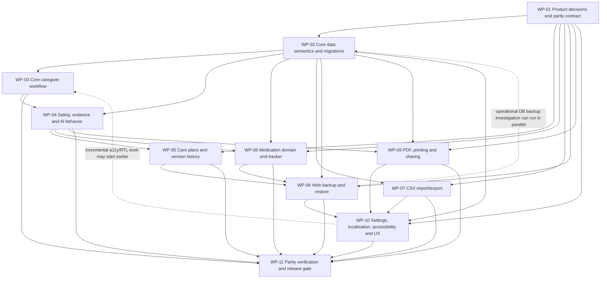

# Web Feature and Data Parity Implementation Roadmap

**Repository:** `alaa157/caregiver-daily-notes`  
**Target documentation path:** `docs/product-alignment/web-parity-roadmap/README.md`  
**Planning baseline:** Phase 1, Phase 2, and Phase 3A documentation retrieved from `main` on 2026-11-03  
**Document status:** Proposed implementation roadmap — product-owner approval required for unresolved decisions  
**Scope:** Web application parity and data/business-rule alignment only; no implementation authorization

---

## 1. Executive Summary

This roadmap defines a dependency-aware sequence for bringing the React/Spring Boot/PostgreSQL Web application closer to the caregiver capabilities already available in the Kotlin/Jetpack Compose Android application.

The objective is **capability and semantic parity**, not identical screens, databases, or infrastructure:

- Android remains a standalone, offline-first application using Room as its primary local store.
- Android BYOK provider credentials, prompts, consent, and configuration remain on-device and are never sent to the Web backend.
- Web remains an authenticated React/TypeScript application backed by Spring Boot and PostgreSQL, and uses **BYOK exclusively** for AI. Each Web caregiver supplies and controls their own provider credentials.
- Both platforms should represent the same care concepts consistently: recipients, daily notes, observations, unknown and missing values, addenda, plans, medication events, dates, safety evidence, and history.
- Existing working Web capabilities must be preserved and improved, not replaced merely to resemble Android.
- Historical records, corrections, uncertainty, and provenance must remain traceable.

### Current documented parity position

Phase 1 records **33 feature-matrix rows**:

| Documented status | Rows |
|---|---:|
| MATCH | 1 |
| PARTIAL | 17 |
| DIFFERENT IMPLEMENTATION | 4 |
| MISSING ON WEB | 10 |
| MISSING ON ANDROID | 1 |
| PLACEHOLDER | 0 |
| UNVERIFIED as primary matrix status | 0 |
| **Total** | **33** |

The 33-row count and classifications are reproduced in Section 4. They describe feature rows, not a percentage of completed work or a runtime test result.

The highest-risk gap is not a missing screen. It is the difference between the two platforms' data semantics and business rules: observation nullability, legacy defaults, recipient lifecycle, note/date uniqueness, addenda, deterministic safety rules, care-plan representation, and medication tracking. The Web already has substantial recipient, note, history, plan, summary, and authenticated-account functionality. Those areas should be aligned and strengthened rather than recreated.

### Recommended strategy

The recommended sequence is:

1. Resolve decisions that affect data meaning and define a Web parity contract.
2. Align recipient, note, observation, addendum, date, and lifecycle semantics with safe database migrations.
3. Complete the everyday caregiver workflow using the existing Web application.
4. Align deterministic safety evaluation, summary evidence, and AI failure behavior while implementing BYOK on both platforms with separate platform-specific credential boundaries.
5. Align care-plan structures and version history.
6. Add medication management only after schedule and intake semantics are approved.
7. Add Web CSV import/export as a separate portability capability.
8. Design and implement independent Web backup/restore.
9. Add useful Web reports, PDF output, printing, and sharing.
10. Complete settings, localization, accessibility, and responsive UX.
11. Run a cross-platform parity and release-readiness gate.

Some presentation and settings work can proceed in parallel with data-contract work, but no feature that depends on unresolved clinical or data semantics should be released ahead of those decisions.

**This roadmap does not implement or design the Android-to-Web transfer protocol.** It deliberately stops at Web parity and readiness. Transfer sessions, device linking, manifests, chunks, receipts, synchronization, and transfer-specific authentication remain out of scope.

---

## 2. Scope and Non-Goals

### 2.1 Included

- Web domain model and business-rule alignment with Android.
- Improvements to existing Web workflows.
- Missing caregiver capabilities that have a meaningful Web use case.
- PostgreSQL schema evolution and safe Flyway migrations.
- Backend API, validation, authorization, and service changes needed by Web parity.
- Web UI, navigation, settings, localization, accessibility, responsive behavior, and user feedback states.
- Web medication and care-plan capability, subject to required decisions.
- CSV import/export, Web backup/restore, reports, PDF, printing, and sharing as separately scoped features.
- Automated and manual tests that demonstrate semantic parity and preserve existing Web behavior.
- Documentation of deferred or platform-specific behavior.

### 2.2 Explicit non-goals

This roadmap does **not** authorize or include:

- Android-to-Web transfer sessions or transfer APIs.
- Device linking, device approval, or transfer-specific credentials.
- Transfer manifests, immutable transfer previews, chunks, receipts, or retry reconciliation.
- Automatic synchronization or bidirectional synchronization.
- Android Room replacement or migration to a shared remote database.
- Making Android dependent on a Web account or internet access.
- Sending Android BYOK credentials, custom prompts, provider URLs, or AI preferences to the Web platform or backend.
- Sharing Android and Web provider credentials or silently using an application-managed/shared AI provider on Web.
- Using an application-owned API key, pooled provider account, or backend-managed AI fallback for Web AI.
- A shared runtime database or a shared implementation language across platforms.
- Rewriting functioning Web features without a demonstrated parity or correctness reason.
- Clinical policy changes without appropriate clinical review and product-owner approval.

CSV, a full Web backup, and Android-to-Web transfer are three distinct capabilities. One must not be used as a substitute for another.

### 2.3 Architecture constraints

1. Android Room remains the primary Android data store.
2. Android remains usable offline for core local workflows.
3. Android BYOK stays local and provider-specific.
4. Web uses authenticated BYOK-only AI: the caregiver supplies their own provider credentials; no application-managed/shared provider or fallback is permitted. The exact secure key-execution and custody design must be approved in WP-01.
5. PostgreSQL remains the Web persistence layer.
6. Platform-specific UI and storage are acceptable when data meaning and user-visible outcomes are compatible.
7. Historical data and provenance are preserved.
8. Unknown, missing, explicit negative, and ambiguous legacy values remain distinguishable.
9. Migrations are additive where practical, reversible where feasible, and tested against existing data.
10. No feature may silently overwrite or reinterpret records.
11. No automatic cross-platform synchronization is introduced.
12. Recommendations remain proposals until approved.

---

## 3. Source Documents and Planning Baseline

The following committed documents are the primary source of truth. This roadmap extends them and does not repeat their audits.

| Source | Purpose in this roadmap | Reference |
|---|---|---|
| Phase 1 — Comprehensive Product Discovery and Cross-Platform Alignment | Android product inventory, Web specification, data models, 33-row parity matrix, business logic/AI comparison, localization, import/export/backup readiness | `docs/product-alignment/phase-1/README.md` |
| Phase 2 — Canonical Data Model, Shared API Contracts & Cross-Platform Architecture Design | Proposed canonical semantics, field-level models, decision register PO-01–PO-23, architecture constraints, migration and security principles | `docs/product-alignment/phase-2/README.md` |
| Phase 3A — Cross-Platform Implementation Readiness Audit | Current readiness and gap inventory, Web readiness, data-model risks, implementation sequencing, testing requirements | `docs/product-alignment/phase-3a/README.md` |

### 3.1 Source snapshots recorded by the documents

| Document | Snapshot information recorded |
|---|---|
| Phase 1 | Android `feat/standalone-byok-ai` at `21876285ad808a6518593ea3974c51b6b1f6bb31`; Web/backend `main` at `30b01f08bc51c8da2ed11bbc89dba1f3a73dfbe7` |
| Phase 2 | Android source at `21876285ad808a6518593ea3974c51b6b1f6bb31`; Web/backend application source at `14dfff2b7a7049d4ac6285fe340b29c59ba5b595`; Phase 2 documentation commit/current main before its revision recorded as `25c031b2bda50a5daa9cda9cb62f2f4cd306a579` |
| Phase 3A | Android branch HEAD `21876285ad808a6518593ea3974c51b6b1f6bb31`; `main` HEAD `bc9a673e48e0f4955b9435a411e85f84ac39c399` |

These are historical references recorded in the source documents, not a claim that the application code was re-audited at those commits for this roadmap. Phase 3A states that the two commits after the Phase 2 application-source snapshot changed only the Phase 2 documentation, so its Web/backend source assessment remained applicable to that comparison. Revalidate implementation status before each implementation phase if `main` has advanced materially.

### 3.2 Evidence and status vocabulary

This roadmap distinguishes:

- **Documented existing capability:** The source documents identify an implemented Web capability.
- **Documented partial parity:** A broad capability exists on both platforms but behavior, fields, rules, or workflow differ.
- **Documented Web gap:** Phase 1 identifies an Android capability without a Web counterpart.
- **Proposed improvement:** A recommended change, not an approved requirement.
- **Decision required:** A Phase 2/3A product-owner decision must be made before the affected behavior is frozen.
- **External review required:** Clinical, security, privacy, or deployment review is needed.
- **Runtime/operational unknown:** Static source inspection did not establish deployed or runtime behavior.

The three source documents report static inspections. Their existence does not establish that tests pass, a deployed database is durable, or every workflow has been verified on a live installation.

---

## 4. Current Parity Baseline

### 4.1 Exact 33-row matrix

The following feature names and primary classifications preserve the Phase 1 matrix. They are not silently reclassified by this roadmap.

| # | Feature | Phase 1 status |
|---:|---|---|
| 1 | Home / overview | PARTIAL |
| 2 | Main navigation | PARTIAL |
| 3 | Onboarding | MISSING ON WEB |
| 4 | Recipient creation | PARTIAL |
| 5 | Recipient edit | PARTIAL |
| 6 | Recipient lifecycle | DIFFERENT IMPLEMENTATION |
| 7 | Recipient relationship data | MISSING ON ANDROID |
| 8 | Daily note creation | PARTIAL |
| 9 | Note detail | PARTIAL |
| 10 | Addendum/correction | PARTIAL |
| 11 | History search/filter | PARTIAL |
| 12 | Care trends | PARTIAL |
| 13 | Summary window selection | PARTIAL |
| 14 | Summary result/evidence | PARTIAL |
| 15 | Deterministic safety logic | DIFFERENT IMPLEMENTATION |
| 16 | AI provider configuration | DIFFERENT IMPLEMENTATION |
| 17 | AI consent and prompt customization | MISSING ON WEB |
| 18 | Plan generation | PARTIAL |
| 19 | Plan lifecycle | PARTIAL |
| 20 | Plan edit and version history | PARTIAL |
| 21 | Medication tracker | MISSING ON WEB |
| 22 | Language choice | MATCH |
| 23 | RTL / mixed text direction | PARTIAL |
| 24 | Theme modes and palettes | MISSING ON WEB |
| 25 | Settings hub | PARTIAL |
| 26 | CSV import/export | MISSING ON WEB |
| 27 | Full backup/restore | MISSING ON WEB |
| 28 | PDF summary/share | MISSING ON WEB |
| 29 | About / app updater | MISSING ON WEB |
| 30 | Backend URL / connection selection | DIFFERENT IMPLEMENTATION |
| 31 | Authentication / access | PARTIAL |
| 32 | Sample/demo data | MISSING ON WEB |
| 33 | Optional offline outbox/transfer | MISSING ON WEB |

**Count check:** 1 MATCH + 17 PARTIAL + 4 DIFFERENT IMPLEMENTATION + 10 MISSING ON WEB + 1 MISSING ON ANDROID = 33. PLACEHOLDER = 0 and UNVERIFIED = 0 as primary matrix statuses.

Row 7 is intentionally retained as **MISSING ON ANDROID**, not a Web gap: the backend/Web model has a relationship field absent from the Android local recipient model. Row 33 is not a request to implement transfer in this roadmap; it is explicitly excluded.

### 4.2 Important documented Web foundations to preserve

The Web application already includes:

- Authenticated caregiver registration/login and account-scoped access.
- Recipient create, view, update, and deactivate workflows.
- Daily note creation, detail, and history retrieval with date and recipient filters.
- Append-only structured note addenda/corrections.
- Summary generation, evidence presentation, and deterministic server-side safety evaluation.
- Care-plan generation and version-oriented backend structures.
- Typed React API modules and a Spring Boot service/API architecture.
- PostgreSQL persistence and Flyway-managed migrations.
- Existing Web backend-managed AI provider configuration and execution (historical baseline to be replaced by the approved BYOK-only target).

These are not to be recreated. The implementation work should focus on missing workflow states, semantic alignment, completeness, and reliability.

### 4.3 Main documented semantic gaps

- Android local recipient lifecycle is archive/unarchive with guarded permanent deletion; Web/backend currently uses active/inactive/deactivate behavior.
- Web has recipient relationship data that Android's local entity does not currently carry.
- Android local notes and Web notes differ in nullability, date handling, medication fields, pain/fall fields, and verification semantics.
- Backend note uniqueness is recipient/date based; Android's local schema does not establish the same recipient/date uniqueness invariant.
- Android addenda are text events; backend addenda can represent structured corrections to selected observation fields.
- Android and backend safety evaluators use different signals and rules. Neither is automatically a clinically approved standard.
- Android care-plan items include free-text content; backend plans use structured action types and parameters.
- Android has a medication catalogue and per-dose intake marks; Web/backend has no equivalent medication domain.
- Phase 1 documented Android BYOK versus Web backend-managed AI as a current implementation difference. The approved roadmap target is BYOK on both platforms, with separate credentials and platform-specific secure execution.
- Web lacks Android's theme/palette, CSV, full backup/restore, PDF/share, and medication workflows.
- Web localization has English/Arabic language choice, but RTL and mixed-direction behavior need improvement.
- Deployment durability, operational backup, and restore guarantees are not established merely by PostgreSQL configuration.

---

## 5. Target Web Product Capabilities

### 5.1 Recipients and caregiver workspace

**Preserve:** Authenticated accounts, caregiver ownership checks, recipient creation, recipient editing, and current list/detail workflows.

**Improve:**
- Define recipient lifecycle semantics in coordination with Android.
- Present active and archived/inactive recipients consistently once PO-02 is approved.
- Make destructive actions explicit and distinguish archive/deactivate from permanent deletion.
- Preserve recipient history and show the consequences/counts of destructive operations.
- Align recipient field validation and relationship handling.

**Add if approved:** A relationship field on Android as well as Web, so the field has a shared meaning rather than remaining an accidental platform-only extension.

### 5.2 Daily notes, observations, addenda, and history

**Preserve:** Web note CRUD boundaries, date selection, note detail, filters, pagination, server-side ownership checks, and append-only correction history.

**Improve:**
- Define the observation state model for recorded, unknown, not recorded, not applicable, and legacy ambiguous values.
- Keep verification separate from the observation value.
- Align date and timezone meaning without shifting a calendar date through UTC conversion.
- Decide and enforce the original-note cardinality rule only after duplicate analysis and approval.
- Preserve original note content and append-only history.
- Show correction events and their effects without hiding the original values.
- Keep history filters, pagination, empty states, and URL state predictable.

### 5.3 Home, trends, and safety

**Preserve:** Web dashboard and summary entry points, server-derived signals, and current summary workflow.

**Improve:**
- Establish shared deterministic safety-rule definitions and fixtures.
- Make signal evidence, date windows, rule version, and source records traceable.
- Avoid silently changing thresholds or interpreting free text as a confirmed clinical event.
- Provide useful home classifications and trend views only when their input semantics are agreed.
- Keep the computed safety signal separate from caregiver acknowledgement metadata; acknowledgement must not dismiss, hide, or resolve the signal (PO-21 approved in WP-01).

### 5.4 AI summaries and care-plan generation

**Preserve:** Existing Web summary and plan-generation capabilities, evidence handling, and Web-specific prompt ownership while replacing the existing backend-managed provider configuration with a BYOK-only provider flow.

**Target AI policy — approved:** Web AI is BYOK only. Each caregiver supplies their own API key for a supported provider. There is no application-managed AI mode, no shared application API key, no pooled provider account, and no silent fallback to an app-provided service. Android and Web credentials/configuration remain separate; neither platform imports or synchronizes the other's secrets.

**Improve:**
- Align the meaning of summary fields, evidence references, uncertainty, and source transcript selection.
- Make provider unavailable, timeout, malformed response, and validation failure explicit states.
- Never label an unavailable/error message as an AI-generated summary.
- Do not send a failed summary placeholder into plan generation as if it were evidence.
- Provide Web-specific BYOK settings for provider selection, API key, model, and provider-specific base URL/options where supported.
- Define explicit connection testing, key replacement/removal, invalid-key handling, provider timeout, rate-limit, malformed-response, and unavailable states.
- Decide and document the secure execution/key-custody boundary before implementation: direct browser-to-provider execution versus a narrowly scoped backend-mediated request path. Evaluate provider CORS/API support, exposure risks, account isolation, operational logging, and user privacy. Do not assume browser storage or a backend proxy is safe by default.
- If any backend-mediated path is selected, it must use only the requesting caregiver's supplied key, must not use an application-owned provider key, and must not persist or log the key. Define how the key is transmitted, held, redacted, and discarded.
- Never silently fall back from BYOK to an application-managed provider when a user key fails or a provider is unavailable.

**Remain platform-specific:** Android and Web each have their own BYOK settings and credentials. Web must not import Android keys/configuration, and Android must not depend on Web settings. UI and secure storage/execution mechanisms may differ by platform.

### 5.5 Care plans

**Preserve:** Web plan generation and version persistence.

**Improve/add:**
- Create/edit/review flows with clear active and historical version states.
- Structured action catalogue and typed parameters.
- Explicit handling for free-text legacy items that cannot be mapped safely.
- Evidence references and source context where available.
- Historical plan preservation and controlled activation.

No free-text care-plan item should be automatically converted into a clinical action unless the mapping is unambiguous and approved.

### 5.6 Medication management

**Add only after approval:** A Web medication domain covering medication identity, schedule representation, and per-dose intake events, with a clear history and audit trail.

The Web implementation must not infer ingestion from a reminder, schedule, or user action that only means “marked.” A schedule is not proof of intake. Medication name, dose, route, frequency, effective dates, and intake/verification meaning must be explicitly modelled and validated.

### 5.7 Portability, reports, and settings

**Proposed additions subject to decisions:**
- CSV export and import as user-controlled spreadsheet portability.
- Full Web backup and restore as a separately versioned archive workflow.
- PDF reports, print-friendly output, and browser-native share/download actions.
- Theme mode and semantic palette preferences.
- Complete Web settings hub, help/about information, supported links, and product version information.
- Optional sample/demo data only if a safe, clearly isolated demo mode is approved.

Web does not need Android-only backend URL selection, native Android updater behavior, Room storage controls, or Android app-store update handling.

---

## 6. Phased Implementation Roadmap

The phase IDs below are for this Web parity roadmap and are not Phase 3A transfer implementation IDs.

### WP-01 — Product Decisions and Web Parity Contract

**Objective**

Resolve the product decisions that affect Web domain semantics and produce an approved, implementation-ready Web parity contract before changing persistent data behavior.

**Priority:** P0 — Critical foundation

**WP-01 decision record:** [`wp-01/README.md`](wp-01/README.md)

**Status (2026-11-03):** Owner decisions and semantic contract are recorded. PO-24 BYOK-only is approved; direct browser-to-provider remains conditional pending formal engineering/security and privacy review. PO-07 requires clinical review, and PO-13 requires deployment evidence. WP-02 schema changes remain blocked on duplicate and ambiguous-legacy-data preflight.

**Why this phase comes now**

The Web already stores real caregiver records. Changing nullability, lifecycle, uniqueness, corrections, or safety behavior without an approved meaning risks corrupting historical information. This phase prevents feature work from hard-coding assumptions that later require destructive migrations.

**Scope and work packages**

1. Review and record decisions relevant to Web parity:
   - PO-01 recipient relationship.
   - PO-02 recipient lifecycle.
   - PO-03 historical note/date behavior where it affects shared semantics.
   - PO-04 original note uniqueness per recipient/local date.
   - PO-05 observation and verification semantics.
   - PO-06 text addenda and structured correction events.
   - PO-07 deterministic safety rule governance and clinical review.
   - PO-08 structured plan action catalogue and free-text mapping.
   - PO-14 Web CSV import/export.
   - PO-15 Web backup/restore.
   - PO-16 Web PDF/report/share.
   - PO-17 Web theme/palette.
   - PO-18 Web medication parity.
   - PO-19 capability parity versus full feature parity.
   - PO-21 safety acknowledgement (acknowledgement does not dismiss or hide the signal).
   - PO-13 server persistence, backup, restore, retention, and deletion guarantees.
   - PO-24 Web BYOK-only AI policy (already approved by the product owner; WP-01 must record the decision and resolve the remaining technical security/execution details without reopening the approved BYOK-only product policy).
2. Record which decisions are approved, deferred, or rejected, with owner, rationale, date, and downstream impact. Record PO-24 as **APPROVED — Web BYOK only**; do not offer or implement an application-managed AI option.
3. Define a Web domain glossary and field semantics for recipient, note, observation, verification, addendum/correction, plan/version, medication/intake, summary/evidence, safety signal, and date/time.
4. Produce a Web BYOK security and execution decision record covering provider support, key custody, browser-versus-backend execution, transmission, storage lifetime, redaction, account isolation, consent/disclosure, key removal, and failure behavior. Keep the approved BYOK-only policy fixed; only the technical implementation details remain open.
5. Define the Web AI settings and user experience contract, including provider/model/base URL options where supported, connection test, key replacement/removal, and clear provider-failure states.
6. Define legacy handling for values that cannot be safely interpreted.
7. Establish an API compatibility policy and migration principles for the Web stack.
8. Define the minimum caregiver workflows that must work end-to-end before parity is declared.
9. Explicitly classify Android-specific features that do not require a Web equivalent.

**Affected domains**

- Product documentation and decision register.
- Backend domain/API contracts.
- PostgreSQL schema planning.
- Web TypeScript API/domain types.
- Test fixtures and quality gates.

No exact source file is prescribed before the implementation team verifies current `main`.

**Dependencies**

- None. This is the entry phase.
- Clinical review is required for PO-07 and any clinical interpretation of observation/safety semantics.
- Product-owner approval is required for all unresolved listed PO decisions before their dependent behavior is frozen. PO-24's BYOK-only policy is already approved; its technical execution/security details still require an explicit documented decision and review.

**Parallelizable work**

- A technical inventory of existing Web test coverage can proceed in parallel, limited to the documented domains.
- UX discovery for settings and responsive layout can proceed as research, but must not decide data semantics.

**Deliverables**

- Approved/deferred decision log for the Web parity scope.
- Web parity domain glossary and semantic contract.
- Legacy-data handling policy.
- List of Web-equivalent, platform-specific, and deferred capabilities.
- Phase-by-phase acceptance test inventory.

**Acceptance criteria**

- Every decision affecting schema or business rules has a recorded status and owner.
- No recommendation is labelled approved without explicit approval.
- Observation state and verification are defined independently.
- Date-only values and instants are explicitly distinguished.
- Recipient lifecycle and note cardinality are unambiguous or explicitly deferred with a safe implementation boundary.
- Clinical rule changes have a named review requirement.
- Web BYOK-only policy is recorded as approved; no app-managed provider or fallback exists in the target contract.
- Web key custody, execution boundary, storage/transmission, account isolation, consent/disclosure, redaction, and key-removal behavior are documented and security-reviewed.
- PO-24's technical execution direction remains conditional until the engineering/security and privacy gates in [`wp-01/README.md`](wp-01/README.md) pass.
- Android and Web BYOK credentials/configuration remain separate and are never synchronized.
- PO-13 is recorded as a production gate; deployment-owner evidence is required before durability claims.
- CSV, full backup/restore, and transfer are explicitly treated as separate capabilities.

**Automated testing**

- Documentation/decision-register consistency checks where available.
- Contract fixture validation once the semantic contract is machine-readable.
- No application behavior test is a substitute for owner approval.

**Manual verification**

- Product-owner walkthrough of all unresolved PO items.
- Clinical reviewer walkthrough of safety/observation definitions.
- Engineering review of migration feasibility and backward compatibility.

**Risks and safeguards**

- Risk: decisions remain unresolved and implementation guesses become de facto policy.  
  Safeguard: block dependent work packages; allow only non-dependent UX or infrastructure work.
- Risk: canonical concepts are mistaken for a shared database design.  
  Safeguard: state explicitly that the contract is semantic, not a shared storage implementation.
- Risk: clinical thresholds are approved as engineering defaults.  
  Safeguard: require clinical review and versioned test fixtures.

**Exit criteria**

The domain contract and decision log are recorded in [`wp-01/README.md`](wp-01/README.md). WP-02 may begin with read-only inventories and fixture preparation; schema changes require duplicate preflight and safe legacy-data handling. Clinical rule activation, Web BYOK integration, and production durability claims remain blocked until the reviews and evidence listed in the decision record are complete.

---

### WP-02 — Recipient, Note, Observation, Addendum, and Date Integrity

**Objective**

Align the Web's core care-record data model and business rules with the approved cross-platform semantics while preserving every existing Web record.

**Priority:** P0 — Critical foundation

**Why this phase comes now**

All major caregiver workflows depend on these records. Medication, plans, summaries, safety, CSV, and backup will be unreliable if recipient identity, observation meaning, date semantics, or correction history are inconsistent.

**Scope and work packages**

1. **Recipient model and lifecycle**
   - Implement approved relationship semantics if PO-01 approves a shared field.
   - Align active/archive/deactivate behavior according to PO-02.
   - Preserve legacy inactive/deactivated records and their children.
   - Separate reversible archive/deactivation from permanent deletion.
   - Enforce ownership and lifecycle rules in backend services, not only in UI.
2. **Observation representation**
   - Introduce the approved explicit state representation for `RECORDED`, `UNKNOWN`, `NOT_RECORDED`, `NOT_APPLICABLE`, and `LEGACY_AMBIGUOUS`, or the approved alternative.
   - Keep verification as a separate property where meaningful.
   - Preserve raw legacy values where meaning cannot be proven.
   - Do not map empty, `false`, or `0` to a confirmed negative unless the source semantics prove that interpretation.
3. **Daily note identity and dates**
   - Define note date as a calendar date with explicit timezone context where needed.
   - Prevent UTC conversion from shifting `noteDate`.
   - Apply the approved one-original-note-per-recipient/local-date rule only after duplicate analysis.
   - Detect existing duplicates before adding a uniqueness constraint.
   - Define idempotency and duplicate behavior for ordinary Web note creation separately from future transfer idempotency.
4. **Addenda and corrections**
   - Preserve append-only event history.
   - Support text-only events and structured correction events if PO-06 approves both.
   - Define explicit clear-versus-not-provided semantics for corrected fields.
   - Preserve original note values and correction timestamps/authorship.
   - Define effective-value projection deterministically.
5. **Validation and API**
   - Align backend request/response validation and Web TypeScript types.
   - Return field-specific validation errors.
   - Keep caregiver ownership checks for every record and child event.
6. **Migration safety**
   - Create additive Flyway migrations where practical.
   - Backfill only when a mapping is deterministic.
   - Quarantine/report ambiguous values rather than guessing.
   - Provide migration diagnostics and a recovery plan.

**Affected domains**

- Backend recipient, note, addendum, validation, service, repository, and API layers.
- PostgreSQL entities, constraints, indexes, and Flyway migrations.
- Web recipient/note/addendum forms, detail views, history filters, and API types.
- Backend and Web tests.

Exact source paths must be verified against the branch being implemented; no new paths are assumed by this roadmap.

**Dependencies**

- WP-01 approved semantics for PO-01, PO-02, PO-04, PO-05, and PO-06.
- Clinical review for any field whose meaning is clinically interpreted.
- Existing-record duplicate and legacy-value inventory before constraints/backfills.

**Parallelizable work**

- Recipient lifecycle UI design can proceed while backend migration design is reviewed.
- Test fixture authoring for settled observation states can proceed alongside API contract work.
- Accessibility improvements to existing forms can proceed if they do not alter field semantics.

**Deliverables**

- Updated Web domain/API types.
- Safe PostgreSQL/Flyway migrations.
- Recipient lifecycle and relationship behavior.
- Explicit observation/verification representation.
- Date and uniqueness enforcement according to approved policy.
- Append-only addendum/correction event model.
- Migration report and legacy-data exception handling.

**Acceptance criteria**

- Existing recipient, note, and addendum records survive migration with stable identity.
- No existing note or addendum is silently deleted or rewritten.
- Unknown and missing values remain distinguishable.
- Legacy ambiguous values remain explicitly ambiguous.
- Verification is not inferred from the presence of an observation.
- Date-only values remain unchanged across supported timezones.
- Duplicate records are reported and handled under an approved policy before uniqueness is enforced.
- Addendum history is append-only and reconstructs the effective view deterministically.
- Backend authorization tests prove cross-caregiver reads/writes are rejected.
- Existing Web workflows remain functional after migration.

**Automated testing**

- Flyway migration tests against representative pre-migration databases.
- Repository/service tests for lifecycle, note uniqueness, date boundaries, and ownership.
- Serialization tests for every observation state and unknown enum values.
- Addendum ordering, field-mask, clear-value, and effective-value tests.
- API contract tests for validation and compatibility.
- Regression tests for existing Web recipient/note/history workflows.

**Manual verification**

- Open representative old and new recipients and notes.
- Test archived/deactivated recipient behavior and child-history access.
- Create notes at date boundaries and verify the displayed date in multiple timezones.
- Add text and structured corrections; verify the original remains visible and the effective value is correct.
- Review a migration exception report for ambiguous legacy rows.

**Risks and safeguards**

- Risk: a migration converts an old default into a confirmed clinical observation.  
  Safeguard: preserve raw value and mark ambiguous unless meaning is proven.
- Risk: adding a unique index fails or drops duplicate data.  
  Safeguard: preflight duplicate detection and explicit remediation; no automatic deletion.
- Risk: permanent deletion removes historical care data unexpectedly.  
  Safeguard: separate archive/deactivate from deletion and require explicit confirmation and authorization.
- Risk: date shifts due to UTC conversion.  
  Safeguard: date-only contract and timezone boundary tests.

**Exit criteria**

Core recipient/note/observation/addendum semantics are stable, migrations pass against existing data, and all existing Web core workflows pass regression tests. WP-03 and WP-04 may then use the aligned records.

---

### WP-03 — Complete the Core Caregiver Web Workflow

**Objective**

Improve existing Web recipient, home, daily note, history, and trend workflows so a caregiver can reliably perform the everyday tasks already supported by Android, using Web-native interaction patterns.

**Priority:** P1 — High priority

**Why this phase comes now**

After the underlying record model is safe, the Web should provide a coherent end-to-end caregiver experience. This phase closes high-value partial-parity gaps without rebuilding working backend features.

**Scope and work packages**

1. **Workspace and navigation**
   - Review protected navigation and route hierarchy.
   - Ensure browser back/forward, deep links, refresh, and query-string filters behave predictably.
   - Provide clear active-recipient context and return paths from detail/edit screens.
   - Preserve the current authenticated workspace architecture.
2. **Home/overview**
   - Define and implement approved equivalents of Android's today/needs-attention/all-recipient overview.
   - Show per-recipient status and relevant date window.
   - Make the source note/date visible for each derived status.
   - Do not present absence of a note as a negative observation.
3. **Recipient workflow**
   - Complete create, edit, detail, archive/deactivate, restore where approved, and safe deletion flows.
   - Show record counts and consequences before destructive actions.
   - Preserve recipient history when lifecycle state changes.
4. **Daily note workflow**
   - Improve create/edit/detail affordances using WP-02 semantics.
   - Clearly distinguish not recorded, unknown, and explicit negative values.
   - Provide clear validation, save confirmation, and retry behavior.
   - Preserve the existing backend rule that original note content is not silently overwritten; corrections use addenda/events.
5. **History**
   - Improve recipient/date filtering, pagination, URL state, and filter reset.
   - Make empty, loading, error, and no-results states distinct.
   - Provide reliable navigation from history results to note details.
6. **Trends**
   - Align trend windows and formulas with approved shared definitions.
   - Label sample sizes, date windows, and missing-data limitations.
   - Do not calculate a trend by treating missing values as zero or negative.

**Affected domains**

- Web workspace shell, routing, recipient, home, note, history, and trend UI.
- Existing backend read/query endpoints and services where a defined behavior is missing.
- API client types and UI tests.

**Dependencies**

- WP-02.
- WP-01 decisions for home status semantics and trend definitions.
- Any shared safety signal displayed on the home page must be approved under WP-04.

**Parallelizable work**

- Navigation/accessibility improvements can proceed alongside home layout work.
- History filter UX and recipient detail UX can be implemented in parallel once API contracts are stable.
- Backend pagination/performance improvements can proceed with frontend query-state work.

**Deliverables**

- Coherent Web caregiver workflow from workspace overview to recipient, note creation, detail, history, and trend views.
- Consistent lifecycle and validation feedback.
- Documented mapping of Android workflow outcomes to Web equivalents.

**Acceptance criteria**

- A caregiver can create and edit a recipient, open its detail, create a daily note, inspect its details, add a correction, and find it through history.
- Active/archived states follow the approved lifecycle.
- Filters survive refresh and browser navigation.
- Empty, loading, error, success, and validation states are distinguishable on every core route.
- Home status is reproducible from documented source records and does not infer a negative from missing data.
- Trends state the period and do not silently treat missing values as zero.
- No existing authenticated route or working Web workflow is removed.

**Automated testing**

- React component and route tests.
- API client and backend integration tests.
- End-to-end caregiver workflow tests.
- Browser refresh/deep-link/back-forward tests.
- Date filter, pagination, and empty/error-state tests.
- Accessibility checks for keyboard navigation and form labels.

**Manual verification**

- Complete a caregiver workflow with multiple recipients and a mix of notes/empty dates.
- Archive and restore a recipient if supported.
- Filter history by recipient and date range, refresh, and navigate back.
- Verify that the home screen does not mislabel a missing note as a negative health observation.

**Risks and safeguards**

- Risk: UI status labels imply clinical meaning not supported by data.  
  Safeguard: use precise labels and show source evidence.
- Risk: UX work changes business logic implicitly.  
  Safeguard: keep calculations in tested domain services and document formulas.
- Risk: new navigation breaks existing deep links.  
  Safeguard: route regression tests.

**Exit criteria**

The core caregiver journey works end-to-end on Web with stable data semantics, reliable navigation, and regression coverage.

---

### WP-04 — Safety Rules, Summary Evidence, and AI Behavior Alignment

**Objective**

Make Web safety outputs and AI summaries consistent in meaning, evidence, uncertainty, and failure behavior using Web's approved BYOK-only AI architecture.

**Priority:** P0 — Critical correctness and trust

**Why this phase comes now**

Safety indicators and generated summaries can influence caregiver decisions. The Phase 1 documents identify different Android and backend safety evaluators and partially aligned summary behavior. A superficial UI match would conceal those differences.

**Scope and work packages**

1. **Rule governance**
   - Resolve PO-07 with appropriate clinical review.
   - Define a versioned, deterministic rule specification for each approved signal.
   - Define required source fields, lookback window, thresholds, aggregation, and exclusions.
   - Preserve a rule version with derived outputs where appropriate.
2. **Safety evaluation**
   - Align backend evaluation to the approved rule catalogue.
   - Keep deterministic evaluation separate from AI-generated interpretation.
   - Preserve source note/addendum references for each signal.
   - Do not turn a caregiver acknowledgement into removal of the underlying computed signal.
   - Implement acknowledgement as separate auditable metadata only (PO-21 approved); do not implement dismissal, hiding, or signal resolution through acknowledgement.
3. **Summary source construction**
   - Document which notes and addenda are included in a requested period.
   - Define inclusive/exclusive date boundaries and timezone behavior.
   - Ensure corrections are represented correctly in source transcript/evidence.
   - Preserve evidence references to stable Web record IDs.
4. **Summary output semantics**
   - Align fields for observations, uncertainty, trends, evidence, and safety context.
   - Validate that each evidence reference resolves to an actual source record.
   - Keep unsupported or absent facts explicitly absent/uncertain.
5. **AI provider and failure behavior**
   - Implement the approved Web BYOK-only provider flow; do not add an application-managed/shared provider key or fallback.
   - Keep Web and Android BYOK credentials/configuration separate; do not add Android key import, Web key import, or prompt/credential synchronization.
   - Use the WP-01-approved execution and key-custody boundary. Enforce per-caregiver isolation and ensure secrets are not written to application logs, analytics, exports, or backups.
   - Provide explicit key entry, replacement, removal, and connection-test behavior. Do not store plaintext keys in ordinary browser storage. Any persistent storage or backend-mediated handling requires the security controls approved in WP-01.
   - Distinguish provider unavailable, timeout, invalid response, validation failure, and successful generation.
   - Never mark an error string such as “AI unavailable” as a generated summary.
   - Do not feed fallback/error text into care-plan generation as source evidence.
   - Ensure provider disclosure and consent are clear: identify the selected provider and explain that the caregiver's care data will be sent to that provider when they request AI processing. Disclose the actual execution path selected in WP-01.
6. **Observability**
   - Log safe operational metadata without clinical note text or secrets.
   - Track provider failures and validation failures without leaking prompt content or credentials.

**Affected domains**

- Backend safety evaluator, summary source loader, summary application/service/API, AI provider adapter, validation, and audit/logging.
- Web summary request/result pages and evidence navigation.
- Shared test fixtures and documentation.

**Dependencies**

- WP-01 PO-07 and PO-21 decision status.
- WP-02 note/addendum/date semantics.
- Clinical review for thresholds, text-pattern signals, and clinically interpreted rules.
- Security/privacy review of Web BYOK key custody, execution path, provider disclosure, and caregiver-data processing.

**Parallelizable work**

- AI failure-state UI can be improved independently of final safety thresholds, provided it does not change clinical interpretation.
- Evidence-link navigation can be implemented while rule fixtures are being reviewed.
- Provider timeout/observability tests can proceed independently of the rule catalogue.

**Deliverables**

- Versioned approved safety rule specification.
- Backend evaluator aligned to approved fixtures.
- Summary source/evidence contract.
- Explicit BYOK provider failure states and safe retry behavior; no app-managed AI fallback.
- Web summary evidence navigation and privacy disclosures.

**Acceptance criteria**

- Every displayed deterministic signal can be reproduced from a named rule version and source records.
- Android and Web produce equivalent outcomes for the approved shared fixtures, or documented platform-specific differences are explicit.
- Missing/unknown/ambiguous observations never become confirmed negatives.
- Corrections affect effective values only according to the approved addendum model; original history remains available.
- Every summary evidence reference resolves to the correct note/addendum.
- Summary period boundaries are deterministic across timezones.
- AI provider failure is never displayed as a successful generated summary.
- Failed/unavailable summary content is never passed to plan generation as evidence.
- No Android BYOK secret, prompt, or consent setting is transmitted to Web.
- Web BYOK credentials are isolated per caregiver and never exposed to another account, logs, analytics, exports, or backups.
- No application-managed/shared provider key or silent AI fallback is used on Web.
- The Web AI execution path matches the WP-01-approved security decision.
- Clinical and privacy reviewers approve the applicable rule and disclosure changes.

**Automated testing**

- Deterministic rule conformance fixtures shared conceptually across Kotlin and Java.
- Boundary tests for date windows, missing values, and correction events.
- Summary source transcript/evidence reference tests.
- AI provider timeout, unavailable, malformed JSON, validation, and retry tests.
- Tests proving errors are not persisted/labelled as successful summaries.
- Authorization and safe-logging tests.

**Manual verification**

- Review sample safety cases with a qualified reviewer.
- Compare the same approved fixture set across Android and Web.
- Generate summaries for periods with complete, missing, unknown, and corrected observations.
- Simulate provider outage and verify a clear unavailable state with retry guidance.

**Risks and safeguards**

- Risk: copying Android or backend thresholds without clinical approval.  
  Safeguard: versioned rules and explicit clinical sign-off.
- Risk: evidence points to a corrected projection but hides the original.  
  Safeguard: retain source events and correction history.
- Risk: AI output is mistaken for verified clinical fact.  
  Safeguard: label generated content, preserve evidence/uncertainty, and avoid diagnostic claims.
- Risk: operational logs expose care data or credentials.  
  Safeguard: allowlisted metadata and redaction tests.

**Exit criteria**

Approved safety fixtures pass; summary provenance and failure states are correct; privacy and clinical reviews are complete. WP-05 may proceed using stable summary/evidence semantics.

---

### WP-05 — Care Plan Structure, Editing, and Version History

**Objective**

Bring Web care-plan creation, editing, structured actions, active-plan behavior, and historical versions into semantic alignment with Android without converting ambiguous free text into clinical actions.

**Priority:** P1 — High priority

**Why this phase comes now**

The Web already has plan generation and version-oriented persistence, so this is an alignment and completeness phase rather than a new subsystem. Plan semantics depend on stable notes, evidence, and safety context from WP-02 and WP-04.

**Scope and work packages**

1. Resolve PO-08 and any plan-specific product choices.
2. Define plan identity, version numbering, creation/update metadata, status, and activation rules.
3. Align the structured action catalogue and typed parameter validation.
4. Define how Android free-text plan items are represented:
   - Map only when the meaning is unambiguous and approved.
   - Otherwise preserve as opaque legacy text or explicitly exclude from a future transfer preview; do not invent an action.
5. Implement Web plan create, edit, review, activate, supersede, and historical version views as approved.
6. Preserve the exact content of prior versions.
7. Attach evidence/source references where the model supports them.
8. Ensure plan generation uses valid summary evidence and handles unavailable AI states safely.
9. Provide clear validation for unsupported action types and parameters.

**Affected domains**

- Backend plan entities, action catalogue, validation, service, controller, and migrations.
- Web plan list/detail/editor/generation pages and API types.
- Domain and integration tests.

**Dependencies**

- WP-01 PO-08.
- WP-02 stable recipient/note/addendum semantics.
- WP-04 summary evidence and AI failure behavior.

**Parallelizable work**

- Plan version-history UI design can proceed while the action catalogue is reviewed.
- Accessibility improvements to existing plan forms can proceed if they do not change action semantics.

**Deliverables**

- Approved Web plan domain contract.
- Validated structured action catalogue.
- Plan create/edit/activate/history workflows.
- Legacy free-text preservation policy.
- Version-aware tests.

**Acceptance criteria**

- Each plan version is immutable after supersession, or changes are represented by a new version according to the approved rule.
- Exactly one active plan per recipient exists if that is the approved invariant.
- Structured actions validate against the approved catalogue and typed parameters.
- Unmappable free-text items remain preserved and are not silently converted.
- Plan generation cannot use AI error placeholders as evidence.
- Historical versions remain inspectable after a new version is activated.
- Evidence links resolve to source records where included.

**Automated testing**

- Plan version lifecycle and active-plan invariant tests.
- Action catalogue and parameter validation tests.
- Legacy opaque-text preservation tests.
- Summary evidence dependency tests.
- API authorization and migration tests.
- Web plan editor and history end-to-end tests.

**Manual verification**

- Generate or create a plan, edit it, activate a later version, and inspect the previous version.
- Test an unsupported legacy free-text item and confirm it is preserved without guessed conversion.
- Attempt invalid structured parameters and verify actionable validation.

**Risks and safeguards**

- Risk: free text is interpreted as a clinical action.  
  Safeguard: explicit mapping catalogue and no automatic guessing.
- Risk: editing destroys prior plan history.  
  Safeguard: version immutability and history tests.
- Risk: generated plans appear authoritative.  
  Safeguard: clear generated/draft status and caregiver review before activation.

**Exit criteria**

Web plans have stable structure, safe editing/versioning, and validated actions. Medication work may proceed independently only if it does not depend on plan medication actions; otherwise wait for the action catalogue.

---

### WP-06 — Medication Domain and Web Medication Tracker

**Objective**

Add a complete and semantically safe Web medication capability only after medication schedule and intake meanings have been approved.

**Priority:** P1 — High caregiver value, gated by domain decisions

**Why this phase comes now**

Android has a normalized medication tracker and per-dose intake marks, while Web/backend has no equivalent medication domain. Implementing a quick UI without an approved data model risks treating reminders, schedules, or marks as proof that a medication was ingested.

**Scope and work packages**

1. Resolve PO-09 and PO-18.
2. Define medication identity and fields: display name, dose, route, schedule/frequency, effective dates, status, and any approved metadata.
3. Define schedule representation for recurring and time-specific doses.
4. Define intake event semantics, including taken, missed, unsure/unknown, not recorded, and verification where applicable.
5. Keep a scheduled dose separate from an intake event.
6. Preserve medication and intake history; corrections should be auditable.
7. Define timezone/date behavior for scheduled doses and historical intake.
8. Implement backend entities, repositories, services, ownership checks, APIs, and Flyway migrations.
9. Implement Web medication list, create/edit, schedule view, intake marking, history, and validation.
10. Define how medication information appears in summary evidence and safety rules only after clinical review.
11. Do not infer a medication schedule from ambiguous free text or infer ingestion from a reminder/mark.
12. Do not include Android medication records in any transfer workflow under this roadmap.

**Affected domains**

- Backend medication domain and PostgreSQL migrations.
- Web medication feature and API types.
- Summary/safety integration only after rule review.
- Tests and operational audit.

**Dependencies**

- WP-01 PO-09 and PO-18.
- WP-02 observation/verification semantics and date rules.
- WP-04 before medication signals are used in safety evaluation.
- Clinical/pharmacy review for any medication interpretation or alerting rule.

**Parallelizable work**

- UI prototyping and accessibility review can proceed after domain requirements are approved.
- Backend CRUD and schedule calculation can proceed in parallel only after a stable schema/API contract exists.

**Deliverables**

- Approved medication domain contract.
- Backend persistence/API and migrations.
- Web medication management and intake history.
- Explicit separation of schedule, reminder, intake mark, and verification.
- Clinical review record for any derived medication safety behavior.

**Acceptance criteria**

- Medication schedules and actual intake events are stored separately.
- A reminder or scheduled dose never counts as ingestion.
- An intake mark is not labelled verified unless verification is explicitly recorded.
- Unknown and not-recorded intake states remain distinct.
- Historical medication and intake records remain visible and auditable.
- All medication resources are caregiver-scoped server-side.
- Date/timezone boundary behavior is deterministic.
- No free-text schedule inference occurs.
- Medication signals are not introduced without approved clinical rules.

**Automated testing**

- Medication schedule recurrence and timezone tests.
- Intake state and verification tests.
- Historical edit/correction and audit tests.
- Backend authorization tests.
- Migration tests against existing Web databases.
- End-to-end medication creation, schedule, mark, and history tests.

**Manual verification**

- Create a medication with a schedule, inspect upcoming doses, mark one intake, leave another unmarked, and inspect history.
- Confirm a scheduled reminder does not create an intake event.
- Test uncertain and explicitly not-recorded states.
- Verify archived recipient restrictions follow the approved lifecycle.

**Risks and safeguards**

- Risk: scheduled dose is misrepresented as ingested.  
  Safeguard: separate schedule and intake entities/events.
- Risk: dose/frequency text is parsed incorrectly.  
  Safeguard: structured fields and explicit validation; no inferred schedule.
- Risk: clinical alerts are introduced without review.  
  Safeguard: keep medication CRUD separate from safety-rule activation.

**Exit criteria**

Medication domain, UI, and tests satisfy the approved semantics, or the feature remains explicitly deferred. No medication data is represented with ambiguous or inferred meaning.

---

### WP-07 — Web CSV Export and Import

**Objective**

Provide user-controlled spreadsheet portability for Web records without confusing CSV with full backup or cross-platform transfer.

**Priority:** P2 — Medium priority, subject to product approval

**Why this phase comes now**

CSV is useful for caregiver-owned portability and analysis, but it depends on stable field meanings. It should follow core data alignment so exported columns do not encode ambiguous clinical states.

**Scope and work packages**

1. Resolve PO-14 and define supported record scope.
2. Define a versioned CSV schema/documented column set, encoding, date format, and null/unknown representation.
3. Implement export with explicit filters and preview/counts.
4. Include stable record IDs and enough metadata to preserve dates and provenance where appropriate.
5. Define whether export includes recipients, notes, addenda, plans, or medication; do not imply that all data is included unless it is.
6. Implement import as a preview/validation workflow before writes.
7. Validate headers, types, required fields, duplicate rows, recipient mapping, date formats, and unknown enum values.
8. Report row-level errors and accepted/rejected counts.
9. Require explicit confirmation before committing imports.
10. Make import idempotent or conflict-aware according to an approved policy; never silently overwrite existing records.
11. Avoid formula injection in exported spreadsheet cells.
12. Document CSV limitations: it is not a full-fidelity backup and may not represent all nested history.

**Affected domains**

- Backend export/import services and APIs where needed.
- Web import/export UI.
- PostgreSQL transaction boundaries.
- API and file-validation tests.

**Dependencies**

- WP-01 PO-14.
- WP-02 stable data semantics.
- WP-05 and WP-06 only if their records are included in the CSV scope.

**Parallelizable work**

- Export can be delivered before import if PO-14 approves and export schema is stable.
- Documentation and UX for preview/error reports can proceed alongside parser implementation.

**Deliverables**

- CSV schema specification.
- Web CSV export.
- Web CSV import preview and validation.
- Row-level import report.
- User-facing limitations and error guidance.

**Acceptance criteria**

- Exported CSV opens correctly in supported spreadsheet tools with documented encoding.
- Export scope and filters are visible before download.
- Import performs validation/preview before modifying data.
- Invalid rows are identified with actionable row/column errors.
- Unknown values are preserved or rejected explicitly; they are not coerced to a nearby value.
- Duplicate/conflicting records are detected and reported.
- No existing record is silently overwritten or deleted.
- Formula-like user content is safely escaped for spreadsheet use.
- CSV export/import round-trip tests demonstrate preservation for the explicitly supported fields.
- Documentation clearly states what CSV does not contain.

**Automated testing**

- CSV parser/export serializer tests.
- Unicode and Arabic text tests.
- Date/locale and decimal separator tests.
- Formula-injection tests.
- Duplicate/conflict and partial-row failure tests.
- Import preview/commit integration tests.
- Round-trip tests for every supported field.

**Manual verification**

- Export Arabic and English records, open in common spreadsheet software, and verify text/date integrity.
- Import a valid file, a malformed file, a duplicate file, and a file containing unknown enum values.
- Verify the preview and error report before confirmation.
- Confirm unsupported nested data is clearly disclosed.

**Risks and safeguards**

- Risk: CSV is mistaken for a complete backup.  
  Safeguard: explicit scope statement and separate backup feature.
- Risk: CSV import overwrites live records.  
  Safeguard: preview, duplicate policy, explicit confirmation, and no silent replacement.
- Risk: spreadsheet formula execution.  
  Safeguard: neutralize formula-leading cells.

**Exit criteria**

The approved CSV scope is implemented with safe preview/validation, documented limitations, and tested round-trip behavior.

---

### WP-08 — Full Web Backup and Restore

**Objective**

Provide an independent, versioned Web-account backup and restore capability with integrity validation and recoverable failure behavior.

**Priority:** P1 — High data-protection value; product and operational approval required

**Why this phase comes now**

A CSV file is not a full backup. Web uses a remote PostgreSQL database, while Android's backup is a local archive designed for Room restore. Web requires its own account-scoped archive and restore policy; it must not attempt to restore an Android Room database.

**Scope and work packages**

1. Resolve PO-15 and clarify whether this is a caregiver-triggered archive, a user-downloadable archive, server-managed backup, or a combination.
2. Define archive contents, version, schema compatibility, ownership binding, integrity hash/signature strategy, and retention.
3. Decide treatment of AI-generated summaries, audit events, attachments, account metadata, and derived signals.
4. Exclude passwords, JWTs, session tokens, provider secrets, and other credentials.
5. Implement account-scoped export with explicit confirmation and secure download handling.
6. Implement restore preview, archive validation, compatibility checks, duplicate handling, and explicit restore confirmation.
7. Define restore modes: merge, replace, or restore into a separate workspace. Do not choose destructive replacement by default.
8. Ensure restore is transactional or uses a staged import with a reliable rollback/recovery strategy.
9. Add versioned migrations for older archive formats.
10. Define operational backup/restore separately from user-level export. A user archive does not replace database disaster recovery.
11. Provide restore audit metadata without logging care-record contents.
12. Test backup integrity and restore into an isolated account/environment.

**Affected domains**

- Backend archive/restore service, storage handling, authorization, migrations, and audit.
- PostgreSQL operational backup documentation and deployment configuration.
- Web settings/data management UI.
- Security, privacy, and integration tests.

**Dependencies**

- WP-01 PO-15.
- WP-02 stable domain model.
- WP-05/WP-06 if plans or medication are included.
- Security/privacy review.
- Deployment owner confirmation of storage durability, encryption, retention, and restore responsibility.

**Parallelizable work**

- Operational PostgreSQL backup/restore verification can proceed independently of user-facing archive UI.
- Archive format design can proceed after the included entity scope is approved.
- Security review can proceed during implementation.

**Deliverables**

- Versioned Web backup format.
- Secure account-scoped export.
- Restore preview and explicit confirmation.
- Compatibility/migration strategy.
- Operational backup and restore evidence.
- User-facing backup history/status where appropriate.

**Acceptance criteria**

- Archive includes exactly the documented supported record types.
- Credentials and secrets are excluded.
- Archive integrity is verified before restore.
- Restore cannot cross caregiver accounts.
- Unsupported archive versions fail safely without partial mutation.
- Restore preview reports counts, conflicts, and unsupported records before confirmation.
- Failed restore leaves the account in a known, recoverable state.
- A successful restore preserves stable record identity and correction history.
- Operational database backups and user-level archives are clearly distinguished.
- A restore drill is completed and documented.

**Automated testing**

- Archive version/schema validation tests.
- Integrity tampering tests.
- Cross-account restore rejection.
- Transaction rollback and staged-recovery tests.
- Duplicate/conflict tests.
- Older-version migration tests.
- Credential exclusion tests.
- Backup/restore round-trip tests.

**Manual verification**

- Export a test account, inspect metadata, and restore to an isolated test account.
- Attempt a corrupted archive, unsupported version, wrong-account restore, and duplicate restore.
- Verify the original account is unchanged after failed restore.
- Perform an operational database restore drill separately from user archive restore.

**Risks and safeguards**

- Risk: restore replaces live data unexpectedly.  
  Safeguard: explicit mode, preview, confirmation, and recovery plan.
- Risk: archive leaks sensitive information.  
  Safeguard: encryption in transit/at rest, least privilege, secret exclusion, and retention policy.
- Risk: operational backup is confused with user export.  
  Safeguard: separate ownership, documentation, monitoring, and acceptance criteria.

**Exit criteria**

A versioned Web backup can be exported, validated, and restored safely in a tested environment; operational backup guarantees are documented independently.

---

### WP-09 — PDF Reports, Printing, and Sharing

**Objective**

Provide Web-native caregiver reports and sharing workflows that serve the use cases of Android PDF summary/share without copying Android's native implementation.

**Priority:** P2 — Medium priority, subject to PO-16

**Why this phase comes now**

Reports should use stable summary/evidence semantics and corrected records. Implementing PDF output before WP-04 risks producing a polished report with incorrect or untraceable content.

**Scope and work packages**

1. Resolve PO-16 and define report types: summary, selected date range, recipient history, or other approved reports.
2. Define report content, evidence references, date/timezone labels, generated timestamp, and uncertainty presentation.
3. Implement print stylesheet and browser print workflow where it meets the use case.
4. Implement downloadable PDF generation using an appropriate Web/backend approach.
5. Preserve Arabic/English text, RTL, fonts, page breaks, and table readability.
6. Provide a preview before download/share.
7. Use browser/device share APIs only when supported; provide a safe download/print fallback.
8. Avoid exposing reports through public URLs or unauthenticated storage.
9. Clearly label AI-generated content and distinguish source records from derived summaries.
10. Do not automatically upload generated PDFs as attachments or treat them as transfer payloads.

**Affected domains**

- Web report pages/components and styles.
- Backend report data endpoints only if required.
- PDF generation and access-control infrastructure.
- Localization and browser compatibility tests.

**Dependencies**

- WP-02 for record semantics.
- WP-04 for summary evidence and AI labels.
- WP-01 PO-16.
- WP-10 RTL/typography work may proceed in parallel, but report release requires it.

**Parallelizable work**

- Print CSS and report layout can be developed in parallel with PDF generation after the content contract is approved.
- Browser share support can be tested independently.

**Deliverables**

- Approved report content contract.
- Print-friendly Web report.
- PDF download.
- Share/download fallback behavior.
- Arabic/English report validation.

**Acceptance criteria**

- Report includes recipient, selected period, generated date, and source/evidence context.
- AI-generated content is clearly labelled and not presented as verified clinical fact.
- Unknown/missing values remain explicit.
- Report data is restricted to the authenticated caregiver.
- Arabic and English output is readable, including mixed-direction values.
- PDF page breaks do not split critical labels/content misleadingly.
- Unsupported browser share capability falls back to download/print.
- No report is exposed through an unprotected public URL.

**Automated testing**

- Report content snapshot tests.
- Authorization tests for report data.
- PDF generation smoke tests.
- RTL/Arabic text rendering checks.
- Browser print/share capability tests with fallbacks.
- Evidence link/source resolution tests.

**Manual verification**

- Generate reports for Arabic and English accounts and inspect on screen, print, and PDF.
- Test long notes, multi-page history, missing values, and evidence links.
- Test share support on browsers with and without the relevant capability.

**Risks and safeguards**

- Risk: a PDF loses uncertainty or evidence provenance.  
  Safeguard: report schema and content acceptance criteria.
- Risk: a report leaks sensitive care data.  
  Safeguard: authenticated access, short-lived/private download handling, and no public links.
- Risk: browser APIs vary.  
  Safeguard: download and print fallbacks.

**Exit criteria**

Caregiver reports can be previewed, printed, and downloaded/shared safely with correct evidence and localization.

---

### WP-10 — Settings, Localization, Accessibility, and Responsive UX

**Objective**

Complete the Web product shell and quality experience, including settings, language/RTL, theme, accessibility, responsive layouts, and reliable feedback states.

**Priority:** P1 for accessibility/localization blockers; P2 for optional customization

**Why this phase comes now**

A parity roadmap should not postpone basic usability, but data-dependent settings and report behavior should use stable contracts. Some tasks can begin earlier as parallel work; this phase consolidates them and closes the release gaps.

**Scope and work packages**

1. **Settings information architecture**
   - Create a Web settings hub with clear sections for account/profile, appearance, language, privacy/security, data/export, backup, and about/help as approved.
   - Keep settings relevant to browser behavior; do not reproduce Android-only controls without a Web use case.
2. **Theme**
   - Resolve PO-17.
   - Implement approved Light/Dark/System modes and semantic color tokens/palettes if approved.
   - Ensure contrast and component states remain accessible in every theme.
   - Persist preferences at the correct account or browser scope according to the product decision.
3. **Localization**
   - Preserve existing English/Arabic language choice.
   - Complete RTL layout, navigation, form alignment, tables, dialogs, icons, and mixed-direction text.
   - Format dates/numbers consistently without changing stored date values.
   - Ensure text expansion and Arabic typography do not break responsive layouts.
4. **Accessibility**
   - Keyboard access to all controls and dialogs.
   - Visible focus, semantic headings, labels, error associations, and accessible status announcements.
   - Appropriate contrast and non-color-only status cues.
   - Reduced-motion support where relevant.
5. **Responsive behavior**
   - Verify small mobile browser, tablet, laptop, and wide desktop layouts.
   - Prevent horizontal overflow in history tables and forms.
   - Keep primary actions reachable without hiding critical information.
6. **Interaction quality**
   - Standardize loading, empty, error, success, validation, confirmation, and retry states.
   - Confirm destructive actions and explain consequences.
   - Avoid duplicate submissions and ambiguous save states.
7. **About and product information**
   - Provide app version/build information and supported links where available.
   - A Web release/update notice is not an Android in-app updater; browser deployment controls the Web release.
8. **Onboarding/demo**
   - Decide whether Web needs first-run onboarding and safe sample/demo data.
   - If approved, isolate demo data from real caregiver records and make reset/removal behavior explicit.

**Affected domains**

- Web settings, localization provider, design tokens, shared components, forms, tables, navigation, responsive CSS, accessibility tests, and app metadata.
- Backend preference persistence only if the approved setting is account-wide and requires it.

**Dependencies**

- WP-01 decisions PO-17 and PO-19.
- WP-02 stable data/date semantics for localized values.
- WP-07/WP-08 for settings links to import/export/backup.
- WP-09 for PDF/report RTL and typography acceptance.
- Accessibility work itself does not need to wait for every domain phase and should be applied continuously.

**Parallelizable work**

- RTL and keyboard accessibility improvements can start during WP-03.
- Theme token architecture can proceed while product owner decides palette options, but do not expose unapproved palettes.
- Onboarding/demo research can proceed independently of data-model changes.

**Deliverables**

- Web settings hub.
- Approved theme and preference behavior.
- Complete Arabic/English RTL and mixed-direction support.
- Responsive layouts for supported viewport ranges.
- Accessibility conformance report and fixes.
- Consistent feedback/confirmation patterns.
- About/version/supported-link section as approved.

**Acceptance criteria**

- Every settings item navigates to a working, relevant Web capability.
- No empty or placeholder settings section is presented as implemented.
- English and Arabic are usable across all core workflows.
- RTL works for forms, tables, dialogs, navigation, and mixed-direction text.
- Date and number formatting changes presentation only, not stored meaning.
- Core workflows are keyboard operable with visible focus.
- Form errors are announced and associated with fields.
- Contrast and status indicators meet the project's selected accessibility target.
- No horizontal overflow or inaccessible primary action at supported viewport sizes.
- Loading, empty, error, success, validation, and destructive confirmation states are covered.
- Theme choices preserve contrast and do not change semantic status colors arbitrarily.

**Automated testing**

- Localization key completeness tests.
- RTL visual/component tests.
- Accessibility automated scans plus keyboard interaction tests.
- Responsive viewport smoke tests.
- Theme token/contrast tests.
- Form validation and confirmation tests.
- Browser compatibility tests for supported targets.

**Manual verification**

- Complete recipient, note, history, plan, and settings workflows in English and Arabic.
- Inspect mixed Arabic/Latin identifiers, dates, phone-like values, and numbers.
- Navigate the app with keyboard only.
- Test mobile-width, tablet, and desktop layouts.
- Switch theme modes and verify focus, contrast, dialogs, and tables.

**Risks and safeguards**

- Risk: theme colors reduce contrast or imply incorrect clinical severity.  
  Safeguard: semantic tokens and contrast tests.
- Risk: localization shifts dates or reverses identifiers.  
  Safeguard: separate storage from display formatting and test mixed-direction strings.
- Risk: settings advertise features that do not work.  
  Safeguard: no placeholder sections; each item must have an implemented action or be clearly labelled unavailable.

**Exit criteria**

Core Web workflows meet localization, accessibility, responsive, and interaction acceptance criteria; settings contain only functional, approved options.

---

### WP-11 — Cross-Platform Parity Verification and Web Release Gate

**Objective**

Demonstrate that the Web application is sufficiently aligned with Android in the approved shared capabilities and that the resulting Web release is safe, testable, and maintainable.

**Priority:** P0 — Release gate

**Why this phase comes now**

Individual phase completion is not proof of overall parity. A final verification must test shared semantics across realistic records and confirm that platform-specific differences are intentional and documented.

**Scope and work packages**

1. Rebuild the 33-row matrix as a current status report without changing the historical Phase 1 counts.
2. Map each row to one of:
   - Equivalent capability/semantics.
   - Intentional platform-specific behavior.
   - Approved deferred feature.
   - Remaining gap with owner and target.
3. Run cross-platform fixtures for recipients, notes, observation states, dates, addenda, safety, summaries, plans, and medication if implemented.
4. Verify data preservation through Web migrations and export/restore workflows.
5. Run API, security, accessibility, localization, performance, and end-to-end suites.
6. Confirm neither platform's BYOK credentials/configuration are imported into or exposed through the other platform's APIs, logs, analytics, exports, or backup payloads.
7. Verify Web deployment durability and operational backup/restore separately from application-level backup.
8. Produce a release report with known limitations and explicit deferred items.
9. Confirm that no transfer-specific implementation was introduced under the parity scope.

**Affected domains**

- Entire Web frontend/backend/database test surface.
- Android only as a read-only functional reference and fixture source; no Android implementation changes are authorized by this phase.
- CI, release documentation, and operational runbooks.

**Dependencies**

- WP-01 through WP-10 as applicable.
- Any deferred phase must have an explicit owner and rationale.
- Security, privacy, clinical, and deployment sign-offs where relevant.

**Parallelizable work**

- Security, accessibility, performance, and localization test runs can execute in parallel once the release candidate is stable.
- Documentation and release notes can be prepared during test execution.

**Deliverables**

- Updated parity matrix with preserved historical baseline.
- Cross-platform semantic conformance report.
- Web release-readiness report.
- Migration/backup/restore evidence.
- Known gaps and deferred capabilities register.
- Explicit statement of transfer readiness inputs, without implementing transfer.

**Acceptance criteria**

- No unresolved P0 data-integrity, authorization, clinical-semantic, or recovery defect remains.
- All approved shared-domain fixtures pass on Web and Android reference behavior.
- Any platform-specific difference is documented and approved.
- No missing/unknown/ambiguous value is silently coerced.
- No historical note/addendum/plan version is silently deleted or overwritten.
- Web API ownership and authorization tests pass.
- Database migrations pass against representative existing data.
- Backup/restore and CSV round-trip tests pass for their explicitly supported scopes.
- Arabic/English, RTL, keyboard, and responsive acceptance criteria pass.
- AI provider failures cannot masquerade as generated content.
- No Android BYOK secret/configuration is exposed.
- Operational backup/restore is demonstrated for the deployed Web environment.
- The Web release contains no transfer session, manifest, chunk, device-link, or synchronization implementation from this roadmap.

**Automated testing**

- Full Web unit, component, integration, contract, migration, and end-to-end suites.
- Cross-platform golden-fixture conformance tests.
- Security/authorization and secret-scanning tests.
- Accessibility, localization, and responsive tests.
- Performance smoke tests for history, summary, and large recipient datasets.
- CSV and backup/restore round-trip tests.

**Manual verification**

- Run full caregiver workflows from account login through recipient, note, history, summary, plan, medication (if approved), export, backup, and report.
- Review representative old records and migrated data.
- Verify operational restore in an isolated environment.
- Complete a product-owner walkthrough of platform-specific and deferred capabilities.

**Risks and safeguards**

- Risk: parity is declared from feature presence rather than behavior.  
  Safeguard: acceptance fixtures compare meaning and outcomes.
- Risk: postponed items disappear from the roadmap.  
  Safeguard: publish an owned deferred-gap register.
- Risk: release testing misses real deployment configuration.  
  Safeguard: deployment smoke and restore verification are release gates.

**Exit criteria**

The parity definition in Section 10 is satisfied, all P0 quality gates pass, and the product owner accepts the remaining platform-specific/deferred differences. Only then may a separate transfer implementation plan be resumed.

---

## 7. Cross-Phase Dependency Map

The graph shows required dependencies, not a single-threaded schedule. WP-10 accessibility/localization work can begin incrementally before its consolidation phase. WP-07 export may be released before import if the product owner approves that split. WP-08 operational database backup investigation can proceed in parallel with application feature work.

### 7.1 Critical path

The main correctness path is:

**WP-01 → WP-02 → WP-03/WP-04 → WP-05 and WP-06 → WP-07/WP-08/WP-09 → WP-10 → WP-11.**

Medication is gated by its own decisions and clinical review. It does not have to block unrelated CSV or report work if those features do not include medication data. Likewise, full Web backup may be designed earlier, but its final included entity set depends on the domains that are actually approved and implemented.

---

## 8. Product-Owner Decisions

PO-01 through PO-23 originate in Phase 2 and are carried forward in Phase 3A. PO-24 is a roadmap-specific decision added after the product owner's explicit direction on 2026-11-03. WP-01 records the current owner decision summaries and their remaining gates in [the decision record](wp-01/README.md). Historical Phase 2 recommendations remain historical recommendations; the current WP-01 statuses govern future Web parity planning. Verbatim owner Q/A evidence was not retained for every decision, as disclosed in WP-01 §3.0. PO-24 approves BYOK-only policy, not a specific technical key-custody implementation.

| Decision | Roadmap impact | Blocks | Can proceed without resolution |
|---|---|---|---|
| PO-01 — Shared recipient relationship | **APPROVED in WP-01** — nullable free-text relationship on both platforms | Related WP-02 schema/editor work; no automatic identity matching | Other recipient workflow work that does not rely on relationship |
| PO-02 — Recipient lifecycle | **APPROVED in WP-01** — ACTIVE / ARCHIVED / DELETED; archive is not deletion | WP-02 lifecycle inventory/backfill remains gated on legacy mapping and PO-13 deletion/retention policy | Non-destructive UI/accessibility work |
| PO-03 — Historical note dates | **APPROVED in WP-01** — future Android historical-date creation; preserve existing dates | Future Android UX implementation and date/time-zone tests | Web date preservation and timezone correctness |
| PO-04 — One original note per recipient/local date | **APPROVED in WP-01** — caregiver-local calendar date at creation | WP-02 duplicate preflight and safe disposition before any uniqueness constraint | Migration diagnostics and duplicate inventory |
| PO-05 — Observation and verification states | **APPROVED in WP-01** — explicit observation states and separate verification | WP-02 legacy mapping/backfill; WP-04 safety/summary projection | UI shell and unrelated settings |
| PO-06 — Text and structured addenda | **APPROVED in WP-01** — immutable text addenda and typed structured corrections | WP-02 event schema/projection and WP-04 evidence/safety projection | Addendum UI accessibility work that preserves current behavior |
| PO-07 — Shared safety rules | **OWNER DIRECTION APPROVED; CLINICAL REVIEW PENDING** — Android deterministic rules are candidate baseline | WP-04 rule activation/claims and medication-derived signals in WP-06 | AI error-state handling and evidence navigation |
| PO-08 — Plan action catalogue and legacy text mapping | **APPROVED in WP-01** — closed structured catalogue; preserve unmappable legacy text | WP-05 catalogue mapping and migration design | Plan history UI shell and accessibility |
| PO-09 — Medication tracker in transfer v1 | Transfer scope only; this Web roadmap does not implement transfer | No Web medication CRUD work by itself; Web medication still needs PO-18 and a domain decision | WP-06 can define a Web-only scope if PO-18 is approved independently; do not infer transfer scope |
| PO-10 — First transfer record types | Transfer scope only | No Web parity phase | All Web parity phases |
| PO-11 — One or multiple recipients per transfer | Transfer scope only | No Web parity phase | All Web parity phases |
| PO-12 — Android account-linking flow | Transfer authentication only | No Web parity phase | All Web parity phases |
| PO-13 — Server persistence/backup/retention guarantees | **POLICY APPROVED; DEPLOYMENT EVIDENCE PENDING** — durable persistence and verified recovery required for production care-data use | WP-08 operational acceptance and any production release; deployment-owner evidence required | Local design and test implementation; production durability claims cannot proceed |
| PO-14 — Web CSV import/export | **APPROVED in WP-01** — separate user-controlled CSV capability | WP-07 detailed schema, preview, duplicate, and formula-safety contract | Other phases |
| PO-15 — Web user-level backup/restore | **APPROVED in WP-01** — separate user-level archive/restore | WP-08 archive contents, restore modes, and recovery contract | Operational database backup investigation |
| PO-16 — Web PDF/report/share | **APPROVED in WP-01** — reports, PDF, print, and sharing | WP-09 report scope, privacy, and sharing contract | Core data and workflow phases |
| PO-17 — Web theme/palette | **APPROVED in WP-01** — System/Light/Dark and semantic palette tokens | WP-10 preference implementation and accessibility validation | RTL, responsive, and non-theme settings work |
| PO-18 — Web medication parity | **APPROVED in WP-01** — Web medication tracker after domain semantics are defined | WP-06 schedule/intake/verification contract and safety integration review | Other phases |
| PO-19 — Capability parity vs full feature parity | **APPROVED in WP-01** — capability and semantic parity, not pixel-identical UX | WP-11 parity acceptance against equivalent meaning/outcomes | Data correctness and essential shared workflows |
| PO-20 — Source identity and canonical IDs | Primarily transfer/provenance architecture; relevant to future import identity, not a reason to add transfer now | Any future transfer schema; no WP phase should implement transfer identity | All Web parity phases; preserve stable Web IDs and audit history |
| PO-21 — Safety acknowledgement (not dismissal) | **APPROVED in WP-01** — acknowledgement is metadata; it never hides, dismisses, or resolves a signal | WP-04 acknowledgement audit behavior; clinical signal correctness remains separate | Deterministic signal correctness |
| PO-22 — Transfer of generated AI summaries | Transfer scope only | No Web parity phase; WP-04 still aligns summary semantics | All Web parity phases |
| PO-23 — Imported Android record editability | Transfer/import policy only | Future transfer/import design | Native Web record editing and all Web parity phases |
| PO-24 — Web AI provider policy: BYOK only | **APPROVED** — Web AI exclusively uses caregiver-supplied provider credentials; no application-managed/shared key, pooled account, or silent fallback | WP-04 implements after a separate execution-architecture decision and engineering/security/privacy approval | AI summaries, plan generation, provider settings, and all Web AI acceptance criteria |

### 8.1 Remaining implementation and review gates (not unresolved product-policy approvals)

The following items are implementation details, evidence requirements, or specialist-review gates. They do not reverse the owner decision statuses recorded in WP-01:

- PO-02 lifecycle is approved in WP-01; legacy inactive/deactivated mapping remains evidence-gated.
- PO-02 lifecycle is approved in WP-01; legacy inactive/deactivated mapping remains evidence-gated.
- PO-04 one-original-note-per-caregiver-local-date rule is approved in WP-01; existing duplicates must be inventoried and safely dispositioned before uniqueness constraints.
- PO-06 immutable text addenda and structured correction events are approved in WP-01; schema/projection design remains implementation work.
- A versioned safety rule specification is recommended, but the actual rules require clinical review under PO-07.
- PO-08 closed structured plan action catalogue with safe preservation of unmappable text is approved in WP-01; legacy mapping remains gated.
- PO-14 through PO-18 Web capability scopes are approved in WP-01; detailed contracts, implementation, and feature-specific security/privacy gates remain.
- PO-19 capability and semantic parity, rather than pixel-identical UI, is approved in WP-01.
- Web BYOK-only AI is an approved product decision under PO-24. The browser-versus-backend execution path, key lifetime/storage, and provider-specific support remain technical decisions for WP-01.

**Current status source:** use the WP-01 decision register for current product-owner statuses. Phase 2 remains the historical recommendation record; it is not overwritten by this roadmap update.

---

## 9. Global Quality Gates

These gates apply to every phase and are mandatory at WP-11.

### 9.1 Data integrity

- No migration silently deletes, overwrites, or reinterprets historical records.
- Stable record identifiers remain stable.
- Unknown and ambiguous values are preserved or explicitly rejected with an actionable report.
- Addenda/corrections retain append-only history and authorship/time metadata where available.
- Duplicate detection precedes uniqueness constraints.
- Failed multi-record operations leave a known, recoverable state.
- Export/import and backup/restore have documented coverage and limitations.

### 9.2 Security and privacy

- Every recipient and child record is scoped to the authenticated caregiver on the server.
- Authorization is enforced in backend services, not only hidden in React.
- No secrets, passwords, JWTs, provider keys, or private prompts appear in logs or archives.
- BYOK provider selection and data-processing disclosure/consent are explicit and reviewed.
- Web API keys are caregiver-supplied, isolated per caregiver, excluded from logs/analytics/exports/backups, and handled only through the WP-01-approved secure execution boundary.
- No application-managed/shared AI provider or silent fallback is available.
- Reports and backup files are private and protected against unintended public access.
- Destructive operations require appropriate confirmation and server-side authorization.
- Audit logs contain safe metadata, not care-note text or credentials.

### 9.3 Clinical semantics

- Missing is not negative.
- Unknown is not negative.
- Legacy ambiguous is not converted into a confirmed value.
- A medication schedule or reminder is not evidence of ingestion.
- An intake mark is not verified unless verification is explicitly recorded.
- Free-text care-plan content is not automatically converted into structured actions.
- Safety thresholds and clinically interpreted text patterns require qualified review.
- AI-generated content is labelled as generated and retains source evidence/uncertainty.
- Acknowledging a signal does not erase the underlying computed signal.

### 9.4 API compatibility

- Web TypeScript types match backend request/response contracts.
- Validation errors are stable and field-specific.
- Pagination, date filters, and sorting are deterministic.
- API changes are versioned or backward-compatible where existing clients depend on them.
- Ownership checks cover nested resources and child events.
- No transfer API is introduced as part of this roadmap.

### 9.5 Database migrations

- Flyway migrations are tested against a representative copy of the existing schema/data.
- Schema changes are additive where practical.
- Backfills are deterministic and auditable.
- Ambiguous rows are reported, not guessed.
- Index/constraint changes include preflight checks.
- Rollback or forward-recovery strategy is documented.
- Production migration is not attempted without backup and recovery confirmation.

### 9.6 Localization

- English and Arabic are supported across core workflows.
- RTL applies to layout and reading order, not merely text alignment.
- Mixed-direction names, IDs, numbers, dates, and values render correctly.
- Display formatting does not mutate stored date/time meaning.
- No critical action is clipped or hidden in Arabic layouts.

### 9.7 Accessibility

- Core workflows are keyboard operable.
- Focus is visible and managed across dialogs/routes.
- Inputs have labels and associated errors.
- Status is not conveyed by color alone.
- Dynamic loading/success/error changes are announced appropriately.
- Contrast is tested in all supported themes.
- Destructive actions have clear accessible confirmation.

### 9.8 Performance and reliability

- History queries remain paginated and indexed for realistic account sizes.
- Large export/backup jobs do not block normal UI requests indefinitely.
- Long-running operations expose progress or a clear completion/failure state.
- Retry behavior does not duplicate writes.
- AI provider failures do not leave the UI indefinitely loading.
- Browser refresh, route navigation, and session expiration have predictable behavior.

### 9.9 Backup and recovery

- User-level Web archive is distinct from infrastructure/database backup.
- Restore validates integrity and compatibility before mutation.
- Restore preview identifies conflicts and affected records.
- Failed restore is recoverable and does not leave partial data.
- Operational restore drills are documented and repeatable.
- Retention and deletion responsibilities are explicit.

---

## 10. Definition of Web Parity Completion

Web parity is complete enough to resume planning the separate cross-platform transfer work when all of the following are true.

### 10.1 Required equivalent capabilities and semantics

1. Recipient identity and approved lifecycle semantics are consistent.
2. Daily note date meaning, uniqueness policy, and observation/verification semantics are consistent.
3. Missing, unknown, explicit negative, and legacy ambiguous values are distinguishable.
4. Addenda/corrections preserve history and have an agreed effective-value model.
5. Core caregiver workflows (overview, recipient, note, detail, history) are reliable on Web.
6. Shared deterministic safety rules have approved definitions and cross-platform conformance fixtures.
7. Summary periods, evidence references, uncertainty, and generated/error states are semantically compatible.
8. Care-plan structure and versioning have an approved mapping/preservation policy.
9. Medication parity is either implemented under approved semantics or explicitly deferred with an approved reason and transfer implications.
10. Web CSV and backup/restore are implemented if approved, or explicitly deferred; neither is treated as transfer.
11. Web localization, accessibility, responsive behavior, and core interaction states pass their release gates.
12. Web database migrations and backup/restore are demonstrated against representative existing data.
13. Security and ownership controls pass.
14. Web and Android use separate BYOK credentials/configuration; neither platform imports or exposes the other's secrets.
15. Web AI is BYOK-only, with no app-managed/shared provider key or silent fallback.
15. The updated 33-row matrix preserves Phase 1's historical baseline and documents each current row as equivalent, platform-specific, approved deferred, or remaining gap.

### 10.2 Capabilities that may remain platform-specific

These do not block Web parity if the product owner accepts the distinction:

- Android Room storage and offline-first local operation.
- Android native navigation, device lifecycle, and OS integrations.
- Android BYOK provider/key/model/base URL configuration, consent, and custom prompts.
- Web BYOK provider/key/model/base URL configuration and Web-specific consent/disclosure, using its separately approved secure execution/key-custody design.
- Android-native local backup/restore implementation details.
- Android app updater and app-store update behavior.
- Android-specific backend URL/connection selection.
- Native share-sheet invocation; Web can use browser share/download/print behavior.
- Device-specific reminders/notifications where no equivalent browser behavior is required.
- Android-only outbox internals; this roadmap does not turn them into synchronization.

### 10.3 Explicitly deferred from this roadmap

- Transfer sessions, device authorization, manifests, chunks, receipts, and transfer reconciliation.
- Automatic or bidirectional synchronization.
- Transfer-specific provenance persistence and imported-record editing policy.
- Any Android implementation changes needed to support transfer.
- Any transfer MVP record-scope decisions beyond recording their dependencies.

### 10.4 Completion evidence

The product owner should receive:

- Updated parity matrix with the exact original 33 rows traceable.
- Approved domain/decision log.
- Cross-platform semantic fixture results.
- Migration and data-preservation report.
- Security/privacy and clinical review evidence.
- CSV and backup/restore evidence where approved.
- Accessibility/localization report.
- Known gaps/deferred list with owners.
- Release candidate test summary.

Completion is not defined as “all 33 rows say MATCH.” Some rows are intentionally different implementations or platform-specific. The criterion is approved capability equivalence for shared product behavior, safe data meaning, and explicit documentation of accepted differences.

---

## 11. Recommended Immediate Next Phase

**Start with WP-01 — Product Decisions and Web Parity Contract.**

Do not begin by implementing medication, backup, CSV import, or UI redesign. The most valuable first work is to resolve the decisions that govern stored meaning and to turn the existing Phase 1/2/3A analysis into an approved Web contract.

### First work to perform

1. Review PO-01, PO-02, PO-04, PO-05, PO-06, PO-07, and PO-08 first because they govern recipient, note, observation, correction, safety, and plan semantics.
2. Record PO-14 through PO-19 and PO-21 as approved, deferred, or rejected so optional product features have a clear scope.
3. Confirm the treatment of PO-03 historical dates and PO-13 operational durability.
4. Produce the field glossary and legacy-value handling table.
5. Define representative test fixtures before any schema migration.
6. Obtain clinical review for safety semantics and security/privacy review for Web BYOK key custody, execution path, provider disclosure, and caregiver-data processing.
7. Only then begin WP-02 for the approved domain areas.

### Must not be included in WP-01

- No application source changes.
- No database migration.
- No API implementation.
- No medication tracker implementation.
- No CSV/backup/PDF feature implementation.
- No transfer protocol, device linking, or synchronization.
- No Android BYOK changes.
- No clinical threshold changes without review.

WP-01 is a decision and contract milestone. It should be independently reviewable and should leave the team with precise approved semantics, not an unbounded implementation task.

---

## 12. Implementation Handoff Strategy

Each phase should be handed to the AI coding agent or development team as a separate implementation prompt. Do not ask an agent to implement the entire roadmap in one run.

### 12.1 Required structure for each implementation prompt

Every handoff prompt should include:

1. **Phase ID and exact title.**
2. **Objective and user value.**
3. **Approved scope**, with explicit exclusions.
4. **Source documents** and exact sections to use.
5. **Relevant PO decision IDs** and their approval status.
6. **Prerequisite phase exit evidence.**
7. **Target repositories/branches** and whether changes are allowed.
8. **Existing functionality to preserve.**
9. **Domain/data semantics and migration safeguards.**
10. **Concrete work packages** separated by backend, database, API, frontend, and tests.
11. **Acceptance criteria** copied from this roadmap and made testable.
12. **Automated and manual verification requirements.**
13. **Security, privacy, clinical, and accessibility constraints.**
14. **Required final report**, including changed files, migrations, tests run, failures, known limitations, and deferred items.

### 12.2 Implementation execution rules

- One phase per implementation handoff unless the owner explicitly approves a small, tightly coupled split.
- The agent must inspect only the relevant current source areas, not repeat the entire product audit.
- The agent must verify current implementation status before assuming a documented gap still exists.
- The agent must not implement unresolved product decisions.
- If an acceptance criterion conflicts with current code or a source document, stop and report the conflict rather than guessing.
- Database migrations must be reviewed independently and tested against existing data.
- No migration may silently delete or reinterpret historical caregiver records.
- Tests must be executed and their actual results reported; test-file presence is not proof of success.
- The phase is not complete until acceptance criteria, regression tests, and manual verification are documented.
- Keep changes reviewable. Avoid unrelated refactors and cosmetic churn.
- Do not commit, push, or open pull requests unless separately instructed.

### 12.3 Phase completion report template

For each implementation phase, require:

- Phase ID/title and implementation summary.
- Approved decisions used.
- Files/modules changed.
- Database migrations and data impact.
- API changes and compatibility notes.
- Tests added and tests actually executed.
- Manual workflows verified.
- Acceptance criteria: pass/fail/not verified.
- Security/privacy/clinical review status.
- Known defects and deferred work.
- Confirmation that excluded work was not implemented.
- Recommended next phase, with dependency evidence.

### 12.4 Review gates between phases

The product owner should review each phase's report and relevant screenshots/test evidence before authorizing the next phase. A phase that only partially meets acceptance criteria should be corrected or explicitly accepted with documented residual risk; it should not be treated as complete by default.

---

## Appendix A — Priority Summary

| Phase | Title | Priority | Main outcome |
|---|---|---|---|
| WP-01 | Product Decisions and Web Parity Contract | P0 | Approved semantics and implementation boundaries |
| WP-02 | Recipient, Note, Observation, Addendum, and Date Integrity | P0 | Safe, aligned core data model and migrations |
| WP-03 | Complete the Core Caregiver Web Workflow | P1 | Reliable recipient/note/history/home experience |
| WP-04 | Safety Rules, Summary Evidence, and AI Behavior Alignment | P0 | Trustworthy deterministic safety and evidence-aware AI behavior |
| WP-05 | Care Plan Structure, Editing, and Version History | P1 | Safe structured plans and historical versions |
| WP-06 | Medication Domain and Web Medication Tracker | P1, decision-gated | Explicit medication schedule and intake model |
| WP-07 | Web CSV Export and Import | P2, decision-gated | Spreadsheet portability |
| WP-08 | Full Web Backup and Restore | P1, decision/operations-gated | Recoverable account-level archive |
| WP-09 | PDF Reports, Printing, and Sharing | P2, decision-gated | Caregiver-ready report outputs |
| WP-10 | Settings, Localization, Accessibility, and Responsive UX | P1/P2 | Complete and accessible Web product shell |
| WP-11 | Cross-Platform Parity Verification and Web Release Gate | P0 | Evidence-based parity and release acceptance |

Priority is based on data integrity, clinical correctness, security, caregiver value, and dependency risk—not implementation effort. WP-04 is P0 even though it follows WP-03 in the primary sequence because safety correctness is a release blocker; its contract/test preparation should begin as soon as WP-01 semantics are approved.

---

## Appendix B — Explicitly Preserved Architecture Boundaries

| Concern | Android | Web |
|---|---|---|
| Primary persistence | Room | PostgreSQL through Spring Boot |
| Offline behavior | Core care workflows remain offline-first | Authenticated backend-dependent application |
| AI provider architecture | Standalone BYOK, credentials/configuration on device | BYOK only; caregiver-supplied provider credentials, with Web-specific secure execution/key custody |
| AI mode policy | BYOK only | BYOK only; no app-managed/shared provider or fallback |
| Secrets | Android Keystore-backed provider credential storage | Web-specific secure handling decision required; no plaintext browser storage, logs, analytics, exports, or backups |
| UI | Kotlin/Jetpack Compose and native navigation | React/TypeScript and browser routes |
| Backup implementation | Android-specific local archive and restore | Separate Web account archive/restore |
| Sharing | Native device share capabilities | Browser share/download/print capabilities |
| Cross-platform behavior | Compatible data meaning and business rules | Compatible data meaning and business rules |
| Synchronization | No automatic synchronization introduced | No automatic synchronization introduced |

---

## Appendix C — Roadmap Integrity Checklist

Before any phase is approved for implementation, verify:

- [ ] Phase 1's 33-row count and original classifications remain unchanged in the historical baseline.
- [ ] No Phase 2/3A recommendation is represented as an approved decision without evidence.
- [ ] All PO IDs referenced in this roadmap exist in Phase 2 and Phase 3A.
- [ ] Data semantics are resolved before schema constraints or backfills.
- [ ] Clinical rules have appropriate review.
- [ ] Existing Web capabilities are preserved unless a specific replacement is approved.
- [ ] Android remains Room-based and offline-first.
- [ ] Android BYOK credentials/configuration remain private to Android.
- [ ] Web remains React/Spring Boot/PostgreSQL with BYOK-only AI; no application-managed/shared provider or silent fallback.
- [ ] Web and Android BYOK credentials/configuration remain separate and are handled through their respective approved security boundaries.
- [ ] CSV, full backup/restore, and transfer remain separate.
- [ ] No transfer sessions, device linking, manifests, chunks, receipts, or synchronization are included.
- [ ] Every implementation phase has dependencies, deliverables, acceptance criteria, tests, manual verification, risks, and exit criteria.
- [ ] Migrations preserve historical data and have a recovery strategy.
- [ ] No implementation is claimed complete without executed test evidence.

---

**End of Web Feature and Data Parity Implementation Roadmap.**